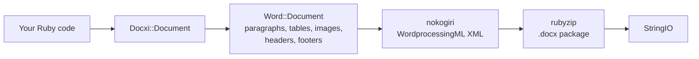

# docxi: create Word (.docx) documents with Ruby

[](https://rubygems.org/gems/docxi)
[](https://github.com/hammad417/docxi/actions/workflows/ci.yml)
[](https://rubygems.org/gems/docxi)
[](https://rubygems.org/gems/docxi)
[](LICENSE)

[English](README.md) · [简体中文](docs/i18n/README.zh-CN.md) · [繁體中文](docs/i18n/README.zh-TW.md) · [Español](docs/i18n/README.es.md) · [العربية](docs/i18n/README.ar.md) · [Français](docs/i18n/README.fr.md) · [Português (Brasil)](docs/i18n/README.pt-BR.md) · [Deutsch](docs/i18n/README.de.md) · [हिन्दी](docs/i18n/README.hi.md) · [日本語](docs/i18n/README.ja.md) · [한국어](docs/i18n/README.ko.md) · [Русский](docs/i18n/README.ru.md) · [Bahasa Indonesia](docs/i18n/README.id.md) · [Türkçe](docs/i18n/README.tr.md) · [Italiano](docs/i18n/README.it.md) · [Tiếng Việt](docs/i18n/README.vi.md)

docxi is a Ruby gem that builds Microsoft Word `.docx` files from code. You describe the document with a small block-based DSL (paragraphs, formatted text, tables, images, headers and footers, page numbers, hyperlinks) and docxi writes the Office Open XML package. It doesn't need Microsoft Word, LibreOffice or a template file, and it works in plain Ruby scripts as well as in Ruby on Rails apps.

```ruby
require "docxi"

word = Docxi::Document.new
word.document.p { |p| p.text "Hello from docxi", bold: true, size: 16 }
File.binwrite("hello.docx", word.render.string)
```

## Contents

- [Overview](#overview)
- [Features](#features)
- [Technology stack](#technology-stack)
- [Installation](#installation)
- [Quick start](#quick-start)
- [Usage examples](#usage-examples)
- [Configuration](#configuration)
- [How it works](#how-it-works)
- [API at a glance](#api-at-a-glance)
- [Supported platforms](#supported-platforms)
- [Common use cases](#common-use-cases)
- [Troubleshooting](#troubleshooting)
- [FAQ](#faq)
- [Documentation](#documentation)
- [Contributing](#contributing)
- [Security](#security)
- [License](#license)
- [Maintainers](#maintainers)

## Overview

Generating a Word document from an application usually means filling in a template, automating an office suite, or converting HTML and hoping the layout survives. docxi takes a different route: you build the document in Ruby, element by element, and get back a `StringIO` holding a complete `.docx` file that you can write to disk, attach to an email or send from a Rails controller.

It is aimed at Ruby and Rails developers who need to export reports, letters or other documents in Word format from their own data. The only runtime dependencies are [nokogiri](https://nokogiri.org/), which builds the XML, and [rubyzip](https://github.com/rubyzip/rubyzip), which packages it.

## Features

- **Paragraphs**: alignment, background shading, left and right indentation, a bottom border, and bullet list items
- **Text**: bold, italic, underline, color, size, font, background shading, preserved spaces and line breaks
- **Breaks and tabs**: line breaks, page breaks and tab characters
- **Tables**: column widths, row height, table indentation, per-cell borders, shading and vertical alignment, and merged cells with `colspan` and `rowspan`
- **Images**: from an IO such as a `File`, a file path or an `http(s)` URL, placed inline with a CSS-style size such as `120pt`
- **Headers and footers**: text, tables, images in headers, page numbers, and a separate header and footer for the first page
- **Table of contents**: rows with dotted (or other) leaders and right-aligned page numbers that you supply
- **Hyperlinks** to external URLs
- **Text frames** (text boxes)
- **Page margins**
- **Zip64-free output**: archives are written without Zip64 records even with rubyzip 3, which Google Docs and older LibreOffice versions refuse to open

### Limitations and known issues

docxi creates new documents only. It can't open or edit an existing `.docx`, fill in a template or run a mail merge. There are no numbered lists, heading styles or automatically generated tables of contents, and the page size is fixed to US Letter in portrait.

These issues are known and planned for 0.2.0:

- Images placed with `pH`/`pV`, images in headers and images in table cells get their size from `width * height`, so they come out much smaller than expected. Inline images sized with `style:` are not affected.
- Table-level `borders:` are applied to every cell rather than to the outside of the table. Per-cell `borders:` work.
- The page-number field code is missing the backslash in `\* MERGEFORMAT`.
- Page numbers inside table cells are prefixed with the text "GlobalOptions".
- Images are always stored as PNG parts, and `[Content_Types].xml` only declares the first two headers and footers.

## Technology stack

| Part | What it uses |
|---|---|
| Language | Ruby 2.5 or newer |
| XML | [nokogiri](https://nokogiri.org/) `>= 1.8, < 2` |
| Packaging | [rubyzip](https://github.com/rubyzip/rubyzip) `>= 1.3, < 4` |
| Output format | Office Open XML WordprocessingML (`.docx`) |
| Tests | Minitest, with output compared against files generated by the previous release |
| CI | GitHub Actions on Ubuntu 24.04, plus a LibreOffice conversion check |

## Installation

### Prerequisites

- Ruby 2.5 or newer
- Bundler, if you install through a Gemfile
- A platform where nokogiri installs. It ships precompiled builds for common Linux, macOS and Windows platforms.

### Install

Add docxi to your Gemfile:

```ruby
gem "docxi", "~> 0.1"
```

and run `bundle install`. Or install it directly:

```sh
gem install docxi
```

Upgrading from 0.0.x needs no code changes: run `bundle update docxi`. 0.1.0 generates the same documents as 0.0.6. Apps on a Ruby older than 2.5 stay on 0.0.6 automatically.

## Quick start

```ruby
require "docxi"

word = Docxi::Document.new
document = word.document

document.p(align: "center") do |p|
  p.text "Monthly report", size: 20, bold: true
end

document.p do |p|
  p.text "Generated with docxi on ", space: true
  p.text Time.now.strftime("%Y-%m-%d"), bold: true
end

File.binwrite("report.docx", word.render.string)
```

`word.render` returns a `StringIO`, and its `.string` is the complete `.docx` file.

## Usage examples

The examples continue from the quick start, using the same `word` and `document`.

### Formatted text and bullet lists

```ruby
document.p do |p|
  p.text "Bold", bold: true
  p.text " italic", italic: true, space: true
  p.text " underlined", underline: true, space: true, br: true
  p.text "Dark red Georgia, 14 pt, on yellow", color: "8B0000", font: "Georgia", size: 14, fill: "FFFF00"
end

document.p(ul: true) { |p| p.text "First bullet" }
document.p(ul: true) { |p| p.text "Second bullet" }

document.p(align: "center", fill: "EEEEEE", bottom: true) do |p|
  p.text "Shaded, centered, with a bottom border"
end

document.br(page: true)
```

Use `space: true` on text that starts or ends with a space, otherwise Word drops the space.

### Tables

```ruby
document.table(columns_width: [240, 100, 100]) do |table|
  table.tr(fill: "D9D9D9", bold: true) do |tr|
    tr.tc { |tc| tc.text "Item" }
    tr.tc { |tc| tc.text "Qty" }
    tr.tc { |tc| tc.text "Price" }
  end

  table.tr do |tr|
    tr.tc(borders: { top: 4, right: 4, bottom: 4, left: 4 }) { |tc| tc.text "Widget" }
    tr.tc(valign: "center") { |tc| tc.text "2" }
    tr.tc { |tc| tc.text "$20.00", align: "right" }
  end

  table.tr do |tr|
    tr.tc(colspan: 2) { |tc| tc.text "Total", bold: true }
    tr.tc { |tc| tc.text "$20.00", align: "right", bold: true }
  end
end
```

Options on `tr` apply to every cell in the row. To merge cells vertically, pass `rowspan: true` to the top cell and `merged: true` to the cell below it.

### Images

```ruby
logo = document.add_media(File.open("logo.png", "rb"))
# add_media also takes a file path or an http(s) URL:
# logo = document.add_media("https://example.com/logo.png")

document.p(align: "center") do |p|
  p.image logo, style: { width: "120pt", height: "60pt" }
end
```

### Headers, footers and page numbers

```ruby
header = Docxi::Word::Headers::Header.new do |h|
  h.text "ACME Corp. quarterly report", size: 9, align: "right"
end

footer = Docxi::Word::Footers::Footer.new do |f|
  f.page_numbers name: "Page", align: "center"
end

document.add_header(header)
document.add_footer(footer)

# The first page always has its own header and footer:
document.add_first_header(Docxi::Word::Headers::Header.new { |h| h.text "Cover page" })
document.add_first_footer(Docxi::Word::Footers::Footer.new { |f| f.text "Confidential" })
```

### Hyperlinks

```ruby
url = "https://github.com/hammad417/docxi"
link = document.add_hyperlink(url)

document.p { |p| p.hyperlink "docxi on GitHub", url, link }
```

### Table of contents

```ruby
document.text "Contents", size: 16, bold: true

document.table_of_content do |toc|
  toc.add_row "Introduction", 1
  toc.add_row "Results", 3
  toc.add_row "Appendix", 7, leader: "hyphen"
end
```

docxi doesn't calculate page numbers. The rows show the numbers you pass in.

### Sending a document from Rails

```ruby
class ReportsController < ApplicationController
  def show
    word = Docxi::Document.new
    word.document.p { |p| p.text "Report for #{Date.today}" }

    send_data word.render.string,
              filename: "report.docx",
              type: "application/vnd.openxmlformats-officedocument.wordprocessingml.document"
  end
end
```

### More examples

[`examples/full_document.rb`](examples/full_document.rb) uses every feature in one document, and the wiki's [Usage Examples](https://github.com/hammad417/docxi/wiki/Usage-Examples) page has complete recipes such as a report, an invoice and a letter. In a clone of this repository, `bundle exec rake samples` writes the sample documents from the test suite to `tmp/samples/`.

## Configuration

docxi has no configuration files or environment variables. Page margins are set when you create the document:

```ruby
# Values are in twentieths of a point (1440 = 1 inch). Pass all four sides.
word = Docxi::Document.new(top: 1440, right: 1080, bottom: 1440, left: 1080, header: 720, footer: 720)
```

The defaults are `top: 720, right: 1440, bottom: 720, left: 1440, header: 190, footer: 200`. If you set any margin, set `top`, `right`, `bottom` and `left` together, because the ones you leave out are written empty.

| Option | Unit |
|---|---|
| Text `size:` | Points |
| Margins, `left:` and `right:` paragraph indents, table `iwidth:` | Twentieths of a point (1440 per inch) |
| Cell `borders:` sizes | Eighths of a point |
| `columns_width:` and cell `width:` | Multiplied by 14.92 to get twentieths of a point, which is close to pixels |
| Image `style:` | CSS lengths such as `"120pt"` |

The page is US Letter in portrait, and the default font is Arial 12 pt.

## How it works



`Docxi::Document` holds the package-level parts: relationships, content types and document properties. `word.document` is a `Docxi::Word::Document`, which collects the elements you add (`Docxi::Word::Contents::Paragraph`, `Table`, `Image`, `TableOfContent` and so on) along with headers, footers, images, hyperlinks, styles, numbering and the theme. When you call `render`, each part builds its XML with nokogiri and is written into a zip archive with rubyzip. `Docxi.write_entry` sets each entry's size up front so rubyzip doesn't add Zip64 records.

## API at a glance

| Call | Adds |
|---|---|
| `Docxi::Document.new(margins)` | A new document. `#render` returns the `.docx` as a `StringIO` |
| `document.p(options)` with a block | A paragraph. Inside the block: `text`, `br`, `tab`, `image`, `hyperlink`, `frame` |
| `document.text(string, options)` | A paragraph with one run of text |
| `document.br(page: true)` | A page break |
| `document.table(options)` with a block | A table. Inside: `tr`, then `tc`, then `text`, `p`, `image` or `page_numbers` |
| `document.table_of_content(options)` with a block | Table of contents rows added with `add_row(text, page)` |
| `document.add_media(file_path_or_url)` | An image to place with `image` |
| `document.add_hyperlink(url)` | A link target to use with `hyperlink` |
| `document.add_header(header)` and `add_first_header` | Headers built with `Docxi::Word::Headers::Header` |
| `document.add_footer(footer)` and `add_first_footer` | Footers built with `Docxi::Word::Footers::Footer` |
| `document.frame(text, options)` | A text box |

## Supported platforms

| Area | Support |
|---|---|
| Ruby | 2.5 or newer. CI runs Ruby 2.5, 2.6, 2.7, 3.0, 3.1, 3.2, 3.3, 3.4 and 4.0 |
| Rails | Not required. CI loads Rails 5.2, 6.0, 6.1, 7.0, 7.1, 7.2, 8.0 and 8.1 next to docxi |
| Dependencies | CI covers rubyzip 1.3, 2.4 and 3.x, and nokogiri 1.11 through 1.19 |
| Operating systems | CI runs on Ubuntu 24.04, and the tests have also been run on macOS. Windows isn't tested. |
| Output | `.docx` for Microsoft Word. CI checks that LibreOffice converts the sample documents |

## Common use cases

- Exporting reports from a Rails app as Word files
- Generating letters, certificates or invoices from database records
- Producing documents in background jobs or command-line scripts, where no office suite is installed

## Troubleshooting

**Bundler can't find compatible versions for `nokogiri` when you add docxi to a Rails 6+ app.**
docxi 0.0.6 pins `nokogiri < 1.7`, and every Rails since 6.0 needs nokogiri 1.8.5 or newer. Use `gem "docxi", "~> 0.1"`.

**Bundler can't find compatible versions for `rubyzip`.**
docxi 0.0.6 pins `rubyzip ~> 0.9.9`, which conflicts with any gem that needs a newer rubyzip. docxi 0.1.0 works with rubyzip 1.3 to 3.x.

**`NoMethodError: undefined method 'present?'` outside Rails.**
docxi 0.0.6 relied on ActiveSupport being loaded. 0.1.0 doesn't.

**Google Docs or LibreOffice won't open a file generated with rubyzip 3.**
docxi 0.0.6 with rubyzip 3 writes Zip64 records into every entry. 0.1.0 writes archives without them.

**Image URLs raise `Errno::ENOENT` on Ruby 3.**
docxi 0.0.6 opened URLs with `Kernel#open`, which no longer fetches URLs on Ruby 3. 0.1.0 downloads them with `URI#open`.

**`NameError` when calling `tab`, `frame` or a header's `page_numbers`.**
These were broken in 0.0.6 and work in 0.1.0.

**The first page doesn't show your header or footer.**
docxi always gives the first page its own header and footer. Set them with `add_first_header` and `add_first_footer`.

**A page margin is missing.**
Pass `top`, `right`, `bottom` and `left` together when you set margins. See [Configuration](#configuration).

## FAQ

**Do I need Microsoft Word or LibreOffice installed?**
No. docxi writes the XML and the zip archive itself.

**Does docxi require Rails?**
No. It works in any Ruby program. CI also runs the tests with Rails 5.2 through 8.1 loaded.

**How do I generate a Word document in Ruby on Rails?**
Build it with docxi in a controller or a background job and send `word.render.string` with `send_data`. See [Sending a document from Rails](#sending-a-document-from-rails).

**Can docxi edit an existing .docx or fill in a Word template?**
No. docxi only creates new documents. For templates with merge fields, use a template-based gem such as sablon.

**Is the table of contents generated from headings?**
No. You add each row and its page number yourself.

**Can I change the page size or orientation?**
Not yet. Pages are US Letter in portrait, and you can only change the margins.

**Which image formats work?**
Images are stored as PNG parts, so PNG files are the safe choice.

**Which Ruby and Rails versions are supported?**
Ruby 2.5 and newer. Rails is optional, and CI tests Rails 5.2 through 8.1.

## Documentation

- The [docxi wiki](https://github.com/hammad417/docxi/wiki) covers every option, with more examples and troubleshooting
- [CHANGELOG.md](CHANGELOG.md) lists the changes in each release
- [examples/full_document.rb](examples/full_document.rb) is a complete example
- [docs/i18n](docs/i18n/README.md) tracks the translations of this README

## Contributing

Bug reports and pull requests are welcome on [GitHub](https://github.com/hammad417/docxi/issues). To work on docxi:

```sh
git clone https://github.com/hammad417/docxi.git
cd docxi
bundle install
bundle exec rake test
```

To run the tests with a specific Rails version loaded, use one of the Gemfiles in `gemfiles/`:

```sh
BUNDLE_GEMFILE=gemfiles/rails_8.1.gemfile bundle install
BUNDLE_GEMFILE=gemfiles/rails_8.1.gemfile DOCXI_WITH_RAILS=1 bundle exec rake test
```

`test/golden` holds the XML that 0.0.6 generated for the documents in `test/support/sample_documents.rb`, and the tests compare every change against it. If you change the generated XML on purpose, update it with `bundle exec rake golden` and explain the change in your pull request.

## Security

Please don't report security problems in public issues. Email the maintainer instead. The addresses are in [docxi.gemspec](docxi.gemspec).

If you still use docxi 0.0.x, upgrade to 0.1.0. Older versions pass image path strings to `Kernel#open`, which runs strings that start with `|` as shell commands.

## License

docxi is released under the [MIT License](LICENSE). The license file keeps the original copyright notice from docxer, the gem docxi was built from.

## Maintainers

docxi is maintained by [Hammad Maqbool](https://github.com/hammad417) at [Phaedra Solutions](https://www.phaedrasolutions.com/). It started in 2016 from [docxer](https://github.com/gtimti/docxer) by Timur Gabdrakipov.

### About Phaedra Solutions

Phaedra Solutions is an AI-first software engineering company that has been building custom software for businesses since 2013.
