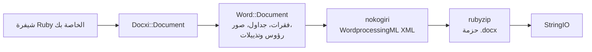

<!-- Translated from README.md (git blob 08aeefecb2eaa6ce543fc23576be90e5767dfaf8). See docs/i18n/TRANSLATION_GUIDE.md. -->

<div dir="rtl">

# مكتبة docxi: إنشاء مستندات Word (.docx) باستخدام Ruby

[](https://rubygems.org/gems/docxi)
[](https://github.com/hammad417/docxi/actions/workflows/ci.yml)
[](https://rubygems.org/gems/docxi)
[](https://rubygems.org/gems/docxi)
[](../../LICENSE)

[English](../../README.md) · [简体中文](README.zh-CN.md) · [繁體中文](README.zh-TW.md) · [Español](README.es.md) · [العربية](README.ar.md) · [Français](README.fr.md) · [Português (Brasil)](README.pt-BR.md) · [Deutsch](README.de.md) · [हिन्दी](README.hi.md) · [日本語](README.ja.md) · [한국어](README.ko.md) · [Русский](README.ru.md) · [Bahasa Indonesia](README.id.md) · [Türkçe](README.tr.md) · [Italiano](README.it.md) · [Tiếng Việt](README.vi.md)

> هذه ترجمة لملف [README](../../README.md) الإنجليزي. عند وجود أي اختلاف بينهما، تكون النسخة الإنجليزية هي المرجع.

مكتبة docxi حزمة (gem) للغة Ruby تُنشئ ملفات Microsoft Word بصيغة <span dir="ltr">`.docx`</span> من خلال الشيفرة البرمجية. تصف المستند بلغة DSL صغيرة قائمة على الكتل (فقرات، ونص منسّق، وجداول، وصور، ورؤوس الصفحات وتذييلاتها، وأرقام الصفحات، وارتباطات تشعبية)، وتتولى docxi كتابة حزمة Office Open XML. لا تحتاج المكتبة إلى Microsoft Word أو LibreOffice أو ملف قالب، وتعمل في سكربتات Ruby العادية كما تعمل في تطبيقات Ruby on Rails.

```ruby
require "docxi"

word = Docxi::Document.new
word.document.p { |p| p.text "Hello from docxi", bold: true, size: 16 }
File.binwrite("hello.docx", word.render.string)
```

## <a id="contents"></a>المحتويات

- [نظرة عامة](#overview)
- [الميزات](#features)
- [التقنيات المستخدمة](#technology-stack)
- [التثبيت](#installation)
- [البدء السريع](#quick-start)
- [أمثلة الاستخدام](#usage-examples)
- [الإعداد](#configuration)
- [آلية العمل](#how-it-works)
- [نظرة سريعة على الواجهة البرمجية](#api-at-a-glance)
- [المنصات المدعومة](#supported-platforms)
- [حالات الاستخدام الشائعة](#common-use-cases)
- [استكشاف الأخطاء وإصلاحها](#troubleshooting)
- [الأسئلة الشائعة](#faq)
- [التوثيق](#documentation)
- [المساهمة](#contributing)
- [الأمان](#security)
- [الترخيص](#license)
- [القائمون على الصيانة](#maintainers)

## <a id="overview"></a>نظرة عامة

عادةً ما يعني إنشاء مستند Word من داخل تطبيقٍ ملءَ قالب، أو أتمتة حزمة برامج مكتبية، أو تحويل HTML على أمل أن يصمد التنسيق. تسلك docxi طريقًا مختلفًا: تبني المستند بلغة Ruby عنصرًا تلو الآخر، وتحصل في النهاية على كائن <span dir="ltr">`StringIO`</span> يحتوي ملف <span dir="ltr">`.docx`</span> كاملًا يمكنك حفظه على القرص، أو إرفاقه برسالة بريد إلكتروني، أو إرساله من وحدة تحكم (controller) في Rails.

وهي موجّهة إلى مطوري Ruby و Rails الذين يحتاجون إلى تصدير تقارير أو خطابات أو مستندات أخرى بصيغة Word من بياناتهم الخاصة. واعتمادياتها الوحيدة وقت التشغيل هما [nokogiri](https://nokogiri.org/) التي تبني ملفات XML، و [rubyzip](https://github.com/rubyzip/rubyzip) التي تحزّمها.

## <a id="features"></a>الميزات

- **الفقرات**: المحاذاة، وتظليل الخلفية، والمسافة البادئة اليسرى واليمنى، والحدّ السفلي، وعناصر القوائم النقطية
- **النص**: الخط الغامق، والمائل، والتسطير، واللون، والحجم، ونوع الخط، وتظليل الخلفية، والمسافات المحفوظة، وفواصل الأسطر
- **الفواصل وعلامات الجدولة**: فواصل الأسطر، وفواصل الصفحات، وأحرف الجدولة
- **الجداول**: عرض الأعمدة، وارتفاع الصفوف، والمسافة البادئة للجدول، وحدود كل خلية وتظليلها ومحاذاتها العمودية، ودمج الخلايا باستخدام <span dir="ltr">`colspan`</span> و <span dir="ltr">`rowspan`</span>
- **الصور**: من كائن IO مثل <span dir="ltr">`File`</span>، أو من مسار ملف، أو من عنوان URL من نوع <span dir="ltr">`http(s)`</span>، وتُدرج ضمن السطر بحجم يُحدَّد على طريقة CSS مثل <span dir="ltr">`120pt`</span>
- **رؤوس الصفحات وتذييلاتها**: نص، وجداول، وصور في رؤوس الصفحات، وأرقام الصفحات، ورأس وتذييل مستقلان للصفحة الأولى
- **جدول المحتويات**: صفوف بنقاط إرشادية (أو بأحرف أخرى) وأرقام صفحات محاذاة إلى اليمين تحددها أنت
- **الارتباطات التشعبية** إلى عناوين URL خارجية
- **الإطارات النصية** (مربعات النص)
- **هوامش الصفحة**
- **مخرجات خالية من Zip64**: تُكتب الأرشيفات دون سجلات Zip64 حتى مع rubyzip 3، وهي سجلات يرفض Google Docs والإصدارات القديمة من LibreOffice فتح الملفات التي تحتويها

### <a id="limitations-and-known-issues"></a>القيود والمشكلات المعروفة

تُنشئ docxi مستندات جديدة فقط، فلا يمكنها فتح ملف <span dir="ltr">`.docx`</span> موجود أو تعديله، ولا ملء قالب، ولا تنفيذ دمج المراسلات. ولا تتوفر فيها قوائم مرقّمة ولا أنماط عناوين ولا جداول محتويات تُنشأ تلقائيًا، وحجم الصفحة ثابت على US Letter بالاتجاه العمودي.

هذه المشكلات معروفة ومن المقرر إصلاحها في الإصدار 0.2.0:

- الصور الموضوعة باستخدام <span dir="ltr">`pH`/`pV`</span>، والصور في رؤوس الصفحات، والصور داخل خلايا الجداول، تأخذ حجمها من <span dir="ltr">`width * height`</span>، لذا تظهر أصغر بكثير من المتوقع. ولا تتأثر الصور الموضوعة ضمن السطر التي يُحدَّد حجمها عبر <span dir="ltr">`style:`</span>.
- يُطبَّق الخيار <span dir="ltr">`borders:`</span> على مستوى الجدول على كل خلية بدلًا من الحواف الخارجية للجدول، أما <span dir="ltr">`borders:`</span> على مستوى الخلية فيعمل.
- يُكتب رمز حقل رقم الصفحة دون الشرطة المائلة العكسية في <span dir="ltr">`\* MERGEFORMAT`</span>.
- تسبق أرقامَ الصفحات داخل خلايا الجداول الكلمةُ «GlobalOptions».
- تُخزَّن الصور دائمًا كأجزاء PNG، ولا يصرّح <span dir="ltr">`[Content_Types].xml`</span> إلا بأول رأسين وأول تذييلين.

## <a id="technology-stack"></a>التقنيات المستخدمة

| المكوّن | ما يستخدمه |
|---|---|
| اللغة | لغة Ruby بالإصدار 2.5 أو أحدث |
| ملفات XML | مكتبة [nokogiri](https://nokogiri.org/) <span dir="ltr">`>= 1.8, < 2`</span> |
| التحزيم | مكتبة [rubyzip](https://github.com/rubyzip/rubyzip) <span dir="ltr">`>= 1.3, < 4`</span> |
| صيغة المخرجات | صيغة Office Open XML WordprocessingML ‏(<span dir="ltr">`.docx`</span>) |
| الاختبارات | إطار Minitest، مع مقارنة المخرجات بملفات أنشأها الإصدار السابق |
| التكامل المستمر (CI) | منصة GitHub Actions على Ubuntu 24.04، إضافةً إلى فحص للتحويل باستخدام LibreOffice |

## <a id="installation"></a>التثبيت

### <a id="prerequisites"></a>المتطلبات المسبقة

- لغة Ruby بالإصدار 2.5 أو أحدث
- أداة Bundler، إذا كنت تثبّت عبر ملف Gemfile
- منصة يمكن تثبيت nokogiri عليها. توفّر nokogiri إصدارات مُجمّعة مسبقًا لمنصات Linux و macOS و Windows الشائعة.

### <a id="install"></a>تثبيت الحزمة

أضِف docxi إلى ملف Gemfile:

```ruby
gem "docxi", "~> 0.1"
```

ثم شغّل <span dir="ltr">`bundle install`</span>، أو ثبّتها مباشرةً:

```sh
gem install docxi
```

لا تتطلب الترقية من 0.0.x أي تغيير في الشيفرة: شغّل <span dir="ltr">`bundle update docxi`</span>. يُنشئ الإصدار 0.1.0 المستندات نفسها التي يُنشئها الإصدار 0.0.6. أما التطبيقات التي تعمل على إصدار من Ruby أقدم من 2.5 فتبقى على الإصدار 0.0.6 تلقائيًا.

## <a id="quick-start"></a>البدء السريع

```ruby
require "docxi"

word = Docxi::Document.new
document = word.document

document.p(align: "center") do |p|
  p.text "Monthly report", size: 20, bold: true
end

document.p do |p|
  p.text "Generated with docxi on ", space: true
  p.text Time.now.strftime("%Y-%m-%d"), bold: true
end

File.binwrite("report.docx", word.render.string)
```

تُعيد <span dir="ltr">`word.render`</span> كائن <span dir="ltr">`StringIO`</span>، وقيمة <span dir="ltr">`.string`</span> منه هي ملف <span dir="ltr">`.docx`</span> الكامل.

## <a id="usage-examples"></a>أمثلة الاستخدام

تُكمل الأمثلة التالية من حيث انتهى البدء السريع، باستخدام <span dir="ltr">`word`</span> و <span dir="ltr">`document`</span> نفسيهما.

### <a id="formatted-text-and-bullet-lists"></a>النص المنسّق والقوائم النقطية

```ruby
document.p do |p|
  p.text "Bold", bold: true
  p.text " italic", italic: true, space: true
  p.text " underlined", underline: true, space: true, br: true
  p.text "Dark red Georgia, 14 pt, on yellow", color: "8B0000", font: "Georgia", size: 14, fill: "FFFF00"
end

document.p(ul: true) { |p| p.text "First bullet" }
document.p(ul: true) { |p| p.text "Second bullet" }

document.p(align: "center", fill: "EEEEEE", bottom: true) do |p|
  p.text "Shaded, centered, with a bottom border"
end

document.br(page: true)
```

استخدم <span dir="ltr">`space: true`</span> مع النص الذي يبدأ بمسافة أو ينتهي بها، وإلا سيحذف Word تلك المسافة.

### <a id="tables"></a>الجداول

```ruby
document.table(columns_width: [240, 100, 100]) do |table|
  table.tr(fill: "D9D9D9", bold: true) do |tr|
    tr.tc { |tc| tc.text "Item" }
    tr.tc { |tc| tc.text "Qty" }
    tr.tc { |tc| tc.text "Price" }
  end

  table.tr do |tr|
    tr.tc(borders: { top: 4, right: 4, bottom: 4, left: 4 }) { |tc| tc.text "Widget" }
    tr.tc(valign: "center") { |tc| tc.text "2" }
    tr.tc { |tc| tc.text "$20.00", align: "right" }
  end

  table.tr do |tr|
    tr.tc(colspan: 2) { |tc| tc.text "Total", bold: true }
    tr.tc { |tc| tc.text "$20.00", align: "right", bold: true }
  end
end
```

تنطبق الخيارات المحددة على <span dir="ltr">`tr`</span> على كل خلايا الصف. ولدمج الخلايا عموديًا، مرّر <span dir="ltr">`rowspan: true`</span> إلى الخلية العليا و <span dir="ltr">`merged: true`</span> إلى الخلية التي تحتها.

### <a id="images"></a>الصور

```ruby
logo = document.add_media(File.open("logo.png", "rb"))
# تقبل add_media أيضًا مسار ملف أو عنوان URL من نوع http(s):
# logo = document.add_media("https://example.com/logo.png")

document.p(align: "center") do |p|
  p.image logo, style: { width: "120pt", height: "60pt" }
end
```

### <a id="headers-footers-and-page-numbers"></a>رؤوس الصفحات وتذييلاتها وأرقام الصفحات

```ruby
header = Docxi::Word::Headers::Header.new do |h|
  h.text "ACME Corp. quarterly report", size: 9, align: "right"
end

footer = Docxi::Word::Footers::Footer.new do |f|
  f.page_numbers name: "Page", align: "center"
end

document.add_header(header)
document.add_footer(footer)

# للصفحة الأولى دائمًا رأس وتذييل خاصان بها:
document.add_first_header(Docxi::Word::Headers::Header.new { |h| h.text "Cover page" })
document.add_first_footer(Docxi::Word::Footers::Footer.new { |f| f.text "Confidential" })
```

### <a id="hyperlinks"></a>الارتباطات التشعبية

```ruby
url = "https://github.com/hammad417/docxi"
link = document.add_hyperlink(url)

document.p { |p| p.hyperlink "docxi on GitHub", url, link }
```

### <a id="table-of-contents"></a>جدول المحتويات

```ruby
document.text "Contents", size: 16, bold: true

document.table_of_content do |toc|
  toc.add_row "Introduction", 1
  toc.add_row "Results", 3
  toc.add_row "Appendix", 7, leader: "hyphen"
end
```

لا تحسب docxi أرقام الصفحات، وتعرض الصفوف الأرقام التي تمرّرها أنت.

### <a id="sending-a-document-from-rails"></a>إرسال مستند من Rails

```ruby
class ReportsController < ApplicationController
  def show
    word = Docxi::Document.new
    word.document.p { |p| p.text "Report for #{Date.today}" }

    send_data word.render.string,
              filename: "report.docx",
              type: "application/vnd.openxmlformats-officedocument.wordprocessingml.document"
  end
end
```

### <a id="more-examples"></a>مزيد من الأمثلة

يستخدم الملف <span dir="ltr">[`examples/full_document.rb`](../../examples/full_document.rb)</span> جميع الميزات في مستند واحد، وتضم صفحة [أمثلة الاستخدام](https://github.com/hammad417/docxi/wiki/Usage-Examples-ar) في الويكي أمثلة كاملة مثل تقرير وفاتورة ورسالة. وفي نسخة مستنسخة من هذا المستودع، يكتب الأمر <span dir="ltr">`bundle exec rake samples`</span> مستندات الأمثلة من مجموعة الاختبارات إلى <span dir="ltr">`tmp/samples/`</span>.

## <a id="configuration"></a>الإعداد

لا تحتوي docxi على ملفات إعداد أو متغيرات بيئة. تُضبط هوامش الصفحة عند إنشاء المستند:

```ruby
word = Docxi::Document.new(top: 1440, right: 1080, bottom: 1440, left: 1080, header: 720, footer: 720)
# القيم بوحدة جزء من عشرين من النقطة (1440 = بوصة واحدة). مرّر الجوانب الأربعة كلها.
```

القيم الافتراضية هي <span dir="ltr">`top: 720, right: 1440, bottom: 720, left: 1440, header: 190, footer: 200`</span>. وإذا ضبطت أي هامش، فاضبط <span dir="ltr">`top`</span> و <span dir="ltr">`right`</span> و <span dir="ltr">`bottom`</span> و <span dir="ltr">`left`</span> معًا، لأن الهوامش التي لا تحددها تُكتب فارغة.

| الخيار | الوحدة |
|---|---|
| الخيار <span dir="ltr">`size:`</span> للنص | النقاط |
| الهوامش، والمسافتان البادئتان <span dir="ltr">`left:`</span> و <span dir="ltr">`right:`</span> للفقرة، والخيار <span dir="ltr">`iwidth:`</span> للجدول | جزء من عشرين من النقطة (1440 لكل بوصة) |
| أحجام <span dir="ltr">`borders:`</span> للخلايا | أثمان النقطة |
| الخياران <span dir="ltr">`columns_width:`</span> و <span dir="ltr">`width:`</span> للخلية | يُضربان في 14.92 للحصول على أجزاء من عشرين من النقطة، وهو ما يقارب البكسل |
| الخيار <span dir="ltr">`style:`</span> للصور | أطوال CSS مثل <span dir="ltr">`"120pt"`</span> |

الصفحة بحجم US Letter بالاتجاه العمودي، والخط الافتراضي هو Arial بحجم 12 نقطة.

## <a id="how-it-works"></a>آلية العمل



يحتفظ <span dir="ltr">`Docxi::Document`</span> بأجزاء مستوى الحزمة: العلاقات، وأنواع المحتوى، وخصائص المستند. أما <span dir="ltr">`word.document`</span> فهو كائن من النوع <span dir="ltr">`Docxi::Word::Document`</span> يجمع العناصر التي تضيفها (<span dir="ltr">`Docxi::Word::Contents::Paragraph`</span> و <span dir="ltr">`Table`</span> و <span dir="ltr">`Image`</span> و <span dir="ltr">`TableOfContent`</span> وغيرها) إلى جانب رؤوس الصفحات وتذييلاتها والصور والارتباطات التشعبية والأنماط والترقيم والسمة. وعند استدعاء <span dir="ltr">`render`</span>، يبني كل جزء ملف XML الخاص به باستخدام nokogiri ثم يُكتب في أرشيف zip باستخدام rubyzip. وتضبط <span dir="ltr">`Docxi.write_entry`</span> حجم كل مُدخل مسبقًا حتى لا يضيف rubyzip سجلات Zip64.

## <a id="api-at-a-glance"></a>نظرة سريعة على الواجهة البرمجية

| الاستدعاء | ما يضيفه |
|---|---|
| <span dir="ltr">`Docxi::Document.new(margins)`</span> | مستندًا جديدًا. تُعيد <span dir="ltr">`#render`</span> ملف <span dir="ltr">`.docx`</span> ككائن <span dir="ltr">`StringIO`</span> |
| <span dir="ltr">`document.p(options)`</span> مع كتلة | فقرة. داخل الكتلة: <span dir="ltr">`text`</span> و <span dir="ltr">`br`</span> و <span dir="ltr">`tab`</span> و <span dir="ltr">`image`</span> و <span dir="ltr">`hyperlink`</span> و <span dir="ltr">`frame`</span> |
| <span dir="ltr">`document.text(string, options)`</span> | فقرة تحتوي مقطعًا نصيًا واحدًا |
| <span dir="ltr">`document.br(page: true)`</span> | فاصل صفحات |
| <span dir="ltr">`document.table(options)`</span> مع كتلة | جدولًا. في الداخل: <span dir="ltr">`tr`</span> ثم <span dir="ltr">`tc`</span> ثم <span dir="ltr">`text`</span> أو <span dir="ltr">`p`</span> أو <span dir="ltr">`image`</span> أو <span dir="ltr">`page_numbers`</span> |
| <span dir="ltr">`document.table_of_content(options)`</span> مع كتلة | صفوف جدول المحتويات المضافة باستخدام <span dir="ltr">`add_row(text, page)`</span> |
| <span dir="ltr">`document.add_media(file_path_or_url)`</span> | صورة تضعها لاحقًا باستخدام <span dir="ltr">`image`</span> |
| <span dir="ltr">`document.add_hyperlink(url)`</span> | هدف ارتباط يُستخدم مع <span dir="ltr">`hyperlink`</span> |
| <span dir="ltr">`document.add_header(header)`</span> و <span dir="ltr">`add_first_header`</span> | رؤوس صفحات تُبنى باستخدام <span dir="ltr">`Docxi::Word::Headers::Header`</span> |
| <span dir="ltr">`document.add_footer(footer)`</span> و <span dir="ltr">`add_first_footer`</span> | تذييلات تُبنى باستخدام <span dir="ltr">`Docxi::Word::Footers::Footer`</span> |
| <span dir="ltr">`document.frame(text, options)`</span> | مربع نص |

## <a id="supported-platforms"></a>المنصات المدعومة

| المجال | الدعم |
|---|---|
| لغة Ruby | الإصدار 2.5 أو أحدث. يشغّل نظام CI إصدارات Ruby ‏2.5 و 2.6 و 2.7 و 3.0 و 3.1 و 3.2 و 3.3 و 3.4 و 4.0 |
| إطار Rails | غير مطلوب. يحمّل نظام CI إصدارات Rails ‏5.2 و 6.0 و 6.1 و 7.0 و 7.1 و 7.2 و 8.0 و 8.1 إلى جانب docxi |
| الاعتماديات | يغطي نظام CI إصدارات rubyzip ‏1.3 و 2.4 و 3.x، وإصدارات nokogiri من 1.11 إلى 1.19 |
| أنظمة التشغيل | يعمل نظام CI على Ubuntu 24.04، وجرى تشغيل الاختبارات أيضًا على macOS. ولم تُختبر على Windows. |
| المخرجات | ملفات <span dir="ltr">`.docx`</span> لبرنامج Microsoft Word. ويتحقق نظام CI من أن LibreOffice يحوّل مستندات الأمثلة |

## <a id="common-use-cases"></a>حالات الاستخدام الشائعة

- تصدير التقارير من تطبيق Rails كملفات Word
- إنشاء خطابات أو شهادات أو فواتير من سجلات قاعدة البيانات
- إنتاج المستندات في المهام الخلفية أو سكربتات سطر الأوامر، حيث لا توجد حزمة برامج مكتبية مثبّتة

## <a id="troubleshooting"></a>استكشاف الأخطاء وإصلاحها

**لا يجد Bundler إصدارات متوافقة من <span dir="ltr">`nokogiri`</span> عند إضافة docxi إلى تطبيق Rails 6 أو أحدث.**
يثبّت الإصدار 0.0.6 من docxi القيد <span dir="ltr">`nokogiri < 1.7`</span>، بينما يحتاج كل إصدار من Rails منذ 6.0 إلى nokogiri 1.8.5 أو أحدث. استخدم <span dir="ltr">`gem "docxi", "~> 0.1"`</span>.

**لا يجد Bundler إصدارات متوافقة من <span dir="ltr">`rubyzip`</span>.**
يثبّت الإصدار 0.0.6 من docxi القيد <span dir="ltr">`rubyzip ~> 0.9.9`</span>، وهو ما يتعارض مع أي حزمة تحتاج إصدارًا أحدث من rubyzip. ويعمل الإصدار 0.1.0 من docxi مع rubyzip من 1.3 إلى 3.x.

**ظهور الخطأ <span dir="ltr">`NoMethodError: undefined method 'present?'`</span> خارج Rails.**
كان الإصدار 0.0.6 من docxi يعتمد على أن تكون ActiveSupport محمّلة مسبقًا، أما الإصدار 0.1.0 فلا يعتمد عليها.

**لا يفتح Google Docs أو LibreOffice ملفًا أُنشئ باستخدام rubyzip 3.**
يكتب الإصدار 0.0.6 من docxi مع rubyzip 3 سجلات Zip64 في كل مُدخل، أما الإصدار 0.1.0 فيكتب الأرشيفات دونها.

**ظهور الخطأ <span dir="ltr">`Errno::ENOENT`</span> عند استخدام عناوين URL للصور على Ruby 3.**
كان الإصدار 0.0.6 من docxi يفتح عناوين URL باستخدام <span dir="ltr">`Kernel#open`</span>، التي لم تعد تجلب عناوين URL في Ruby 3، بينما يُنزّلها الإصدار 0.1.0 باستخدام <span dir="ltr">`URI#open`</span>.

**ظهور <span dir="ltr">`NameError`</span> عند استدعاء <span dir="ltr">`tab`</span> أو <span dir="ltr">`frame`</span> أو <span dir="ltr">`page_numbers`</span> الخاصة برأس الصفحة.**
كانت هذه الميزات معطّلة في الإصدار 0.0.6 وتعمل في الإصدار 0.1.0.

**لا تُظهر الصفحة الأولى رأس الصفحة أو تذييلها الذي حدّدته.**
تمنح docxi الصفحة الأولى دائمًا رأسًا وتذييلًا خاصين بها. اضبطهما باستخدام <span dir="ltr">`add_first_header`</span> و <span dir="ltr">`add_first_footer`</span>.

**أحد هوامش الصفحة مفقود.**
مرّر <span dir="ltr">`top`</span> و <span dir="ltr">`right`</span> و <span dir="ltr">`bottom`</span> و <span dir="ltr">`left`</span> معًا عند ضبط الهوامش. راجع [الإعداد](#configuration).

## <a id="faq"></a>الأسئلة الشائعة

**هل أحتاج إلى تثبيت Microsoft Word أو LibreOffice؟**
لا. تكتب docxi ملفات XML وأرشيف zip بنفسها.

**هل تتطلب docxi إطار Rails؟**
لا. تعمل المكتبة في أي برنامج Ruby، كما يشغّل نظام CI الاختبارات مع تحميل Rails من 5.2 إلى 8.1.

**كيف أُنشئ مستند Word في Ruby on Rails؟**
ابنِ المستند باستخدام docxi في وحدة تحكم أو مهمة خلفية، ثم أرسل <span dir="ltr">`word.render.string`</span> باستخدام <span dir="ltr">`send_data`</span>. راجع [إرسال مستند من Rails](#sending-a-document-from-rails).

**هل تستطيع docxi تعديل ملف <span dir="ltr">.docx</span> موجود أو ملء قالب Word؟**
لا. تُنشئ docxi مستندات جديدة فقط. وللقوالب التي تحتوي حقول دمج، استخدم حزمة قائمة على القوالب مثل sablon.

**هل يُنشأ جدول المحتويات من العناوين؟**
لا. أنت من يضيف كل صف ورقم صفحته.

**هل يمكنني تغيير حجم الصفحة أو اتجاهها؟**
ليس بعد. الصفحات بحجم US Letter بالاتجاه العمودي، ويمكنك تغيير الهوامش فقط.

**ما صيغ الصور التي تعمل؟**
تُخزَّن الصور كأجزاء PNG، لذا فإن ملفات PNG هي الخيار الآمن.

**ما إصدارات Ruby و Rails المدعومة؟**
الإصدار 2.5 من Ruby وما بعده. وإطار Rails اختياري، ويختبر نظام CI إصدارات Rails من 5.2 إلى 8.1.

## <a id="documentation"></a>التوثيق

- يشرح [ويكي docxi](https://github.com/hammad417/docxi/wiki/Home-ar) كل خيار، مع مزيد من الأمثلة وحلول المشكلات
- ملف [CHANGELOG.md](../../CHANGELOG.md) يسرد التغييرات في كل إصدار (بالإنجليزية)
- الملف [examples/full_document.rb](../../examples/full_document.rb) مثال كامل
- الصفحة [docs/i18n](README.md) تتابع حالة ترجمات ملف README هذا

## <a id="contributing"></a>المساهمة

نرحّب بتقارير الأخطاء وطلبات السحب (pull requests) على [GitHub](https://github.com/hammad417/docxi/issues). للعمل على docxi:

```sh
git clone https://github.com/hammad417/docxi.git
cd docxi
bundle install
bundle exec rake test
```

لتشغيل الاختبارات مع تحميل إصدار محدد من Rails، استخدم أحد ملفات Gemfile الموجودة في <span dir="ltr">`gemfiles/`</span>:

```sh
BUNDLE_GEMFILE=gemfiles/rails_8.1.gemfile bundle install
BUNDLE_GEMFILE=gemfiles/rails_8.1.gemfile DOCXI_WITH_RAILS=1 bundle exec rake test
```

يحتوي <span dir="ltr">`test/golden`</span> على ملفات XML التي أنشأها الإصدار 0.0.6 للمستندات الموجودة في <span dir="ltr">`test/support/sample_documents.rb`</span>، وتقارن الاختبارات كل تغيير بها. وإذا غيّرت ملفات XML المُنشأة عن قصد، فحدّثها باستخدام <span dir="ltr">`bundle exec rake golden`</span> واشرح التغيير في طلب السحب.

## <a id="security"></a>الأمان

يُرجى عدم الإبلاغ عن مشكلات الأمان في issues علنية، وراسل القائم على الصيانة عبر البريد الإلكتروني بدلًا من ذلك. العناوين موجودة في [docxi.gemspec](../../docxi.gemspec).

إذا كنت لا تزال تستخدم الإصدار 0.0.x من docxi، فرقِّ إلى الإصدار 0.1.0. فالإصدارات الأقدم تمرّر سلاسل مسارات الصور إلى <span dir="ltr">`Kernel#open`</span>، التي تنفّذ السلاسل التي تبدأ بالرمز <span dir="ltr">`|`</span> كأوامر shell.

## <a id="license"></a>الترخيص

تُنشر docxi بموجب [ترخيص MIT](../../LICENSE). ويحتفظ ملف الترخيص بإشعار حقوق النشر الأصلي من docxer، وهي الحزمة التي بُنيت docxi انطلاقًا منها.

## <a id="maintainers"></a>القائمون على الصيانة

يتولى [Hammad Maqbool](https://github.com/hammad417) من [Phaedra Solutions](https://www.phaedrasolutions.com/) صيانة docxi. وقد بدأ المشروع عام 2016 انطلاقًا من [docxer](https://github.com/gtimti/docxer) الذي طوّره Timur Gabdrakipov.

### <a id="about-phaedra-solutions"></a>نبذة عن Phaedra Solutions

تعمل Phaedra Solutions، وهي شركة هندسة برمجيات تضع الذكاء الاصطناعي في المقام الأول، على تطوير برمجيات مخصّصة للشركات منذ عام 2013.

</div>
