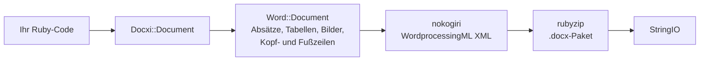

<!-- Translated from README.md (git blob 08aeefecb2eaa6ce543fc23576be90e5767dfaf8). See docs/i18n/TRANSLATION_GUIDE.md. -->

# docxi: Word-Dokumente (.docx) mit Ruby erstellen

[](https://rubygems.org/gems/docxi)
[](https://github.com/hammad417/docxi/actions/workflows/ci.yml)
[](https://rubygems.org/gems/docxi)
[](https://rubygems.org/gems/docxi)
[](../../LICENSE)

[English](../../README.md) · [简体中文](README.zh-CN.md) · [繁體中文](README.zh-TW.md) · [Español](README.es.md) · [العربية](README.ar.md) · [Français](README.fr.md) · [Português (Brasil)](README.pt-BR.md) · [Deutsch](README.de.md) · [हिन्दी](README.hi.md) · [日本語](README.ja.md) · [한국어](README.ko.md) · [Русский](README.ru.md) · [Bahasa Indonesia](README.id.md) · [Türkçe](README.tr.md) · [Italiano](README.it.md) · [Tiếng Việt](README.vi.md)

> Dies ist eine Übersetzung der englischen [README](../../README.md). Bei Abweichungen gilt die englische Fassung.

docxi ist ein Ruby-Gem, das Microsoft-Word-Dateien im Format `.docx` aus Code erzeugt. Sie beschreiben das Dokument mit einer kleinen blockbasierten DSL (Absätze, formatierter Text, Tabellen, Bilder, Kopf- und Fußzeilen, Seitenzahlen, Hyperlinks), und docxi schreibt das Office-Open-XML-Paket. Es braucht weder Microsoft Word noch LibreOffice noch eine Vorlagendatei und funktioniert in einfachen Ruby-Skripten ebenso wie in Ruby-on-Rails-Anwendungen.

```ruby
require "docxi"

word = Docxi::Document.new
word.document.p { |p| p.text "Hello from docxi", bold: true, size: 16 }
File.binwrite("hello.docx", word.render.string)
```

## <a id="contents"></a>Inhalt

- [Überblick](#overview)
- [Funktionen](#features)
- [Technologien](#technology-stack)
- [Installation](#installation)
- [Schnellstart](#quick-start)
- [Anwendungsbeispiele](#usage-examples)
- [Konfiguration](#configuration)
- [Funktionsweise](#how-it-works)
- [Die API im Überblick](#api-at-a-glance)
- [Unterstützte Plattformen](#supported-platforms)
- [Typische Einsatzszenarien](#common-use-cases)
- [Fehlerbehebung](#troubleshooting)
- [FAQ](#faq)
- [Dokumentation](#documentation)
- [Mitwirken](#contributing)
- [Sicherheit](#security)
- [Lizenz](#license)
- [Maintainer](#maintainers)

## <a id="overview"></a>Überblick

Ein Word-Dokument aus einer Anwendung heraus zu erzeugen, heißt meist: eine Vorlage befüllen, eine Office-Suite fernsteuern oder HTML konvertieren und hoffen, dass das Layout überlebt. docxi geht einen anderen Weg: Sie bauen das Dokument in Ruby Element für Element auf und erhalten ein `StringIO` mit einer vollständigen `.docx`-Datei, die Sie auf die Festplatte schreiben, an eine E-Mail anhängen oder aus einem Rails-Controller senden können.

Es richtet sich an Ruby- und Rails-Entwickler, die Berichte, Briefe oder andere Dokumente aus ihren eigenen Daten im Word-Format exportieren müssen. Die einzigen Laufzeitabhängigkeiten sind [nokogiri](https://nokogiri.org/), das das XML erzeugt, und [rubyzip](https://github.com/rubyzip/rubyzip), das es verpackt.

## <a id="features"></a>Funktionen

- **Absätze**: Ausrichtung, Hintergrundschattierung, Einzug links und rechts, ein unterer Rahmen und Aufzählungspunkte
- **Text**: fett, kursiv, unterstrichen, Farbe, Größe, Schriftart, Hintergrundschattierung, erhaltene Leerzeichen und Zeilenumbrüche
- **Umbrüche und Tabstopps**: Zeilenumbrüche, Seitenumbrüche und Tabulatorzeichen
- **Tabellen**: Spaltenbreiten, Zeilenhöhe, Tabelleneinzug, Rahmen, Schattierung und vertikale Ausrichtung pro Zelle sowie verbundene Zellen mit `colspan` und `rowspan`
- **Bilder**: aus einem IO-Objekt wie einer `File`, einem Dateipfad oder einer `http(s)`-URL, im Textfluss platziert und mit einer CSS-artigen Größe wie `120pt`
- **Kopf- und Fußzeilen**: Text, Tabellen, Bilder in Kopfzeilen, Seitenzahlen sowie eine eigene Kopf- und Fußzeile für die erste Seite
- **Inhaltsverzeichnis**: Einträge mit Füllzeichen aus Punkten (oder anderen Zeichen) und rechtsbündigen Seitenzahlen, die Sie selbst angeben
- **Hyperlinks** auf externe URLs
- **Textrahmen** (Textfelder)
- **Seitenränder**
- **Ausgabe ohne Zip64**: Archive werden auch mit rubyzip 3 ohne Zip64-Datensätze geschrieben; Google Docs und ältere LibreOffice-Versionen verweigern das Öffnen von Dateien, die solche Einträge enthalten

### <a id="limitations-and-known-issues"></a>Einschränkungen und bekannte Probleme

docxi erstellt ausschließlich neue Dokumente. Es kann keine vorhandene `.docx` öffnen oder bearbeiten, keine Vorlage befüllen und keinen Serienbrief erstellen. Nummerierte Listen, Überschriftenformatvorlagen und automatisch erzeugte Inhaltsverzeichnisse gibt es nicht, und das Seitenformat ist fest auf US Letter im Hochformat eingestellt.

Diese Probleme sind bekannt, ihre Behebung ist für Version 0.2.0 geplant:

- Mit `pH`/`pV` positionierte Bilder, Bilder in Kopfzeilen und Bilder in Tabellenzellen berechnen ihre Größe aus `width * height` und fallen deshalb viel kleiner aus als erwartet. Bilder im Textfluss, deren Größe über `style:` gesetzt wird, sind nicht betroffen.
- `borders:` auf Tabellenebene wird auf jede Zelle angewendet statt auf den äußeren Rand der Tabelle. `borders:` pro Zelle funktioniert.
- In der Feldfunktion der Seitenzahl fehlt der Backslash von `\* MERGEFORMAT`.
- Seitenzahlen in Tabellenzellen wird der Text „GlobalOptions“ vorangestellt.
- Bilder werden immer als PNG-Parts gespeichert, und `[Content_Types].xml` deklariert nur die ersten beiden Kopf- und Fußzeilen.

## <a id="technology-stack"></a>Technologien

| Bestandteil | Verwendet |
|---|---|
| Sprache | Ruby 2.5 oder neuer |
| XML | [nokogiri](https://nokogiri.org/) `>= 1.8, < 2` |
| Paketierung | [rubyzip](https://github.com/rubyzip/rubyzip) `>= 1.3, < 4` |
| Ausgabeformat | Office Open XML WordprocessingML (`.docx`) |
| Tests | Minitest; die Ausgabe wird mit Dateien verglichen, die die vorherige Version erzeugt hat |
| CI | GitHub Actions unter Ubuntu 24.04, dazu eine Konvertierungsprüfung mit LibreOffice |

## <a id="installation"></a>Installation

### <a id="prerequisites"></a>Voraussetzungen

- Ruby 2.5 oder neuer
- Bundler, wenn Sie über ein Gemfile installieren
- Eine Plattform, auf der sich nokogiri installieren lässt. nokogiri liefert vorkompilierte Builds für gängige Linux-, macOS- und Windows-Plattformen.

### <a id="install"></a>Gem installieren

Fügen Sie docxi zu Ihrem Gemfile hinzu:

```ruby
gem "docxi", "~> 0.1"
```

und führen Sie `bundle install` aus. Oder installieren Sie es direkt:

```sh
gem install docxi
```

Das Upgrade von 0.0.x erfordert keine Codeänderungen: Führen Sie `bundle update docxi` aus. Version 0.1.0 erzeugt dieselben Dokumente wie 0.0.6. Anwendungen mit einer Ruby-Version älter als 2.5 bleiben automatisch bei 0.0.6.

## <a id="quick-start"></a>Schnellstart

```ruby
require "docxi"

word = Docxi::Document.new
document = word.document

document.p(align: "center") do |p|
  p.text "Monthly report", size: 20, bold: true
end

document.p do |p|
  p.text "Generated with docxi on ", space: true
  p.text Time.now.strftime("%Y-%m-%d"), bold: true
end

File.binwrite("report.docx", word.render.string)
```

`word.render` gibt ein `StringIO` zurück, und dessen `.string` ist die vollständige `.docx`-Datei.

## <a id="usage-examples"></a>Anwendungsbeispiele

Die Beispiele setzen den Schnellstart fort und verwenden dieselben Objekte `word` und `document`.

### <a id="formatted-text-and-bullet-lists"></a>Formatierter Text und Aufzählungen

```ruby
document.p do |p|
  p.text "Bold", bold: true
  p.text " italic", italic: true, space: true
  p.text " underlined", underline: true, space: true, br: true
  p.text "Dark red Georgia, 14 pt, on yellow", color: "8B0000", font: "Georgia", size: 14, fill: "FFFF00"
end

document.p(ul: true) { |p| p.text "First bullet" }
document.p(ul: true) { |p| p.text "Second bullet" }

document.p(align: "center", fill: "EEEEEE", bottom: true) do |p|
  p.text "Shaded, centered, with a bottom border"
end

document.br(page: true)
```

Verwenden Sie `space: true` für Text, der mit einem Leerzeichen beginnt oder endet, sonst entfernt Word dieses Leerzeichen.

### <a id="tables"></a>Tabellen

```ruby
document.table(columns_width: [240, 100, 100]) do |table|
  table.tr(fill: "D9D9D9", bold: true) do |tr|
    tr.tc { |tc| tc.text "Item" }
    tr.tc { |tc| tc.text "Qty" }
    tr.tc { |tc| tc.text "Price" }
  end

  table.tr do |tr|
    tr.tc(borders: { top: 4, right: 4, bottom: 4, left: 4 }) { |tc| tc.text "Widget" }
    tr.tc(valign: "center") { |tc| tc.text "2" }
    tr.tc { |tc| tc.text "$20.00", align: "right" }
  end

  table.tr do |tr|
    tr.tc(colspan: 2) { |tc| tc.text "Total", bold: true }
    tr.tc { |tc| tc.text "$20.00", align: "right", bold: true }
  end
end
```

Optionen an `tr` gelten für jede Zelle der Zeile. Um Zellen vertikal zu verbinden, übergeben Sie `rowspan: true` an die obere Zelle und `merged: true` an die Zelle darunter.

### <a id="images"></a>Bilder

```ruby
logo = document.add_media(File.open("logo.png", "rb"))
# add_media akzeptiert auch einen Dateipfad oder eine http(s)-URL:
# logo = document.add_media("https://example.com/logo.png")

document.p(align: "center") do |p|
  p.image logo, style: { width: "120pt", height: "60pt" }
end
```

### <a id="headers-footers-and-page-numbers"></a>Kopfzeilen, Fußzeilen und Seitenzahlen

```ruby
header = Docxi::Word::Headers::Header.new do |h|
  h.text "ACME Corp. quarterly report", size: 9, align: "right"
end

footer = Docxi::Word::Footers::Footer.new do |f|
  f.page_numbers name: "Page", align: "center"
end

document.add_header(header)
document.add_footer(footer)

# Die erste Seite hat immer eine eigene Kopf- und Fußzeile:
document.add_first_header(Docxi::Word::Headers::Header.new { |h| h.text "Cover page" })
document.add_first_footer(Docxi::Word::Footers::Footer.new { |f| f.text "Confidential" })
```

### <a id="hyperlinks"></a>Hyperlinks

```ruby
url = "https://github.com/hammad417/docxi"
link = document.add_hyperlink(url)

document.p { |p| p.hyperlink "docxi on GitHub", url, link }
```

### <a id="table-of-contents"></a>Inhaltsverzeichnis

```ruby
document.text "Contents", size: 16, bold: true

document.table_of_content do |toc|
  toc.add_row "Introduction", 1
  toc.add_row "Results", 3
  toc.add_row "Appendix", 7, leader: "hyphen"
end
```

docxi berechnet keine Seitenzahlen. Die Einträge zeigen die Zahlen, die Sie übergeben.

### <a id="sending-a-document-from-rails"></a>Ein Dokument aus Rails senden

```ruby
class ReportsController < ApplicationController
  def show
    word = Docxi::Document.new
    word.document.p { |p| p.text "Report for #{Date.today}" }

    send_data word.render.string,
              filename: "report.docx",
              type: "application/vnd.openxmlformats-officedocument.wordprocessingml.document"
  end
end
```

### <a id="more-examples"></a>Weitere Beispiele

[`examples/full_document.rb`](../../examples/full_document.rb) verwendet alle Funktionen in einem einzigen Dokument, und die Wiki-Seite [Anwendungsbeispiele](https://github.com/hammad417/docxi/wiki/Usage-Examples-de) enthält vollständige Rezepte, etwa für einen Bericht, eine Rechnung und einen Brief. In einem Klon dieses Repositorys schreibt `bundle exec rake samples` die Beispieldokumente der Testsuite nach `tmp/samples/`.

## <a id="configuration"></a>Konfiguration

docxi hat weder Konfigurationsdateien noch Umgebungsvariablen. Die Seitenränder werden beim Erstellen des Dokuments festgelegt:

```ruby
# Werte in Zwanzigstelpunkt (1440 = 1 Zoll). Geben Sie alle vier Seiten an.
word = Docxi::Document.new(top: 1440, right: 1080, bottom: 1440, left: 1080, header: 720, footer: 720)
```

Die Standardwerte sind `top: 720, right: 1440, bottom: 720, left: 1440, header: 190, footer: 200`. Wenn Sie einen Rand setzen, setzen Sie `top`, `right`, `bottom` und `left` gemeinsam, denn nicht angegebene Ränder werden leer geschrieben.

| Option | Einheit |
|---|---|
| `size:` des Textes | Punkt |
| Seitenränder, Absatzeinzüge `left:` und `right:`, `iwidth:` der Tabelle | Zwanzigstelpunkt (1440 pro Zoll) |
| Stärke der Zell-`borders:` | Achtelpunkt |
| `columns_width:` und Zell-`width:` | Werden mit 14.92 multipliziert, um Zwanzigstelpunkt zu erhalten, was ungefähr Pixeln entspricht |
| `style:` des Bildes | CSS-Längen wie `"120pt"` |

Die Seite ist US Letter im Hochformat, die Standardschrift ist Arial 12 pt.

## <a id="how-it-works"></a>Funktionsweise



`Docxi::Document` enthält die Parts auf Paketebene: Beziehungen, Inhaltstypen und Dokumenteigenschaften. `word.document` ist ein `Docxi::Word::Document`, das die hinzugefügten Elemente sammelt (`Docxi::Word::Contents::Paragraph`, `Table`, `Image`, `TableOfContent` und so weiter), dazu Kopf- und Fußzeilen, Bilder, Hyperlinks, Formatvorlagen, Nummerierung und das Design. Wenn Sie `render` aufrufen, erzeugt jeder Part sein XML mit nokogiri und wird mit rubyzip in ein ZIP-Archiv geschrieben. `Docxi.write_entry` legt die Größe jedes Eintrags im Voraus fest, damit rubyzip keine Zip64-Datensätze hinzufügt.

## <a id="api-at-a-glance"></a>Die API im Überblick

| Aufruf | Fügt hinzu |
|---|---|
| `Docxi::Document.new(margins)` | Ein neues Dokument. `#render` gibt die `.docx` als `StringIO` zurück |
| `document.p(options)` mit einem Block | Einen Absatz. Im Block: `text`, `br`, `tab`, `image`, `hyperlink`, `frame` |
| `document.text(string, options)` | Einen Absatz mit einem einzelnen Textabschnitt |
| `document.br(page: true)` | Einen Seitenumbruch |
| `document.table(options)` mit einem Block | Eine Tabelle. Darin: `tr`, dann `tc`, dann `text`, `p`, `image` oder `page_numbers` |
| `document.table_of_content(options)` mit einem Block | Inhaltsverzeichniseinträge, die mit `add_row(text, page)` hinzugefügt werden |
| `document.add_media(file_path_or_url)` | Ein Bild, das mit `image` platziert wird |
| `document.add_hyperlink(url)` | Ein Linkziel für `hyperlink` |
| `document.add_header(header)` und `add_first_header` | Kopfzeilen, gebaut mit `Docxi::Word::Headers::Header` |
| `document.add_footer(footer)` und `add_first_footer` | Fußzeilen, gebaut mit `Docxi::Word::Footers::Footer` |
| `document.frame(text, options)` | Ein Textfeld |

## <a id="supported-platforms"></a>Unterstützte Plattformen

| Bereich | Unterstützung |
|---|---|
| Ruby | 2.5 oder neuer. Die CI testet Ruby 2.5, 2.6, 2.7, 3.0, 3.1, 3.2, 3.3, 3.4 und 4.0 |
| Rails | Nicht erforderlich. Die CI lädt Rails 5.2, 6.0, 6.1, 7.0, 7.1, 7.2, 8.0 und 8.1 zusammen mit docxi |
| Abhängigkeiten | Die CI deckt rubyzip 1.3, 2.4 und 3.x sowie nokogiri 1.11 bis 1.19 ab |
| Betriebssysteme | Die CI läuft unter Ubuntu 24.04, die Tests wurden außerdem unter macOS ausgeführt. Windows wird nicht getestet. |
| Ausgabe | `.docx` für Microsoft Word. Die CI prüft, ob LibreOffice die Beispieldokumente konvertiert |

## <a id="common-use-cases"></a>Typische Einsatzszenarien

- Berichte aus einer Rails-Anwendung als Word-Dateien exportieren
- Briefe, Zertifikate oder Rechnungen aus Datenbankeinträgen erzeugen
- Dokumente in Hintergrundjobs oder Kommandozeilenskripten erstellen, wo keine Office-Suite installiert ist

## <a id="troubleshooting"></a>Fehlerbehebung

**Bundler findet keine kompatiblen Versionen von `nokogiri`, wenn Sie docxi zu einer Anwendung mit Rails 6 oder neuer hinzufügen.**
docxi 0.0.6 legt `nokogiri < 1.7` fest, und jede Rails-Version seit 6.0 benötigt nokogiri 1.8.5 oder neuer. Verwenden Sie `gem "docxi", "~> 0.1"`.

**Bundler findet keine kompatiblen Versionen von `rubyzip`.**
docxi 0.0.6 legt `rubyzip ~> 0.9.9` fest, was mit jedem Gem kollidiert, das ein neueres rubyzip benötigt. docxi 0.1.0 funktioniert mit rubyzip 1.3 bis 3.x.

**`NoMethodError: undefined method 'present?'` außerhalb von Rails.**
docxi 0.0.6 setzte voraus, dass ActiveSupport geladen ist. Version 0.1.0 tut das nicht mehr.

**Google Docs oder LibreOffice öffnet eine mit rubyzip 3 erzeugte Datei nicht.**
docxi 0.0.6 schreibt mit rubyzip 3 Zip64-Datensätze in jeden Eintrag. Version 0.1.0 schreibt Archive ohne sie.

**Bild-URLs lösen unter Ruby 3 `Errno::ENOENT` aus.**
docxi 0.0.6 öffnete URLs mit `Kernel#open`, das unter Ruby 3 keine URLs mehr abruft. Version 0.1.0 lädt sie mit `URI#open` herunter.

**`NameError` beim Aufruf von `tab`, `frame` oder `page_numbers` einer Kopfzeile.**
Diese waren in 0.0.6 defekt und funktionieren in 0.1.0.

**Die erste Seite zeigt Ihre Kopf- oder Fußzeile nicht an.**
docxi gibt der ersten Seite immer eine eigene Kopf- und Fußzeile. Legen Sie diese mit `add_first_header` und `add_first_footer` fest.

**Ein Seitenrand fehlt.**
Übergeben Sie `top`, `right`, `bottom` und `left` gemeinsam, wenn Sie Ränder festlegen. Siehe [Konfiguration](#configuration).

## <a id="faq"></a>FAQ

**Muss Microsoft Word oder LibreOffice installiert sein?**
Nein. docxi schreibt das XML und das ZIP-Archiv selbst.

**Benötigt docxi Rails?**
Nein. Es funktioniert in jedem Ruby-Programm. Die CI führt die Tests zusätzlich mit geladenem Rails 5.2 bis 8.1 aus.

**Wie erzeuge ich ein Word-Dokument in Ruby on Rails?**
Bauen Sie es mit docxi in einem Controller oder einem Hintergrundjob auf und senden Sie `word.render.string` mit `send_data`. Siehe [Ein Dokument aus Rails senden](#sending-a-document-from-rails).

**Kann docxi eine vorhandene .docx bearbeiten oder eine Word-Vorlage befüllen?**
Nein. docxi erstellt nur neue Dokumente. Für Vorlagen mit Seriendruckfeldern verwenden Sie ein vorlagenbasiertes Gem wie sablon.

**Wird das Inhaltsverzeichnis aus Überschriften erzeugt?**
Nein. Sie fügen jeden Eintrag und seine Seitenzahl selbst hinzu.

**Kann ich Seitenformat oder Ausrichtung ändern?**
Noch nicht. Die Seiten sind US Letter im Hochformat, ändern lassen sich nur die Ränder.

**Welche Bildformate funktionieren?**
Bilder werden als PNG-Parts gespeichert, daher sind PNG-Dateien die sichere Wahl.

**Welche Ruby- und Rails-Versionen werden unterstützt?**
Ruby 2.5 und neuer. Rails ist optional, und die CI testet Rails 5.2 bis 8.1.

## <a id="documentation"></a>Dokumentation

- Das [docxi-Wiki](https://github.com/hammad417/docxi/wiki/Home-de) beschreibt jede Option, mit weiteren Beispielen und Hilfe bei Problemen
- [CHANGELOG.md](../../CHANGELOG.md) listet die Änderungen jeder Version auf (auf Englisch)
- [examples/full_document.rb](../../examples/full_document.rb) ist ein vollständiges Beispiel
- [docs/i18n](README.md) verfolgt den Stand der Übersetzungen dieser README

## <a id="contributing"></a>Mitwirken

Fehlerberichte und Pull Requests sind auf [GitHub](https://github.com/hammad417/docxi/issues) willkommen. So arbeiten Sie an docxi:

```sh
git clone https://github.com/hammad417/docxi.git
cd docxi
bundle install
bundle exec rake test
```

Um die Tests mit einer bestimmten geladenen Rails-Version auszuführen, verwenden Sie eines der Gemfiles in `gemfiles/`:

```sh
BUNDLE_GEMFILE=gemfiles/rails_8.1.gemfile bundle install
BUNDLE_GEMFILE=gemfiles/rails_8.1.gemfile DOCXI_WITH_RAILS=1 bundle exec rake test
```

`test/golden` enthält das XML, das 0.0.6 für die Dokumente in `test/support/sample_documents.rb` erzeugt hat, und die Tests vergleichen jede Änderung damit. Wenn Sie das erzeugte XML bewusst ändern, aktualisieren Sie es mit `bundle exec rake golden` und erläutern Sie die Änderung in Ihrem Pull Request.

## <a id="security"></a>Sicherheit

Bitte melden Sie Sicherheitsprobleme nicht in öffentlichen Issues, sondern schreiben Sie dem Maintainer eine E-Mail. Die Adressen stehen in [docxi.gemspec](../../docxi.gemspec).

Wenn Sie noch docxi 0.0.x verwenden, aktualisieren Sie auf 0.1.0. Ältere Versionen übergeben Bildpfade an `Kernel#open`, das Zeichenketten, die mit `|` beginnen, als Shell-Befehle ausführt.

## <a id="license"></a>Lizenz

docxi wird unter der [MIT-Lizenz](../../LICENSE) veröffentlicht. Die Lizenzdatei enthält weiterhin den ursprünglichen Copyright-Vermerk von docxer, dem Gem, aus dem docxi entstanden ist.

## <a id="maintainers"></a>Maintainer

docxi wird von [Hammad Maqbool](https://github.com/hammad417) bei [Phaedra Solutions](https://www.phaedrasolutions.com/) gepflegt. Es entstand 2016 aus [docxer](https://github.com/gtimti/docxer) von Timur Gabdrakipov.

### <a id="about-phaedra-solutions"></a>Über Phaedra Solutions

Phaedra Solutions ist ein KI-orientiertes Software-Engineering-Unternehmen, das seit 2013 maßgeschneiderte Software für Unternehmen entwickelt.
