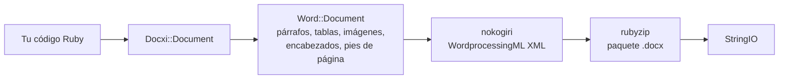

<!-- Translated from README.md (git blob 08aeefecb2eaa6ce543fc23576be90e5767dfaf8). See docs/i18n/TRANSLATION_GUIDE.md. -->

# docxi: genera documentos Word (.docx) con Ruby

[](https://rubygems.org/gems/docxi)
[](https://github.com/hammad417/docxi/actions/workflows/ci.yml)
[](https://rubygems.org/gems/docxi)
[](https://rubygems.org/gems/docxi)
[](../../LICENSE)

[English](../../README.md) · [简体中文](README.zh-CN.md) · [繁體中文](README.zh-TW.md) · [Español](README.es.md) · [العربية](README.ar.md) · [Français](README.fr.md) · [Português (Brasil)](README.pt-BR.md) · [Deutsch](README.de.md) · [हिन्दी](README.hi.md) · [日本語](README.ja.md) · [한국어](README.ko.md) · [Русский](README.ru.md) · [Bahasa Indonesia](README.id.md) · [Türkçe](README.tr.md) · [Italiano](README.it.md) · [Tiếng Việt](README.vi.md)

> Esta es una traducción del [README](../../README.md) en inglés. Si hay diferencias, la versión en inglés es la de referencia.

docxi es una gema de Ruby que genera archivos `.docx` de Microsoft Word a partir de código. Describes el documento con un pequeño DSL basado en bloques (párrafos, texto con formato, tablas, imágenes, encabezados y pies de página, números de página, hipervínculos) y docxi escribe el paquete Office Open XML. No necesita Microsoft Word, LibreOffice ni un archivo de plantilla, y funciona tanto en scripts de Ruby como en aplicaciones Ruby on Rails.

```ruby
require "docxi"

word = Docxi::Document.new
word.document.p { |p| p.text "Hello from docxi", bold: true, size: 16 }
File.binwrite("hello.docx", word.render.string)
```

## <a id="contents"></a>Contenido

- [Descripción general](#overview)
- [Características](#features)
- [Tecnologías](#technology-stack)
- [Instalación](#installation)
- [Inicio rápido](#quick-start)
- [Ejemplos de uso](#usage-examples)
- [Configuración](#configuration)
- [Cómo funciona](#how-it-works)
- [La API de un vistazo](#api-at-a-glance)
- [Plataformas compatibles](#supported-platforms)
- [Casos de uso habituales](#common-use-cases)
- [Solución de problemas](#troubleshooting)
- [Preguntas frecuentes](#faq)
- [Documentación](#documentation)
- [Cómo contribuir](#contributing)
- [Seguridad](#security)
- [Licencia](#license)
- [Mantenedores](#maintainers)

## <a id="overview"></a>Descripción general

Generar un documento de Word desde una aplicación suele significar rellenar una plantilla, automatizar una suite ofimática o convertir HTML y esperar que el diseño sobreviva. docxi toma otro camino: construyes el documento en Ruby, elemento por elemento, y obtienes un `StringIO` con un archivo `.docx` completo que puedes guardar en disco, adjuntar a un correo o enviar desde un controlador de Rails.

Está pensada para desarrolladores de Ruby y Rails que necesitan exportar informes, cartas u otros documentos en formato Word a partir de sus propios datos. Sus únicas dependencias en tiempo de ejecución son [nokogiri](https://nokogiri.org/), que construye el XML, y [rubyzip](https://github.com/rubyzip/rubyzip), que lo empaqueta.

## <a id="features"></a>Características

- **Párrafos**: alineación, sombreado de fondo, sangría izquierda y derecha, borde inferior y elementos de lista con viñetas
- **Texto**: negrita, cursiva, subrayado, color, tamaño, fuente, sombreado de fondo, espacios preservados y saltos de línea
- **Saltos y tabulaciones**: saltos de línea, saltos de página y caracteres de tabulación
- **Tablas**: ancho de columnas, alto de fila, sangría de la tabla, bordes, sombreado y alineación vertical por celda, y celdas combinadas con `colspan` y `rowspan`
- **Imágenes**: desde un objeto IO como un `File`, una ruta de archivo o una URL `http(s)`, insertadas en línea con un tamaño de estilo CSS como `120pt`
- **Encabezados y pies de página**: texto, tablas, imágenes en los encabezados, números de página y un encabezado y pie de página propios para la primera página
- **Tabla de contenido**: filas con relleno de puntos (u otro carácter) y números de página alineados a la derecha que tú indicas
- **Hipervínculos** a URL externas
- **Marcos de texto** (cuadros de texto)
- **Márgenes de página**
- **Salida sin Zip64**: los archivos ZIP se escriben sin registros Zip64 incluso con rubyzip 3; Google Docs y las versiones antiguas de LibreOffice se niegan a abrir archivos que los contienen

### <a id="limitations-and-known-issues"></a>Limitaciones y problemas conocidos

docxi solo crea documentos nuevos. No puede abrir ni editar un `.docx` existente, rellenar una plantilla ni hacer una combinación de correspondencia. No hay listas numeradas, estilos de título ni tablas de contenido generadas automáticamente, y el tamaño de página es fijo: US Letter en vertical.

Estos problemas son conocidos y su corrección está prevista para la versión 0.2.0:

- Las imágenes colocadas con `pH`/`pV`, las imágenes en los encabezados y las imágenes en celdas de tabla calculan su tamaño como `width * height`, así que salen mucho más pequeñas de lo esperado. Las imágenes en línea con tamaño definido mediante `style:` no se ven afectadas.
- Los `borders:` a nivel de tabla se aplican a cada celda en lugar de al contorno de la tabla. Los `borders:` por celda funcionan.
- Al código del campo de número de página le falta la barra invertida de `\* MERGEFORMAT`.
- Los números de página dentro de celdas de tabla llevan delante el texto "GlobalOptions".
- Las imágenes siempre se guardan como partes PNG, y `[Content_Types].xml` solo declara los dos primeros encabezados y pies de página.

## <a id="technology-stack"></a>Tecnologías

| Componente | Qué usa |
|---|---|
| Lenguaje | Ruby 2.5 o posterior |
| XML | [nokogiri](https://nokogiri.org/) `>= 1.8, < 2` |
| Empaquetado | [rubyzip](https://github.com/rubyzip/rubyzip) `>= 1.3, < 4` |
| Formato de salida | Office Open XML WordprocessingML (`.docx`) |
| Pruebas | Minitest, comparando la salida con archivos generados por la versión anterior |
| CI | GitHub Actions en Ubuntu 24.04, más una comprobación de conversión con LibreOffice |

## <a id="installation"></a>Instalación

### <a id="prerequisites"></a>Requisitos previos

- Ruby 2.5 o posterior
- Bundler, si instalas mediante un Gemfile
- Una plataforma en la que se pueda instalar nokogiri. nokogiri ofrece versiones precompiladas para las plataformas Linux, macOS y Windows más comunes.

### <a id="install"></a>Instalar la gema

Añade docxi a tu Gemfile:

```ruby
gem "docxi", "~> 0.1"
```

y ejecuta `bundle install`. También puedes instalarla directamente:

```sh
gem install docxi
```

Actualizar desde 0.0.x no requiere cambios en el código: ejecuta `bundle update docxi`. La versión 0.1.0 genera los mismos documentos que la 0.0.6. Las aplicaciones con una versión de Ruby anterior a la 2.5 se quedan automáticamente en la 0.0.6.

## <a id="quick-start"></a>Inicio rápido

```ruby
require "docxi"

word = Docxi::Document.new
document = word.document

document.p(align: "center") do |p|
  p.text "Monthly report", size: 20, bold: true
end

document.p do |p|
  p.text "Generated with docxi on ", space: true
  p.text Time.now.strftime("%Y-%m-%d"), bold: true
end

File.binwrite("report.docx", word.render.string)
```

`word.render` devuelve un `StringIO`, y su `.string` es el archivo `.docx` completo.

## <a id="usage-examples"></a>Ejemplos de uso

Los ejemplos continúan a partir del inicio rápido y usan los mismos `word` y `document`.

### <a id="formatted-text-and-bullet-lists"></a>Texto con formato y listas con viñetas

```ruby
document.p do |p|
  p.text "Bold", bold: true
  p.text " italic", italic: true, space: true
  p.text " underlined", underline: true, space: true, br: true
  p.text "Dark red Georgia, 14 pt, on yellow", color: "8B0000", font: "Georgia", size: 14, fill: "FFFF00"
end

document.p(ul: true) { |p| p.text "First bullet" }
document.p(ul: true) { |p| p.text "Second bullet" }

document.p(align: "center", fill: "EEEEEE", bottom: true) do |p|
  p.text "Shaded, centered, with a bottom border"
end

document.br(page: true)
```

Usa `space: true` en el texto que empiece o termine con un espacio; si no, Word elimina ese espacio.

### <a id="tables"></a>Tablas

```ruby
document.table(columns_width: [240, 100, 100]) do |table|
  table.tr(fill: "D9D9D9", bold: true) do |tr|
    tr.tc { |tc| tc.text "Item" }
    tr.tc { |tc| tc.text "Qty" }
    tr.tc { |tc| tc.text "Price" }
  end

  table.tr do |tr|
    tr.tc(borders: { top: 4, right: 4, bottom: 4, left: 4 }) { |tc| tc.text "Widget" }
    tr.tc(valign: "center") { |tc| tc.text "2" }
    tr.tc { |tc| tc.text "$20.00", align: "right" }
  end

  table.tr do |tr|
    tr.tc(colspan: 2) { |tc| tc.text "Total", bold: true }
    tr.tc { |tc| tc.text "$20.00", align: "right", bold: true }
  end
end
```

Las opciones de `tr` se aplican a todas las celdas de la fila. Para combinar celdas en vertical, pasa `rowspan: true` a la celda superior y `merged: true` a la celda que tiene debajo.

### <a id="images"></a>Imágenes

```ruby
logo = document.add_media(File.open("logo.png", "rb"))
# add_media también acepta una ruta de archivo o una URL http(s):
# logo = document.add_media("https://example.com/logo.png")

document.p(align: "center") do |p|
  p.image logo, style: { width: "120pt", height: "60pt" }
end
```

### <a id="headers-footers-and-page-numbers"></a>Encabezados, pies de página y números de página

```ruby
header = Docxi::Word::Headers::Header.new do |h|
  h.text "ACME Corp. quarterly report", size: 9, align: "right"
end

footer = Docxi::Word::Footers::Footer.new do |f|
  f.page_numbers name: "Page", align: "center"
end

document.add_header(header)
document.add_footer(footer)

# La primera página siempre tiene su propio encabezado y pie de página:
document.add_first_header(Docxi::Word::Headers::Header.new { |h| h.text "Cover page" })
document.add_first_footer(Docxi::Word::Footers::Footer.new { |f| f.text "Confidential" })
```

### <a id="hyperlinks"></a>Hipervínculos

```ruby
url = "https://github.com/hammad417/docxi"
link = document.add_hyperlink(url)

document.p { |p| p.hyperlink "docxi on GitHub", url, link }
```

### <a id="table-of-contents"></a>Tabla de contenido

```ruby
document.text "Contents", size: 16, bold: true

document.table_of_content do |toc|
  toc.add_row "Introduction", 1
  toc.add_row "Results", 3
  toc.add_row "Appendix", 7, leader: "hyphen"
end
```

docxi no calcula los números de página. Las filas muestran los números que tú indicas.

### <a id="sending-a-document-from-rails"></a>Enviar un documento desde Rails

```ruby
class ReportsController < ApplicationController
  def show
    word = Docxi::Document.new
    word.document.p { |p| p.text "Report for #{Date.today}" }

    send_data word.render.string,
              filename: "report.docx",
              type: "application/vnd.openxmlformats-officedocument.wordprocessingml.document"
  end
end
```

### <a id="more-examples"></a>Más ejemplos

[`examples/full_document.rb`](../../examples/full_document.rb) usa todas las funciones en un mismo documento, y la página [Ejemplos de uso](https://github.com/hammad417/docxi/wiki/Usage-Examples-es) de la wiki tiene recetas completas, como un informe, una factura y una carta. En un clon de este repositorio, `bundle exec rake samples` escribe en `tmp/samples/` los documentos de ejemplo de la suite de pruebas.

## <a id="configuration"></a>Configuración

docxi no tiene archivos de configuración ni variables de entorno. Los márgenes de página se definen al crear el documento:

```ruby
# Los valores están en veinteavos de punto (1440 = 1 pulgada). Indica los cuatro lados.
word = Docxi::Document.new(top: 1440, right: 1080, bottom: 1440, left: 1080, header: 720, footer: 720)
```

Los valores predeterminados son `top: 720, right: 1440, bottom: 720, left: 1440, header: 190, footer: 200`. Si defines cualquier margen, define `top`, `right`, `bottom` y `left` a la vez, porque los que omitas se escriben vacíos.

| Opción | Unidad |
|---|---|
| `size:` del texto | Puntos |
| Márgenes, sangrías `left:` y `right:` de párrafo, `iwidth:` de la tabla | Veinteavos de punto (1440 por pulgada) |
| Grosor de los `borders:` de celda | Octavos de punto |
| `columns_width:` y `width:` de celda | Se multiplican por 14.92 para obtener veinteavos de punto, lo que se acerca a píxeles |
| `style:` de imagen | Longitudes CSS como `"120pt"` |

La página es US Letter en vertical y la fuente predeterminada es Arial de 12 pt.

## <a id="how-it-works"></a>Cómo funciona



`Docxi::Document` contiene las partes del nivel de paquete: relaciones, tipos de contenido y propiedades del documento. `word.document` es un `Docxi::Word::Document`, que reúne los elementos que añades (`Docxi::Word::Contents::Paragraph`, `Table`, `Image`, `TableOfContent`, etc.) junto con los encabezados, pies de página, imágenes, hipervínculos, estilos, numeración y el tema. Al llamar a `render`, cada parte construye su XML con nokogiri y se escribe en un archivo ZIP con rubyzip. `Docxi.write_entry` define de antemano el tamaño de cada entrada para que rubyzip no añada registros Zip64.

## <a id="api-at-a-glance"></a>La API de un vistazo

| Llamada | Añade |
|---|---|
| `Docxi::Document.new(margins)` | Un documento nuevo. `#render` devuelve el `.docx` como `StringIO` |
| `document.p(options)` con un bloque | Un párrafo. Dentro del bloque: `text`, `br`, `tab`, `image`, `hyperlink`, `frame` |
| `document.text(string, options)` | Un párrafo con un solo fragmento de texto |
| `document.br(page: true)` | Un salto de página |
| `document.table(options)` con un bloque | Una tabla. Dentro: `tr`, luego `tc`, y después `text`, `p`, `image` o `page_numbers` |
| `document.table_of_content(options)` con un bloque | Filas de la tabla de contenido añadidas con `add_row(text, page)` |
| `document.add_media(file_path_or_url)` | Una imagen para colocar con `image` |
| `document.add_hyperlink(url)` | Un destino de enlace para usar con `hyperlink` |
| `document.add_header(header)` y `add_first_header` | Encabezados construidos con `Docxi::Word::Headers::Header` |
| `document.add_footer(footer)` y `add_first_footer` | Pies de página construidos con `Docxi::Word::Footers::Footer` |
| `document.frame(text, options)` | Un cuadro de texto |

## <a id="supported-platforms"></a>Plataformas compatibles

| Área | Compatibilidad |
|---|---|
| Ruby | 2.5 o posterior. La CI ejecuta Ruby 2.5, 2.6, 2.7, 3.0, 3.1, 3.2, 3.3, 3.4 y 4.0 |
| Rails | No es necesario. La CI carga Rails 5.2, 6.0, 6.1, 7.0, 7.1, 7.2, 8.0 y 8.1 junto a docxi |
| Dependencias | La CI cubre rubyzip 1.3, 2.4 y 3.x, y nokogiri de la 1.11 a la 1.19 |
| Sistemas operativos | La CI se ejecuta en Ubuntu 24.04, y las pruebas también se han ejecutado en macOS. No se ha probado en Windows. |
| Salida | `.docx` para Microsoft Word. La CI comprueba que LibreOffice convierte los documentos de ejemplo |

## <a id="common-use-cases"></a>Casos de uso habituales

- Exportar informes de una aplicación Rails como archivos de Word
- Generar cartas, certificados o facturas a partir de registros de una base de datos
- Producir documentos en tareas en segundo plano o scripts de línea de comandos, donde no hay ninguna suite ofimática instalada

## <a id="troubleshooting"></a>Solución de problemas

**Bundler no encuentra versiones compatibles de `nokogiri` al añadir docxi a una aplicación con Rails 6 o posterior.**
docxi 0.0.6 fija `nokogiri < 1.7`, y todas las versiones de Rails desde la 6.0 necesitan nokogiri 1.8.5 o posterior. Usa `gem "docxi", "~> 0.1"`.

**Bundler no encuentra versiones compatibles de `rubyzip`.**
docxi 0.0.6 fija `rubyzip ~> 0.9.9`, lo que entra en conflicto con cualquier gema que necesite un rubyzip más reciente. docxi 0.1.0 funciona con rubyzip de la 1.3 a la 3.x.

**`NoMethodError: undefined method 'present?'` fuera de Rails.**
docxi 0.0.6 dependía de que ActiveSupport estuviera cargado. La 0.1.0 ya no.

**Google Docs o LibreOffice no abren un archivo generado con rubyzip 3.**
docxi 0.0.6 con rubyzip 3 escribe registros Zip64 en cada entrada. La 0.1.0 escribe los archivos ZIP sin ellos.

**Las URL de imágenes lanzan `Errno::ENOENT` en Ruby 3.**
docxi 0.0.6 abría las URL con `Kernel#open`, que en Ruby 3 ya no descarga URL. La 0.1.0 las descarga con `URI#open`.

**`NameError` al llamar a `tab`, `frame` o al `page_numbers` de un encabezado.**
Estaban rotos en la 0.0.6 y funcionan en la 0.1.0.

**La primera página no muestra tu encabezado ni tu pie de página.**
docxi siempre da a la primera página su propio encabezado y pie de página. Defínelos con `add_first_header` y `add_first_footer`.

**Falta un margen de página.**
Pasa `top`, `right`, `bottom` y `left` a la vez cuando definas los márgenes. Consulta la [configuración](#configuration).

## <a id="faq"></a>Preguntas frecuentes

**¿Necesito tener instalado Microsoft Word o LibreOffice?**
No. docxi escribe por sí misma el XML y el archivo ZIP.

**¿docxi requiere Rails?**
No. Funciona en cualquier programa Ruby. Además, la CI ejecuta las pruebas con Rails de la 5.2 a la 8.1 cargado.

**¿Cómo genero un documento de Word en Ruby on Rails?**
Constrúyelo con docxi en un controlador o en una tarea en segundo plano y envía `word.render.string` con `send_data`. Consulta [Enviar un documento desde Rails](#sending-a-document-from-rails).

**¿Puede docxi editar un .docx existente o rellenar una plantilla de Word?**
No. docxi solo crea documentos nuevos. Para plantillas con campos de combinación, usa una gema basada en plantillas, como sablon.

**¿La tabla de contenido se genera a partir de los títulos?**
No. Tú añades cada fila y su número de página.

**¿Puedo cambiar el tamaño o la orientación de la página?**
Todavía no. Las páginas son US Letter en vertical y solo puedes cambiar los márgenes.

**¿Qué formatos de imagen funcionan?**
Las imágenes se guardan como partes PNG, así que los archivos PNG son la opción segura.

**¿Qué versiones de Ruby y Rails son compatibles?**
Ruby 2.5 y posteriores. Rails es opcional, y la CI prueba Rails de la 5.2 a la 8.1.

## <a id="documentation"></a>Documentación

- La [wiki de docxi](https://github.com/hammad417/docxi/wiki/Home-es) explica todas las opciones, con más ejemplos y solución de problemas
- [CHANGELOG.md](../../CHANGELOG.md) recoge los cambios de cada versión (en inglés)
- [examples/full_document.rb](../../examples/full_document.rb) es un ejemplo completo
- [docs/i18n](README.md) registra el estado de las traducciones de este README

## <a id="contributing"></a>Cómo contribuir

Los informes de errores y las pull requests son bienvenidos en [GitHub](https://github.com/hammad417/docxi/issues). Para trabajar en docxi:

```sh
git clone https://github.com/hammad417/docxi.git
cd docxi
bundle install
bundle exec rake test
```

Para ejecutar las pruebas con una versión concreta de Rails cargada, usa uno de los Gemfiles de `gemfiles/`:

```sh
BUNDLE_GEMFILE=gemfiles/rails_8.1.gemfile bundle install
BUNDLE_GEMFILE=gemfiles/rails_8.1.gemfile DOCXI_WITH_RAILS=1 bundle exec rake test
```

`test/golden` contiene el XML que la 0.0.6 generó para los documentos de `test/support/sample_documents.rb`, y las pruebas comparan cada cambio con él. Si cambias el XML generado a propósito, actualízalo con `bundle exec rake golden` y explica el cambio en tu pull request.

## <a id="security"></a>Seguridad

Por favor, no informes de problemas de seguridad en issues públicos. Escribe en su lugar un correo al mantenedor. Las direcciones están en [docxi.gemspec](../../docxi.gemspec).

Si todavía usas docxi 0.0.x, actualiza a la 0.1.0. Las versiones anteriores pasan las rutas de imagen a `Kernel#open`, que ejecuta como comandos de shell las cadenas que empiezan con `|`.

## <a id="license"></a>Licencia

docxi se publica bajo la [licencia MIT](../../LICENSE). El archivo de licencia conserva el aviso de copyright original de docxer, la gema a partir de la cual se creó docxi.

## <a id="maintainers"></a>Mantenedores

docxi lo mantiene [Hammad Maqbool](https://github.com/hammad417), de [Phaedra Solutions](https://www.phaedrasolutions.com/). Nació en 2016 a partir de [docxer](https://github.com/gtimti/docxer), de Timur Gabdrakipov.

### <a id="about-phaedra-solutions"></a>Acerca de Phaedra Solutions

Phaedra Solutions es una empresa de ingeniería de software centrada en la IA que desarrolla software a medida para empresas desde 2013.
