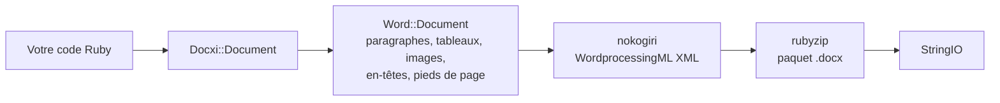

<!-- Translated from README.md (git blob 08aeefecb2eaa6ce543fc23576be90e5767dfaf8). See docs/i18n/TRANSLATION_GUIDE.md. -->

# docxi : générer des documents Word (.docx) avec Ruby

[](https://rubygems.org/gems/docxi)
[](https://github.com/hammad417/docxi/actions/workflows/ci.yml)
[](https://rubygems.org/gems/docxi)
[](https://rubygems.org/gems/docxi)
[](../../LICENSE)

[English](../../README.md) · [简体中文](README.zh-CN.md) · [繁體中文](README.zh-TW.md) · [Español](README.es.md) · [العربية](README.ar.md) · [Français](README.fr.md) · [Português (Brasil)](README.pt-BR.md) · [Deutsch](README.de.md) · [हिन्दी](README.hi.md) · [日本語](README.ja.md) · [한국어](README.ko.md) · [Русский](README.ru.md) · [Bahasa Indonesia](README.id.md) · [Türkçe](README.tr.md) · [Italiano](README.it.md) · [Tiếng Việt](README.vi.md)

> Ceci est une traduction du [README](../../README.md) anglais. En cas de différence, c'est la version anglaise qui fait foi.

docxi est une gem Ruby qui génère des fichiers Microsoft Word `.docx` à partir de code. Vous décrivez le document avec un petit DSL à base de blocs (paragraphes, texte mis en forme, tableaux, images, en-têtes et pieds de page, numéros de page, liens hypertexte) et docxi écrit le paquet Office Open XML. Elle ne nécessite ni Microsoft Word, ni LibreOffice, ni fichier modèle, et fonctionne aussi bien dans de simples scripts Ruby que dans des applications Ruby on Rails.

```ruby
require "docxi"

word = Docxi::Document.new
word.document.p { |p| p.text "Hello from docxi", bold: true, size: 16 }
File.binwrite("hello.docx", word.render.string)
```

## <a id="contents"></a>Sommaire

- [Présentation](#overview)
- [Fonctionnalités](#features)
- [Technologies utilisées](#technology-stack)
- [Installation](#installation)
- [Démarrage rapide](#quick-start)
- [Exemples d'utilisation](#usage-examples)
- [Configuration](#configuration)
- [Fonctionnement](#how-it-works)
- [L'API en bref](#api-at-a-glance)
- [Plateformes prises en charge](#supported-platforms)
- [Cas d'usage courants](#common-use-cases)
- [Dépannage](#troubleshooting)
- [FAQ](#faq)
- [Documentation](#documentation)
- [Contribuer](#contributing)
- [Sécurité](#security)
- [Licence](#license)
- [Mainteneurs](#maintainers)

## <a id="overview"></a>Présentation

Générer un document Word depuis une application revient généralement à remplir un modèle, à piloter une suite bureautique ou à convertir du HTML en espérant que la mise en page survive. docxi prend un autre chemin : vous construisez le document en Ruby, élément par élément, et vous récupérez un `StringIO` contenant un fichier `.docx` complet, que vous pouvez écrire sur le disque, joindre à un e-mail ou envoyer depuis un contrôleur Rails.

Elle s'adresse aux développeurs Ruby et Rails qui doivent exporter des rapports, des courriers ou d'autres documents au format Word à partir de leurs propres données. Ses seules dépendances à l'exécution sont [nokogiri](https://nokogiri.org/), qui construit le XML, et [rubyzip](https://github.com/rubyzip/rubyzip), qui l'empaquette.

## <a id="features"></a>Fonctionnalités

- **Paragraphes** : alignement, trame de fond, retraits gauche et droit, bordure inférieure et éléments de liste à puces
- **Texte** : gras, italique, souligné, couleur, taille, police, trame de fond, espaces conservées et sauts de ligne
- **Sauts et tabulations** : sauts de ligne, sauts de page et caractères de tabulation
- **Tableaux** : largeurs de colonnes, hauteur de ligne, retrait du tableau, bordures, trame et alignement vertical par cellule, et cellules fusionnées avec `colspan` et `rowspan`
- **Images** : depuis un objet IO comme un `File`, un chemin de fichier ou une URL `http(s)`, insérées dans le texte avec une taille de style CSS comme `120pt`
- **En-têtes et pieds de page** : texte, tableaux, images dans les en-têtes, numéros de page, ainsi qu'un en-tête et un pied de page distincts pour la première page
- **Table des matières** : lignes avec points de suite (ou un autre caractère) et numéros de page alignés à droite, que vous fournissez
- **Liens hypertexte** vers des URL externes
- **Cadres de texte** (zones de texte)
- **Marges de page**
- **Sortie sans Zip64** : les archives sont écrites sans enregistrements Zip64, même avec rubyzip 3 ; Google Docs et les anciennes versions de LibreOffice refusent d'ouvrir les fichiers qui en contiennent

### <a id="limitations-and-known-issues"></a>Limites et problèmes connus

docxi ne crée que de nouveaux documents. Elle ne peut pas ouvrir ni modifier un `.docx` existant, remplir un modèle ni faire de publipostage. Il n'y a ni listes numérotées, ni styles de titre, ni tables des matières générées automatiquement, et le format de page est fixé au US Letter en portrait.

Ces problèmes sont connus et leur correction est prévue pour la version 0.2.0 :

- Les images positionnées avec `pH`/`pV`, les images dans les en-têtes et les images dans les cellules de tableau calculent leur taille avec `width * height`, si bien qu'elles sortent bien plus petites que prévu. Les images dans le texte dimensionnées avec `style:` ne sont pas concernées.
- Les `borders:` définies au niveau du tableau s'appliquent à chaque cellule au lieu du contour du tableau. Les `borders:` par cellule fonctionnent.
- Le code du champ de numéro de page est écrit sans la barre oblique inverse de `\* MERGEFORMAT`.
- Les numéros de page à l'intérieur des cellules de tableau sont précédés du texte « GlobalOptions ».
- Les images sont toujours stockées sous forme de parties PNG, et `[Content_Types].xml` ne déclare que les deux premiers en-têtes et pieds de page.

## <a id="technology-stack"></a>Technologies utilisées

| Élément | Ce qui est utilisé |
|---|---|
| Langage | Ruby 2.5 ou plus récent |
| XML | [nokogiri](https://nokogiri.org/) `>= 1.8, < 2` |
| Empaquetage | [rubyzip](https://github.com/rubyzip/rubyzip) `>= 1.3, < 4` |
| Format de sortie | Office Open XML WordprocessingML (`.docx`) |
| Tests | Minitest, avec une sortie comparée à des fichiers générés par la version précédente |
| CI | GitHub Actions sur Ubuntu 24.04, plus une vérification de conversion avec LibreOffice |

## <a id="installation"></a>Installation

### <a id="prerequisites"></a>Prérequis

- Ruby 2.5 ou plus récent
- Bundler, si vous installez via un Gemfile
- Une plateforme sur laquelle nokogiri s'installe. nokogiri fournit des versions précompilées pour les plateformes Linux, macOS et Windows courantes.

### <a id="install"></a>Installer la gem

Ajoutez docxi à votre Gemfile :

```ruby
gem "docxi", "~> 0.1"
```

puis lancez `bundle install`. Vous pouvez aussi l'installer directement :

```sh
gem install docxi
```

La mise à niveau depuis 0.0.x ne demande aucune modification du code : lancez `bundle update docxi`. La version 0.1.0 génère les mêmes documents que la 0.0.6. Les applications qui tournent sur une version de Ruby antérieure à 2.5 restent automatiquement sur la 0.0.6.

## <a id="quick-start"></a>Démarrage rapide

```ruby
require "docxi"

word = Docxi::Document.new
document = word.document

document.p(align: "center") do |p|
  p.text "Monthly report", size: 20, bold: true
end

document.p do |p|
  p.text "Generated with docxi on ", space: true
  p.text Time.now.strftime("%Y-%m-%d"), bold: true
end

File.binwrite("report.docx", word.render.string)
```

`word.render` renvoie un `StringIO`, et son `.string` est le fichier `.docx` complet.

## <a id="usage-examples"></a>Exemples d'utilisation

Les exemples suivants reprennent là où s'arrête le démarrage rapide, avec les mêmes `word` et `document`.

### <a id="formatted-text-and-bullet-lists"></a>Texte mis en forme et listes à puces

```ruby
document.p do |p|
  p.text "Bold", bold: true
  p.text " italic", italic: true, space: true
  p.text " underlined", underline: true, space: true, br: true
  p.text "Dark red Georgia, 14 pt, on yellow", color: "8B0000", font: "Georgia", size: 14, fill: "FFFF00"
end

document.p(ul: true) { |p| p.text "First bullet" }
document.p(ul: true) { |p| p.text "Second bullet" }

document.p(align: "center", fill: "EEEEEE", bottom: true) do |p|
  p.text "Shaded, centered, with a bottom border"
end

document.br(page: true)
```

Utilisez `space: true` pour un texte qui commence ou se termine par une espace, sinon Word supprime cette espace.

### <a id="tables"></a>Tableaux

```ruby
document.table(columns_width: [240, 100, 100]) do |table|
  table.tr(fill: "D9D9D9", bold: true) do |tr|
    tr.tc { |tc| tc.text "Item" }
    tr.tc { |tc| tc.text "Qty" }
    tr.tc { |tc| tc.text "Price" }
  end

  table.tr do |tr|
    tr.tc(borders: { top: 4, right: 4, bottom: 4, left: 4 }) { |tc| tc.text "Widget" }
    tr.tc(valign: "center") { |tc| tc.text "2" }
    tr.tc { |tc| tc.text "$20.00", align: "right" }
  end

  table.tr do |tr|
    tr.tc(colspan: 2) { |tc| tc.text "Total", bold: true }
    tr.tc { |tc| tc.text "$20.00", align: "right", bold: true }
  end
end
```

Les options passées à `tr` s'appliquent à toutes les cellules de la ligne. Pour fusionner des cellules verticalement, passez `rowspan: true` à la cellule du haut et `merged: true` à la cellule située en dessous.

### <a id="images"></a>Images

```ruby
logo = document.add_media(File.open("logo.png", "rb"))
# add_media accepte aussi un chemin de fichier ou une URL http(s) :
# logo = document.add_media("https://example.com/logo.png")

document.p(align: "center") do |p|
  p.image logo, style: { width: "120pt", height: "60pt" }
end
```

### <a id="headers-footers-and-page-numbers"></a>En-têtes, pieds de page et numéros de page

```ruby
header = Docxi::Word::Headers::Header.new do |h|
  h.text "ACME Corp. quarterly report", size: 9, align: "right"
end

footer = Docxi::Word::Footers::Footer.new do |f|
  f.page_numbers name: "Page", align: "center"
end

document.add_header(header)
document.add_footer(footer)

# La première page a toujours son propre en-tête et son propre pied de page :
document.add_first_header(Docxi::Word::Headers::Header.new { |h| h.text "Cover page" })
document.add_first_footer(Docxi::Word::Footers::Footer.new { |f| f.text "Confidential" })
```

### <a id="hyperlinks"></a>Liens hypertexte

```ruby
url = "https://github.com/hammad417/docxi"
link = document.add_hyperlink(url)

document.p { |p| p.hyperlink "docxi on GitHub", url, link }
```

### <a id="table-of-contents"></a>Table des matières

```ruby
document.text "Contents", size: 16, bold: true

document.table_of_content do |toc|
  toc.add_row "Introduction", 1
  toc.add_row "Results", 3
  toc.add_row "Appendix", 7, leader: "hyphen"
end
```

docxi ne calcule pas les numéros de page. Les lignes affichent les numéros que vous lui passez.

### <a id="sending-a-document-from-rails"></a>Envoyer un document depuis Rails

```ruby
class ReportsController < ApplicationController
  def show
    word = Docxi::Document.new
    word.document.p { |p| p.text "Report for #{Date.today}" }

    send_data word.render.string,
              filename: "report.docx",
              type: "application/vnd.openxmlformats-officedocument.wordprocessingml.document"
  end
end
```

### <a id="more-examples"></a>Autres exemples

[`examples/full_document.rb`](../../examples/full_document.rb) utilise toutes les fonctionnalités dans un seul document, et la page [Exemples d'utilisation](https://github.com/hammad417/docxi/wiki/Usage-Examples-fr) du wiki propose des exemples complets, comme un rapport, une facture et une lettre. Dans un clone de ce dépôt, `bundle exec rake samples` écrit dans `tmp/samples/` les documents d'exemple de la suite de tests.

## <a id="configuration"></a>Configuration

docxi n'a ni fichier de configuration ni variable d'environnement. Les marges de page se définissent à la création du document :

```ruby
# Les valeurs sont en vingtièmes de point (1440 = 1 pouce). Indiquez les quatre côtés.
word = Docxi::Document.new(top: 1440, right: 1080, bottom: 1440, left: 1080, header: 720, footer: 720)
```

Les valeurs par défaut sont `top: 720, right: 1440, bottom: 720, left: 1440, header: 190, footer: 200`. Si vous définissez une marge, définissez `top`, `right`, `bottom` et `left` ensemble, car celles que vous omettez sont écrites vides.

| Option | Unité |
|---|---|
| `size:` du texte | Points |
| Marges, retraits de paragraphe `left:` et `right:`, `iwidth:` du tableau | Vingtièmes de point (1440 par pouce) |
| Épaisseur des `borders:` de cellule | Huitièmes de point |
| `columns_width:` et `width:` de cellule | Multipliés par 14.92 pour obtenir des vingtièmes de point, ce qui est proche des pixels |
| `style:` d'image | Longueurs CSS comme `"120pt"` |

La page est au format US Letter en portrait, et la police par défaut est Arial 12 pt.

## <a id="how-it-works"></a>Fonctionnement



`Docxi::Document` contient les parties de niveau paquet : relations, types de contenu et propriétés du document. `word.document` est un `Docxi::Word::Document`, qui rassemble les éléments que vous ajoutez (`Docxi::Word::Contents::Paragraph`, `Table`, `Image`, `TableOfContent`, etc.) ainsi que les en-têtes, pieds de page, images, liens hypertexte, styles, la numérotation et le thème. Quand vous appelez `render`, chaque partie construit son XML avec nokogiri, puis est écrite dans une archive zip avec rubyzip. `Docxi.write_entry` fixe à l'avance la taille de chaque entrée pour que rubyzip n'ajoute pas d'enregistrements Zip64.

## <a id="api-at-a-glance"></a>L'API en bref

| Appel | Ajoute |
|---|---|
| `Docxi::Document.new(margins)` | Un nouveau document. `#render` renvoie le `.docx` sous forme de `StringIO` |
| `document.p(options)` avec un bloc | Un paragraphe. Dans le bloc : `text`, `br`, `tab`, `image`, `hyperlink`, `frame` |
| `document.text(string, options)` | Un paragraphe contenant une seule portion de texte |
| `document.br(page: true)` | Un saut de page |
| `document.table(options)` avec un bloc | Un tableau. À l'intérieur : `tr`, puis `tc`, puis `text`, `p`, `image` ou `page_numbers` |
| `document.table_of_content(options)` avec un bloc | Des lignes de table des matières ajoutées avec `add_row(text, page)` |
| `document.add_media(file_path_or_url)` | Une image à placer avec `image` |
| `document.add_hyperlink(url)` | Une cible de lien à utiliser avec `hyperlink` |
| `document.add_header(header)` et `add_first_header` | Des en-têtes construits avec `Docxi::Word::Headers::Header` |
| `document.add_footer(footer)` et `add_first_footer` | Des pieds de page construits avec `Docxi::Word::Footers::Footer` |
| `document.frame(text, options)` | Une zone de texte |

## <a id="supported-platforms"></a>Plateformes prises en charge

| Domaine | Prise en charge |
|---|---|
| Ruby | 2.5 ou plus récent. La CI exécute Ruby 2.5, 2.6, 2.7, 3.0, 3.1, 3.2, 3.3, 3.4 et 4.0 |
| Rails | Non requis. La CI charge Rails 5.2, 6.0, 6.1, 7.0, 7.1, 7.2, 8.0 et 8.1 aux côtés de docxi |
| Dépendances | La CI couvre rubyzip 1.3, 2.4 et 3.x, et nokogiri de la 1.11 à la 1.19 |
| Systèmes d'exploitation | La CI tourne sous Ubuntu 24.04, et les tests ont aussi été exécutés sous macOS. Windows n'est pas testé. |
| Sortie | Des `.docx` pour Microsoft Word. La CI vérifie que LibreOffice convertit les documents d'exemple |

## <a id="common-use-cases"></a>Cas d'usage courants

- Exporter les rapports d'une application Rails sous forme de fichiers Word
- Générer des courriers, des certificats ou des factures à partir d'enregistrements en base de données
- Produire des documents dans des tâches en arrière-plan ou des scripts en ligne de commande, là où aucune suite bureautique n'est installée

## <a id="troubleshooting"></a>Dépannage

**Bundler ne trouve pas de versions compatibles de `nokogiri` quand vous ajoutez docxi à une application Rails 6 ou plus récente.**
docxi 0.0.6 impose `nokogiri < 1.7`, alors que toutes les versions de Rails depuis la 6.0 exigent nokogiri 1.8.5 ou plus récent. Utilisez `gem "docxi", "~> 0.1"`.

**Bundler ne trouve pas de versions compatibles de `rubyzip`.**
docxi 0.0.6 impose `rubyzip ~> 0.9.9`, ce qui entre en conflit avec toute gem qui a besoin d'un rubyzip plus récent. docxi 0.1.0 fonctionne avec rubyzip de la 1.3 à la 3.x.

**`NoMethodError: undefined method 'present?'` en dehors de Rails.**
docxi 0.0.6 supposait qu'ActiveSupport était chargé. Ce n'est plus le cas avec la 0.1.0.

**Google Docs ou LibreOffice refuse d'ouvrir un fichier généré avec rubyzip 3.**
docxi 0.0.6 avec rubyzip 3 écrit des enregistrements Zip64 dans chaque entrée. La 0.1.0 écrit des archives qui n'en contiennent pas.

**Les URL d'images lèvent `Errno::ENOENT` sous Ruby 3.**
docxi 0.0.6 ouvrait les URL avec `Kernel#open`, qui ne télécharge plus d'URL sous Ruby 3. La 0.1.0 les télécharge avec `URI#open`.

**`NameError` en appelant `tab`, `frame` ou le `page_numbers` d'un en-tête.**
Ces méthodes ne fonctionnaient pas dans la 0.0.6 et fonctionnent dans la 0.1.0.

**La première page n'affiche pas votre en-tête ou votre pied de page.**
docxi donne toujours à la première page son propre en-tête et son propre pied de page. Définissez-les avec `add_first_header` et `add_first_footer`.

**Une marge de page manque.**
Passez `top`, `right`, `bottom` et `left` ensemble quand vous définissez les marges. Voir [Configuration](#configuration).

## <a id="faq"></a>FAQ

**Faut-il installer Microsoft Word ou LibreOffice ?**
Non. docxi écrit elle-même le XML et l'archive zip.

**docxi nécessite-t-elle Rails ?**
Non. Elle fonctionne dans n'importe quel programme Ruby. La CI exécute aussi les tests avec Rails 5.2 à 8.1 chargé.

**Comment générer un document Word avec Ruby on Rails ?**
Construisez-le avec docxi dans un contrôleur ou une tâche en arrière-plan, puis envoyez `word.render.string` avec `send_data`. Voir [Envoyer un document depuis Rails](#sending-a-document-from-rails).

**docxi peut-elle modifier un .docx existant ou remplir un modèle Word ?**
Non. docxi crée uniquement de nouveaux documents. Pour des modèles avec champs de fusion, utilisez une gem basée sur des modèles, comme sablon.

**La table des matières est-elle générée à partir des titres ?**
Non. Vous ajoutez vous-même chaque ligne et son numéro de page.

**Peut-on changer le format ou l'orientation de la page ?**
Pas encore. Les pages sont au format US Letter en portrait, et seules les marges sont modifiables.

**Quels formats d'image fonctionnent ?**
Les images sont stockées sous forme de parties PNG : les fichiers PNG sont donc le choix le plus sûr.

**Quelles versions de Ruby et de Rails sont prises en charge ?**
Ruby 2.5 et plus récent. Rails est facultatif, et la CI teste Rails 5.2 à 8.1.

## <a id="documentation"></a>Documentation

- Le [wiki docxi](https://github.com/hammad417/docxi/wiki/Home-fr) détaille chaque option, avec d'autres exemples et des solutions aux problèmes courants
- [CHANGELOG.md](../../CHANGELOG.md) liste les changements de chaque version (en anglais)
- [examples/full_document.rb](../../examples/full_document.rb) est un exemple complet
- [docs/i18n](README.md) suit l'état des traductions de ce README

## <a id="contributing"></a>Contribuer

Les rapports de bogues et les pull requests sont les bienvenus sur [GitHub](https://github.com/hammad417/docxi/issues). Pour travailler sur docxi :

```sh
git clone https://github.com/hammad417/docxi.git
cd docxi
bundle install
bundle exec rake test
```

Pour lancer les tests avec une version précise de Rails chargée, utilisez l'un des Gemfiles du dossier `gemfiles/` :

```sh
BUNDLE_GEMFILE=gemfiles/rails_8.1.gemfile bundle install
BUNDLE_GEMFILE=gemfiles/rails_8.1.gemfile DOCXI_WITH_RAILS=1 bundle exec rake test
```

`test/golden` contient le XML que la 0.0.6 a généré pour les documents de `test/support/sample_documents.rb`, et les tests comparent chaque modification à ce XML. Si vous modifiez volontairement le XML généré, mettez-le à jour avec `bundle exec rake golden` et expliquez la modification dans votre pull request.

## <a id="security"></a>Sécurité

Merci de ne pas signaler de problèmes de sécurité dans des issues publiques. Écrivez plutôt au mainteneur par e-mail. Les adresses figurent dans [docxi.gemspec](../../docxi.gemspec).

Si vous utilisez encore docxi 0.0.x, passez à la 0.1.0. Les versions précédentes transmettent les chemins d'images à `Kernel#open`, qui exécute comme des commandes shell les chaînes commençant par `|`.

## <a id="license"></a>Licence

docxi est distribuée sous [licence MIT](../../LICENSE). Le fichier de licence conserve la mention de copyright d'origine de docxer, la gem à partir de laquelle docxi a été créée.

## <a id="maintainers"></a>Mainteneurs

docxi est maintenue par [Hammad Maqbool](https://github.com/hammad417), chez [Phaedra Solutions](https://www.phaedrasolutions.com/). Le projet est né en 2016 à partir de [docxer](https://github.com/gtimti/docxer), de Timur Gabdrakipov.

### <a id="about-phaedra-solutions"></a>À propos de Phaedra Solutions

Phaedra Solutions est une société d'ingénierie logicielle axée sur l'IA, qui développe des logiciels sur mesure pour les entreprises depuis 2013.
