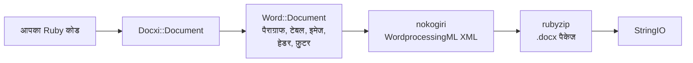

<!-- Translated from README.md (git blob 08aeefecb2eaa6ce543fc23576be90e5767dfaf8). See docs/i18n/TRANSLATION_GUIDE.md. -->

# docxi: Ruby से Word (.docx) डॉक्यूमेंट बनाएं

[](https://rubygems.org/gems/docxi)
[](https://github.com/hammad417/docxi/actions/workflows/ci.yml)
[](https://rubygems.org/gems/docxi)
[](https://rubygems.org/gems/docxi)
[](../../LICENSE)

[English](../../README.md) · [简体中文](README.zh-CN.md) · [繁體中文](README.zh-TW.md) · [Español](README.es.md) · [العربية](README.ar.md) · [Français](README.fr.md) · [Português (Brasil)](README.pt-BR.md) · [Deutsch](README.de.md) · [हिन्दी](README.hi.md) · [日本語](README.ja.md) · [한국어](README.ko.md) · [Русский](README.ru.md) · [Bahasa Indonesia](README.id.md) · [Türkçe](README.tr.md) · [Italiano](README.it.md) · [Tiếng Việt](README.vi.md)

> यह अंग्रेज़ी [README](../../README.md) का अनुवाद है। दोनों में कोई अंतर हो तो अंग्रेज़ी संस्करण को ही सही माना जाए।

docxi एक Ruby gem है जो कोड से Microsoft Word की `.docx` फ़ाइलें बनाता है। आप ब्लॉक पर आधारित एक छोटी DSL से डॉक्यूमेंट का विवरण लिखते हैं (पैराग्राफ, फ़ॉर्मैट किया हुआ टेक्स्ट, टेबल, इमेज, हेडर और फ़ुटर, पेज नंबर, हाइपरलिंक), और docxi Office Open XML पैकेज लिख देता है। इसके लिए Microsoft Word, LibreOffice या किसी टेम्पलेट फ़ाइल की ज़रूरत नहीं होती, और यह साधारण Ruby स्क्रिप्ट के साथ-साथ Ruby on Rails ऐप्स में भी काम करता है।

```ruby
require "docxi"

word = Docxi::Document.new
word.document.p { |p| p.text "Hello from docxi", bold: true, size: 16 }
File.binwrite("hello.docx", word.render.string)
```

## <a id="contents"></a>विषय-सूची

- [परिचय](#overview)
- [सुविधाएं](#features)
- [टेक्नोलॉजी स्टैक](#technology-stack)
- [इंस्टॉलेशन](#installation)
- [क्विक स्टार्ट](#quick-start)
- [उपयोग के उदाहरण](#usage-examples)
- [कॉन्फ़िगरेशन](#configuration)
- [यह कैसे काम करता है](#how-it-works)
- [API एक नज़र में](#api-at-a-glance)
- [समर्थित प्लेटफ़ॉर्म](#supported-platforms)
- [आम उपयोग](#common-use-cases)
- [समस्या निवारण](#troubleshooting)
- [अक्सर पूछे जाने वाले प्रश्न](#faq)
- [डॉक्यूमेंटेशन](#documentation)
- [योगदान](#contributing)
- [सुरक्षा](#security)
- [लाइसेंस](#license)
- [मेंटेनर](#maintainers)

## <a id="overview"></a>परिचय

किसी ऐप्लिकेशन से Word डॉक्यूमेंट बनाने का मतलब अक्सर होता है कोई टेम्पलेट भरना, किसी ऑफ़िस सुइट को ऑटोमेट करना, या HTML को बदलकर उम्मीद करना कि लेआउट बचा रहेगा। docxi अलग रास्ता अपनाता है: आप Ruby में डॉक्यूमेंट को एक-एक एलिमेंट करके बनाते हैं और बदले में एक `StringIO` पाते हैं जिसमें पूरी `.docx` फ़ाइल होती है। इसे आप डिस्क पर सेव कर सकते हैं, ईमेल के साथ अटैच कर सकते हैं या किसी Rails controller से भेज सकते हैं।

यह उन Ruby और Rails डेवलपर्स के लिए है जिन्हें अपने डेटा से रिपोर्ट, पत्र या दूसरे डॉक्यूमेंट Word फ़ॉर्मैट में एक्सपोर्ट करने होते हैं। रनटाइम पर इसकी सिर्फ़ दो डिपेंडेंसी हैं: [nokogiri](https://nokogiri.org/), जो XML बनाती है, और [rubyzip](https://github.com/rubyzip/rubyzip), जो उसे पैकेज करती है।

## <a id="features"></a>सुविधाएं

- **पैराग्राफ**: अलाइनमेंट, बैकग्राउंड शेडिंग, बाएं और दाएं इंडेंट, नीचे की बॉर्डर, और बुलेट सूची के आइटम
- **टेक्स्ट**: बोल्ड, इटैलिक, अंडरलाइन, रंग, साइज़, फ़ॉन्ट, बैकग्राउंड शेडिंग, सुरक्षित रखे गए स्पेस और लाइन ब्रेक
- **ब्रेक और टैब**: लाइन ब्रेक, पेज ब्रेक और टैब कैरेक्टर
- **टेबल**: कॉलम की चौड़ाई, पंक्ति की ऊंचाई, टेबल का इंडेंट, हर सेल की अलग बॉर्डर, शेडिंग और वर्टिकल अलाइनमेंट, और `colspan` व `rowspan` से मर्ज किए गए सेल
- **इमेज**: `File` जैसे किसी IO ऑब्जेक्ट, फ़ाइल पाथ या `http(s)` URL से, इनलाइन रखी गई और `120pt` जैसे CSS-स्टाइल साइज़ वाली
- **हेडर और फ़ुटर**: टेक्स्ट, टेबल, हेडर में इमेज, पेज नंबर, और पहले पेज के लिए अलग हेडर और फ़ुटर
- **विषय-सूची**: डॉट (या किसी और कैरेक्टर) वाले लीडर और दाईं ओर अलाइन पेज नंबर वाली पंक्तियां, जिनके नंबर आप खुद देते हैं
- **हाइपरलिंक** बाहरी URL के लिए
- **टेक्स्ट फ़्रेम** (टेक्स्ट बॉक्स)
- **पेज मार्जिन**
- **Zip64 के बिना आउटपुट**: rubyzip 3 के साथ भी आर्काइव Zip64 रिकॉर्ड के बिना लिखे जाते हैं; Google Docs और LibreOffice के पुराने वर्शन ऐसे रिकॉर्ड वाली फ़ाइलें खोलने से मना कर देते हैं

### <a id="limitations-and-known-issues"></a>सीमाएं और ज्ञात समस्याएं

docxi सिर्फ़ नए डॉक्यूमेंट बनाता है। यह किसी मौजूदा `.docx` को खोल या एडिट नहीं कर सकता, टेम्पलेट नहीं भर सकता और मेल मर्ज नहीं कर सकता। इसमें क्रमांकित सूचियां, हेडिंग स्टाइल या अपने-आप बनने वाली विषय-सूची नहीं है, और पेज का साइज़ पोर्ट्रेट US Letter पर तय है।

ये समस्याएं ज्ञात हैं और इन्हें 0.2.0 में ठीक करने की योजना है:

- `pH`/`pV` से रखी गई इमेज, हेडर में इमेज और टेबल सेल में इमेज का साइज़ `width * height` से निकलता है, इसलिए वे उम्मीद से बहुत छोटी दिखती हैं। `style:` से साइज़ तय की गई इनलाइन इमेज पर इसका असर नहीं पड़ता।
- टेबल लेवल पर दी गई `borders:` टेबल के बाहरी किनारों की जगह हर सेल पर लागू होती है। हर सेल के लिए `borders:` ठीक काम करती है।
- पेज नंबर फ़ील्ड के कोड में `\* MERGEFORMAT` का बैकस्लैश छूट जाता है।
- टेबल सेल के अंदर पेज नंबर से पहले "GlobalOptions" टेक्स्ट जुड़ जाता है।
- इमेज हमेशा PNG पार्ट के रूप में सेव होती हैं, और `[Content_Types].xml` सिर्फ़ पहले दो हेडर और फ़ुटर घोषित करता है।

## <a id="technology-stack"></a>टेक्नोलॉजी स्टैक

| हिस्सा | किसका उपयोग होता है |
|---|---|
| भाषा | Ruby 2.5 या नया |
| XML | [nokogiri](https://nokogiri.org/) `>= 1.8, < 2` |
| पैकेजिंग | [rubyzip](https://github.com/rubyzip/rubyzip) `>= 1.3, < 4` |
| आउटपुट फ़ॉर्मैट | Office Open XML WordprocessingML (`.docx`) |
| टेस्ट | Minitest, जिसमें आउटपुट की तुलना पिछले रिलीज़ से बनी फ़ाइलों से होती है |
| CI | Ubuntu 24.04 पर GitHub Actions, साथ में LibreOffice कन्वर्ज़न की जांच |

## <a id="installation"></a>इंस्टॉलेशन

### <a id="prerequisites"></a>पहले से ज़रूरी चीज़ें

- Ruby 2.5 या नया
- Bundler, अगर आप Gemfile से इंस्टॉल करते हैं
- ऐसा प्लेटफ़ॉर्म जिस पर nokogiri इंस्टॉल हो सके। nokogiri आम Linux, macOS और Windows प्लेटफ़ॉर्म के लिए पहले से कंपाइल किए गए बिल्ड देता है।

### <a id="install"></a>gem इंस्टॉल करें

अपने Gemfile में docxi जोड़ें:

```ruby
gem "docxi", "~> 0.1"
```

और `bundle install` चलाएं। या इसे सीधे इंस्टॉल करें:

```sh
gem install docxi
```

0.0.x से अपग्रेड करने के लिए कोड में कोई बदलाव नहीं चाहिए: `bundle update docxi` चलाएं। 0.1.0 वही डॉक्यूमेंट बनाता है जो 0.0.6 बनाता था। 2.5 से पुराने Ruby वाले ऐप्स अपने-आप 0.0.6 पर ही रहते हैं।

## <a id="quick-start"></a>क्विक स्टार्ट

```ruby
require "docxi"

word = Docxi::Document.new
document = word.document

document.p(align: "center") do |p|
  p.text "Monthly report", size: 20, bold: true
end

document.p do |p|
  p.text "Generated with docxi on ", space: true
  p.text Time.now.strftime("%Y-%m-%d"), bold: true
end

File.binwrite("report.docx", word.render.string)
```

`word.render` एक `StringIO` लौटाता है, और उसका `.string` ही पूरी `.docx` फ़ाइल है।

## <a id="usage-examples"></a>उपयोग के उदाहरण

ये उदाहरण क्विक स्टार्ट से आगे चलते हैं और उसी `word` और `document` का इस्तेमाल करते हैं।

### <a id="formatted-text-and-bullet-lists"></a>फ़ॉर्मैट किया हुआ टेक्स्ट और बुलेट सूचियां

```ruby
document.p do |p|
  p.text "Bold", bold: true
  p.text " italic", italic: true, space: true
  p.text " underlined", underline: true, space: true, br: true
  p.text "Dark red Georgia, 14 pt, on yellow", color: "8B0000", font: "Georgia", size: 14, fill: "FFFF00"
end

document.p(ul: true) { |p| p.text "First bullet" }
document.p(ul: true) { |p| p.text "Second bullet" }

document.p(align: "center", fill: "EEEEEE", bottom: true) do |p|
  p.text "Shaded, centered, with a bottom border"
end

document.br(page: true)
```

जो टेक्स्ट स्पेस से शुरू या ख़त्म होता है, उस पर `space: true` लगाएं, वरना Word वह स्पेस हटा देता है।

### <a id="tables"></a>टेबल

```ruby
document.table(columns_width: [240, 100, 100]) do |table|
  table.tr(fill: "D9D9D9", bold: true) do |tr|
    tr.tc { |tc| tc.text "Item" }
    tr.tc { |tc| tc.text "Qty" }
    tr.tc { |tc| tc.text "Price" }
  end

  table.tr do |tr|
    tr.tc(borders: { top: 4, right: 4, bottom: 4, left: 4 }) { |tc| tc.text "Widget" }
    tr.tc(valign: "center") { |tc| tc.text "2" }
    tr.tc { |tc| tc.text "$20.00", align: "right" }
  end

  table.tr do |tr|
    tr.tc(colspan: 2) { |tc| tc.text "Total", bold: true }
    tr.tc { |tc| tc.text "$20.00", align: "right", bold: true }
  end
end
```

`tr` पर दिए गए विकल्प उस पंक्ति के हर सेल पर लागू होते हैं। सेल को ऊपर-नीचे मर्ज करने के लिए ऊपर वाले सेल को `rowspan: true` और उसके नीचे वाले सेल को `merged: true` दें।

### <a id="images"></a>इमेज

```ruby
logo = document.add_media(File.open("logo.png", "rb"))
# add_media फ़ाइल पाथ या http(s) URL भी लेता है:
# logo = document.add_media("https://example.com/logo.png")

document.p(align: "center") do |p|
  p.image logo, style: { width: "120pt", height: "60pt" }
end
```

### <a id="headers-footers-and-page-numbers"></a>हेडर, फ़ुटर और पेज नंबर

```ruby
header = Docxi::Word::Headers::Header.new do |h|
  h.text "ACME Corp. quarterly report", size: 9, align: "right"
end

footer = Docxi::Word::Footers::Footer.new do |f|
  f.page_numbers name: "Page", align: "center"
end

document.add_header(header)
document.add_footer(footer)

# पहले पेज का हेडर और फ़ुटर हमेशा अलग होता है:
document.add_first_header(Docxi::Word::Headers::Header.new { |h| h.text "Cover page" })
document.add_first_footer(Docxi::Word::Footers::Footer.new { |f| f.text "Confidential" })
```

### <a id="hyperlinks"></a>हाइपरलिंक

```ruby
url = "https://github.com/hammad417/docxi"
link = document.add_hyperlink(url)

document.p { |p| p.hyperlink "docxi on GitHub", url, link }
```

### <a id="table-of-contents"></a>विषय-सूची जोड़ना

```ruby
document.text "Contents", size: 16, bold: true

document.table_of_content do |toc|
  toc.add_row "Introduction", 1
  toc.add_row "Results", 3
  toc.add_row "Appendix", 7, leader: "hyphen"
end
```

docxi पेज नंबर नहीं गिनता। पंक्तियों में वही नंबर दिखते हैं जो आप देते हैं।

### <a id="sending-a-document-from-rails"></a>Rails से डॉक्यूमेंट भेजना

```ruby
class ReportsController < ApplicationController
  def show
    word = Docxi::Document.new
    word.document.p { |p| p.text "Report for #{Date.today}" }

    send_data word.render.string,
              filename: "report.docx",
              type: "application/vnd.openxmlformats-officedocument.wordprocessingml.document"
  end
end
```

### <a id="more-examples"></a>और उदाहरण

[`examples/full_document.rb`](../../examples/full_document.rb) एक ही डॉक्यूमेंट में सभी सुविधाओं का इस्तेमाल करता है, और विकी के [उपयोग के उदाहरण](https://github.com/hammad417/docxi/wiki/Usage-Examples-hi) पेज पर रिपोर्ट, इनवॉइस और पत्र जैसे पूरे उदाहरण हैं। इस रिपॉज़िटरी के क्लोन में `bundle exec rake samples` चलाने पर टेस्ट सूट के सैंपल डॉक्यूमेंट `tmp/samples/` में लिखे जाते हैं।

## <a id="configuration"></a>कॉन्फ़िगरेशन

docxi में कोई कॉन्फ़िगरेशन फ़ाइल या एनवायरनमेंट वेरिएबल नहीं है। पेज मार्जिन डॉक्यूमेंट बनाते समय तय किए जाते हैं:

```ruby
# मान एक पॉइंट के बीसवें हिस्से में हैं (1440 = 1 इंच)। चारों तरफ़ के मान दें।
word = Docxi::Document.new(top: 1440, right: 1080, bottom: 1440, left: 1080, header: 720, footer: 720)
```

डिफ़ॉल्ट मान `top: 720, right: 1440, bottom: 720, left: 1440, header: 190, footer: 200` हैं। अगर आप कोई भी मार्जिन सेट करते हैं, तो `top`, `right`, `bottom` और `left` चारों एक साथ सेट करें, क्योंकि जो छूट जाते हैं वे ख़ाली लिखे जाते हैं।

| विकल्प | इकाई |
|---|---|
| टेक्स्ट का `size:` | पॉइंट |
| मार्जिन, पैराग्राफ के `left:` और `right:` इंडेंट, टेबल का `iwidth:` | पॉइंट का बीसवां हिस्सा (1 इंच में 1440) |
| सेल की `borders:` की मोटाई | पॉइंट का आठवां हिस्सा |
| `columns_width:` और सेल का `width:` | 14.92 से गुणा करके पॉइंट के बीसवें हिस्से में बदले जाते हैं, जो लगभग पिक्सेल के बराबर है |
| इमेज का `style:` | `"120pt"` जैसी CSS लंबाई |

पेज पोर्ट्रेट US Letter है, और डिफ़ॉल्ट फ़ॉन्ट Arial 12 pt है।

## <a id="how-it-works"></a>यह कैसे काम करता है



`Docxi::Document` पैकेज लेवल के पार्ट रखता है: रिलेशनशिप, कंटेंट टाइप और डॉक्यूमेंट प्रॉपर्टी। `word.document` एक `Docxi::Word::Document` है, जो आपके जोड़े गए एलिमेंट (`Docxi::Word::Contents::Paragraph`, `Table`, `Image`, `TableOfContent` वगैरह) के साथ हेडर, फ़ुटर, इमेज, हाइपरलिंक, स्टाइल, नंबरिंग और थीम को इकट्ठा करता है। जब आप `render` कॉल करते हैं, तो हर पार्ट nokogiri से अपना XML बनाता है और rubyzip उसे zip आर्काइव में लिखता है। `Docxi.write_entry` हर एंट्री का साइज़ पहले से सेट कर देता है, ताकि rubyzip कोई Zip64 रिकॉर्ड न जोड़े।

## <a id="api-at-a-glance"></a>API एक नज़र में

| कॉल | क्या जोड़ता है |
|---|---|
| `Docxi::Document.new(margins)` | एक नया डॉक्यूमेंट। `#render` पूरी `.docx` को `StringIO` के रूप में लौटाता है |
| ब्लॉक के साथ `document.p(options)` | एक पैराग्राफ। ब्लॉक के अंदर: `text`, `br`, `tab`, `image`, `hyperlink`, `frame` |
| `document.text(string, options)` | टेक्स्ट के एक हिस्से वाला पैराग्राफ |
| `document.br(page: true)` | एक पेज ब्रेक |
| ब्लॉक के साथ `document.table(options)` | एक टेबल। अंदर: `tr`, फिर `tc`, फिर `text`, `p`, `image` या `page_numbers` |
| ब्लॉक के साथ `document.table_of_content(options)` | `add_row(text, page)` से जोड़ी गई विषय-सूची की पंक्तियां |
| `document.add_media(file_path_or_url)` | एक इमेज, जिसे `image` से रखा जाता है |
| `document.add_hyperlink(url)` | `hyperlink` के साथ इस्तेमाल होने वाला लिंक टारगेट |
| `document.add_header(header)` और `add_first_header` | `Docxi::Word::Headers::Header` से बने हेडर |
| `document.add_footer(footer)` और `add_first_footer` | `Docxi::Word::Footers::Footer` से बने फ़ुटर |
| `document.frame(text, options)` | एक टेक्स्ट बॉक्स |

## <a id="supported-platforms"></a>समर्थित प्लेटफ़ॉर्म

| क्षेत्र | समर्थन |
|---|---|
| Ruby | 2.5 या नया। CI पर Ruby 2.5, 2.6, 2.7, 3.0, 3.1, 3.2, 3.3, 3.4 और 4.0 चलते हैं |
| Rails | ज़रूरी नहीं। CI पर docxi के साथ Rails 5.2, 6.0, 6.1, 7.0, 7.1, 7.2, 8.0 और 8.1 लोड किए जाते हैं |
| डिपेंडेंसी | CI पर rubyzip 1.3, 2.4 और 3.x, और nokogiri 1.11 से 1.19 तक जांचे जाते हैं |
| ऑपरेटिंग सिस्टम | CI Ubuntu 24.04 पर चलता है, और टेस्ट macOS पर भी चलाए गए हैं। Windows पर टेस्ट नहीं हुआ है। |
| आउटपुट | Microsoft Word के लिए `.docx`। CI जांचता है कि LibreOffice सैंपल डॉक्यूमेंट को कन्वर्ट कर पाता है |

## <a id="common-use-cases"></a>आम उपयोग

- Rails ऐप से रिपोर्ट को Word फ़ाइल के रूप में एक्सपोर्ट करना
- डेटाबेस रिकॉर्ड से पत्र, सर्टिफ़िकेट या इनवॉइस बनाना
- बैकग्राउंड जॉब या कमांड-लाइन स्क्रिप्ट में डॉक्यूमेंट बनाना, जहां कोई ऑफ़िस सुइट इंस्टॉल नहीं है

## <a id="troubleshooting"></a>समस्या निवारण

**Rails 6 या नए ऐप में docxi जोड़ने पर Bundler को `nokogiri` के संगत वर्शन नहीं मिलते।**
docxi 0.0.6 `nokogiri < 1.7` पर अटका है, जबकि 6.0 के बाद का हर Rails वर्शन nokogiri 1.8.5 या नया मांगता है। `gem "docxi", "~> 0.1"` इस्तेमाल करें।

**Bundler को `rubyzip` के संगत वर्शन नहीं मिलते।**
docxi 0.0.6 `rubyzip ~> 0.9.9` पर अटका है, जो किसी भी ऐसे gem से टकराता है जिसे नया rubyzip चाहिए। docxi 0.1.0, rubyzip 1.3 से 3.x तक के साथ काम करता है।

**Rails के बाहर `NoMethodError: undefined method 'present?'` आता है।**
docxi 0.0.6 इस बात पर निर्भर था कि ActiveSupport पहले से लोड हो। 0.1.0 को इसकी ज़रूरत नहीं है।

**rubyzip 3 से बनी फ़ाइल Google Docs या LibreOffice में नहीं खुलती।**
rubyzip 3 के साथ docxi 0.0.6 हर एंट्री में Zip64 रिकॉर्ड लिखता है। 0.1.0 बिना इन रिकॉर्ड के आर्काइव लिखता है।

**Ruby 3 पर इमेज URL से `Errno::ENOENT` आता है।**
docxi 0.0.6 URL को `Kernel#open` से खोलता था, जो Ruby 3 पर अब URL डाउनलोड नहीं करता। 0.1.0 उन्हें `URI#open` से डाउनलोड करता है।

**`tab`, `frame` या हेडर का `page_numbers` कॉल करने पर `NameError` आता है।**
ये 0.0.6 में ख़राब थे और 0.1.0 में काम करते हैं।

**पहले पेज पर आपका हेडर या फ़ुटर नहीं दिखता।**
docxi पहले पेज को हमेशा अलग हेडर और फ़ुटर देता है। इन्हें `add_first_header` और `add_first_footer` से सेट करें।

**कोई पेज मार्जिन गायब है।**
मार्जिन सेट करते समय `top`, `right`, `bottom` और `left` एक साथ दें। देखें [कॉन्फ़िगरेशन](#configuration)।

## <a id="faq"></a>अक्सर पूछे जाने वाले प्रश्न

**क्या Microsoft Word या LibreOffice इंस्टॉल होना ज़रूरी है?**
नहीं। docxi XML और zip आर्काइव खुद लिखता है।

**क्या docxi को Rails चाहिए?**
नहीं। यह किसी भी Ruby प्रोग्राम में काम करता है। CI पर Rails 5.2 से 8.1 तक लोड करके भी टेस्ट चलाए जाते हैं।

**Ruby on Rails में Word डॉक्यूमेंट कैसे बनाएं?**
किसी controller या बैकग्राउंड जॉब में docxi से डॉक्यूमेंट बनाएं और `word.render.string` को `send_data` से भेजें। देखें [Rails से डॉक्यूमेंट भेजना](#sending-a-document-from-rails)।

**क्या docxi किसी मौजूदा .docx को एडिट कर सकता है या Word टेम्पलेट भर सकता है?**
नहीं। docxi सिर्फ़ नए डॉक्यूमेंट बनाता है। मर्ज फ़ील्ड वाले टेम्पलेट के लिए sablon जैसा टेम्पलेट-आधारित gem इस्तेमाल करें।

**क्या विषय-सूची हेडिंग से अपने-आप बनती है?**
नहीं। हर पंक्ति और उसका पेज नंबर आप खुद जोड़ते हैं।

**क्या पेज का साइज़ या ओरिएंटेशन बदला जा सकता है?**
अभी नहीं। पेज पोर्ट्रेट US Letter हैं, और आप सिर्फ़ मार्जिन बदल सकते हैं।

**कौन से इमेज फ़ॉर्मैट काम करते हैं?**
इमेज PNG पार्ट के रूप में सेव होती हैं, इसलिए PNG फ़ाइलें सबसे सुरक्षित विकल्प हैं।

**Ruby और Rails के कौन से वर्शन समर्थित हैं?**
Ruby 2.5 और उससे नए। Rails वैकल्पिक है, और CI पर Rails 5.2 से 8.1 तक टेस्ट किए जाते हैं।

## <a id="documentation"></a>डॉक्यूमेंटेशन

- [docxi विकी](https://github.com/hammad417/docxi/wiki/Home-hi) में हर विकल्प की जानकारी है, साथ में और उदाहरण और समस्याओं के समाधान भी
- [CHANGELOG.md](../../CHANGELOG.md) में हर रिलीज़ के बदलाव दिए गए हैं (अंग्रेज़ी में)
- [examples/full_document.rb](../../examples/full_document.rb) एक पूरा उदाहरण है
- [docs/i18n](README.md) इस README के अनुवादों की स्थिति दर्ज करता है

## <a id="contributing"></a>योगदान

बग रिपोर्ट और पुल रिक्वेस्ट का [GitHub](https://github.com/hammad417/docxi/issues) पर स्वागत है। docxi पर काम शुरू करने के लिए:

```sh
git clone https://github.com/hammad417/docxi.git
cd docxi
bundle install
bundle exec rake test
```

किसी ख़ास Rails वर्शन को लोड करके टेस्ट चलाने के लिए `gemfiles/` में से कोई Gemfile इस्तेमाल करें:

```sh
BUNDLE_GEMFILE=gemfiles/rails_8.1.gemfile bundle install
BUNDLE_GEMFILE=gemfiles/rails_8.1.gemfile DOCXI_WITH_RAILS=1 bundle exec rake test
```

`test/golden` में वह XML है जो 0.0.6 ने `test/support/sample_documents.rb` के डॉक्यूमेंट के लिए बनाया था, और टेस्ट हर बदलाव की तुलना उससे करते हैं। अगर आप जानबूझकर बनने वाला XML बदलते हैं, तो उसे `bundle exec rake golden` से अपडेट करें और अपने पुल रिक्वेस्ट में बदलाव की वजह बताएं।

## <a id="security"></a>सुरक्षा

कृपया सुरक्षा से जुड़ी समस्याएं सार्वजनिक issue में न बताएं, बल्कि मेंटेनर को ईमेल करें। ईमेल पते [docxi.gemspec](../../docxi.gemspec) में हैं।

अगर आप अब भी docxi 0.0.x इस्तेमाल कर रहे हैं, तो 0.1.0 पर अपग्रेड करें। पुराने वर्शन इमेज पाथ स्ट्रिंग को `Kernel#open` को देते हैं, जो `|` से शुरू होने वाली स्ट्रिंग को shell कमांड की तरह चला देता है।

## <a id="license"></a>लाइसेंस

docxi [MIT लाइसेंस](../../LICENSE) के तहत जारी किया गया है। लाइसेंस फ़ाइल में docxer का मूल कॉपीराइट नोटिस बरकरार है, वही gem जिससे docxi बना।

## <a id="maintainers"></a>मेंटेनर

docxi का रखरखाव [Phaedra Solutions](https://www.phaedrasolutions.com/) के [Hammad Maqbool](https://github.com/hammad417) करते हैं। इसकी शुरुआत 2016 में Timur Gabdrakipov के [docxer](https://github.com/gtimti/docxer) से हुई थी।

### <a id="about-phaedra-solutions"></a>Phaedra Solutions के बारे में

Phaedra Solutions एक AI-फ़र्स्ट सॉफ़्टवेयर इंजीनियरिंग कंपनी है, जो 2013 से कारोबारों के लिए कस्टम सॉफ़्टवेयर बना रही है।
