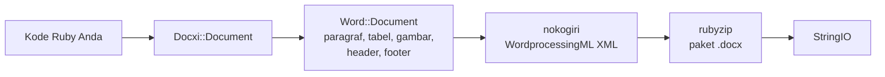

<!-- Translated from README.md (git blob 08aeefecb2eaa6ce543fc23576be90e5767dfaf8). See docs/i18n/TRANSLATION_GUIDE.md. -->

# docxi: membuat dokumen Word (.docx) dengan Ruby

[](https://rubygems.org/gems/docxi)
[](https://github.com/hammad417/docxi/actions/workflows/ci.yml)
[](https://rubygems.org/gems/docxi)
[](https://rubygems.org/gems/docxi)
[](../../LICENSE)

[English](../../README.md) · [简体中文](README.zh-CN.md) · [繁體中文](README.zh-TW.md) · [Español](README.es.md) · [العربية](README.ar.md) · [Français](README.fr.md) · [Português (Brasil)](README.pt-BR.md) · [Deutsch](README.de.md) · [हिन्दी](README.hi.md) · [日本語](README.ja.md) · [한국어](README.ko.md) · [Русский](README.ru.md) · [Bahasa Indonesia](README.id.md) · [Türkçe](README.tr.md) · [Italiano](README.it.md) · [Tiếng Việt](README.vi.md)

> Ini adalah terjemahan dari [README](../../README.md) berbahasa Inggris. Jika ada perbedaan, versi bahasa Inggris yang menjadi acuan.

docxi adalah gem Ruby yang membuat file Microsoft Word `.docx` dari kode. Anda mendeskripsikan dokumen dengan DSL kecil berbasis blok (paragraf, teks berformat, tabel, gambar, header dan footer, nomor halaman, hyperlink), lalu docxi menulis paket Office Open XML-nya. Gem ini tidak memerlukan Microsoft Word, LibreOffice, maupun file template, dan bisa dipakai di skrip Ruby biasa maupun di aplikasi Ruby on Rails.

```ruby
require "docxi"

word = Docxi::Document.new
word.document.p { |p| p.text "Hello from docxi", bold: true, size: 16 }
File.binwrite("hello.docx", word.render.string)
```

## <a id="contents"></a>Daftar isi

- [Ikhtisar](#overview)
- [Fitur](#features)
- [Teknologi](#technology-stack)
- [Instalasi](#installation)
- [Mulai cepat](#quick-start)
- [Contoh penggunaan](#usage-examples)
- [Konfigurasi](#configuration)
- [Cara kerja](#how-it-works)
- [Sekilas tentang API](#api-at-a-glance)
- [Platform yang didukung](#supported-platforms)
- [Kasus penggunaan umum](#common-use-cases)
- [Pemecahan masalah](#troubleshooting)
- [Pertanyaan umum](#faq)
- [Dokumentasi](#documentation)
- [Berkontribusi](#contributing)
- [Keamanan](#security)
- [Lisensi](#license)
- [Pengelola](#maintainers)

## <a id="overview"></a>Ikhtisar

Membuat dokumen Word dari sebuah aplikasi biasanya berarti mengisi template, mengotomatiskan paket aplikasi perkantoran, atau mengonversi HTML sambil berharap tata letaknya tetap utuh. docxi mengambil jalan lain: Anda menyusun dokumen di Ruby, elemen demi elemen, lalu mendapatkan sebuah `StringIO` berisi file `.docx` lengkap yang bisa Anda simpan ke disk, lampirkan ke email, atau kirim dari controller Rails.

Gem ini ditujukan bagi developer Ruby dan Rails yang perlu mengekspor laporan, surat, atau dokumen lain dalam format Word dari data mereka sendiri. Dependensi runtime-nya hanya dua: [nokogiri](https://nokogiri.org/) yang menyusun XML, dan [rubyzip](https://github.com/rubyzip/rubyzip) yang mengemasnya.

## <a id="features"></a>Fitur

- **Paragraf**: perataan, bayangan latar, indentasi kiri dan kanan, garis batas bawah, serta item daftar berpoin
- **Teks**: tebal, miring, garis bawah, warna, ukuran, font, bayangan latar, spasi yang dipertahankan, dan pemisah baris
- **Pemisah dan tab**: pemisah baris, pemisah halaman, dan karakter tab
- **Tabel**: lebar kolom, tinggi baris, indentasi tabel, garis batas, bayangan, dan perataan vertikal per sel, serta penggabungan sel dengan `colspan` dan `rowspan`
- **Gambar**: dari objek IO seperti `File`, path file, atau URL `http(s)`, disisipkan sebaris dengan ukuran bergaya CSS seperti `120pt`
- **Header dan footer**: teks, tabel, gambar di header, nomor halaman, serta header dan footer tersendiri untuk halaman pertama
- **Daftar isi**: baris dengan karakter pengisi titik-titik (atau karakter lain) dan nomor halaman rata kanan yang Anda tentukan sendiri
- **Hyperlink** ke URL eksternal
- **Bingkai teks** (kotak teks)
- **Margin halaman**
- **Output tanpa Zip64**: arsip ditulis tanpa record Zip64 bahkan saat memakai rubyzip 3; Google Docs dan LibreOffice versi lama menolak membuka file yang berisi record tersebut

### <a id="limitations-and-known-issues"></a>Keterbatasan dan masalah yang diketahui

docxi hanya membuat dokumen baru. Gem ini tidak bisa membuka atau mengedit `.docx` yang sudah ada, mengisi template, atau menjalankan mail merge. Tidak ada daftar bernomor, gaya judul, maupun daftar isi yang dibuat otomatis, dan ukuran halaman tetap US Letter dengan orientasi potret.

Masalah berikut sudah diketahui dan direncanakan diperbaiki di versi 0.2.0:

- Gambar yang ditempatkan dengan `pH`/`pV`, gambar di header, dan gambar di dalam sel tabel menghitung ukurannya dari `width * height`, sehingga hasilnya jauh lebih kecil dari yang diharapkan. Gambar sebaris yang ukurannya diatur dengan `style:` tidak terpengaruh.
- `borders:` di tingkat tabel diterapkan ke setiap sel, bukan ke tepi luar tabel. `borders:` per sel berfungsi dengan baik.
- Kode field nomor halaman ditulis tanpa garis miring terbalik pada `\* MERGEFORMAT`.
- Nomor halaman di dalam sel tabel diawali teks "GlobalOptions".
- Gambar selalu disimpan sebagai part PNG, dan `[Content_Types].xml` hanya mendeklarasikan dua header dan footer pertama.

## <a id="technology-stack"></a>Teknologi

| Bagian | Yang digunakan |
|---|---|
| Bahasa | Ruby 2.5 atau yang lebih baru |
| XML | [nokogiri](https://nokogiri.org/) `>= 1.8, < 2` |
| Pengemasan | [rubyzip](https://github.com/rubyzip/rubyzip) `>= 1.3, < 4` |
| Format output | Office Open XML WordprocessingML (`.docx`) |
| Pengujian | Minitest, dengan output yang dibandingkan terhadap file buatan rilis sebelumnya |
| CI | GitHub Actions di Ubuntu 24.04, ditambah pemeriksaan konversi dengan LibreOffice |

## <a id="installation"></a>Instalasi

### <a id="prerequisites"></a>Prasyarat

- Ruby 2.5 atau yang lebih baru
- Bundler, jika Anda memasang lewat Gemfile
- Platform tempat nokogiri bisa dipasang. nokogiri menyediakan build siap pakai untuk platform Linux, macOS, dan Windows yang umum.

### <a id="install"></a>Memasang gem

Tambahkan docxi ke Gemfile Anda:

```ruby
gem "docxi", "~> 0.1"
```

lalu jalankan `bundle install`. Atau pasang langsung:

```sh
gem install docxi
```

Upgrade dari 0.0.x tidak memerlukan perubahan kode: jalankan `bundle update docxi`. Versi 0.1.0 menghasilkan dokumen yang sama dengan 0.0.6. Aplikasi yang memakai Ruby lebih lama dari 2.5 otomatis tetap di 0.0.6.

## <a id="quick-start"></a>Mulai cepat

```ruby
require "docxi"

word = Docxi::Document.new
document = word.document

document.p(align: "center") do |p|
  p.text "Monthly report", size: 20, bold: true
end

document.p do |p|
  p.text "Generated with docxi on ", space: true
  p.text Time.now.strftime("%Y-%m-%d"), bold: true
end

File.binwrite("report.docx", word.render.string)
```

`word.render` mengembalikan sebuah `StringIO`, dan `.string`-nya adalah file `.docx` yang lengkap.

## <a id="usage-examples"></a>Contoh penggunaan

Contoh-contoh berikut melanjutkan dari bagian mulai cepat dan memakai `word` serta `document` yang sama.

### <a id="formatted-text-and-bullet-lists"></a>Teks berformat dan daftar berpoin

```ruby
document.p do |p|
  p.text "Bold", bold: true
  p.text " italic", italic: true, space: true
  p.text " underlined", underline: true, space: true, br: true
  p.text "Dark red Georgia, 14 pt, on yellow", color: "8B0000", font: "Georgia", size: 14, fill: "FFFF00"
end

document.p(ul: true) { |p| p.text "First bullet" }
document.p(ul: true) { |p| p.text "Second bullet" }

document.p(align: "center", fill: "EEEEEE", bottom: true) do |p|
  p.text "Shaded, centered, with a bottom border"
end

document.br(page: true)
```

Gunakan `space: true` untuk teks yang diawali atau diakhiri spasi, karena jika tidak, Word akan membuang spasi tersebut.

### <a id="tables"></a>Tabel

```ruby
document.table(columns_width: [240, 100, 100]) do |table|
  table.tr(fill: "D9D9D9", bold: true) do |tr|
    tr.tc { |tc| tc.text "Item" }
    tr.tc { |tc| tc.text "Qty" }
    tr.tc { |tc| tc.text "Price" }
  end

  table.tr do |tr|
    tr.tc(borders: { top: 4, right: 4, bottom: 4, left: 4 }) { |tc| tc.text "Widget" }
    tr.tc(valign: "center") { |tc| tc.text "2" }
    tr.tc { |tc| tc.text "$20.00", align: "right" }
  end

  table.tr do |tr|
    tr.tc(colspan: 2) { |tc| tc.text "Total", bold: true }
    tr.tc { |tc| tc.text "$20.00", align: "right", bold: true }
  end
end
```

Opsi pada `tr` berlaku untuk setiap sel di baris itu. Untuk menggabungkan sel secara vertikal, berikan `rowspan: true` ke sel atas dan `merged: true` ke sel di bawahnya.

### <a id="images"></a>Gambar

```ruby
logo = document.add_media(File.open("logo.png", "rb"))
# add_media juga menerima path file atau URL http(s):
# logo = document.add_media("https://example.com/logo.png")

document.p(align: "center") do |p|
  p.image logo, style: { width: "120pt", height: "60pt" }
end
```

### <a id="headers-footers-and-page-numbers"></a>Header, footer, dan nomor halaman

```ruby
header = Docxi::Word::Headers::Header.new do |h|
  h.text "ACME Corp. quarterly report", size: 9, align: "right"
end

footer = Docxi::Word::Footers::Footer.new do |f|
  f.page_numbers name: "Page", align: "center"
end

document.add_header(header)
document.add_footer(footer)

# Halaman pertama selalu punya header dan footer sendiri:
document.add_first_header(Docxi::Word::Headers::Header.new { |h| h.text "Cover page" })
document.add_first_footer(Docxi::Word::Footers::Footer.new { |f| f.text "Confidential" })
```

### <a id="hyperlinks"></a>Hyperlink

```ruby
url = "https://github.com/hammad417/docxi"
link = document.add_hyperlink(url)

document.p { |p| p.hyperlink "docxi on GitHub", url, link }
```

### <a id="table-of-contents"></a>Menambahkan daftar isi

```ruby
document.text "Contents", size: 16, bold: true

document.table_of_content do |toc|
  toc.add_row "Introduction", 1
  toc.add_row "Results", 3
  toc.add_row "Appendix", 7, leader: "hyphen"
end
```

docxi tidak menghitung nomor halaman. Baris-barisnya menampilkan nomor yang Anda berikan.

### <a id="sending-a-document-from-rails"></a>Mengirim dokumen dari Rails

```ruby
class ReportsController < ApplicationController
  def show
    word = Docxi::Document.new
    word.document.p { |p| p.text "Report for #{Date.today}" }

    send_data word.render.string,
              filename: "report.docx",
              type: "application/vnd.openxmlformats-officedocument.wordprocessingml.document"
  end
end
```

### <a id="more-examples"></a>Contoh lainnya

[`examples/full_document.rb`](../../examples/full_document.rb) memakai semua fitur dalam satu dokumen, dan halaman [Contoh penggunaan](https://github.com/hammad417/docxi/wiki/Usage-Examples-id) di wiki berisi resep lengkap, seperti laporan, faktur, dan surat. Di hasil clone repositori ini, `bundle exec rake samples` menulis dokumen contoh dari test suite ke `tmp/samples/`.

## <a id="configuration"></a>Konfigurasi

docxi tidak punya file konfigurasi maupun variabel lingkungan. Margin halaman diatur saat dokumen dibuat:

```ruby
# Nilainya dalam satuan seperdua puluh poin (1440 = 1 inci). Isi keempat sisinya.
word = Docxi::Document.new(top: 1440, right: 1080, bottom: 1440, left: 1080, header: 720, footer: 720)
```

Nilai bawaannya adalah `top: 720, right: 1440, bottom: 720, left: 1440, header: 190, footer: 200`. Jika Anda mengatur salah satu margin, atur `top`, `right`, `bottom`, dan `left` sekaligus, karena margin yang tidak diisi akan ditulis kosong.

| Opsi | Satuan |
|---|---|
| `size:` pada teks | Poin |
| Margin, indentasi paragraf `left:` dan `right:`, `iwidth:` pada tabel | Seperdua puluh poin (1440 per inci) |
| Ketebalan `borders:` pada sel | Seperdelapan poin |
| `columns_width:` dan `width:` pada sel | Dikalikan 14.92 untuk mendapatkan seperdua puluh poin, yang mendekati piksel |
| `style:` pada gambar | Panjang CSS seperti `"120pt"` |

Halamannya berukuran US Letter dengan orientasi potret, dan font bawaannya Arial 12 pt.

## <a id="how-it-works"></a>Cara kerja



`Docxi::Document` menyimpan part di tingkat paket: relasi, tipe konten, dan properti dokumen. `word.document` adalah `Docxi::Word::Document`, yang mengumpulkan elemen yang Anda tambahkan (`Docxi::Word::Contents::Paragraph`, `Table`, `Image`, `TableOfContent`, dan seterusnya) bersama header, footer, gambar, hyperlink, gaya, penomoran, dan tema. Saat Anda memanggil `render`, setiap part menyusun XML-nya dengan nokogiri lalu ditulis ke arsip zip dengan rubyzip. `Docxi.write_entry` menetapkan ukuran setiap entri di awal agar rubyzip tidak menambahkan record Zip64.

## <a id="api-at-a-glance"></a>Sekilas tentang API

| Panggilan | Yang ditambahkan |
|---|---|
| `Docxi::Document.new(margins)` | Dokumen baru. `#render` mengembalikan `.docx` sebagai `StringIO` |
| `document.p(options)` dengan blok | Sebuah paragraf. Di dalam blok: `text`, `br`, `tab`, `image`, `hyperlink`, `frame` |
| `document.text(string, options)` | Paragraf berisi satu potongan teks |
| `document.br(page: true)` | Pemisah halaman |
| `document.table(options)` dengan blok | Sebuah tabel. Di dalamnya: `tr`, lalu `tc`, lalu `text`, `p`, `image`, atau `page_numbers` |
| `document.table_of_content(options)` dengan blok | Baris daftar isi yang ditambahkan dengan `add_row(text, page)` |
| `document.add_media(file_path_or_url)` | Gambar yang ditempatkan dengan `image` |
| `document.add_hyperlink(url)` | Target tautan untuk dipakai dengan `hyperlink` |
| `document.add_header(header)` dan `add_first_header` | Header yang dibuat dengan `Docxi::Word::Headers::Header` |
| `document.add_footer(footer)` dan `add_first_footer` | Footer yang dibuat dengan `Docxi::Word::Footers::Footer` |
| `document.frame(text, options)` | Kotak teks |

## <a id="supported-platforms"></a>Platform yang didukung

| Area | Dukungan |
|---|---|
| Ruby | 2.5 atau yang lebih baru. CI menjalankan Ruby 2.5, 2.6, 2.7, 3.0, 3.1, 3.2, 3.3, 3.4, dan 4.0 |
| Rails | Tidak wajib. CI memuat Rails 5.2, 6.0, 6.1, 7.0, 7.1, 7.2, 8.0, dan 8.1 bersama docxi |
| Dependensi | CI mencakup rubyzip 1.3, 2.4, dan 3.x, serta nokogiri 1.11 hingga 1.19 |
| Sistem operasi | CI berjalan di Ubuntu 24.04, dan pengujian juga pernah dijalankan di macOS. Windows belum diuji. |
| Output | `.docx` untuk Microsoft Word. CI memeriksa bahwa LibreOffice dapat mengonversi dokumen contoh |

## <a id="common-use-cases"></a>Kasus penggunaan umum

- Mengekspor laporan dari aplikasi Rails sebagai file Word
- Membuat surat, sertifikat, atau faktur dari record database
- Menghasilkan dokumen di background job atau skrip command line yang tidak memiliki paket aplikasi perkantoran

## <a id="troubleshooting"></a>Pemecahan masalah

**Bundler tidak menemukan versi `nokogiri` yang kompatibel saat docxi ditambahkan ke aplikasi Rails 6 atau yang lebih baru.**
docxi 0.0.6 mengunci `nokogiri < 1.7`, sementara setiap versi Rails sejak 6.0 memerlukan nokogiri 1.8.5 atau yang lebih baru. Gunakan `gem "docxi", "~> 0.1"`.

**Bundler tidak menemukan versi `rubyzip` yang kompatibel.**
docxi 0.0.6 mengunci `rubyzip ~> 0.9.9`, yang bentrok dengan gem apa pun yang membutuhkan rubyzip lebih baru. docxi 0.1.0 berfungsi dengan rubyzip 1.3 hingga 3.x.

**`NoMethodError: undefined method 'present?'` di luar Rails.**
docxi 0.0.6 mengandalkan ActiveSupport yang sudah dimuat. Versi 0.1.0 tidak lagi memerlukannya.

**Google Docs atau LibreOffice tidak bisa membuka file yang dibuat dengan rubyzip 3.**
docxi 0.0.6 dengan rubyzip 3 menulis record Zip64 ke setiap entri. Versi 0.1.0 menulis arsip tanpa record tersebut.

**URL gambar memunculkan `Errno::ENOENT` di Ruby 3.**
docxi 0.0.6 membuka URL dengan `Kernel#open`, yang di Ruby 3 tidak lagi mengambil URL. Versi 0.1.0 mengunduhnya dengan `URI#open`.

**`NameError` saat memanggil `tab`, `frame`, atau `page_numbers` milik header.**
Fitur-fitur ini rusak di 0.0.6 dan sudah berfungsi di 0.1.0.

**Halaman pertama tidak menampilkan header atau footer Anda.**
docxi selalu memberi halaman pertama header dan footer tersendiri. Atur keduanya dengan `add_first_header` dan `add_first_footer`.

**Salah satu margin halaman hilang.**
Berikan `top`, `right`, `bottom`, dan `left` sekaligus saat mengatur margin. Lihat [Konfigurasi](#configuration).

## <a id="faq"></a>Pertanyaan umum

**Apakah Microsoft Word atau LibreOffice harus terpasang?**
Tidak. docxi menulis XML dan arsip zip-nya sendiri.

**Apakah docxi memerlukan Rails?**
Tidak. Gem ini berfungsi di program Ruby apa pun. CI juga menjalankan pengujian dengan Rails 5.2 hingga 8.1 yang dimuat.

**Bagaimana cara membuat dokumen Word di Ruby on Rails?**
Susun dokumennya dengan docxi di controller atau background job, lalu kirim `word.render.string` dengan `send_data`. Lihat [Mengirim dokumen dari Rails](#sending-a-document-from-rails).

**Bisakah docxi mengedit .docx yang sudah ada atau mengisi template Word?**
Tidak. docxi hanya membuat dokumen baru. Untuk template dengan field gabungan (merge field), gunakan gem berbasis template seperti sablon.

**Apakah daftar isi dibuat otomatis dari judul?**
Tidak. Anda sendiri yang menambahkan setiap baris beserta nomor halamannya.

**Bisakah saya mengubah ukuran atau orientasi halaman?**
Belum bisa. Halaman berukuran US Letter dengan orientasi potret, dan Anda hanya bisa mengubah margin.

**Format gambar apa saja yang bisa dipakai?**
Gambar disimpan sebagai part PNG, jadi file PNG adalah pilihan yang paling aman.

**Versi Ruby dan Rails mana yang didukung?**
Ruby 2.5 dan yang lebih baru. Rails bersifat opsional, dan CI menguji Rails 5.2 hingga 8.1.

## <a id="documentation"></a>Dokumentasi

- [Wiki docxi](https://github.com/hammad417/docxi/wiki/Home-id) menjelaskan setiap opsi, lengkap dengan contoh tambahan dan pemecahan masalah
- [CHANGELOG.md](../../CHANGELOG.md) mencantumkan perubahan di setiap rilis (dalam bahasa Inggris)
- [examples/full_document.rb](../../examples/full_document.rb) adalah contoh lengkap
- [docs/i18n](README.md) mencatat status terjemahan README ini

## <a id="contributing"></a>Berkontribusi

Laporan bug dan pull request dipersilakan di [GitHub](https://github.com/hammad417/docxi/issues). Untuk mulai mengerjakan docxi:

```sh
git clone https://github.com/hammad417/docxi.git
cd docxi
bundle install
bundle exec rake test
```

Untuk menjalankan pengujian dengan versi Rails tertentu yang dimuat, gunakan salah satu Gemfile di `gemfiles/`:

```sh
BUNDLE_GEMFILE=gemfiles/rails_8.1.gemfile bundle install
BUNDLE_GEMFILE=gemfiles/rails_8.1.gemfile DOCXI_WITH_RAILS=1 bundle exec rake test
```

`test/golden` berisi XML yang dihasilkan 0.0.6 untuk dokumen di `test/support/sample_documents.rb`, dan pengujian membandingkan setiap perubahan dengannya. Jika Anda sengaja mengubah XML yang dihasilkan, perbarui dengan `bundle exec rake golden` dan jelaskan perubahannya di pull request Anda.

## <a id="security"></a>Keamanan

Mohon jangan melaporkan masalah keamanan di issue publik. Kirimkan email ke pengelola sebagai gantinya. Alamatnya tercantum di [docxi.gemspec](../../docxi.gemspec).

Jika Anda masih memakai docxi 0.0.x, upgrade ke 0.1.0. Versi lama meneruskan string path gambar ke `Kernel#open`, yang menjalankan string berawalan `|` sebagai perintah shell.

## <a id="license"></a>Lisensi

docxi dirilis di bawah [Lisensi MIT](../../LICENSE). File lisensinya tetap memuat pemberitahuan hak cipta asli dari docxer, gem yang menjadi dasar docxi.

## <a id="maintainers"></a>Pengelola

docxi dikelola oleh [Hammad Maqbool](https://github.com/hammad417) dari [Phaedra Solutions](https://www.phaedrasolutions.com/). Proyek ini dimulai pada 2016 dari [docxer](https://github.com/gtimti/docxer) karya Timur Gabdrakipov.

### <a id="about-phaedra-solutions"></a>Tentang Phaedra Solutions

Phaedra Solutions adalah perusahaan rekayasa perangkat lunak yang berfokus pada AI dan telah membangun perangkat lunak khusus untuk berbagai bisnis sejak 2013.
