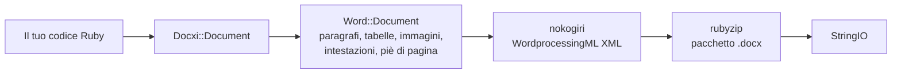

<!-- Translated from README.md (git blob 08aeefecb2eaa6ce543fc23576be90e5767dfaf8). See docs/i18n/TRANSLATION_GUIDE.md. -->

# docxi: generare documenti Word (.docx) con Ruby

[](https://rubygems.org/gems/docxi)
[](https://github.com/hammad417/docxi/actions/workflows/ci.yml)
[](https://rubygems.org/gems/docxi)
[](https://rubygems.org/gems/docxi)
[](../../LICENSE)

[English](../../README.md) · [简体中文](README.zh-CN.md) · [繁體中文](README.zh-TW.md) · [Español](README.es.md) · [العربية](README.ar.md) · [Français](README.fr.md) · [Português (Brasil)](README.pt-BR.md) · [Deutsch](README.de.md) · [हिन्दी](README.hi.md) · [日本語](README.ja.md) · [한국어](README.ko.md) · [Русский](README.ru.md) · [Bahasa Indonesia](README.id.md) · [Türkçe](README.tr.md) · [Italiano](README.it.md) · [Tiếng Việt](README.vi.md)

> Questa è una traduzione del [README](../../README.md) in inglese. In caso di differenze, fa fede la versione inglese.

docxi è una gem Ruby che genera file Microsoft Word `.docx` a partire dal codice. Descrivi il documento con un piccolo DSL basato su blocchi (paragrafi, testo formattato, tabelle, immagini, intestazioni e piè di pagina, numeri di pagina, collegamenti ipertestuali) e docxi scrive il pacchetto Office Open XML. Non richiede Microsoft Word, LibreOffice né un file modello, e funziona sia in semplici script Ruby sia nelle applicazioni Ruby on Rails.

```ruby
require "docxi"

word = Docxi::Document.new
word.document.p { |p| p.text "Hello from docxi", bold: true, size: 16 }
File.binwrite("hello.docx", word.render.string)
```

## <a id="contents"></a>Indice

- [Panoramica](#overview)
- [Funzionalità](#features)
- [Tecnologie utilizzate](#technology-stack)
- [Installazione](#installation)
- [Avvio rapido](#quick-start)
- [Esempi d'uso](#usage-examples)
- [Configurazione](#configuration)
- [Come funziona](#how-it-works)
- [L'API in breve](#api-at-a-glance)
- [Piattaforme supportate](#supported-platforms)
- [Casi d'uso comuni](#common-use-cases)
- [Risoluzione dei problemi](#troubleshooting)
- [Domande frequenti](#faq)
- [Documentazione](#documentation)
- [Contribuire](#contributing)
- [Sicurezza](#security)
- [Licenza](#license)
- [Manutentori](#maintainers)

## <a id="overview"></a>Panoramica

Generare un documento Word da un'applicazione di solito significa compilare un modello, automatizzare una suite per ufficio oppure convertire dell'HTML sperando che il layout regga. docxi segue un'altra strada: costruisci il documento in Ruby, un elemento alla volta, e ottieni uno `StringIO` con un file `.docx` completo, che puoi salvare su disco, allegare a un'email o inviare da un controller Rails.

È pensata per gli sviluppatori Ruby e Rails che devono esportare in formato Word report, lettere o altri documenti a partire dai propri dati. Le uniche dipendenze a runtime sono [nokogiri](https://nokogiri.org/), che costruisce l'XML, e [rubyzip](https://github.com/rubyzip/rubyzip), che lo impacchetta.

## <a id="features"></a>Funzionalità

- **Paragrafi**: allineamento, ombreggiatura dello sfondo, rientro sinistro e destro, bordo inferiore ed elementi di elenco puntato
- **Testo**: grassetto, corsivo, sottolineato, colore, dimensione, tipo di carattere, ombreggiatura dello sfondo, spazi mantenuti e interruzioni di riga
- **Interruzioni e tabulazioni**: interruzioni di riga, interruzioni di pagina e caratteri di tabulazione
- **Tabelle**: larghezza delle colonne, altezza delle righe, rientro della tabella, bordi, ombreggiatura e allineamento verticale per singola cella, e celle unite con `colspan` e `rowspan`
- **Immagini**: da un oggetto IO come un `File`, da un percorso di file o da un URL `http(s)`, inserite in linea con una dimensione in stile CSS come `120pt`
- **Intestazioni e piè di pagina**: testo, tabelle, immagini nelle intestazioni, numeri di pagina e un'intestazione e un piè di pagina dedicati alla prima pagina
- **Sommario**: righe con carattere di riempimento a puntini (o altro) e numeri di pagina allineati a destra, che indichi tu
- **Collegamenti ipertestuali** verso URL esterni
- **Cornici di testo** (caselle di testo)
- **Margini della pagina**
- **Output senza Zip64**: gli archivi vengono scritti senza record Zip64 anche con rubyzip 3; Google Docs e le versioni meno recenti di LibreOffice si rifiutano di aprire i file che li contengono

### <a id="limitations-and-known-issues"></a>Limitazioni e problemi noti

docxi crea solo documenti nuovi. Non può aprire o modificare un `.docx` esistente, compilare un modello né eseguire una stampa unione. Non ci sono elenchi numerati, stili di titolo né sommari generati automaticamente, e il formato della pagina è fisso: US Letter con orientamento verticale.

Questi problemi sono noti e la loro correzione è prevista nella versione 0.2.0:

- Le immagini posizionate con `pH`/`pV`, quelle nelle intestazioni e quelle nelle celle di tabella calcolano la dimensione come `width * height`, quindi risultano molto più piccole del previsto. Le immagini in linea dimensionate con `style:` non sono interessate.
- I `borders:` a livello di tabella vengono applicati a ogni cella invece che al contorno della tabella. I `borders:` per singola cella funzionano.
- Nel codice del campo del numero di pagina manca la barra rovesciata di `\* MERGEFORMAT`.
- I numeri di pagina all'interno delle celle di tabella sono preceduti dal testo "GlobalOptions".
- Le immagini vengono sempre salvate come parti PNG, e `[Content_Types].xml` dichiara solo le prime due intestazioni e i primi due piè di pagina.

## <a id="technology-stack"></a>Tecnologie utilizzate

| Componente | Cosa usa |
|---|---|
| Linguaggio | Ruby 2.5 o successivo |
| XML | [nokogiri](https://nokogiri.org/) `>= 1.8, < 2` |
| Impacchettamento | [rubyzip](https://github.com/rubyzip/rubyzip) `>= 1.3, < 4` |
| Formato di output | Office Open XML WordprocessingML (`.docx`) |
| Test | Minitest, con l'output confrontato con i file generati dalla versione precedente |
| CI | GitHub Actions su Ubuntu 24.04, più un controllo di conversione con LibreOffice |

## <a id="installation"></a>Installazione

### <a id="prerequisites"></a>Prerequisiti

- Ruby 2.5 o successivo
- Bundler, se installi tramite un Gemfile
- Una piattaforma su cui si installa nokogiri. nokogiri fornisce build precompilate per le piattaforme Linux, macOS e Windows più diffuse.

### <a id="install"></a>Installare la gem

Aggiungi docxi al tuo Gemfile:

```ruby
gem "docxi", "~> 0.1"
```

ed esegui `bundle install`. In alternativa, installala direttamente:

```sh
gem install docxi
```

L'aggiornamento da 0.0.x non richiede modifiche al codice: esegui `bundle update docxi`. La versione 0.1.0 genera gli stessi documenti della 0.0.6. Le applicazioni con una versione di Ruby precedente alla 2.5 restano automaticamente sulla 0.0.6.

## <a id="quick-start"></a>Avvio rapido

```ruby
require "docxi"

word = Docxi::Document.new
document = word.document

document.p(align: "center") do |p|
  p.text "Monthly report", size: 20, bold: true
end

document.p do |p|
  p.text "Generated with docxi on ", space: true
  p.text Time.now.strftime("%Y-%m-%d"), bold: true
end

File.binwrite("report.docx", word.render.string)
```

`word.render` restituisce uno `StringIO`, e il suo `.string` è il file `.docx` completo.

## <a id="usage-examples"></a>Esempi d'uso

Gli esempi proseguono dall'avvio rapido e usano gli stessi `word` e `document`.

### <a id="formatted-text-and-bullet-lists"></a>Testo formattato ed elenchi puntati

```ruby
document.p do |p|
  p.text "Bold", bold: true
  p.text " italic", italic: true, space: true
  p.text " underlined", underline: true, space: true, br: true
  p.text "Dark red Georgia, 14 pt, on yellow", color: "8B0000", font: "Georgia", size: 14, fill: "FFFF00"
end

document.p(ul: true) { |p| p.text "First bullet" }
document.p(ul: true) { |p| p.text "Second bullet" }

document.p(align: "center", fill: "EEEEEE", bottom: true) do |p|
  p.text "Shaded, centered, with a bottom border"
end

document.br(page: true)
```

Usa `space: true` per il testo che inizia o finisce con uno spazio, altrimenti Word elimina quello spazio.

### <a id="tables"></a>Tabelle

```ruby
document.table(columns_width: [240, 100, 100]) do |table|
  table.tr(fill: "D9D9D9", bold: true) do |tr|
    tr.tc { |tc| tc.text "Item" }
    tr.tc { |tc| tc.text "Qty" }
    tr.tc { |tc| tc.text "Price" }
  end

  table.tr do |tr|
    tr.tc(borders: { top: 4, right: 4, bottom: 4, left: 4 }) { |tc| tc.text "Widget" }
    tr.tc(valign: "center") { |tc| tc.text "2" }
    tr.tc { |tc| tc.text "$20.00", align: "right" }
  end

  table.tr do |tr|
    tr.tc(colspan: 2) { |tc| tc.text "Total", bold: true }
    tr.tc { |tc| tc.text "$20.00", align: "right", bold: true }
  end
end
```

Le opzioni passate a `tr` si applicano a tutte le celle della riga. Per unire celle in verticale, passa `rowspan: true` alla cella superiore e `merged: true` alla cella sottostante.

### <a id="images"></a>Immagini

```ruby
logo = document.add_media(File.open("logo.png", "rb"))
# add_media accetta anche un percorso di file o un URL http(s):
# logo = document.add_media("https://example.com/logo.png")

document.p(align: "center") do |p|
  p.image logo, style: { width: "120pt", height: "60pt" }
end
```

### <a id="headers-footers-and-page-numbers"></a>Intestazioni, piè di pagina e numeri di pagina

```ruby
header = Docxi::Word::Headers::Header.new do |h|
  h.text "ACME Corp. quarterly report", size: 9, align: "right"
end

footer = Docxi::Word::Footers::Footer.new do |f|
  f.page_numbers name: "Page", align: "center"
end

document.add_header(header)
document.add_footer(footer)

# La prima pagina ha sempre intestazione e piè di pagina propri:
document.add_first_header(Docxi::Word::Headers::Header.new { |h| h.text "Cover page" })
document.add_first_footer(Docxi::Word::Footers::Footer.new { |f| f.text "Confidential" })
```

### <a id="hyperlinks"></a>Collegamenti ipertestuali

```ruby
url = "https://github.com/hammad417/docxi"
link = document.add_hyperlink(url)

document.p { |p| p.hyperlink "docxi on GitHub", url, link }
```

### <a id="table-of-contents"></a>Sommario

```ruby
document.text "Contents", size: 16, bold: true

document.table_of_content do |toc|
  toc.add_row "Introduction", 1
  toc.add_row "Results", 3
  toc.add_row "Appendix", 7, leader: "hyphen"
end
```

docxi non calcola i numeri di pagina. Le righe mostrano i numeri che gli passi.

### <a id="sending-a-document-from-rails"></a>Inviare un documento da Rails

```ruby
class ReportsController < ApplicationController
  def show
    word = Docxi::Document.new
    word.document.p { |p| p.text "Report for #{Date.today}" }

    send_data word.render.string,
              filename: "report.docx",
              type: "application/vnd.openxmlformats-officedocument.wordprocessingml.document"
  end
end
```

### <a id="more-examples"></a>Altri esempi

[`examples/full_document.rb`](../../examples/full_document.rb) usa tutte le funzionalità in un unico documento, e la pagina [Esempi d'uso](https://github.com/hammad417/docxi/wiki/Usage-Examples-it) della wiki contiene ricette complete, come un report, una fattura e una lettera. In un clone di questo repository, `bundle exec rake samples` scrive in `tmp/samples/` i documenti di esempio della suite di test.

## <a id="configuration"></a>Configurazione

docxi non ha file di configurazione né variabili d'ambiente. I margini della pagina si impostano quando crei il documento:

```ruby
# I valori sono in ventesimi di punto (1440 = 1 pollice). Indica tutti e quattro i lati.
word = Docxi::Document.new(top: 1440, right: 1080, bottom: 1440, left: 1080, header: 720, footer: 720)
```

I valori predefiniti sono `top: 720, right: 1440, bottom: 720, left: 1440, header: 190, footer: 200`. Se imposti un margine, imposta insieme `top`, `right`, `bottom` e `left`, perché quelli che ometti vengono scritti vuoti.

| Opzione | Unità |
|---|---|
| `size:` del testo | Punti |
| Margini, rientri `left:` e `right:` del paragrafo, `iwidth:` della tabella | Ventesimi di punto (1440 per pollice) |
| Spessore dei `borders:` della cella | Ottavi di punto |
| `columns_width:` e `width:` della cella | Moltiplicati per 14.92 per ottenere ventesimi di punto, un valore vicino ai pixel |
| `style:` dell'immagine | Lunghezze CSS come `"120pt"` |

La pagina è in formato US Letter con orientamento verticale e il carattere predefinito è Arial 12 pt.

## <a id="how-it-works"></a>Come funziona



`Docxi::Document` contiene le parti a livello di pacchetto: relazioni, tipi di contenuto e proprietà del documento. `word.document` è un `Docxi::Word::Document`, che raccoglie gli elementi che aggiungi (`Docxi::Word::Contents::Paragraph`, `Table`, `Image`, `TableOfContent` e così via) insieme a intestazioni, piè di pagina, immagini, collegamenti, stili, numerazione e tema. Quando chiami `render`, ogni parte costruisce il proprio XML con nokogiri e viene scritta in un archivio zip con rubyzip. `Docxi.write_entry` imposta in anticipo la dimensione di ogni voce, così rubyzip non aggiunge record Zip64.

## <a id="api-at-a-glance"></a>L'API in breve

| Chiamata | Aggiunge |
|---|---|
| `Docxi::Document.new(margins)` | Un nuovo documento. `#render` restituisce il `.docx` come `StringIO` |
| `document.p(options)` con un blocco | Un paragrafo. Nel blocco: `text`, `br`, `tab`, `image`, `hyperlink`, `frame` |
| `document.text(string, options)` | Un paragrafo con un solo frammento di testo |
| `document.br(page: true)` | Un'interruzione di pagina |
| `document.table(options)` con un blocco | Una tabella. All'interno: `tr`, poi `tc`, poi `text`, `p`, `image` o `page_numbers` |
| `document.table_of_content(options)` con un blocco | Righe del sommario aggiunte con `add_row(text, page)` |
| `document.add_media(file_path_or_url)` | Un'immagine da posizionare con `image` |
| `document.add_hyperlink(url)` | Una destinazione di collegamento da usare con `hyperlink` |
| `document.add_header(header)` e `add_first_header` | Intestazioni create con `Docxi::Word::Headers::Header` |
| `document.add_footer(footer)` e `add_first_footer` | Piè di pagina creati con `Docxi::Word::Footers::Footer` |
| `document.frame(text, options)` | Una casella di testo |

## <a id="supported-platforms"></a>Piattaforme supportate

| Ambito | Supporto |
|---|---|
| Ruby | 2.5 o successivo. La CI esegue Ruby 2.5, 2.6, 2.7, 3.0, 3.1, 3.2, 3.3, 3.4 e 4.0 |
| Rails | Non necessario. La CI carica Rails 5.2, 6.0, 6.1, 7.0, 7.1, 7.2, 8.0 e 8.1 insieme a docxi |
| Dipendenze | La CI copre rubyzip 1.3, 2.4 e 3.x, e nokogiri dalla 1.11 alla 1.19 |
| Sistemi operativi | La CI gira su Ubuntu 24.04, e i test sono stati eseguiti anche su macOS. Windows non è testato. |
| Output | `.docx` per Microsoft Word. La CI verifica che LibreOffice converta i documenti di esempio |

## <a id="common-use-cases"></a>Casi d'uso comuni

- Esportare i report di un'applicazione Rails come file Word
- Generare lettere, certificati o fatture a partire dai record del database
- Produrre documenti in job in background o script da riga di comando, dove non è installata alcuna suite per ufficio

## <a id="troubleshooting"></a>Risoluzione dei problemi

**Bundler non trova versioni compatibili di `nokogiri` quando aggiungi docxi a un'applicazione Rails 6 o successiva.**
docxi 0.0.6 fissa `nokogiri < 1.7`, mentre ogni versione di Rails dalla 6.0 in poi richiede nokogiri 1.8.5 o successivo. Usa `gem "docxi", "~> 0.1"`.

**Bundler non trova versioni compatibili di `rubyzip`.**
docxi 0.0.6 fissa `rubyzip ~> 0.9.9`, che va in conflitto con qualsiasi gem che richieda un rubyzip più recente. docxi 0.1.0 funziona con rubyzip dalla 1.3 alla 3.x.

**`NoMethodError: undefined method 'present?'` al di fuori di Rails.**
docxi 0.0.6 dava per scontato che ActiveSupport fosse caricato. La 0.1.0 non lo richiede.

**Google Docs o LibreOffice non aprono un file generato con rubyzip 3.**
docxi 0.0.6 con rubyzip 3 scrive record Zip64 in ogni voce. La 0.1.0 scrive archivi senza questi record.

**Gli URL delle immagini sollevano `Errno::ENOENT` su Ruby 3.**
docxi 0.0.6 apriva gli URL con `Kernel#open`, che su Ruby 3 non scarica più gli URL. La 0.1.0 li scarica con `URI#open`.

**`NameError` chiamando `tab`, `frame` o il `page_numbers` di un'intestazione.**
Non funzionavano nella 0.0.6 e funzionano nella 0.1.0.

**La prima pagina non mostra l'intestazione o il piè di pagina.**
docxi assegna sempre alla prima pagina un'intestazione e un piè di pagina propri. Impostali con `add_first_header` e `add_first_footer`.

**Manca un margine della pagina.**
Passa insieme `top`, `right`, `bottom` e `left` quando imposti i margini. Vedi [Configurazione](#configuration).

## <a id="faq"></a>Domande frequenti

**Devo avere installato Microsoft Word o LibreOffice?**
No. docxi scrive da sola l'XML e l'archivio zip.

**docxi richiede Rails?**
No. Funziona in qualsiasi programma Ruby. Inoltre la CI esegue i test con Rails dalla 5.2 alla 8.1 caricato.

**Come si genera un documento Word in Ruby on Rails?**
Costruiscilo con docxi in un controller o in un job in background e invia `word.render.string` con `send_data`. Vedi [Inviare un documento da Rails](#sending-a-document-from-rails).

**docxi può modificare un .docx esistente o compilare un modello Word?**
No. docxi crea solo documenti nuovi. Per i modelli con campi unione, usa una gem basata su modelli come sablon.

**Il sommario viene generato dai titoli?**
No. Ogni riga e il relativo numero di pagina li aggiungi tu.

**Posso cambiare il formato o l'orientamento della pagina?**
Non ancora. Le pagine sono in formato US Letter con orientamento verticale, e puoi cambiare solo i margini.

**Quali formati di immagine funzionano?**
Le immagini vengono salvate come parti PNG, quindi i file PNG sono la scelta più sicura.

**Quali versioni di Ruby e Rails sono supportate?**
Ruby 2.5 e successive. Rails è facoltativo, e la CI testa Rails dalla 5.2 alla 8.1.

## <a id="documentation"></a>Documentazione

- La [wiki di docxi](https://github.com/hammad417/docxi/wiki/Home-it) descrive ogni opzione, con altri esempi e la risoluzione dei problemi
- [CHANGELOG.md](../../CHANGELOG.md) elenca le modifiche di ogni versione (in inglese)
- [examples/full_document.rb](../../examples/full_document.rb) è un esempio completo
- [docs/i18n](README.md) tiene traccia dello stato delle traduzioni di questo README

## <a id="contributing"></a>Contribuire

Segnalazioni di bug e pull request sono benvenute su [GitHub](https://github.com/hammad417/docxi/issues). Per lavorare su docxi:

```sh
git clone https://github.com/hammad417/docxi.git
cd docxi
bundle install
bundle exec rake test
```

Per eseguire i test con una specifica versione di Rails caricata, usa uno dei Gemfile in `gemfiles/`:

```sh
BUNDLE_GEMFILE=gemfiles/rails_8.1.gemfile bundle install
BUNDLE_GEMFILE=gemfiles/rails_8.1.gemfile DOCXI_WITH_RAILS=1 bundle exec rake test
```

`test/golden` contiene l'XML che la 0.0.6 ha generato per i documenti in `test/support/sample_documents.rb`, e i test confrontano ogni modifica con esso. Se modifichi di proposito l'XML generato, aggiornalo con `bundle exec rake golden` e spiega la modifica nella tua pull request.

## <a id="security"></a>Sicurezza

Per favore non segnalare problemi di sicurezza in issue pubbliche. Scrivi invece un'email al manutentore. Gli indirizzi si trovano in [docxi.gemspec](../../docxi.gemspec).

Se usi ancora docxi 0.0.x, aggiorna alla 0.1.0. Le versioni precedenti passano i percorsi delle immagini a `Kernel#open`, che esegue come comandi di shell le stringhe che iniziano con `|`.

## <a id="license"></a>Licenza

docxi è distribuita con [licenza MIT](../../LICENSE). Il file di licenza mantiene la nota di copyright originale di docxer, la gem da cui è nata docxi.

## <a id="maintainers"></a>Manutentori

docxi è mantenuta da [Hammad Maqbool](https://github.com/hammad417) di [Phaedra Solutions](https://www.phaedrasolutions.com/). Il progetto è nato nel 2016 a partire da [docxer](https://github.com/gtimti/docxer) di Timur Gabdrakipov.

### <a id="about-phaedra-solutions"></a>Informazioni su Phaedra Solutions

Phaedra Solutions è un'azienda di ingegneria del software orientata all'IA che dal 2013 sviluppa software su misura per le aziende.
