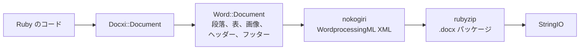

<!-- Translated from README.md (git blob 08aeefecb2eaa6ce543fc23576be90e5767dfaf8). See docs/i18n/TRANSLATION_GUIDE.md. -->

# docxi：Ruby で Word（.docx）文書を生成

[](https://rubygems.org/gems/docxi)
[](https://github.com/hammad417/docxi/actions/workflows/ci.yml)
[](https://rubygems.org/gems/docxi)
[](https://rubygems.org/gems/docxi)
[](../../LICENSE)

[English](../../README.md) · [简体中文](README.zh-CN.md) · [繁體中文](README.zh-TW.md) · [Español](README.es.md) · [العربية](README.ar.md) · [Français](README.fr.md) · [Português (Brasil)](README.pt-BR.md) · [Deutsch](README.de.md) · [हिन्दी](README.hi.md) · [日本語](README.ja.md) · [한국어](README.ko.md) · [Русский](README.ru.md) · [Bahasa Indonesia](README.id.md) · [Türkçe](README.tr.md) · [Italiano](README.it.md) · [Tiếng Việt](README.vi.md)

> これは英語版 [README](../../README.md) の翻訳です。内容に食い違いがある場合は英語版が正となります。

docxi は、コードから Microsoft Word の `.docx` ファイルを生成する Ruby の gem です。ブロックベースの小さな DSL で文書の内容（段落、書式付きテキスト、表、画像、ヘッダーとフッター、ページ番号、ハイパーリンク）を記述すると、docxi が Office Open XML パッケージを書き出します。Microsoft Word や LibreOffice、テンプレートファイルは不要で、普通の Ruby スクリプトでも Ruby on Rails アプリケーションでも動作します。

```ruby
require "docxi"

word = Docxi::Document.new
word.document.p { |p| p.text "Hello from docxi", bold: true, size: 16 }
File.binwrite("hello.docx", word.render.string)
```

## <a id="contents"></a>目次

- [概要](#overview)
- [機能](#features)
- [技術スタック](#technology-stack)
- [インストール](#installation)
- [クイックスタート](#quick-start)
- [使用例](#usage-examples)
- [設定](#configuration)
- [仕組み](#how-it-works)
- [API の概要](#api-at-a-glance)
- [対応プラットフォーム](#supported-platforms)
- [主なユースケース](#common-use-cases)
- [トラブルシューティング](#troubleshooting)
- [よくある質問](#faq)
- [ドキュメント](#documentation)
- [コントリビュート](#contributing)
- [セキュリティ](#security)
- [ライセンス](#license)
- [メンテナー](#maintainers)

## <a id="overview"></a>概要

アプリケーションから Word 文書を生成するとなると、テンプレートを埋める、オフィススイートを自動操作する、あるいは HTML を変換してレイアウトが崩れないことを祈る、といった方法が一般的です。docxi は別のアプローチを取ります。Ruby で文書を要素ごとに組み立てると、完成した `.docx` ファイルを格納した `StringIO` が返ってきます。それをディスクに書き込んだり、メールに添付したり、Rails のコントローラーから送信したりできます。

自分たちのデータからレポートや手紙などの文書を Word 形式でエクスポートする必要がある、Ruby と Rails の開発者向けのライブラリです。実行時の依存関係は、XML を組み立てる [nokogiri](https://nokogiri.org/) と、それをパッケージ化する [rubyzip](https://github.com/rubyzip/rubyzip) の 2 つだけです。

## <a id="features"></a>機能

- **段落**：配置、背景の網かけ、左右のインデント、下罫線、箇条書きの項目
- **テキスト**：太字、斜体、下線、色、サイズ、フォント、背景の網かけ、空白の保持、改行
- **改行・改ページとタブ**：改行、改ページ、タブ文字
- **表**：列幅、行の高さ、表のインデント、セルごとの罫線・網かけ・垂直方向の配置、`colspan` と `rowspan` によるセルの結合
- **画像**：`File` などの IO オブジェクト、ファイルパス、`http(s)` の URL から読み込み、`120pt` のような CSS 形式のサイズでインライン配置
- **ヘッダーとフッター**：テキスト、表、ヘッダー内の画像、ページ番号、そして 1 ページ目専用のヘッダーとフッター
- **目次**：点線（または別の文字）のリーダーと右揃えのページ番号を持つ行。ページ番号は自分で指定します
- **ハイパーリンク**：外部 URL へのリンク
- **テキストフレーム**（テキストボックス）
- **ページの余白**
- **Zip64 を含まない出力**：rubyzip 3 を使っても、アーカイブは Zip64 レコードなしで書き出されます。Google Docs や古いバージョンの LibreOffice は、このレコードを含むファイルを開けません

### <a id="limitations-and-known-issues"></a>制限事項と既知の問題

docxi は新しい文書を作成するだけです。既存の `.docx` を開いたり編集したりすること、テンプレートへの差し込み、差し込み印刷はできません。番号付きリスト、見出しスタイル、自動生成される目次はなく、ページサイズは縦向きの US Letter に固定されています。

以下の問題は既知のもので、0.2.0 での修正を予定しています。

- `pH`/`pV` で配置した画像、ヘッダー内の画像、表のセル内の画像は、サイズが `width * height` で計算されるため、想定よりかなり小さく表示されます。`style:` でサイズを指定したインライン画像には影響しません。
- 表全体に指定した `borders:` は、表の外枠ではなく各セルに適用されます。セルごとの `borders:` は正しく機能します。
- ページ番号のフィールドコードで、`\* MERGEFORMAT` のバックスラッシュが欠けています。
- 表のセル内のページ番号の前に "GlobalOptions" という文字列が付きます。
- 画像は常に PNG パーツとして保存され、`[Content_Types].xml` は最初の 2 つのヘッダーとフッターしか宣言しません。

## <a id="technology-stack"></a>技術スタック

| 構成要素 | 使用している技術 |
|---|---|
| 言語 | Ruby 2.5 以降 |
| XML | [nokogiri](https://nokogiri.org/) `>= 1.8, < 2` |
| パッケージング | [rubyzip](https://github.com/rubyzip/rubyzip) `>= 1.3, < 4` |
| 出力形式 | Office Open XML WordprocessingML（`.docx`） |
| テスト | Minitest。出力を前のリリースが生成したファイルと比較します |
| CI | Ubuntu 24.04 上の GitHub Actions と、LibreOffice による変換チェック |

## <a id="installation"></a>インストール

### <a id="prerequisites"></a>前提条件

- Ruby 2.5 以降
- Gemfile 経由でインストールする場合は Bundler
- nokogiri をインストールできるプラットフォーム。nokogiri は一般的な Linux、macOS、Windows 向けにビルド済みのバイナリを提供しています。

### <a id="install"></a>gem のインストール

Gemfile に docxi を追加します。

```ruby
gem "docxi", "~> 0.1"
```

そのあと `bundle install` を実行します。直接インストールすることもできます。

```sh
gem install docxi
```

0.0.x からのアップグレードにコードの変更は不要で、`bundle update docxi` を実行するだけです。0.1.0 は 0.0.6 と同じ文書を生成します。Ruby 2.5 より古いバージョンで動いているアプリケーションは、自動的に 0.0.6 のまま維持されます。

## <a id="quick-start"></a>クイックスタート

```ruby
require "docxi"

word = Docxi::Document.new
document = word.document

document.p(align: "center") do |p|
  p.text "Monthly report", size: 20, bold: true
end

document.p do |p|
  p.text "Generated with docxi on ", space: true
  p.text Time.now.strftime("%Y-%m-%d"), bold: true
end

File.binwrite("report.docx", word.render.string)
```

`word.render` は `StringIO` を返し、その `.string` が完成した `.docx` ファイルです。

## <a id="usage-examples"></a>使用例

以下の例はクイックスタートの続きで、同じ `word` と `document` を使います。

### <a id="formatted-text-and-bullet-lists"></a>書式付きテキストと箇条書き

```ruby
document.p do |p|
  p.text "Bold", bold: true
  p.text " italic", italic: true, space: true
  p.text " underlined", underline: true, space: true, br: true
  p.text "Dark red Georgia, 14 pt, on yellow", color: "8B0000", font: "Georgia", size: 14, fill: "FFFF00"
end

document.p(ul: true) { |p| p.text "First bullet" }
document.p(ul: true) { |p| p.text "Second bullet" }

document.p(align: "center", fill: "EEEEEE", bottom: true) do |p|
  p.text "Shaded, centered, with a bottom border"
end

document.br(page: true)
```

先頭または末尾に空白があるテキストには `space: true` を指定してください。指定しないと、Word がその空白を削除します。

### <a id="tables"></a>表

```ruby
document.table(columns_width: [240, 100, 100]) do |table|
  table.tr(fill: "D9D9D9", bold: true) do |tr|
    tr.tc { |tc| tc.text "Item" }
    tr.tc { |tc| tc.text "Qty" }
    tr.tc { |tc| tc.text "Price" }
  end

  table.tr do |tr|
    tr.tc(borders: { top: 4, right: 4, bottom: 4, left: 4 }) { |tc| tc.text "Widget" }
    tr.tc(valign: "center") { |tc| tc.text "2" }
    tr.tc { |tc| tc.text "$20.00", align: "right" }
  end

  table.tr do |tr|
    tr.tc(colspan: 2) { |tc| tc.text "Total", bold: true }
    tr.tc { |tc| tc.text "$20.00", align: "right", bold: true }
  end
end
```

`tr` に指定したオプションは、その行のすべてのセルに適用されます。セルを縦方向に結合するには、上のセルに `rowspan: true` を、そのすぐ下のセルに `merged: true` を渡します。

### <a id="images"></a>画像

```ruby
logo = document.add_media(File.open("logo.png", "rb"))
# add_media にはファイルパスや http(s) の URL も渡せます：
# logo = document.add_media("https://example.com/logo.png")

document.p(align: "center") do |p|
  p.image logo, style: { width: "120pt", height: "60pt" }
end
```

### <a id="headers-footers-and-page-numbers"></a>ヘッダー、フッター、ページ番号

```ruby
header = Docxi::Word::Headers::Header.new do |h|
  h.text "ACME Corp. quarterly report", size: 9, align: "right"
end

footer = Docxi::Word::Footers::Footer.new do |f|
  f.page_numbers name: "Page", align: "center"
end

document.add_header(header)
document.add_footer(footer)

# 1 ページ目には常に専用のヘッダーとフッターがあります：
document.add_first_header(Docxi::Word::Headers::Header.new { |h| h.text "Cover page" })
document.add_first_footer(Docxi::Word::Footers::Footer.new { |f| f.text "Confidential" })
```

### <a id="hyperlinks"></a>ハイパーリンク

```ruby
url = "https://github.com/hammad417/docxi"
link = document.add_hyperlink(url)

document.p { |p| p.hyperlink "docxi on GitHub", url, link }
```

### <a id="table-of-contents"></a>目次の追加

```ruby
document.text "Contents", size: 16, bold: true

document.table_of_content do |toc|
  toc.add_row "Introduction", 1
  toc.add_row "Results", 3
  toc.add_row "Appendix", 7, leader: "hyphen"
end
```

docxi はページ番号を計算しません。各行には渡した番号がそのまま表示されます。

### <a id="sending-a-document-from-rails"></a>Rails から文書を送信する

```ruby
class ReportsController < ApplicationController
  def show
    word = Docxi::Document.new
    word.document.p { |p| p.text "Report for #{Date.today}" }

    send_data word.render.string,
              filename: "report.docx",
              type: "application/vnd.openxmlformats-officedocument.wordprocessingml.document"
  end
end
```

### <a id="more-examples"></a>その他の例

[`examples/full_document.rb`](../../examples/full_document.rb) は、1 つの文書ですべての機能を使っています。Wiki の[使用例](https://github.com/hammad417/docxi/wiki/Usage-Examples-ja)ページには、レポート、請求書、手紙などの完全なサンプルがあります。このリポジトリのクローンで `bundle exec rake samples` を実行すると、テストスイートのサンプル文書が `tmp/samples/` に書き出されます。

## <a id="configuration"></a>設定

docxi には設定ファイルも環境変数もありません。ページの余白は文書を作成するときに指定します。

```ruby
# 値の単位は 1/20 ポイントです（1440 = 1 インチ）。上下左右の 4 つすべてを指定してください。
word = Docxi::Document.new(top: 1440, right: 1080, bottom: 1440, left: 1080, header: 720, footer: 720)
```

デフォルト値は `top: 720, right: 1440, bottom: 720, left: 1440, header: 190, footer: 200` です。余白を 1 つでも指定する場合は、`top`、`right`、`bottom`、`left` をまとめて指定してください。指定しなかった余白は空の値で書き出されます。

| オプション | 単位 |
|---|---|
| テキストの `size:` | ポイント |
| 余白、段落の `left:` と `right:` のインデント、表の `iwidth:` | 1/20 ポイント（1 インチ = 1440） |
| セルの `borders:` の太さ | 1/8 ポイント |
| `columns_width:` とセルの `width:` | 14.92 を掛けて 1/20 ポイントに換算されます。ほぼピクセルに相当します |
| 画像の `style:` | `"120pt"` のような CSS の長さ |

ページは縦向きの US Letter で、デフォルトのフォントは Arial 12 pt です。

## <a id="how-it-works"></a>仕組み



`Docxi::Document` は、リレーションシップ、コンテンツタイプ、文書プロパティといったパッケージレベルのパーツを保持します。`word.document` は `Docxi::Word::Document` で、追加した要素（`Docxi::Word::Contents::Paragraph`、`Table`、`Image`、`TableOfContent` など）に加えて、ヘッダー、フッター、画像、ハイパーリンク、スタイル、番号付け、テーマをまとめて管理します。`render` を呼ぶと、各パーツが nokogiri で自身の XML を組み立て、rubyzip で zip アーカイブに書き込まれます。`Docxi.write_entry` は各エントリのサイズをあらかじめ設定するため、rubyzip が Zip64 レコードを追加することはありません。

## <a id="api-at-a-glance"></a>API の概要

| 呼び出し | 追加されるもの |
|---|---|
| `Docxi::Document.new(margins)` | 新しい文書。`#render` は `.docx` を `StringIO` として返します |
| ブロック付きの `document.p(options)` | 段落。ブロック内では `text`、`br`、`tab`、`image`、`hyperlink`、`frame` が使えます |
| `document.text(string, options)` | テキストが 1 つだけの段落 |
| `document.br(page: true)` | 改ページ |
| ブロック付きの `document.table(options)` | 表。内部で `tr`、`tc` の順に使い、その中で `text`、`p`、`image`、`page_numbers` を使います |
| ブロック付きの `document.table_of_content(options)` | `add_row(text, page)` で追加する目次の行 |
| `document.add_media(file_path_or_url)` | `image` で配置する画像 |
| `document.add_hyperlink(url)` | `hyperlink` で使うリンク先 |
| `document.add_header(header)` と `add_first_header` | `Docxi::Word::Headers::Header` で作成したヘッダー |
| `document.add_footer(footer)` と `add_first_footer` | `Docxi::Word::Footers::Footer` で作成したフッター |
| `document.frame(text, options)` | テキストボックス |

## <a id="supported-platforms"></a>対応プラットフォーム

| 項目 | 対応状況 |
|---|---|
| Ruby | 2.5 以降。CI では Ruby 2.5、2.6、2.7、3.0、3.1、3.2、3.3、3.4、4.0 を実行しています |
| Rails | 必須ではありません。CI では Rails 5.2、6.0、6.1、7.0、7.1、7.2、8.0、8.1 を docxi と一緒に読み込んでいます |
| 依存関係 | CI では rubyzip 1.3、2.4、3.x と、nokogiri 1.11 から 1.19 までをカバーしています |
| OS | CI は Ubuntu 24.04 で実行しており、テストは macOS でも実行済みです。Windows ではテストしていません。 |
| 出力 | Microsoft Word 向けの `.docx`。CI では LibreOffice がサンプル文書を変換できることを確認しています |

## <a id="common-use-cases"></a>主なユースケース

- Rails アプリケーションのレポートを Word ファイルとしてエクスポートする
- データベースのレコードから手紙、証明書、請求書を生成する
- オフィススイートがインストールされていないバックグラウンドジョブやコマンドラインスクリプトで文書を作成する

## <a id="troubleshooting"></a>トラブルシューティング

**Rails 6 以降のアプリケーションに docxi を追加すると、Bundler が `nokogiri` の互換バージョンを見つけられない。**
docxi 0.0.6 は `nokogiri < 1.7` に固定されていますが、Rails 6.0 以降のすべてのバージョンは nokogiri 1.8.5 以降を必要とします。`gem "docxi", "~> 0.1"` を使ってください。

**Bundler が `rubyzip` の互換バージョンを見つけられない。**
docxi 0.0.6 は `rubyzip ~> 0.9.9` に固定されているため、より新しい rubyzip を必要とする gem と衝突します。docxi 0.1.0 は rubyzip 1.3 から 3.x で動作します。

**Rails の外で `NoMethodError: undefined method 'present?'` が発生する。**
docxi 0.0.6 は ActiveSupport が読み込まれていることを前提にしていました。0.1.0 ではその必要はありません。

**rubyzip 3 で生成したファイルを Google Docs や LibreOffice で開けない。**
rubyzip 3 と組み合わせた docxi 0.0.6 は、すべてのエントリに Zip64 レコードを書き込みます。0.1.0 はこれを含まないアーカイブを書き出します。

**Ruby 3 で画像の URL を指定すると `Errno::ENOENT` が発生する。**
docxi 0.0.6 は `Kernel#open` で URL を開いていましたが、Ruby 3 ではこのメソッドで URL を取得できなくなりました。0.1.0 は `URI#open` でダウンロードします。

**`tab`、`frame`、ヘッダーの `page_numbers` を呼ぶと `NameError` が発生する。**
これらは 0.0.6 では動作しませんでしたが、0.1.0 で修正されています。

**1 ページ目にヘッダーやフッターが表示されない。**
docxi は 1 ページ目に常に専用のヘッダーとフッターを設定します。`add_first_header` と `add_first_footer` で指定してください。

**ページの余白が欠けている。**
余白を指定するときは、`top`、`right`、`bottom`、`left` をまとめて渡してください。詳しくは[設定](#configuration)を参照してください。

## <a id="faq"></a>よくある質問

**Microsoft Word や LibreOffice のインストールは必要ですか？**
いいえ。docxi は XML と zip アーカイブを自分で書き出します。

**docxi には Rails が必要ですか？**
いいえ。どんな Ruby プログラムでも動作します。CI では Rails 5.2 から 8.1 を読み込んだ状態でもテストを実行しています。

**Ruby on Rails で Word 文書を生成するにはどうすればよいですか？**
コントローラーやバックグラウンドジョブの中で docxi を使って文書を組み立て、`word.render.string` を `send_data` で送信します。[Rails から文書を送信する](#sending-a-document-from-rails)を参照してください。

**docxi で既存の .docx を編集したり、Word のテンプレートに差し込んだりできますか？**
いいえ。docxi は新しい文書を作成するだけです。差し込みフィールドを含むテンプレートを使いたい場合は、sablon などのテンプレートベースの gem を使ってください。

**目次は見出しから自動生成されますか？**
いいえ。各行とそのページ番号は自分で追加します。

**ページのサイズや向きは変更できますか？**
現時点ではできません。ページは縦向きの US Letter で、変更できるのは余白だけです。

**どの画像形式が使えますか？**
画像は PNG パーツとして保存されるため、PNG ファイルを使うのが確実です。

**どのバージョンの Ruby と Rails に対応していますか？**
Ruby 2.5 以降です。Rails は任意で、CI では Rails 5.2 から 8.1 をテストしています。

## <a id="documentation"></a>ドキュメント

- [docxi Wiki](https://github.com/hammad417/docxi/wiki/Home-ja) では、すべてのオプションを解説し、さらに多くの例とトラブルシューティングを載せています
- [CHANGELOG.md](../../CHANGELOG.md) には各リリースの変更点が記載されています（英語）
- [examples/full_document.rb](../../examples/full_document.rb) は完全なサンプルです
- [docs/i18n](README.md) では、この README の翻訳状況を管理しています

## <a id="contributing"></a>コントリビュート

バグ報告やプルリクエストは [GitHub](https://github.com/hammad417/docxi/issues) で歓迎しています。docxi の開発を始めるには：

```sh
git clone https://github.com/hammad417/docxi.git
cd docxi
bundle install
bundle exec rake test
```

特定のバージョンの Rails を読み込んだ状態でテストを実行するには、`gemfiles/` にある Gemfile のいずれかを使います。

```sh
BUNDLE_GEMFILE=gemfiles/rails_8.1.gemfile bundle install
BUNDLE_GEMFILE=gemfiles/rails_8.1.gemfile DOCXI_WITH_RAILS=1 bundle exec rake test
```

`test/golden` には、0.0.6 が `test/support/sample_documents.rb` の文書に対して生成した XML が入っており、テストはすべての変更をこれと比較します。生成される XML を意図的に変更した場合は、`bundle exec rake golden` で更新し、プルリクエストで変更内容を説明してください。

## <a id="security"></a>セキュリティ

セキュリティ上の問題は公開の issue で報告せず、メンテナーにメールで連絡してください。メールアドレスは [docxi.gemspec](../../docxi.gemspec) に記載されています。

docxi 0.0.x をまだ使っている場合は、0.1.0 にアップグレードしてください。古いバージョンは画像パスの文字列を `Kernel#open` に渡しており、`|` で始まる文字列はシェルコマンドとして実行されてしまいます。

## <a id="license"></a>ライセンス

docxi は [MIT ライセンス](../../LICENSE) のもとで公開されています。ライセンスファイルには、docxi の元になった gem である docxer のオリジナルの著作権表示が残されています。

## <a id="maintainers"></a>メンテナー

docxi は [Phaedra Solutions](https://www.phaedrasolutions.com/) の [Hammad Maqbool](https://github.com/hammad417) がメンテナンスしています。2016 年に Timur Gabdrakipov による [docxer](https://github.com/gtimti/docxer) をもとに始まりました。

### <a id="about-phaedra-solutions"></a>Phaedra Solutions について

Phaedra Solutions は AI ファーストのソフトウェアエンジニアリング企業で、2013 年から企業向けにカスタムソフトウェアを開発しています。
