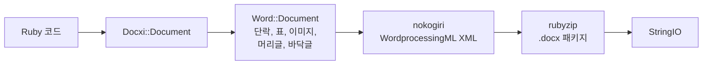

<!-- Translated from README.md (git blob 08aeefecb2eaa6ce543fc23576be90e5767dfaf8). See docs/i18n/TRANSLATION_GUIDE.md. -->

# docxi: Ruby로 Word(.docx) 문서 생성하기

[](https://rubygems.org/gems/docxi)
[](https://github.com/hammad417/docxi/actions/workflows/ci.yml)
[](https://rubygems.org/gems/docxi)
[](https://rubygems.org/gems/docxi)
[](../../LICENSE)

[English](../../README.md) · [简体中文](README.zh-CN.md) · [繁體中文](README.zh-TW.md) · [Español](README.es.md) · [العربية](README.ar.md) · [Français](README.fr.md) · [Português (Brasil)](README.pt-BR.md) · [Deutsch](README.de.md) · [हिन्दी](README.hi.md) · [日本語](README.ja.md) · [한국어](README.ko.md) · [Русский](README.ru.md) · [Bahasa Indonesia](README.id.md) · [Türkçe](README.tr.md) · [Italiano](README.it.md) · [Tiếng Việt](README.vi.md)

> 이 문서는 영어 [README](../../README.md)를 번역한 것입니다. 내용이 서로 다르면 영어 버전을 기준으로 합니다.

docxi는 코드로 Microsoft Word `.docx` 파일을 만드는 Ruby gem입니다. 블록 기반의 작은 DSL로 문서(단락, 서식 있는 텍스트, 표, 이미지, 머리글과 바닥글, 페이지 번호, 하이퍼링크)를 기술하면 docxi가 Office Open XML 패키지를 작성합니다. Microsoft Word나 LibreOffice, 템플릿 파일이 필요 없으며, 일반 Ruby 스크립트와 Ruby on Rails 애플리케이션 모두에서 동작합니다.

```ruby
require "docxi"

word = Docxi::Document.new
word.document.p { |p| p.text "Hello from docxi", bold: true, size: 16 }
File.binwrite("hello.docx", word.render.string)
```

## <a id="contents"></a>목차

- [개요](#overview)
- [기능](#features)
- [기술 스택](#technology-stack)
- [설치](#installation)
- [빠른 시작](#quick-start)
- [사용 예제](#usage-examples)
- [설정](#configuration)
- [동작 방식](#how-it-works)
- [API 한눈에 보기](#api-at-a-glance)
- [지원 플랫폼](#supported-platforms)
- [주요 사용 사례](#common-use-cases)
- [문제 해결](#troubleshooting)
- [자주 묻는 질문](#faq)
- [문서](#documentation)
- [기여하기](#contributing)
- [보안](#security)
- [라이선스](#license)
- [메인테이너](#maintainers)

## <a id="overview"></a>개요

애플리케이션에서 Word 문서를 생성한다고 하면 보통 템플릿을 채우거나, 오피스 제품군을 자동화하거나, HTML을 변환한 뒤 레이아웃이 깨지지 않기를 바라는 방법을 떠올립니다. docxi는 다른 길을 택합니다. Ruby로 문서를 요소 하나하나 조립하면 완성된 `.docx` 파일이 담긴 `StringIO`를 돌려받고, 이를 디스크에 저장하거나 이메일에 첨부하거나 Rails 컨트롤러에서 바로 전송할 수 있습니다.

자체 데이터로 보고서, 편지 같은 문서를 Word 형식으로 내보내야 하는 Ruby 및 Rails 개발자를 위한 라이브러리입니다. 런타임 의존성은 XML을 생성하는 [nokogiri](https://nokogiri.org/)와 이를 패키징하는 [rubyzip](https://github.com/rubyzip/rubyzip) 두 가지뿐입니다.

## <a id="features"></a>기능

- **단락**: 정렬, 배경 음영, 왼쪽·오른쪽 들여쓰기, 아래쪽 테두리, 글머리 기호 목록 항목
- **텍스트**: 굵게, 기울임꼴, 밑줄, 색, 크기, 글꼴, 배경 음영, 공백 유지, 줄 바꿈
- **나누기와 탭**: 줄 바꿈, 페이지 나누기, 탭 문자
- **표**: 열 너비, 행 높이, 표 들여쓰기, 셀별 테두리·음영·세로 맞춤, `colspan`과 `rowspan`을 이용한 셀 병합
- **이미지**: `File` 같은 IO 객체, 파일 경로, `http(s)` URL에서 가져와 `120pt`처럼 CSS 방식으로 크기를 지정해 인라인으로 배치
- **머리글과 바닥글**: 텍스트, 표, 머리글 안의 이미지, 페이지 번호, 첫 페이지 전용 머리글과 바닥글
- **목차**: 점선(또는 다른 문자) 채움선과 오른쪽 정렬된 페이지 번호가 있는 행. 페이지 번호는 직접 지정합니다
- 외부 URL로 연결되는 **하이퍼링크**
- **텍스트 프레임**(텍스트 상자)
- **페이지 여백**
- **Zip64 없는 출력**: rubyzip 3을 사용해도 Zip64 레코드 없이 아카이브를 작성합니다. Google Docs와 이전 버전의 LibreOffice는 이 레코드가 들어 있는 파일을 열지 못합니다

### <a id="limitations-and-known-issues"></a>제한 사항과 알려진 문제

docxi는 새 문서만 만듭니다. 기존 `.docx`를 열거나 편집할 수 없고, 템플릿을 채우거나 편지 병합을 실행할 수도 없습니다. 번호 매기기 목록, 제목 스타일, 자동 생성 목차는 없으며 페이지 크기는 세로 방향의 US Letter로 고정되어 있습니다.

다음 문제는 알려져 있으며 0.2.0에서 수정할 예정입니다.

- `pH`/`pV`로 배치한 이미지, 머리글의 이미지, 표 셀 안의 이미지는 크기를 `width * height`로 계산하기 때문에 예상보다 훨씬 작게 나옵니다. `style:`로 크기를 지정한 인라인 이미지는 영향을 받지 않습니다.
- 표 수준의 `borders:`는 표의 바깥 테두리가 아니라 모든 셀에 적용됩니다. 셀별 `borders:`는 정상적으로 동작합니다.
- 페이지 번호 필드 코드에서 `\* MERGEFORMAT`의 백슬래시가 빠져 있습니다.
- 표 셀 안의 페이지 번호 앞에 "GlobalOptions"라는 텍스트가 붙습니다.
- 이미지는 항상 PNG 파트로 저장되며, `[Content_Types].xml`은 처음 두 개의 머리글과 바닥글만 선언합니다.

## <a id="technology-stack"></a>기술 스택

| 구성 요소 | 사용 기술 |
|---|---|
| 언어 | Ruby 2.5 이상 |
| XML | [nokogiri](https://nokogiri.org/) `>= 1.8, < 2` |
| 패키징 | [rubyzip](https://github.com/rubyzip/rubyzip) `>= 1.3, < 4` |
| 출력 형식 | Office Open XML WordprocessingML(`.docx`) |
| 테스트 | Minitest. 이전 릴리스가 생성한 파일과 출력을 비교합니다 |
| CI | Ubuntu 24.04의 GitHub Actions와 LibreOffice 변환 검사 |

## <a id="installation"></a>설치

### <a id="prerequisites"></a>사전 요구 사항

- Ruby 2.5 이상
- Gemfile로 설치하는 경우 Bundler
- nokogiri를 설치할 수 있는 플랫폼. nokogiri는 일반적인 Linux, macOS, Windows 플랫폼용 사전 컴파일 빌드를 제공합니다.

### <a id="install"></a>gem 설치

Gemfile에 docxi를 추가하고:

```ruby
gem "docxi", "~> 0.1"
```

`bundle install`을 실행합니다. 직접 설치할 수도 있습니다.

```sh
gem install docxi
```

0.0.x에서 업그레이드할 때 코드를 바꿀 필요는 없으며, `bundle update docxi`만 실행하면 됩니다. 0.1.0은 0.0.6과 똑같은 문서를 생성합니다. Ruby 2.5보다 오래된 버전을 쓰는 애플리케이션은 자동으로 0.0.6에 머무릅니다.

## <a id="quick-start"></a>빠른 시작

```ruby
require "docxi"

word = Docxi::Document.new
document = word.document

document.p(align: "center") do |p|
  p.text "Monthly report", size: 20, bold: true
end

document.p do |p|
  p.text "Generated with docxi on ", space: true
  p.text Time.now.strftime("%Y-%m-%d"), bold: true
end

File.binwrite("report.docx", word.render.string)
```

`word.render`는 `StringIO`를 반환하며, 그 `.string`이 완성된 `.docx` 파일입니다.

## <a id="usage-examples"></a>사용 예제

다음 예제는 빠른 시작에서 이어지며, 같은 `word`와 `document`를 사용합니다.

### <a id="formatted-text-and-bullet-lists"></a>서식 있는 텍스트와 글머리 기호 목록

```ruby
document.p do |p|
  p.text "Bold", bold: true
  p.text " italic", italic: true, space: true
  p.text " underlined", underline: true, space: true, br: true
  p.text "Dark red Georgia, 14 pt, on yellow", color: "8B0000", font: "Georgia", size: 14, fill: "FFFF00"
end

document.p(ul: true) { |p| p.text "First bullet" }
document.p(ul: true) { |p| p.text "Second bullet" }

document.p(align: "center", fill: "EEEEEE", bottom: true) do |p|
  p.text "Shaded, centered, with a bottom border"
end

document.br(page: true)
```

공백으로 시작하거나 끝나는 텍스트에는 `space: true`를 지정하세요. 그렇지 않으면 Word가 그 공백을 지웁니다.

### <a id="tables"></a>표

```ruby
document.table(columns_width: [240, 100, 100]) do |table|
  table.tr(fill: "D9D9D9", bold: true) do |tr|
    tr.tc { |tc| tc.text "Item" }
    tr.tc { |tc| tc.text "Qty" }
    tr.tc { |tc| tc.text "Price" }
  end

  table.tr do |tr|
    tr.tc(borders: { top: 4, right: 4, bottom: 4, left: 4 }) { |tc| tc.text "Widget" }
    tr.tc(valign: "center") { |tc| tc.text "2" }
    tr.tc { |tc| tc.text "$20.00", align: "right" }
  end

  table.tr do |tr|
    tr.tc(colspan: 2) { |tc| tc.text "Total", bold: true }
    tr.tc { |tc| tc.text "$20.00", align: "right", bold: true }
  end
end
```

`tr`에 지정한 옵션은 그 행의 모든 셀에 적용됩니다. 셀을 세로로 병합하려면 위쪽 셀에 `rowspan: true`를, 바로 아래 셀에 `merged: true`를 전달합니다.

### <a id="images"></a>이미지

```ruby
logo = document.add_media(File.open("logo.png", "rb"))
# add_media에는 파일 경로나 http(s) URL도 전달할 수 있습니다:
# logo = document.add_media("https://example.com/logo.png")

document.p(align: "center") do |p|
  p.image logo, style: { width: "120pt", height: "60pt" }
end
```

### <a id="headers-footers-and-page-numbers"></a>머리글, 바닥글, 페이지 번호

```ruby
header = Docxi::Word::Headers::Header.new do |h|
  h.text "ACME Corp. quarterly report", size: 9, align: "right"
end

footer = Docxi::Word::Footers::Footer.new do |f|
  f.page_numbers name: "Page", align: "center"
end

document.add_header(header)
document.add_footer(footer)

# 첫 페이지에는 항상 전용 머리글과 바닥글이 있습니다:
document.add_first_header(Docxi::Word::Headers::Header.new { |h| h.text "Cover page" })
document.add_first_footer(Docxi::Word::Footers::Footer.new { |f| f.text "Confidential" })
```

### <a id="hyperlinks"></a>하이퍼링크

```ruby
url = "https://github.com/hammad417/docxi"
link = document.add_hyperlink(url)

document.p { |p| p.hyperlink "docxi on GitHub", url, link }
```

### <a id="table-of-contents"></a>목차 추가

```ruby
document.text "Contents", size: 16, bold: true

document.table_of_content do |toc|
  toc.add_row "Introduction", 1
  toc.add_row "Results", 3
  toc.add_row "Appendix", 7, leader: "hyphen"
end
```

docxi는 페이지 번호를 계산하지 않습니다. 각 행에는 전달한 번호가 그대로 표시됩니다.

### <a id="sending-a-document-from-rails"></a>Rails에서 문서 보내기

```ruby
class ReportsController < ApplicationController
  def show
    word = Docxi::Document.new
    word.document.p { |p| p.text "Report for #{Date.today}" }

    send_data word.render.string,
              filename: "report.docx",
              type: "application/vnd.openxmlformats-officedocument.wordprocessingml.document"
  end
end
```

### <a id="more-examples"></a>더 많은 예제

[`examples/full_document.rb`](../../examples/full_document.rb)는 하나의 문서에서 모든 기능을 사용합니다. 위키의 [사용 예제](https://github.com/hammad417/docxi/wiki/Usage-Examples-ko) 페이지에는 보고서, 청구서, 편지 같은 완전한 예제가 있습니다. 이 저장소를 클론한 뒤 `bundle exec rake samples`를 실행하면 테스트 스위트의 샘플 문서가 `tmp/samples/`에 작성됩니다.

## <a id="configuration"></a>설정

docxi에는 설정 파일이나 환경 변수가 없습니다. 페이지 여백은 문서를 만들 때 지정합니다.

```ruby
# 값의 단위는 1/20 포인트입니다(1440 = 1인치). 네 방향을 모두 지정하세요.
word = Docxi::Document.new(top: 1440, right: 1080, bottom: 1440, left: 1080, header: 720, footer: 720)
```

기본값은 `top: 720, right: 1440, bottom: 720, left: 1440, header: 190, footer: 200`입니다. 여백을 하나라도 지정한다면 `top`, `right`, `bottom`, `left`를 함께 지정하세요. 빠뜨린 여백은 빈 값으로 작성됩니다.

| 옵션 | 단위 |
|---|---|
| 텍스트의 `size:` | 포인트 |
| 여백, 단락의 `left:`·`right:` 들여쓰기, 표의 `iwidth:` | 1/20 포인트(1인치 = 1440) |
| 셀 `borders:`의 두께 | 1/8 포인트 |
| `columns_width:`와 셀의 `width:` | 14.92를 곱해 1/20 포인트로 환산하며, 픽셀과 비슷한 크기입니다 |
| 이미지의 `style:` | `"120pt"` 같은 CSS 길이 |

페이지는 세로 방향의 US Letter이며, 기본 글꼴은 Arial 12pt입니다.

## <a id="how-it-works"></a>동작 방식



`Docxi::Document`는 관계(relationships), 콘텐츠 형식, 문서 속성 같은 패키지 수준의 파트를 가지고 있습니다. `word.document`는 `Docxi::Word::Document`로, 추가한 요소(`Docxi::Word::Contents::Paragraph`, `Table`, `Image`, `TableOfContent` 등)와 함께 머리글, 바닥글, 이미지, 하이퍼링크, 스타일, 번호 매기기, 테마를 모아 둡니다. `render`를 호출하면 각 파트가 nokogiri로 자신의 XML을 만들고, rubyzip이 이를 zip 아카이브에 씁니다. `Docxi.write_entry`는 각 항목의 크기를 미리 설정하므로 rubyzip이 Zip64 레코드를 추가하지 않습니다.

## <a id="api-at-a-glance"></a>API 한눈에 보기

| 호출 | 추가되는 것 |
|---|---|
| `Docxi::Document.new(margins)` | 새 문서. `#render`는 `.docx`를 `StringIO`로 반환합니다 |
| 블록과 함께 쓰는 `document.p(options)` | 단락. 블록 안에서는 `text`, `br`, `tab`, `image`, `hyperlink`, `frame`을 사용합니다 |
| `document.text(string, options)` | 텍스트 하나로 된 단락 |
| `document.br(page: true)` | 페이지 나누기 |
| 블록과 함께 쓰는 `document.table(options)` | 표. 안에서 `tr`, `tc` 순으로 쓰고, 그 안에서 `text`, `p`, `image`, `page_numbers`를 사용합니다 |
| 블록과 함께 쓰는 `document.table_of_content(options)` | `add_row(text, page)`로 추가하는 목차 행 |
| `document.add_media(file_path_or_url)` | `image`로 배치할 이미지 |
| `document.add_hyperlink(url)` | `hyperlink`에 쓸 링크 대상 |
| `document.add_header(header)`와 `add_first_header` | `Docxi::Word::Headers::Header`로 만든 머리글 |
| `document.add_footer(footer)`와 `add_first_footer` | `Docxi::Word::Footers::Footer`로 만든 바닥글 |
| `document.frame(text, options)` | 텍스트 상자 |

## <a id="supported-platforms"></a>지원 플랫폼

| 영역 | 지원 범위 |
|---|---|
| Ruby | 2.5 이상. CI에서는 Ruby 2.5, 2.6, 2.7, 3.0, 3.1, 3.2, 3.3, 3.4, 4.0을 실행합니다 |
| Rails | 필수가 아닙니다. CI에서는 Rails 5.2, 6.0, 6.1, 7.0, 7.1, 7.2, 8.0, 8.1을 docxi와 함께 불러옵니다 |
| 의존성 | CI에서 rubyzip 1.3, 2.4, 3.x와 nokogiri 1.11부터 1.19까지를 다룹니다 |
| 운영체제 | CI는 Ubuntu 24.04에서 실행되며, 테스트는 macOS에서도 실행해 보았습니다. Windows에서는 테스트하지 않았습니다. |
| 출력 | Microsoft Word용 `.docx`. CI에서 LibreOffice가 샘플 문서를 변환할 수 있는지 확인합니다 |

## <a id="common-use-cases"></a>주요 사용 사례

- Rails 애플리케이션의 보고서를 Word 파일로 내보내기
- 데이터베이스 레코드로 편지, 증명서, 청구서 생성하기
- 오피스 제품군이 설치되지 않은 백그라운드 작업이나 명령줄 스크립트에서 문서 만들기

## <a id="troubleshooting"></a>문제 해결

**Rails 6 이상 애플리케이션에 docxi를 추가하면 Bundler가 호환되는 `nokogiri` 버전을 찾지 못합니다.**
docxi 0.0.6은 `nokogiri < 1.7`로 고정되어 있는데, Rails 6.0 이후의 모든 버전은 nokogiri 1.8.5 이상이 필요합니다. `gem "docxi", "~> 0.1"`을 사용하세요.

**Bundler가 호환되는 `rubyzip` 버전을 찾지 못합니다.**
docxi 0.0.6은 `rubyzip ~> 0.9.9`로 고정되어 있어, 더 새로운 rubyzip이 필요한 gem과 충돌합니다. docxi 0.1.0은 rubyzip 1.3부터 3.x까지 지원합니다.

**Rails 밖에서 `NoMethodError: undefined method 'present?'`가 발생합니다.**
docxi 0.0.6은 ActiveSupport가 로드되어 있다고 가정했습니다. 0.1.0은 그렇지 않습니다.

**rubyzip 3으로 생성한 파일이 Google Docs나 LibreOffice에서 열리지 않습니다.**
rubyzip 3과 함께 쓰는 docxi 0.0.6은 모든 항목에 Zip64 레코드를 씁니다. 0.1.0은 이 레코드 없이 아카이브를 작성합니다.

**Ruby 3에서 이미지 URL을 쓰면 `Errno::ENOENT`가 발생합니다.**
docxi 0.0.6은 `Kernel#open`으로 URL을 열었는데, Ruby 3에서는 이 메서드로 더 이상 URL을 가져올 수 없습니다. 0.1.0은 `URI#open`으로 내려받습니다.

**`tab`, `frame`, 머리글의 `page_numbers`를 호출하면 `NameError`가 발생합니다.**
이 기능들은 0.0.6에서 동작하지 않았고, 0.1.0에서 고쳐졌습니다.

**첫 페이지에 머리글이나 바닥글이 보이지 않습니다.**
docxi는 첫 페이지에 항상 전용 머리글과 바닥글을 둡니다. `add_first_header`와 `add_first_footer`로 지정하세요.

**페이지 여백 하나가 빠져 있습니다.**
여백을 지정할 때는 `top`, `right`, `bottom`, `left`를 함께 전달하세요. [설정](#configuration)을 참고하세요.

## <a id="faq"></a>자주 묻는 질문

**Microsoft Word나 LibreOffice를 설치해야 하나요?**
아니요. docxi가 XML과 zip 아카이브를 직접 작성합니다.

**docxi를 쓰려면 Rails가 필요한가요?**
아니요. 어떤 Ruby 프로그램에서든 동작합니다. CI에서는 Rails 5.2부터 8.1까지를 불러온 상태에서도 테스트를 실행합니다.

**Ruby on Rails에서 Word 문서를 생성하려면 어떻게 하나요?**
컨트롤러나 백그라운드 작업에서 docxi로 문서를 만든 뒤 `word.render.string`을 `send_data`로 보내면 됩니다. [Rails에서 문서 보내기](#sending-a-document-from-rails)를 참고하세요.

**docxi로 기존 .docx를 편집하거나 Word 템플릿을 채울 수 있나요?**
아니요. docxi는 새 문서만 만듭니다. 병합 필드가 있는 템플릿이 필요하다면 sablon 같은 템플릿 기반 gem을 사용하세요.

**목차가 제목에서 자동으로 생성되나요?**
아니요. 각 행과 그 페이지 번호는 직접 추가합니다.

**페이지 크기나 방향을 바꿀 수 있나요?**
아직은 안 됩니다. 페이지는 세로 방향의 US Letter이며, 여백만 바꿀 수 있습니다.

**어떤 이미지 형식을 쓸 수 있나요?**
이미지는 PNG 파트로 저장되므로 PNG 파일이 가장 안전합니다.

**어떤 버전의 Ruby와 Rails를 지원하나요?**
Ruby 2.5 이상입니다. Rails는 선택 사항이며, CI에서 Rails 5.2부터 8.1까지 테스트합니다.

## <a id="documentation"></a>문서

- [docxi 위키](https://github.com/hammad417/docxi/wiki/Home-ko)에서 모든 옵션과 더 많은 예제, 문제 해결 방법을 설명합니다
- [CHANGELOG.md](../../CHANGELOG.md)에는 릴리스별 변경 사항이 정리되어 있습니다(영어)
- [examples/full_document.rb](../../examples/full_document.rb)는 전체 예제입니다
- [docs/i18n](README.md)에서 이 README의 번역 현황을 관리합니다

## <a id="contributing"></a>기여하기

버그 신고와 풀 리퀘스트는 [GitHub](https://github.com/hammad417/docxi/issues)에서 환영합니다. docxi 개발을 시작하려면:

```sh
git clone https://github.com/hammad417/docxi.git
cd docxi
bundle install
bundle exec rake test
```

특정 버전의 Rails를 불러온 상태로 테스트를 실행하려면 `gemfiles/`에 있는 Gemfile 중 하나를 사용하세요.

```sh
BUNDLE_GEMFILE=gemfiles/rails_8.1.gemfile bundle install
BUNDLE_GEMFILE=gemfiles/rails_8.1.gemfile DOCXI_WITH_RAILS=1 bundle exec rake test
```

`test/golden`에는 0.0.6이 `test/support/sample_documents.rb`의 문서에 대해 생성한 XML이 들어 있으며, 테스트는 모든 변경을 이와 비교합니다. 생성되는 XML을 의도적으로 바꿨다면 `bundle exec rake golden`으로 갱신하고, 풀 리퀘스트에서 변경 내용을 설명해 주세요.

## <a id="security"></a>보안

보안 문제는 공개 issue로 신고하지 말고 메인테이너에게 이메일로 알려 주세요. 이메일 주소는 [docxi.gemspec](../../docxi.gemspec)에 있습니다.

아직 docxi 0.0.x를 쓰고 있다면 0.1.0으로 업그레이드하세요. 이전 버전은 이미지 경로 문자열을 `Kernel#open`에 넘기는데, 이 메서드는 `|`로 시작하는 문자열을 셸 명령으로 실행합니다.

## <a id="license"></a>라이선스

docxi는 [MIT 라이선스](../../LICENSE)로 배포됩니다. 라이선스 파일에는 docxi의 바탕이 된 gem인 docxer의 원래 저작권 고지가 그대로 남아 있습니다.

## <a id="maintainers"></a>메인테이너

docxi는 [Phaedra Solutions](https://www.phaedrasolutions.com/)의 [Hammad Maqbool](https://github.com/hammad417)이 유지 관리하고 있습니다. 2016년 Timur Gabdrakipov가 만든 [docxer](https://github.com/gtimti/docxer)에서 출발했습니다.

### <a id="about-phaedra-solutions"></a>Phaedra Solutions 소개

Phaedra Solutions는 AI 중심의 소프트웨어 엔지니어링 회사로, 2013년부터 기업을 위한 맞춤형 소프트웨어를 개발해 왔습니다.
