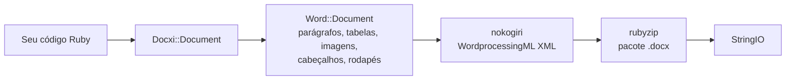

<!-- Translated from README.md (git blob 08aeefecb2eaa6ce543fc23576be90e5767dfaf8). See docs/i18n/TRANSLATION_GUIDE.md. -->

# docxi: gere documentos Word (.docx) com Ruby

[](https://rubygems.org/gems/docxi)
[](https://github.com/hammad417/docxi/actions/workflows/ci.yml)
[](https://rubygems.org/gems/docxi)
[](https://rubygems.org/gems/docxi)
[](../../LICENSE)

[English](../../README.md) · [简体中文](README.zh-CN.md) · [繁體中文](README.zh-TW.md) · [Español](README.es.md) · [العربية](README.ar.md) · [Français](README.fr.md) · [Português (Brasil)](README.pt-BR.md) · [Deutsch](README.de.md) · [हिन्दी](README.hi.md) · [日本語](README.ja.md) · [한국어](README.ko.md) · [Русский](README.ru.md) · [Bahasa Indonesia](README.id.md) · [Türkçe](README.tr.md) · [Italiano](README.it.md) · [Tiếng Việt](README.vi.md)

> Esta é uma tradução do [README](../../README.md) em inglês. Em caso de divergência, vale a versão em inglês.

docxi é uma gem Ruby que gera arquivos `.docx` do Microsoft Word a partir de código. Você descreve o documento com uma pequena DSL baseada em blocos (parágrafos, texto formatado, tabelas, imagens, cabeçalhos e rodapés, números de página, hiperlinks) e o docxi escreve o pacote Office Open XML. Ele não precisa do Microsoft Word, do LibreOffice nem de um arquivo de modelo, e funciona tanto em scripts Ruby simples quanto em aplicações Ruby on Rails.

```ruby
require "docxi"

word = Docxi::Document.new
word.document.p { |p| p.text "Hello from docxi", bold: true, size: 16 }
File.binwrite("hello.docx", word.render.string)
```

## <a id="contents"></a>Conteúdo

- [Visão geral](#overview)
- [Recursos](#features)
- [Tecnologias](#technology-stack)
- [Instalação](#installation)
- [Início rápido](#quick-start)
- [Exemplos de uso](#usage-examples)
- [Configuração](#configuration)
- [Como funciona](#how-it-works)
- [A API em resumo](#api-at-a-glance)
- [Plataformas suportadas](#supported-platforms)
- [Casos de uso comuns](#common-use-cases)
- [Solução de problemas](#troubleshooting)
- [Perguntas frequentes](#faq)
- [Documentação](#documentation)
- [Como contribuir](#contributing)
- [Segurança](#security)
- [Licença](#license)
- [Mantenedores](#maintainers)

## <a id="overview"></a>Visão geral

Gerar um documento do Word a partir de uma aplicação costuma significar preencher um modelo, automatizar um pacote de escritório ou converter HTML e torcer para o layout sobreviver. O docxi segue outro caminho: você monta o documento em Ruby, elemento por elemento, e recebe um `StringIO` com um arquivo `.docx` completo, que pode ser gravado em disco, anexado a um e-mail ou enviado por um controller do Rails.

Ele foi pensado para desenvolvedores Ruby e Rails que precisam exportar relatórios, cartas ou outros documentos no formato Word a partir dos próprios dados. As únicas dependências em tempo de execução são o [nokogiri](https://nokogiri.org/), que monta o XML, e o [rubyzip](https://github.com/rubyzip/rubyzip), que o empacota.

## <a id="features"></a>Recursos

- **Parágrafos**: alinhamento, sombreamento de fundo, recuo à esquerda e à direita, borda inferior e itens de lista com marcadores
- **Texto**: negrito, itálico, sublinhado, cor, tamanho, fonte, sombreamento de fundo, espaços preservados e quebras de linha
- **Quebras e tabulações**: quebras de linha, quebras de página e caracteres de tabulação
- **Tabelas**: largura das colunas, altura das linhas, recuo da tabela, bordas, sombreamento e alinhamento vertical por célula, e células mescladas com `colspan` e `rowspan`
- **Imagens**: a partir de um objeto IO como um `File`, de um caminho de arquivo ou de uma URL `http(s)`, inseridas na linha com um tamanho no estilo CSS, como `120pt`
- **Cabeçalhos e rodapés**: texto, tabelas, imagens nos cabeçalhos, números de página e um cabeçalho e um rodapé próprios para a primeira página
- **Sumário**: linhas com preenchimento pontilhado (ou outro caractere) e números de página alinhados à direita, informados por você
- **Hiperlinks** para URLs externas
- **Quadros de texto** (caixas de texto)
- **Margens da página**
- **Saída sem Zip64**: os arquivos são gravados sem registros Zip64 mesmo com o rubyzip 3; o Google Docs e versões antigas do LibreOffice se recusam a abrir arquivos que os contenham

### <a id="limitations-and-known-issues"></a>Limitações e problemas conhecidos

O docxi só cria documentos novos. Ele não consegue abrir nem editar um `.docx` existente, preencher um modelo ou fazer mala direta. Não há listas numeradas, estilos de título nem sumários gerados automaticamente, e o tamanho da página é fixo em US Letter, na orientação retrato.

Estes problemas são conhecidos e a correção está prevista para a versão 0.2.0:

- Imagens posicionadas com `pH`/`pV`, imagens em cabeçalhos e imagens em células de tabela calculam o tamanho com `width * height`, por isso saem muito menores do que o esperado. Imagens na linha com tamanho definido por `style:` não são afetadas.
- Os `borders:` no nível da tabela são aplicados a cada célula, e não ao contorno da tabela. Os `borders:` por célula funcionam.
- O código do campo de número de página é gravado sem a barra invertida de `\* MERGEFORMAT`.
- Os números de página dentro de células de tabela vêm precedidos do texto "GlobalOptions".
- As imagens são sempre armazenadas como partes PNG, e o `[Content_Types].xml` só declara os dois primeiros cabeçalhos e rodapés.

## <a id="technology-stack"></a>Tecnologias

| Parte | O que usa |
|---|---|
| Linguagem | Ruby 2.5 ou mais recente |
| XML | [nokogiri](https://nokogiri.org/) `>= 1.8, < 2` |
| Empacotamento | [rubyzip](https://github.com/rubyzip/rubyzip) `>= 1.3, < 4` |
| Formato de saída | Office Open XML WordprocessingML (`.docx`) |
| Testes | Minitest, com a saída comparada a arquivos gerados pela versão anterior |
| CI | GitHub Actions no Ubuntu 24.04, além de uma verificação de conversão com o LibreOffice |

## <a id="installation"></a>Instalação

### <a id="prerequisites"></a>Pré-requisitos

- Ruby 2.5 ou mais recente
- Bundler, se você instalar por meio de um Gemfile
- Uma plataforma em que o nokogiri possa ser instalado. O nokogiri oferece builds pré-compilados para as plataformas Linux, macOS e Windows mais comuns.

### <a id="install"></a>Instalar a gem

Adicione o docxi ao seu Gemfile:

```ruby
gem "docxi", "~> 0.1"
```

e execute `bundle install`. Ou instale diretamente:

```sh
gem install docxi
```

Atualizar a partir da 0.0.x não exige mudanças no código: execute `bundle update docxi`. A versão 0.1.0 gera os mesmos documentos que a 0.0.6. Aplicações com uma versão do Ruby anterior à 2.5 continuam automaticamente na 0.0.6.

## <a id="quick-start"></a>Início rápido

```ruby
require "docxi"

word = Docxi::Document.new
document = word.document

document.p(align: "center") do |p|
  p.text "Monthly report", size: 20, bold: true
end

document.p do |p|
  p.text "Generated with docxi on ", space: true
  p.text Time.now.strftime("%Y-%m-%d"), bold: true
end

File.binwrite("report.docx", word.render.string)
```

`word.render` retorna um `StringIO`, e o seu `.string` é o arquivo `.docx` completo.

## <a id="usage-examples"></a>Exemplos de uso

Os exemplos continuam a partir do início rápido, usando os mesmos `word` e `document`.

### <a id="formatted-text-and-bullet-lists"></a>Texto formatado e listas com marcadores

```ruby
document.p do |p|
  p.text "Bold", bold: true
  p.text " italic", italic: true, space: true
  p.text " underlined", underline: true, space: true, br: true
  p.text "Dark red Georgia, 14 pt, on yellow", color: "8B0000", font: "Georgia", size: 14, fill: "FFFF00"
end

document.p(ul: true) { |p| p.text "First bullet" }
document.p(ul: true) { |p| p.text "Second bullet" }

document.p(align: "center", fill: "EEEEEE", bottom: true) do |p|
  p.text "Shaded, centered, with a bottom border"
end

document.br(page: true)
```

Use `space: true` em textos que começam ou terminam com espaço; caso contrário, o Word descarta esse espaço.

### <a id="tables"></a>Tabelas

```ruby
document.table(columns_width: [240, 100, 100]) do |table|
  table.tr(fill: "D9D9D9", bold: true) do |tr|
    tr.tc { |tc| tc.text "Item" }
    tr.tc { |tc| tc.text "Qty" }
    tr.tc { |tc| tc.text "Price" }
  end

  table.tr do |tr|
    tr.tc(borders: { top: 4, right: 4, bottom: 4, left: 4 }) { |tc| tc.text "Widget" }
    tr.tc(valign: "center") { |tc| tc.text "2" }
    tr.tc { |tc| tc.text "$20.00", align: "right" }
  end

  table.tr do |tr|
    tr.tc(colspan: 2) { |tc| tc.text "Total", bold: true }
    tr.tc { |tc| tc.text "$20.00", align: "right", bold: true }
  end
end
```

As opções de `tr` valem para todas as células da linha. Para mesclar células na vertical, passe `rowspan: true` para a célula de cima e `merged: true` para a célula logo abaixo dela.

### <a id="images"></a>Imagens

```ruby
logo = document.add_media(File.open("logo.png", "rb"))
# add_media também aceita um caminho de arquivo ou uma URL http(s):
# logo = document.add_media("https://example.com/logo.png")

document.p(align: "center") do |p|
  p.image logo, style: { width: "120pt", height: "60pt" }
end
```

### <a id="headers-footers-and-page-numbers"></a>Cabeçalhos, rodapés e números de página

```ruby
header = Docxi::Word::Headers::Header.new do |h|
  h.text "ACME Corp. quarterly report", size: 9, align: "right"
end

footer = Docxi::Word::Footers::Footer.new do |f|
  f.page_numbers name: "Page", align: "center"
end

document.add_header(header)
document.add_footer(footer)

# A primeira página sempre tem cabeçalho e rodapé próprios:
document.add_first_header(Docxi::Word::Headers::Header.new { |h| h.text "Cover page" })
document.add_first_footer(Docxi::Word::Footers::Footer.new { |f| f.text "Confidential" })
```

### <a id="hyperlinks"></a>Hiperlinks

```ruby
url = "https://github.com/hammad417/docxi"
link = document.add_hyperlink(url)

document.p { |p| p.hyperlink "docxi on GitHub", url, link }
```

### <a id="table-of-contents"></a>Sumário

```ruby
document.text "Contents", size: 16, bold: true

document.table_of_content do |toc|
  toc.add_row "Introduction", 1
  toc.add_row "Results", 3
  toc.add_row "Appendix", 7, leader: "hyphen"
end
```

O docxi não calcula números de página. As linhas mostram os números que você informar.

### <a id="sending-a-document-from-rails"></a>Enviando um documento pelo Rails

```ruby
class ReportsController < ApplicationController
  def show
    word = Docxi::Document.new
    word.document.p { |p| p.text "Report for #{Date.today}" }

    send_data word.render.string,
              filename: "report.docx",
              type: "application/vnd.openxmlformats-officedocument.wordprocessingml.document"
  end
end
```

### <a id="more-examples"></a>Mais exemplos

[`examples/full_document.rb`](../../examples/full_document.rb) usa todos os recursos em um único documento, e a página [Exemplos de uso](https://github.com/hammad417/docxi/wiki/Usage-Examples-pt-BR) da wiki traz receitas completas, como um relatório, uma fatura e uma carta. Em um clone deste repositório, `bundle exec rake samples` grava em `tmp/samples/` os documentos de exemplo da suíte de testes.

## <a id="configuration"></a>Configuração

O docxi não tem arquivos de configuração nem variáveis de ambiente. As margens da página são definidas ao criar o documento:

```ruby
# Os valores são em vigésimos de ponto (1440 = 1 polegada). Informe os quatro lados.
word = Docxi::Document.new(top: 1440, right: 1080, bottom: 1440, left: 1080, header: 720, footer: 720)
```

Os valores padrão são `top: 720, right: 1440, bottom: 720, left: 1440, header: 190, footer: 200`. Se você definir qualquer margem, defina `top`, `right`, `bottom` e `left` juntas, porque as que ficarem de fora são gravadas vazias.

| Opção | Unidade |
|---|---|
| `size:` do texto | Pontos |
| Margens, recuos `left:` e `right:` do parágrafo, `iwidth:` da tabela | Vigésimos de ponto (1440 por polegada) |
| Espessura dos `borders:` da célula | Oitavos de ponto |
| `columns_width:` e `width:` da célula | Multiplicados por 14.92 para obter vigésimos de ponto, o que fica próximo de pixels |
| `style:` da imagem | Medidas CSS como `"120pt"` |

A página é US Letter na orientação retrato, e a fonte padrão é Arial 12 pt.

## <a id="how-it-works"></a>Como funciona



`Docxi::Document` guarda as partes no nível do pacote: relacionamentos, tipos de conteúdo e propriedades do documento. `word.document` é um `Docxi::Word::Document`, que reúne os elementos que você adiciona (`Docxi::Word::Contents::Paragraph`, `Table`, `Image`, `TableOfContent` e assim por diante), junto com cabeçalhos, rodapés, imagens, hiperlinks, estilos, numeração e o tema. Quando você chama `render`, cada parte monta seu XML com o nokogiri e é gravada em um arquivo zip com o rubyzip. `Docxi.write_entry` define de antemão o tamanho de cada entrada para que o rubyzip não adicione registros Zip64.

## <a id="api-at-a-glance"></a>A API em resumo

| Chamada | Adiciona |
|---|---|
| `Docxi::Document.new(margins)` | Um documento novo. `#render` retorna o `.docx` como um `StringIO` |
| `document.p(options)` com um bloco | Um parágrafo. Dentro do bloco: `text`, `br`, `tab`, `image`, `hyperlink`, `frame` |
| `document.text(string, options)` | Um parágrafo com um único trecho de texto |
| `document.br(page: true)` | Uma quebra de página |
| `document.table(options)` com um bloco | Uma tabela. Dentro: `tr`, depois `tc`, depois `text`, `p`, `image` ou `page_numbers` |
| `document.table_of_content(options)` com um bloco | Linhas do sumário adicionadas com `add_row(text, page)` |
| `document.add_media(file_path_or_url)` | Uma imagem para posicionar com `image` |
| `document.add_hyperlink(url)` | Um destino de link para usar com `hyperlink` |
| `document.add_header(header)` e `add_first_header` | Cabeçalhos montados com `Docxi::Word::Headers::Header` |
| `document.add_footer(footer)` e `add_first_footer` | Rodapés montados com `Docxi::Word::Footers::Footer` |
| `document.frame(text, options)` | Uma caixa de texto |

## <a id="supported-platforms"></a>Plataformas suportadas

| Área | Suporte |
|---|---|
| Ruby | 2.5 ou mais recente. A CI executa Ruby 2.5, 2.6, 2.7, 3.0, 3.1, 3.2, 3.3, 3.4 e 4.0 |
| Rails | Não é obrigatório. A CI carrega Rails 5.2, 6.0, 6.1, 7.0, 7.1, 7.2, 8.0 e 8.1 junto com o docxi |
| Dependências | A CI cobre rubyzip 1.3, 2.4 e 3.x, e nokogiri da 1.11 à 1.19 |
| Sistemas operacionais | A CI roda no Ubuntu 24.04, e os testes também já foram executados no macOS. O Windows não é testado. |
| Saída | `.docx` para o Microsoft Word. A CI verifica se o LibreOffice converte os documentos de exemplo |

## <a id="common-use-cases"></a>Casos de uso comuns

- Exportar relatórios de uma aplicação Rails como arquivos do Word
- Gerar cartas, certificados ou faturas a partir de registros do banco de dados
- Produzir documentos em jobs em segundo plano ou scripts de linha de comando, onde não há pacote de escritório instalado

## <a id="troubleshooting"></a>Solução de problemas

**O Bundler não encontra versões compatíveis de `nokogiri` ao adicionar o docxi a uma aplicação Rails 6 ou mais recente.**
O docxi 0.0.6 fixa `nokogiri < 1.7`, e todas as versões do Rails desde a 6.0 exigem o nokogiri 1.8.5 ou mais recente. Use `gem "docxi", "~> 0.1"`.

**O Bundler não encontra versões compatíveis de `rubyzip`.**
O docxi 0.0.6 fixa `rubyzip ~> 0.9.9`, o que entra em conflito com qualquer gem que precise de um rubyzip mais novo. O docxi 0.1.0 funciona com o rubyzip da 1.3 à 3.x.

**`NoMethodError: undefined method 'present?'` fora do Rails.**
O docxi 0.0.6 dependia de o ActiveSupport estar carregado. A 0.1.0 não depende.

**O Google Docs ou o LibreOffice não abrem um arquivo gerado com o rubyzip 3.**
O docxi 0.0.6 com o rubyzip 3 grava registros Zip64 em todas as entradas. A 0.1.0 grava os arquivos sem eles.

**URLs de imagens geram `Errno::ENOENT` no Ruby 3.**
O docxi 0.0.6 abria URLs com `Kernel#open`, que não baixa mais URLs no Ruby 3. A 0.1.0 as baixa com `URI#open`.

**`NameError` ao chamar `tab`, `frame` ou o `page_numbers` de um cabeçalho.**
Esses métodos não funcionavam na 0.0.6 e funcionam na 0.1.0.

**A primeira página não mostra o seu cabeçalho ou rodapé.**
O docxi sempre dá à primeira página um cabeçalho e um rodapé próprios. Defina-os com `add_first_header` e `add_first_footer`.

**Está faltando uma margem da página.**
Passe `top`, `right`, `bottom` e `left` juntos ao definir as margens. Veja [Configuração](#configuration).

## <a id="faq"></a>Perguntas frequentes

**Preciso ter o Microsoft Word ou o LibreOffice instalado?**
Não. O próprio docxi grava o XML e o arquivo zip.

**O docxi exige o Rails?**
Não. Ele funciona em qualquer programa Ruby. A CI também executa os testes com o Rails da 5.2 à 8.1 carregado.

**Como gerar um documento do Word no Ruby on Rails?**
Monte o documento com o docxi em um controller ou em um job em segundo plano e envie `word.render.string` com `send_data`. Veja [Enviando um documento pelo Rails](#sending-a-document-from-rails).

**O docxi consegue editar um .docx existente ou preencher um modelo do Word?**
Não. O docxi só cria documentos novos. Para modelos com campos de mesclagem, use uma gem baseada em modelos, como a sablon.

**O sumário é gerado a partir dos títulos?**
Não. Você adiciona cada linha e o número da página.

**Posso mudar o tamanho ou a orientação da página?**
Ainda não. As páginas são US Letter na orientação retrato, e só é possível alterar as margens.

**Quais formatos de imagem funcionam?**
As imagens são armazenadas como partes PNG, então arquivos PNG são a escolha mais segura.

**Quais versões do Ruby e do Rails são suportadas?**
Ruby 2.5 ou mais recente. O Rails é opcional, e a CI testa o Rails da 5.2 à 8.1.

## <a id="documentation"></a>Documentação

- A [wiki do docxi](https://github.com/hammad417/docxi/wiki/Home-pt-BR) explica todas as opções, com mais exemplos e solução de problemas
- [CHANGELOG.md](../../CHANGELOG.md) lista as mudanças de cada versão (em inglês)
- [examples/full_document.rb](../../examples/full_document.rb) é um exemplo completo
- [docs/i18n](README.md) acompanha o status das traduções deste README

## <a id="contributing"></a>Como contribuir

Relatos de bugs e pull requests são bem-vindos no [GitHub](https://github.com/hammad417/docxi/issues). Para trabalhar no docxi:

```sh
git clone https://github.com/hammad417/docxi.git
cd docxi
bundle install
bundle exec rake test
```

Para executar os testes com uma versão específica do Rails carregada, use um dos Gemfiles em `gemfiles/`:

```sh
BUNDLE_GEMFILE=gemfiles/rails_8.1.gemfile bundle install
BUNDLE_GEMFILE=gemfiles/rails_8.1.gemfile DOCXI_WITH_RAILS=1 bundle exec rake test
```

`test/golden` guarda o XML que a 0.0.6 gerou para os documentos de `test/support/sample_documents.rb`, e os testes comparam cada mudança com ele. Se você alterar o XML gerado de propósito, atualize-o com `bundle exec rake golden` e explique a mudança no seu pull request.

## <a id="security"></a>Segurança

Por favor, não relate problemas de segurança em issues públicas. Em vez disso, envie um e-mail ao mantenedor. Os endereços estão no [docxi.gemspec](../../docxi.gemspec).

Se você ainda usa o docxi 0.0.x, atualize para a 0.1.0. As versões anteriores repassam caminhos de imagens para `Kernel#open`, que executa como comandos de shell as strings que começam com `|`.

## <a id="license"></a>Licença

O docxi é distribuído sob a [Licença MIT](../../LICENSE). O arquivo de licença mantém o aviso de copyright original do docxer, a gem a partir da qual o docxi foi criado.

## <a id="maintainers"></a>Mantenedores

O docxi é mantido por [Hammad Maqbool](https://github.com/hammad417), da [Phaedra Solutions](https://www.phaedrasolutions.com/). O projeto começou em 2016 a partir do [docxer](https://github.com/gtimti/docxer), de Timur Gabdrakipov.

### <a id="about-phaedra-solutions"></a>Sobre a Phaedra Solutions

A Phaedra Solutions é uma empresa de engenharia de software com foco em IA que desenvolve software sob medida para empresas desde 2013.
