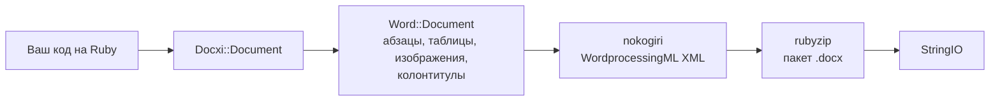

<!-- Translated from README.md (git blob 08aeefecb2eaa6ce543fc23576be90e5767dfaf8). See docs/i18n/TRANSLATION_GUIDE.md. -->

# docxi: создание документов Word (.docx) на Ruby

[](https://rubygems.org/gems/docxi)
[](https://github.com/hammad417/docxi/actions/workflows/ci.yml)
[](https://rubygems.org/gems/docxi)
[](https://rubygems.org/gems/docxi)
[](../../LICENSE)

[English](../../README.md) · [简体中文](README.zh-CN.md) · [繁體中文](README.zh-TW.md) · [Español](README.es.md) · [العربية](README.ar.md) · [Français](README.fr.md) · [Português (Brasil)](README.pt-BR.md) · [Deutsch](README.de.md) · [हिन्दी](README.hi.md) · [日本語](README.ja.md) · [한국어](README.ko.md) · [Русский](README.ru.md) · [Bahasa Indonesia](README.id.md) · [Türkçe](README.tr.md) · [Italiano](README.it.md) · [Tiếng Việt](README.vi.md)

> Это перевод английского [README](../../README.md). Если версии расходятся, верной считается английская.

docxi — это гем для Ruby, который создаёт файлы Microsoft Word в формате `.docx` из кода. Вы описываете документ с помощью небольшого DSL на блоках (абзацы, форматированный текст, таблицы, изображения, колонтитулы, номера страниц, гиперссылки), а docxi записывает пакет Office Open XML. Ему не нужны ни Microsoft Word, ни LibreOffice, ни файл шаблона, и он работает как в обычных скриптах на Ruby, так и в приложениях Ruby on Rails.

```ruby
require "docxi"

word = Docxi::Document.new
word.document.p { |p| p.text "Hello from docxi", bold: true, size: 16 }
File.binwrite("hello.docx", word.render.string)
```

## <a id="contents"></a>Содержание

- [Обзор](#overview)
- [Возможности](#features)
- [Технологии](#technology-stack)
- [Установка](#installation)
- [Быстрый старт](#quick-start)
- [Примеры использования](#usage-examples)
- [Настройка](#configuration)
- [Как это работает](#how-it-works)
- [API вкратце](#api-at-a-glance)
- [Поддерживаемые платформы](#supported-platforms)
- [Типичные сценарии](#common-use-cases)
- [Решение проблем](#troubleshooting)
- [Частые вопросы](#faq)
- [Документация](#documentation)
- [Участие в разработке](#contributing)
- [Безопасность](#security)
- [Лицензия](#license)
- [Сопровождающие](#maintainers)

## <a id="overview"></a>Обзор

Создать документ Word из приложения обычно означает заполнить шаблон, автоматизировать офисный пакет или сконвертировать HTML в надежде, что вёрстка не развалится. docxi идёт другим путём: вы собираете документ на Ruby элемент за элементом и получаете `StringIO` с готовым файлом `.docx`, который можно записать на диск, приложить к письму или отправить из контроллера Rails.

Гем рассчитан на разработчиков на Ruby и Rails, которым нужно выгружать отчёты, письма и другие документы в формате Word из собственных данных. Единственные зависимости времени выполнения — [nokogiri](https://nokogiri.org/), который строит XML, и [rubyzip](https://github.com/rubyzip/rubyzip), который его упаковывает.

## <a id="features"></a>Возможности

- **Абзацы**: выравнивание, заливка фона, отступы слева и справа, нижняя граница и пункты маркированного списка
- **Текст**: полужирный, курсив, подчёркивание, цвет, размер, шрифт, заливка фона, сохранение пробелов и разрывы строк
- **Разрывы и табуляция**: разрывы строк, разрывы страниц и символы табуляции
- **Таблицы**: ширина столбцов, высота строк, отступ таблицы, границы, заливка и вертикальное выравнивание для каждой ячейки, а также объединение ячеек с помощью `colspan` и `rowspan`
- **Изображения**: из IO-объекта, например `File`, из файла по пути или по URL `http(s)`, вставляются в текст с размером в стиле CSS, например `120pt`
- **Колонтитулы**: текст, таблицы, изображения в верхних колонтитулах, номера страниц и отдельные колонтитулы для первой страницы
- **Оглавление**: строки с точечным (или другим) заполнителем и номерами страниц, выровненными по правому краю, которые вы указываете сами
- **Гиперссылки** на внешние URL
- **Текстовые рамки** (надписи)
- **Поля страницы**
- **Вывод без Zip64**: архивы записываются без записей Zip64 даже с rubyzip 3; Google Docs и старые версии LibreOffice отказываются открывать файлы с такими записями

### <a id="limitations-and-known-issues"></a>Ограничения и известные проблемы

docxi только создаёт новые документы. Он не умеет открывать или редактировать существующий `.docx`, заполнять шаблон или выполнять слияние. Нумерованных списков, стилей заголовков и автоматически создаваемого оглавления нет, а формат страницы зафиксирован: US Letter, книжная ориентация.

Эти проблемы известны, их исправление запланировано на версию 0.2.0:

- Изображения, размещённые через `pH`/`pV`, изображения в верхних колонтитулах и изображения в ячейках таблиц вычисляют размер как `width * height`, поэтому получаются намного меньше ожидаемого. Изображения в тексте с размером из `style:` это не затрагивает.
- `borders:` на уровне таблицы применяются к каждой ячейке, а не к внешнему контуру таблицы. `borders:` для отдельных ячеек работают.
- В коде поля номера страницы не хватает обратной косой черты в `\* MERGEFORMAT`.
- Перед номерами страниц внутри ячеек таблицы появляется текст «GlobalOptions».
- Изображения всегда сохраняются как части PNG, а `[Content_Types].xml` объявляет только первые два верхних и нижних колонтитула.

## <a id="technology-stack"></a>Технологии

| Часть | Что используется |
|---|---|
| Язык | Ruby 2.5 или новее |
| XML | [nokogiri](https://nokogiri.org/) `>= 1.8, < 2` |
| Упаковка | [rubyzip](https://github.com/rubyzip/rubyzip) `>= 1.3, < 4` |
| Формат вывода | Office Open XML WordprocessingML (`.docx`) |
| Тесты | Minitest; вывод сравнивается с файлами, созданными предыдущим релизом |
| CI | GitHub Actions на Ubuntu 24.04 и проверка конвертации в LibreOffice |

## <a id="installation"></a>Установка

### <a id="prerequisites"></a>Требования

- Ruby 2.5 или новее
- Bundler, если вы устанавливаете через Gemfile
- Платформа, на которую устанавливается nokogiri. Для распространённых платформ Linux, macOS и Windows nokogiri поставляется в предварительно скомпилированном виде.

### <a id="install"></a>Установка гема

Добавьте docxi в Gemfile:

```ruby
gem "docxi", "~> 0.1"
```

и выполните `bundle install`. Или установите напрямую:

```sh
gem install docxi
```

Обновление с 0.0.x не требует изменений в коде: выполните `bundle update docxi`. Версия 0.1.0 создаёт те же документы, что и 0.0.6. Приложения на Ruby старше 2.5 автоматически остаются на 0.0.6.

## <a id="quick-start"></a>Быстрый старт

```ruby
require "docxi"

word = Docxi::Document.new
document = word.document

document.p(align: "center") do |p|
  p.text "Monthly report", size: 20, bold: true
end

document.p do |p|
  p.text "Generated with docxi on ", space: true
  p.text Time.now.strftime("%Y-%m-%d"), bold: true
end

File.binwrite("report.docx", word.render.string)
```

`word.render` возвращает `StringIO`, а его `.string` — это готовый файл `.docx`.

## <a id="usage-examples"></a>Примеры использования

Примеры продолжают быстрый старт и используют те же `word` и `document`.

### <a id="formatted-text-and-bullet-lists"></a>Форматированный текст и маркированные списки

```ruby
document.p do |p|
  p.text "Bold", bold: true
  p.text " italic", italic: true, space: true
  p.text " underlined", underline: true, space: true, br: true
  p.text "Dark red Georgia, 14 pt, on yellow", color: "8B0000", font: "Georgia", size: 14, fill: "FFFF00"
end

document.p(ul: true) { |p| p.text "First bullet" }
document.p(ul: true) { |p| p.text "Second bullet" }

document.p(align: "center", fill: "EEEEEE", bottom: true) do |p|
  p.text "Shaded, centered, with a bottom border"
end

document.br(page: true)
```

Указывайте `space: true` для текста, который начинается или заканчивается пробелом, иначе Word этот пробел удалит.

### <a id="tables"></a>Таблицы

```ruby
document.table(columns_width: [240, 100, 100]) do |table|
  table.tr(fill: "D9D9D9", bold: true) do |tr|
    tr.tc { |tc| tc.text "Item" }
    tr.tc { |tc| tc.text "Qty" }
    tr.tc { |tc| tc.text "Price" }
  end

  table.tr do |tr|
    tr.tc(borders: { top: 4, right: 4, bottom: 4, left: 4 }) { |tc| tc.text "Widget" }
    tr.tc(valign: "center") { |tc| tc.text "2" }
    tr.tc { |tc| tc.text "$20.00", align: "right" }
  end

  table.tr do |tr|
    tr.tc(colspan: 2) { |tc| tc.text "Total", bold: true }
    tr.tc { |tc| tc.text "$20.00", align: "right", bold: true }
  end
end
```

Параметры `tr` применяются ко всем ячейкам строки. Чтобы объединить ячейки по вертикали, передайте `rowspan: true` верхней ячейке и `merged: true` ячейке под ней.

### <a id="images"></a>Изображения

```ruby
logo = document.add_media(File.open("logo.png", "rb"))
# add_media также принимает путь к файлу или URL http(s):
# logo = document.add_media("https://example.com/logo.png")

document.p(align: "center") do |p|
  p.image logo, style: { width: "120pt", height: "60pt" }
end
```

### <a id="headers-footers-and-page-numbers"></a>Колонтитулы и номера страниц

```ruby
header = Docxi::Word::Headers::Header.new do |h|
  h.text "ACME Corp. quarterly report", size: 9, align: "right"
end

footer = Docxi::Word::Footers::Footer.new do |f|
  f.page_numbers name: "Page", align: "center"
end

document.add_header(header)
document.add_footer(footer)

# У первой страницы всегда собственные колонтитулы:
document.add_first_header(Docxi::Word::Headers::Header.new { |h| h.text "Cover page" })
document.add_first_footer(Docxi::Word::Footers::Footer.new { |f| f.text "Confidential" })
```

### <a id="hyperlinks"></a>Гиперссылки

```ruby
url = "https://github.com/hammad417/docxi"
link = document.add_hyperlink(url)

document.p { |p| p.hyperlink "docxi on GitHub", url, link }
```

### <a id="table-of-contents"></a>Оглавление

```ruby
document.text "Contents", size: 16, bold: true

document.table_of_content do |toc|
  toc.add_row "Introduction", 1
  toc.add_row "Results", 3
  toc.add_row "Appendix", 7, leader: "hyphen"
end
```

docxi не вычисляет номера страниц: в строках выводятся те номера, которые вы передали.

### <a id="sending-a-document-from-rails"></a>Отправка документа из Rails

```ruby
class ReportsController < ApplicationController
  def show
    word = Docxi::Document.new
    word.document.p { |p| p.text "Report for #{Date.today}" }

    send_data word.render.string,
              filename: "report.docx",
              type: "application/vnd.openxmlformats-officedocument.wordprocessingml.document"
  end
end
```

### <a id="more-examples"></a>Другие примеры

[`examples/full_document.rb`](../../examples/full_document.rb) использует все возможности в одном документе, а на странице вики [Примеры использования](https://github.com/hammad417/docxi/wiki/Usage-Examples-ru) собраны полные рецепты, например отчёт, счёт и письмо. В клоне этого репозитория команда `bundle exec rake samples` записывает примеры документов из набора тестов в `tmp/samples/`.

## <a id="configuration"></a>Настройка

У docxi нет конфигурационных файлов и переменных окружения. Поля страницы задаются при создании документа:

```ruby
# Значения в двадцатых долях пункта (1440 = 1 дюйм). Укажите все четыре стороны.
word = Docxi::Document.new(top: 1440, right: 1080, bottom: 1440, left: 1080, header: 720, footer: 720)
```

Значения по умолчанию: `top: 720, right: 1440, bottom: 720, left: 1440, header: 190, footer: 200`. Если вы задаёте хотя бы одно поле, задайте `top`, `right`, `bottom` и `left` вместе, потому что пропущенные поля записываются пустыми.

| Параметр | Единица измерения |
|---|---|
| `size:` текста | Пункты |
| Поля, отступы абзаца `left:` и `right:`, `iwidth:` таблицы | Двадцатые доли пункта (1440 на дюйм) |
| Толщина `borders:` ячейки | Восьмые доли пункта |
| `columns_width:` и `width:` ячейки | Умножаются на 14.92, чтобы получить двадцатые доли пункта, что близко к пикселям |
| `style:` изображения | Длины CSS, например `"120pt"` |

Страница — US Letter в книжной ориентации, шрифт по умолчанию — Arial 12 pt.

## <a id="how-it-works"></a>Как это работает



`Docxi::Document` хранит части уровня пакета: связи, типы содержимого и свойства документа. `word.document` — это `Docxi::Word::Document`, который собирает добавленные вами элементы (`Docxi::Word::Contents::Paragraph`, `Table`, `Image`, `TableOfContent` и так далее), а также колонтитулы, изображения, гиперссылки, стили, нумерацию и тему. Когда вы вызываете `render`, каждая часть строит свой XML с помощью nokogiri и записывается в zip-архив с помощью rubyzip. `Docxi.write_entry` заранее задаёт размер каждой записи, чтобы rubyzip не добавлял записи Zip64.

## <a id="api-at-a-glance"></a>API вкратце

| Вызов | Что добавляет |
|---|---|
| `Docxi::Document.new(margins)` | Новый документ. `#render` возвращает `.docx` в виде `StringIO` |
| `document.p(options)` с блоком | Абзац. Внутри блока: `text`, `br`, `tab`, `image`, `hyperlink`, `frame` |
| `document.text(string, options)` | Абзац с одним фрагментом текста |
| `document.br(page: true)` | Разрыв страницы |
| `document.table(options)` с блоком | Таблицу. Внутри: `tr`, затем `tc`, затем `text`, `p`, `image` или `page_numbers` |
| `document.table_of_content(options)` с блоком | Строки оглавления, добавляемые через `add_row(text, page)` |
| `document.add_media(file_path_or_url)` | Изображение, которое размещается через `image` |
| `document.add_hyperlink(url)` | Цель ссылки для `hyperlink` |
| `document.add_header(header)` и `add_first_header` | Верхние колонтитулы, построенные через `Docxi::Word::Headers::Header` |
| `document.add_footer(footer)` и `add_first_footer` | Нижние колонтитулы, построенные через `Docxi::Word::Footers::Footer` |
| `document.frame(text, options)` | Надпись (текстовое поле) |

## <a id="supported-platforms"></a>Поддерживаемые платформы

| Область | Поддержка |
|---|---|
| Ruby | 2.5 или новее. CI запускает Ruby 2.5, 2.6, 2.7, 3.0, 3.1, 3.2, 3.3, 3.4 и 4.0 |
| Rails | Не обязателен. CI загружает Rails 5.2, 6.0, 6.1, 7.0, 7.1, 7.2, 8.0 и 8.1 вместе с docxi |
| Зависимости | CI проверяет rubyzip 1.3, 2.4 и 3.x, а также nokogiri с 1.11 по 1.19 |
| Операционные системы | CI работает на Ubuntu 24.04, тесты также запускались на macOS. На Windows не тестировалось. |
| Вывод | `.docx` для Microsoft Word. CI проверяет, что LibreOffice конвертирует примеры документов |

## <a id="common-use-cases"></a>Типичные сценарии

- Выгрузка отчётов из приложения Rails в виде файлов Word
- Создание писем, сертификатов или счетов по записям из базы данных
- Формирование документов в фоновых задачах или скриптах командной строки, где не установлен офисный пакет

## <a id="troubleshooting"></a>Решение проблем

**Bundler не находит совместимые версии `nokogiri` при добавлении docxi в приложение на Rails 6 или новее.**
docxi 0.0.6 жёстко требует `nokogiri < 1.7`, а все версии Rails начиная с 6.0 требуют nokogiri 1.8.5 или новее. Используйте `gem "docxi", "~> 0.1"`.

**Bundler не находит совместимые версии `rubyzip`.**
docxi 0.0.6 жёстко требует `rubyzip ~> 0.9.9`, что конфликтует с любым гемом, которому нужен более новый rubyzip. docxi 0.1.0 работает с rubyzip от 1.3 до 3.x.

**`NoMethodError: undefined method 'present?'` вне Rails.**
docxi 0.0.6 рассчитывал на то, что ActiveSupport уже загружен. Версии 0.1.0 это не нужно.

**Google Docs или LibreOffice не открывает файл, созданный с rubyzip 3.**
docxi 0.0.6 с rubyzip 3 записывает записи Zip64 в каждый элемент архива. Версия 0.1.0 пишет архивы без них.

**URL изображений вызывают `Errno::ENOENT` на Ruby 3.**
docxi 0.0.6 открывал URL через `Kernel#open`, который в Ruby 3 больше не загружает URL. Версия 0.1.0 скачивает их через `URI#open`.

**`NameError` при вызове `tab`, `frame` или `page_numbers` у верхнего колонтитула.**
В 0.0.6 они не работали, а в 0.1.0 работают.

**На первой странице не видно вашего колонтитула.**
docxi всегда даёт первой странице собственные колонтитулы. Задайте их через `add_first_header` и `add_first_footer`.

**Не хватает одного из полей страницы.**
Передавайте `top`, `right`, `bottom` и `left` вместе, когда задаёте поля. См. раздел [Настройка](#configuration).

## <a id="faq"></a>Частые вопросы

**Нужно ли устанавливать Microsoft Word или LibreOffice?**
Нет. docxi сам записывает XML и zip-архив.

**Нужен ли docxi фреймворк Rails?**
Нет. Он работает в любой программе на Ruby. Кроме того, CI запускает тесты с загруженным Rails от 5.2 до 8.1.

**Как создать документ Word в Ruby on Rails?**
Соберите его с помощью docxi в контроллере или фоновой задаче и отправьте `word.render.string` через `send_data`. См. [Отправка документа из Rails](#sending-a-document-from-rails).

**Может ли docxi редактировать существующий .docx или заполнять шаблон Word?**
Нет. docxi только создаёт новые документы. Для шаблонов с полями слияния используйте гем на основе шаблонов, например sablon.

**Создаётся ли оглавление по заголовкам?**
Нет. Каждую строку и её номер страницы вы добавляете сами.

**Можно ли изменить размер или ориентацию страницы?**
Пока нет. Страницы имеют формат US Letter в книжной ориентации, менять можно только поля.

**Какие форматы изображений поддерживаются?**
Изображения сохраняются как части PNG, поэтому надёжнее всего использовать файлы PNG.

**Какие версии Ruby и Rails поддерживаются?**
Ruby 2.5 и новее. Rails не обязателен, CI проверяет Rails с 5.2 по 8.1.

## <a id="documentation"></a>Документация

- [Вики docxi](https://github.com/hammad417/docxi/wiki/Home-ru) — описание каждого параметра, больше примеров и решение проблем
- [CHANGELOG.md](../../CHANGELOG.md) — изменения в каждом релизе (на английском)
- [examples/full_document.rb](../../examples/full_document.rb) — полный пример
- [docs/i18n](README.md) — состояние переводов этого README

## <a id="contributing"></a>Участие в разработке

Сообщения об ошибках и pull request'ы принимаются на [GitHub](https://github.com/hammad417/docxi/issues). Чтобы начать работу над docxi:

```sh
git clone https://github.com/hammad417/docxi.git
cd docxi
bundle install
bundle exec rake test
```

Чтобы запустить тесты с определённой версией Rails, используйте один из Gemfile'ов в `gemfiles/`:

```sh
BUNDLE_GEMFILE=gemfiles/rails_8.1.gemfile bundle install
BUNDLE_GEMFILE=gemfiles/rails_8.1.gemfile DOCXI_WITH_RAILS=1 bundle exec rake test
```

В `test/golden` хранится XML, который версия 0.0.6 создала для документов из `test/support/sample_documents.rb`, и тесты сравнивают с ним каждое изменение. Если вы намеренно меняете генерируемый XML, обновите его командой `bundle exec rake golden` и опишите изменение в pull request'е.

## <a id="security"></a>Безопасность

Пожалуйста, не сообщайте о проблемах безопасности в публичных issue. Вместо этого напишите сопровождающему по электронной почте. Адреса указаны в [docxi.gemspec](../../docxi.gemspec).

Если вы всё ещё используете docxi 0.0.x, обновитесь до 0.1.0. Старые версии передают пути к изображениям в `Kernel#open`, а он выполняет строки, начинающиеся с `|`, как команды оболочки.

## <a id="license"></a>Лицензия

docxi распространяется по [лицензии MIT](../../LICENSE). В файле лицензии сохранено исходное уведомление об авторских правах docxer — гема, на основе которого создан docxi.

## <a id="maintainers"></a>Сопровождающие

docxi сопровождает [Hammad Maqbool](https://github.com/hammad417) из [Phaedra Solutions](https://www.phaedrasolutions.com/). Проект появился в 2016 году на основе [docxer](https://github.com/gtimti/docxer) Тимура Габдракипова (Timur Gabdrakipov).

### <a id="about-phaedra-solutions"></a>О компании Phaedra Solutions

Phaedra Solutions — компания по разработке программного обеспечения, ориентированная на ИИ, которая с 2013 года создаёт заказное ПО для бизнеса.
