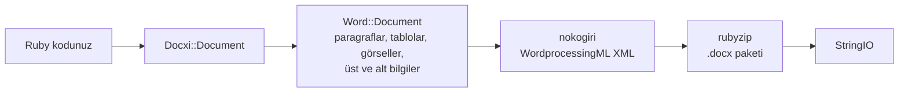

<!-- Translated from README.md (git blob 08aeefecb2eaa6ce543fc23576be90e5767dfaf8). See docs/i18n/TRANSLATION_GUIDE.md. -->

# docxi: Ruby ile Word (.docx) belgeleri oluşturun

[](https://rubygems.org/gems/docxi)
[](https://github.com/hammad417/docxi/actions/workflows/ci.yml)
[](https://rubygems.org/gems/docxi)
[](https://rubygems.org/gems/docxi)
[](../../LICENSE)

[English](../../README.md) · [简体中文](README.zh-CN.md) · [繁體中文](README.zh-TW.md) · [Español](README.es.md) · [العربية](README.ar.md) · [Français](README.fr.md) · [Português (Brasil)](README.pt-BR.md) · [Deutsch](README.de.md) · [हिन्दी](README.hi.md) · [日本語](README.ja.md) · [한국어](README.ko.md) · [Русский](README.ru.md) · [Bahasa Indonesia](README.id.md) · [Türkçe](README.tr.md) · [Italiano](README.it.md) · [Tiếng Việt](README.vi.md)

> Bu belge, İngilizce [README](../../README.md) dosyasının çevirisidir. İkisi arasında bir fark olursa İngilizce sürüm esas alınır.

docxi, koddan Microsoft Word `.docx` dosyaları üreten bir Ruby gem'idir. Belgeyi blok tabanlı küçük bir DSL ile tanımlarsınız (paragraflar, biçimlendirilmiş metin, tablolar, görseller, üst ve alt bilgiler, sayfa numaraları, köprüler), docxi de Office Open XML paketini yazar. Microsoft Word, LibreOffice ya da bir şablon dosyası gerektirmez; düz Ruby betiklerinde de Ruby on Rails uygulamalarında da çalışır.

```ruby
require "docxi"

word = Docxi::Document.new
word.document.p { |p| p.text "Hello from docxi", bold: true, size: 16 }
File.binwrite("hello.docx", word.render.string)
```

## <a id="contents"></a>İçindekiler

- [Genel bakış](#overview)
- [Özellikler](#features)
- [Kullanılan teknolojiler](#technology-stack)
- [Kurulum](#installation)
- [Hızlı başlangıç](#quick-start)
- [Kullanım örnekleri](#usage-examples)
- [Yapılandırma](#configuration)
- [Nasıl çalışır](#how-it-works)
- [Bir bakışta API](#api-at-a-glance)
- [Desteklenen platformlar](#supported-platforms)
- [Yaygın kullanım senaryoları](#common-use-cases)
- [Sorun giderme](#troubleshooting)
- [Sık sorulan sorular](#faq)
- [Dokümantasyon](#documentation)
- [Katkıda bulunma](#contributing)
- [Güvenlik](#security)
- [Lisans](#license)
- [Bakımcılar](#maintainers)

## <a id="overview"></a>Genel bakış

Bir uygulamadan Word belgesi üretmek genellikle bir şablonu doldurmak, bir ofis paketini otomatikleştirmek ya da HTML'i dönüştürüp sayfa düzeninin bozulmamasını ummak anlamına gelir. docxi farklı bir yol izler: belgeyi Ruby'de öğe öğe oluşturursunuz ve karşılığında eksiksiz bir `.docx` dosyası içeren bir `StringIO` alırsınız. Bu dosyayı diske yazabilir, bir e-postaya ekleyebilir ya da bir Rails controller'ından gönderebilirsiniz.

Kendi verilerinden rapor, mektup veya başka belgeleri Word biçiminde dışa aktarması gereken Ruby ve Rails geliştiricileri için tasarlanmıştır. Çalışma zamanındaki tek bağımlılıkları, XML'i oluşturan [nokogiri](https://nokogiri.org/) ve onu paketleyen [rubyzip](https://github.com/rubyzip/rubyzip)'tir.

## <a id="features"></a>Özellikler

- **Paragraflar**: hizalama, arka plan gölgelendirmesi, sol ve sağ girinti, alt kenarlık ve madde işaretli liste öğeleri
- **Metin**: kalın, italik, altı çizili, renk, boyut, yazı tipi, arka plan gölgelendirmesi, korunan boşluklar ve satır sonları
- **Sonlar ve sekmeler**: satır sonları, sayfa sonları ve sekme karakterleri
- **Tablolar**: sütun genişlikleri, satır yüksekliği, tablo girintisi, hücre bazında kenarlık, gölgelendirme ve dikey hizalama, ayrıca `colspan` ve `rowspan` ile birleştirilmiş hücreler
- **Görseller**: `File` gibi bir IO nesnesinden, bir dosya yolundan ya da bir `http(s)` URL'sinden alınır; `120pt` gibi CSS tarzı bir boyutla satır içine yerleştirilir
- **Üst ve alt bilgiler**: metin, tablolar, üst bilgide görseller, sayfa numaraları ve ilk sayfaya özel üst ve alt bilgi
- **İçindekiler tablosu**: noktalı (ya da başka karakterli) öncü karakterler ve sağa hizalı sayfa numaraları içeren satırlar; numaraları siz belirlersiniz
- Harici URL'lere **köprüler**
- **Metin çerçeveleri** (metin kutuları)
- **Sayfa kenar boşlukları**
- **Zip64 içermeyen çıktı**: rubyzip 3 kullanılsa bile arşivler Zip64 kayıtları olmadan yazılır; Google Docs ve LibreOffice'in eski sürümleri bu kayıtları içeren dosyaları açmayı reddeder

### <a id="limitations-and-known-issues"></a>Sınırlamalar ve bilinen sorunlar

docxi yalnızca yeni belge oluşturur. Var olan bir `.docx` dosyasını açamaz veya düzenleyemez, şablon dolduramaz ve adres mektup birleştirme yapamaz. Numaralı listeler, başlık stilleri ya da otomatik oluşturulan içindekiler tabloları yoktur; sayfa boyutu dikey yönlendirmede US Letter olarak sabittir.

Aşağıdaki sorunlar biliniyor ve 0.2.0 sürümünde düzeltilmesi planlanıyor:

- `pH`/`pV` ile yerleştirilen görseller, üst bilgilerdeki görseller ve tablo hücrelerindeki görseller boyutlarını `width * height` ile hesaplar, bu yüzden beklenenden çok daha küçük çıkar. Boyutu `style:` ile belirlenen satır içi görseller bundan etkilenmez.
- Tablo düzeyindeki `borders:` tablonun dış kenarına değil, her hücreye uygulanır. Hücre düzeyindeki `borders:` çalışır.
- Sayfa numarası alan kodunda `\* MERGEFORMAT` içindeki ters eğik çizgi eksik yazılır.
- Tablo hücrelerindeki sayfa numaralarının başına "GlobalOptions" metni eklenir.
- Görseller her zaman PNG parçası olarak saklanır ve `[Content_Types].xml` yalnızca ilk iki üst ve alt bilgiyi bildirir.

## <a id="technology-stack"></a>Kullanılan teknolojiler

| Bileşen | Kullanılan |
|---|---|
| Dil | Ruby 2.5 veya daha yenisi |
| XML | [nokogiri](https://nokogiri.org/) `>= 1.8, < 2` |
| Paketleme | [rubyzip](https://github.com/rubyzip/rubyzip) `>= 1.3, < 4` |
| Çıktı biçimi | Office Open XML WordprocessingML (`.docx`) |
| Testler | Minitest; çıktı, önceki sürümün ürettiği dosyalarla karşılaştırılır |
| CI | Ubuntu 24.04 üzerinde GitHub Actions ve LibreOffice ile dönüştürme kontrolü |

## <a id="installation"></a>Kurulum

### <a id="prerequisites"></a>Gereksinimler

- Ruby 2.5 veya daha yenisi
- Gemfile üzerinden kuruyorsanız Bundler
- nokogiri'nin kurulabildiği bir platform. nokogiri, yaygın Linux, macOS ve Windows platformları için önceden derlenmiş sürümler sunar.

### <a id="install"></a>Gem'i kurma

docxi'yi Gemfile'ınıza ekleyin:

```ruby
gem "docxi", "~> 0.1"
```

ve `bundle install` komutunu çalıştırın. Ya da doğrudan kurun:

```sh
gem install docxi
```

0.0.x'ten yükseltmek için kodda değişiklik gerekmez: `bundle update docxi` komutunu çalıştırın. 0.1.0 sürümü, 0.0.6 ile aynı belgeleri üretir. Ruby sürümü 2.5'ten eski olan uygulamalar otomatik olarak 0.0.6'da kalır.

## <a id="quick-start"></a>Hızlı başlangıç

```ruby
require "docxi"

word = Docxi::Document.new
document = word.document

document.p(align: "center") do |p|
  p.text "Monthly report", size: 20, bold: true
end

document.p do |p|
  p.text "Generated with docxi on ", space: true
  p.text Time.now.strftime("%Y-%m-%d"), bold: true
end

File.binwrite("report.docx", word.render.string)
```

`word.render` bir `StringIO` döndürür ve bunun `.string` değeri eksiksiz `.docx` dosyasıdır.

## <a id="usage-examples"></a>Kullanım örnekleri

Aşağıdaki örnekler hızlı başlangıcın devamıdır ve aynı `word` ile `document` nesnelerini kullanır.

### <a id="formatted-text-and-bullet-lists"></a>Biçimlendirilmiş metin ve madde işaretli listeler

```ruby
document.p do |p|
  p.text "Bold", bold: true
  p.text " italic", italic: true, space: true
  p.text " underlined", underline: true, space: true, br: true
  p.text "Dark red Georgia, 14 pt, on yellow", color: "8B0000", font: "Georgia", size: 14, fill: "FFFF00"
end

document.p(ul: true) { |p| p.text "First bullet" }
document.p(ul: true) { |p| p.text "Second bullet" }

document.p(align: "center", fill: "EEEEEE", bottom: true) do |p|
  p.text "Shaded, centered, with a bottom border"
end

document.br(page: true)
```

Boşlukla başlayan veya biten metinlerde `space: true` kullanın; aksi halde Word o boşluğu siler.

### <a id="tables"></a>Tablolar

```ruby
document.table(columns_width: [240, 100, 100]) do |table|
  table.tr(fill: "D9D9D9", bold: true) do |tr|
    tr.tc { |tc| tc.text "Item" }
    tr.tc { |tc| tc.text "Qty" }
    tr.tc { |tc| tc.text "Price" }
  end

  table.tr do |tr|
    tr.tc(borders: { top: 4, right: 4, bottom: 4, left: 4 }) { |tc| tc.text "Widget" }
    tr.tc(valign: "center") { |tc| tc.text "2" }
    tr.tc { |tc| tc.text "$20.00", align: "right" }
  end

  table.tr do |tr|
    tr.tc(colspan: 2) { |tc| tc.text "Total", bold: true }
    tr.tc { |tc| tc.text "$20.00", align: "right", bold: true }
  end
end
```

`tr` üzerindeki seçenekler satırdaki her hücreye uygulanır. Hücreleri dikey olarak birleştirmek için üstteki hücreye `rowspan: true`, hemen altındaki hücreye ise `merged: true` verin.

### <a id="images"></a>Görseller

```ruby
logo = document.add_media(File.open("logo.png", "rb"))
# add_media bir dosya yolu ya da http(s) URL'si de kabul eder:
# logo = document.add_media("https://example.com/logo.png")

document.p(align: "center") do |p|
  p.image logo, style: { width: "120pt", height: "60pt" }
end
```

### <a id="headers-footers-and-page-numbers"></a>Üst bilgiler, alt bilgiler ve sayfa numaraları

```ruby
header = Docxi::Word::Headers::Header.new do |h|
  h.text "ACME Corp. quarterly report", size: 9, align: "right"
end

footer = Docxi::Word::Footers::Footer.new do |f|
  f.page_numbers name: "Page", align: "center"
end

document.add_header(header)
document.add_footer(footer)

# İlk sayfanın her zaman kendine ait üst ve alt bilgisi vardır:
document.add_first_header(Docxi::Word::Headers::Header.new { |h| h.text "Cover page" })
document.add_first_footer(Docxi::Word::Footers::Footer.new { |f| f.text "Confidential" })
```

### <a id="hyperlinks"></a>Köprüler

```ruby
url = "https://github.com/hammad417/docxi"
link = document.add_hyperlink(url)

document.p { |p| p.hyperlink "docxi on GitHub", url, link }
```

### <a id="table-of-contents"></a>İçindekiler tablosu

```ruby
document.text "Contents", size: 16, bold: true

document.table_of_content do |toc|
  toc.add_row "Introduction", 1
  toc.add_row "Results", 3
  toc.add_row "Appendix", 7, leader: "hyphen"
end
```

docxi sayfa numaralarını hesaplamaz. Satırlarda, sizin verdiğiniz numaralar görünür.

### <a id="sending-a-document-from-rails"></a>Rails'ten belge gönderme

```ruby
class ReportsController < ApplicationController
  def show
    word = Docxi::Document.new
    word.document.p { |p| p.text "Report for #{Date.today}" }

    send_data word.render.string,
              filename: "report.docx",
              type: "application/vnd.openxmlformats-officedocument.wordprocessingml.document"
  end
end
```

### <a id="more-examples"></a>Diğer örnekler

[`examples/full_document.rb`](../../examples/full_document.rb), tüm özellikleri tek bir belgede kullanır. Wiki'deki [Kullanım örnekleri](https://github.com/hammad417/docxi/wiki/Usage-Examples-tr) sayfasında rapor, fatura ve mektup gibi eksiksiz örnekler vardır. Bu deponun bir klonunda `bundle exec rake samples` komutu, test paketindeki örnek belgeleri `tmp/samples/` klasörüne yazar.

## <a id="configuration"></a>Yapılandırma

docxi'nin yapılandırma dosyası ya da ortam değişkeni yoktur. Sayfa kenar boşlukları belge oluşturulurken ayarlanır:

```ruby
# Değerler, bir puntonun yirmide biri cinsindendir (1440 = 1 inç). Dört kenarın hepsini verin.
word = Docxi::Document.new(top: 1440, right: 1080, bottom: 1440, left: 1080, header: 720, footer: 720)
```

Varsayılan değerler `top: 720, right: 1440, bottom: 720, left: 1440, header: 190, footer: 200` şeklindedir. Herhangi bir kenar boşluğunu ayarlarsanız `top`, `right`, `bottom` ve `left` değerlerini birlikte ayarlayın, çünkü belirtmedikleriniz boş yazılır.

| Seçenek | Birim |
|---|---|
| Metnin `size:` değeri | Punto |
| Kenar boşlukları, paragrafın `left:` ve `right:` girintileri, tablonun `iwidth:` değeri | Puntonun yirmide biri (inç başına 1440) |
| Hücre `borders:` kalınlığı | Puntonun sekizde biri |
| `columns_width:` ve hücrenin `width:` değeri | Puntonun yirmide birine çevrilmek için 14.92 ile çarpılır; bu da yaklaşık piksele denk gelir |
| Görselin `style:` değeri | `"120pt"` gibi CSS uzunlukları |

Sayfa, dikey yönlendirmede US Letter boyutundadır ve varsayılan yazı tipi Arial 12 pt'dir.

## <a id="how-it-works"></a>Nasıl çalışır



`Docxi::Document`, paket düzeyindeki parçaları tutar: ilişkiler, içerik türleri ve belge özellikleri. `word.document` bir `Docxi::Word::Document` nesnesidir; eklediğiniz öğeleri (`Docxi::Word::Contents::Paragraph`, `Table`, `Image`, `TableOfContent` vb.) üst ve alt bilgiler, görseller, köprüler, stiller, numaralandırma ve temayla birlikte toplar. `render` çağrıldığında her parça kendi XML'ini nokogiri ile oluşturur ve rubyzip ile bir zip arşivine yazılır. `Docxi.write_entry` her girdinin boyutunu önceden ayarlar, böylece rubyzip Zip64 kaydı eklemez.

## <a id="api-at-a-glance"></a>Bir bakışta API

| Çağrı | Ekledikleri |
|---|---|
| `Docxi::Document.new(margins)` | Yeni bir belge. `#render`, `.docx` dosyasını bir `StringIO` olarak döndürür |
| Blokla birlikte `document.p(options)` | Bir paragraf. Blok içinde: `text`, `br`, `tab`, `image`, `hyperlink`, `frame` |
| `document.text(string, options)` | Tek bir metin parçası içeren paragraf |
| `document.br(page: true)` | Bir sayfa sonu |
| Blokla birlikte `document.table(options)` | Bir tablo. İçinde: önce `tr`, sonra `tc`, ardından `text`, `p`, `image` veya `page_numbers` |
| Blokla birlikte `document.table_of_content(options)` | `add_row(text, page)` ile eklenen içindekiler satırları |
| `document.add_media(file_path_or_url)` | `image` ile yerleştirilecek bir görsel |
| `document.add_hyperlink(url)` | `hyperlink` ile kullanılacak bir bağlantı hedefi |
| `document.add_header(header)` ve `add_first_header` | `Docxi::Word::Headers::Header` ile oluşturulan üst bilgiler |
| `document.add_footer(footer)` ve `add_first_footer` | `Docxi::Word::Footers::Footer` ile oluşturulan alt bilgiler |
| `document.frame(text, options)` | Bir metin kutusu |

## <a id="supported-platforms"></a>Desteklenen platformlar

| Alan | Destek |
|---|---|
| Ruby | 2.5 veya daha yenisi. CI; Ruby 2.5, 2.6, 2.7, 3.0, 3.1, 3.2, 3.3, 3.4 ve 4.0 sürümlerini çalıştırır |
| Rails | Zorunlu değildir. CI; Rails 5.2, 6.0, 6.1, 7.0, 7.1, 7.2, 8.0 ve 8.1'i docxi ile birlikte yükler |
| Bağımlılıklar | CI; rubyzip 1.3, 2.4 ve 3.x ile nokogiri 1.11'den 1.19'a kadar olan sürümleri kapsar |
| İşletim sistemleri | CI, Ubuntu 24.04 üzerinde çalışır; testler macOS'ta da çalıştırılmıştır. Windows'ta test edilmemiştir. |
| Çıktı | Microsoft Word için `.docx`. CI, LibreOffice'in örnek belgeleri dönüştürebildiğini kontrol eder |

## <a id="common-use-cases"></a>Yaygın kullanım senaryoları

- Bir Rails uygulamasındaki raporları Word dosyası olarak dışa aktarmak
- Veritabanı kayıtlarından mektup, sertifika veya fatura üretmek
- Ofis paketinin kurulu olmadığı arka plan işlerinde ya da komut satırı betiklerinde belge oluşturmak

## <a id="troubleshooting"></a>Sorun giderme

**docxi'yi Rails 6 veya daha yeni bir uygulamaya eklerken Bundler uyumlu `nokogiri` sürümleri bulamıyor.**
docxi 0.0.6, `nokogiri < 1.7` koşulunu sabitler; oysa Rails 6.0'dan bu yana her Rails sürümü nokogiri 1.8.5 veya daha yenisini gerektirir. `gem "docxi", "~> 0.1"` kullanın.

**Bundler uyumlu `rubyzip` sürümleri bulamıyor.**
docxi 0.0.6, `rubyzip ~> 0.9.9` koşulunu sabitler; bu da daha yeni bir rubyzip gerektiren her gem ile çakışır. docxi 0.1.0, rubyzip 1.3 ile 3.x arasındaki sürümlerle çalışır.

**Rails dışında `NoMethodError: undefined method 'present?'` hatası.**
docxi 0.0.6, ActiveSupport'un yüklenmiş olmasına güveniyordu. 0.1.0 buna ihtiyaç duymaz.

**Google Docs veya LibreOffice, rubyzip 3 ile üretilen dosyayı açmıyor.**
rubyzip 3 ile birlikte docxi 0.0.6, her girdiye Zip64 kayıtları yazar. 0.1.0 ise arşivleri bu kayıtlar olmadan yazar.

**Ruby 3'te görsel URL'leri `Errno::ENOENT` hatası veriyor.**
docxi 0.0.6, URL'leri `Kernel#open` ile açıyordu; bu yöntem Ruby 3'te artık URL indirmiyor. 0.1.0 ise onları `URI#open` ile indirir.

**`tab`, `frame` veya bir üst bilginin `page_numbers` yöntemi çağrılınca `NameError` alınıyor.**
Bunlar 0.0.6'da bozuktu ve 0.1.0'da çalışıyor.

**İlk sayfada üst veya alt bilginiz görünmüyor.**
docxi ilk sayfaya her zaman kendine ait bir üst ve alt bilgi verir. Bunları `add_first_header` ve `add_first_footer` ile ayarlayın.

**Bir sayfa kenar boşluğu eksik.**
Kenar boşluklarını ayarlarken `top`, `right`, `bottom` ve `left` değerlerini birlikte verin. Bkz. [Yapılandırma](#configuration).

## <a id="faq"></a>Sık sorulan sorular

**Microsoft Word veya LibreOffice'in kurulu olması gerekir mi?**
Hayır. docxi, XML'i ve zip arşivini kendisi yazar.

**docxi için Rails gerekir mi?**
Hayır. Herhangi bir Ruby programında çalışır. CI, testleri Rails 5.2 ile 8.1 arası sürümler yüklüyken de çalıştırır.

**Ruby on Rails'te nasıl Word belgesi oluşturabilirim?**
Belgeyi bir controller'da veya arka plan işinde docxi ile oluşturun ve `word.render.string` değerini `send_data` ile gönderin. Bkz. [Rails'ten belge gönderme](#sending-a-document-from-rails).

**docxi var olan bir .docx dosyasını düzenleyebilir ya da bir Word şablonunu doldurabilir mi?**
Hayır. docxi yalnızca yeni belge oluşturur. Birleştirme alanları içeren şablonlar için sablon gibi şablon tabanlı bir gem kullanın.

**İçindekiler tablosu başlıklardan otomatik mi oluşturuluyor?**
Hayır. Her satırı ve sayfa numarasını kendiniz eklersiniz.

**Sayfa boyutunu veya yönünü değiştirebilir miyim?**
Henüz değil. Sayfalar dikey yönlendirmede US Letter boyutundadır ve yalnızca kenar boşluklarını değiştirebilirsiniz.

**Hangi görsel biçimleri çalışır?**
Görseller PNG parçası olarak saklandığından en güvenli seçenek PNG dosyalarıdır.

**Hangi Ruby ve Rails sürümleri destekleniyor?**
Ruby 2.5 ve daha yenisi. Rails isteğe bağlıdır; CI, Rails 5.2 ile 8.1 arasını test eder.

## <a id="documentation"></a>Dokümantasyon

- [docxi wiki](https://github.com/hammad417/docxi/wiki/Home-tr) her seçeneği anlatır; ek örnekler ve sorun giderme bilgileri de içerir
- [CHANGELOG.md](../../CHANGELOG.md) her sürümdeki değişiklikleri listeler (İngilizce)
- [examples/full_document.rb](../../examples/full_document.rb) eksiksiz bir örnektir
- [docs/i18n](README.md) bu README'nin çevirilerinin durumunu takip eder

## <a id="contributing"></a>Katkıda bulunma

Hata bildirimleri ve pull request'ler [GitHub](https://github.com/hammad417/docxi/issues) üzerinde memnuniyetle karşılanır. docxi üzerinde çalışmaya başlamak için:

```sh
git clone https://github.com/hammad417/docxi.git
cd docxi
bundle install
bundle exec rake test
```

Testleri belirli bir Rails sürümü yüklüyken çalıştırmak için `gemfiles/` içindeki Gemfile'lardan birini kullanın:

```sh
BUNDLE_GEMFILE=gemfiles/rails_8.1.gemfile bundle install
BUNDLE_GEMFILE=gemfiles/rails_8.1.gemfile DOCXI_WITH_RAILS=1 bundle exec rake test
```

`test/golden`, 0.0.6 sürümünün `test/support/sample_documents.rb` içindeki belgeler için ürettiği XML'i içerir ve testler her değişikliği bununla karşılaştırır. Üretilen XML'i bilerek değiştirirseniz, `bundle exec rake golden` ile güncelleyin ve değişikliği pull request'inizde açıklayın.

## <a id="security"></a>Güvenlik

Lütfen güvenlik sorunlarını herkese açık issue'larda bildirmeyin; bunun yerine bakımcıya e-posta gönderin. Adresler [docxi.gemspec](../../docxi.gemspec) dosyasındadır.

Hâlâ docxi 0.0.x kullanıyorsanız 0.1.0'a yükseltin. Eski sürümler görsel yolu dizelerini `Kernel#open` yöntemine iletir; bu yöntem de `|` ile başlayan dizeleri kabuk komutu olarak çalıştırır.

## <a id="license"></a>Lisans

docxi, [MIT Lisansı](../../LICENSE) altında yayımlanır. Lisans dosyası, docxi'nin temel aldığı gem olan docxer'ın özgün telif hakkı bildirimini korur.

## <a id="maintainers"></a>Bakımcılar

docxi'nin bakımını [Phaedra Solutions](https://www.phaedrasolutions.com/) bünyesinden [Hammad Maqbool](https://github.com/hammad417) üstlenmektedir. Proje 2016'da Timur Gabdrakipov'un [docxer](https://github.com/gtimti/docxer) projesinden yola çıkarak başladı.

### <a id="about-phaedra-solutions"></a>Phaedra Solutions hakkında

Phaedra Solutions, 2013'ten bu yana işletmeler için özel yazılım geliştiren, yapay zekâyı öncelikli tutan bir yazılım mühendisliği şirketidir.
