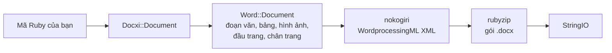

<!-- Translated from README.md (git blob 08aeefecb2eaa6ce543fc23576be90e5767dfaf8). See docs/i18n/TRANSLATION_GUIDE.md. -->

# docxi: tạo tài liệu Word (.docx) bằng Ruby

[](https://rubygems.org/gems/docxi)
[](https://github.com/hammad417/docxi/actions/workflows/ci.yml)
[](https://rubygems.org/gems/docxi)
[](https://rubygems.org/gems/docxi)
[](../../LICENSE)

[English](../../README.md) · [简体中文](README.zh-CN.md) · [繁體中文](README.zh-TW.md) · [Español](README.es.md) · [العربية](README.ar.md) · [Français](README.fr.md) · [Português (Brasil)](README.pt-BR.md) · [Deutsch](README.de.md) · [हिन्दी](README.hi.md) · [日本語](README.ja.md) · [한국어](README.ko.md) · [Русский](README.ru.md) · [Bahasa Indonesia](README.id.md) · [Türkçe](README.tr.md) · [Italiano](README.it.md) · [Tiếng Việt](README.vi.md)

> Đây là bản dịch của [README](../../README.md) tiếng Anh. Nếu hai bản có điểm khác nhau, bản tiếng Anh là bản chuẩn.

docxi là một gem Ruby tạo tệp Microsoft Word `.docx` từ mã nguồn. Bạn mô tả tài liệu bằng một DSL nhỏ dựa trên khối (đoạn văn, văn bản có định dạng, bảng, hình ảnh, đầu trang và chân trang, số trang, siêu liên kết), và docxi ghi ra gói Office Open XML. Gem này không cần Microsoft Word, LibreOffice hay tệp mẫu, và chạy được cả trong các script Ruby thông thường lẫn trong ứng dụng Ruby on Rails.

```ruby
require "docxi"

word = Docxi::Document.new
word.document.p { |p| p.text "Hello from docxi", bold: true, size: 16 }
File.binwrite("hello.docx", word.render.string)
```

## <a id="contents"></a>Mục lục

- [Tổng quan](#overview)
- [Tính năng](#features)
- [Công nghệ sử dụng](#technology-stack)
- [Cài đặt](#installation)
- [Bắt đầu nhanh](#quick-start)
- [Ví dụ sử dụng](#usage-examples)
- [Cấu hình](#configuration)
- [Cách hoạt động](#how-it-works)
- [Tóm tắt API](#api-at-a-glance)
- [Nền tảng được hỗ trợ](#supported-platforms)
- [Trường hợp sử dụng phổ biến](#common-use-cases)
- [Khắc phục sự cố](#troubleshooting)
- [Câu hỏi thường gặp](#faq)
- [Tài liệu](#documentation)
- [Đóng góp](#contributing)
- [Bảo mật](#security)
- [Giấy phép](#license)
- [Người bảo trì](#maintainers)

## <a id="overview"></a>Tổng quan

Tạo tài liệu Word từ một ứng dụng thường có nghĩa là điền vào một mẫu, tự động hóa một bộ phần mềm văn phòng, hoặc chuyển đổi HTML rồi hy vọng bố cục không bị vỡ. docxi đi theo hướng khác: bạn dựng tài liệu bằng Ruby, từng phần tử một, và nhận lại một `StringIO` chứa tệp `.docx` hoàn chỉnh để ghi ra đĩa, đính kèm vào email hoặc gửi từ một controller của Rails.

Gem này dành cho các lập trình viên Ruby và Rails cần xuất báo cáo, thư từ hoặc các tài liệu khác ở định dạng Word từ dữ liệu của chính họ. Phụ thuộc lúc chạy chỉ có hai: [nokogiri](https://nokogiri.org/) để dựng XML và [rubyzip](https://github.com/rubyzip/rubyzip) để đóng gói.

## <a id="features"></a>Tính năng

- **Đoạn văn**: căn lề, tô nền, thụt lề trái và phải, viền dưới và các mục danh sách dấu đầu dòng
- **Văn bản**: in đậm, in nghiêng, gạch chân, màu, cỡ chữ, phông chữ, tô nền, giữ nguyên khoảng trắng và ngắt dòng
- **Ngắt và tab**: ngắt dòng, ngắt trang và ký tự tab
- **Bảng**: độ rộng cột, chiều cao hàng, thụt lề bảng, viền, tô nền và căn chỉnh theo chiều dọc cho từng ô, và gộp ô bằng `colspan` và `rowspan`
- **Hình ảnh**: lấy từ một đối tượng IO như `File`, một đường dẫn tệp hoặc một URL `http(s)`, đặt cùng dòng văn bản với kích thước kiểu CSS như `120pt`
- **Đầu trang và chân trang**: văn bản, bảng, hình ảnh trong đầu trang, số trang, cùng một đầu trang và chân trang riêng cho trang đầu tiên
- **Mục lục**: các dòng có ký tự dẫn dạng dấu chấm (hoặc ký tự khác) và số trang căn phải do bạn tự cung cấp
- **Siêu liên kết** tới các URL bên ngoài
- **Khung văn bản** (hộp văn bản)
- **Lề trang**
- **Đầu ra không có Zip64**: kho lưu trữ được ghi mà không có bản ghi Zip64 ngay cả khi dùng rubyzip 3; Google Docs và các phiên bản LibreOffice cũ từ chối mở tệp có chứa các bản ghi này

### <a id="limitations-and-known-issues"></a>Giới hạn và vấn đề đã biết

docxi chỉ tạo tài liệu mới. Gem này không thể mở hoặc chỉnh sửa một tệp `.docx` có sẵn, điền vào mẫu hay thực hiện trộn thư. Không có danh sách đánh số, kiểu đề mục hay mục lục được tạo tự động, và khổ giấy được cố định là US Letter hướng dọc.

Các vấn đề sau đã được biết và dự kiến sẽ được sửa trong phiên bản 0.2.0:

- Hình ảnh đặt bằng `pH`/`pV`, hình ảnh trong đầu trang và hình ảnh trong ô bảng tính kích thước theo `width * height`, nên hiển thị nhỏ hơn nhiều so với mong đợi. Hình ảnh cùng dòng có kích thước đặt bằng `style:` không bị ảnh hưởng.
- `borders:` ở cấp bảng được áp dụng cho từng ô thay vì cho đường viền ngoài của bảng. `borders:` cho từng ô vẫn hoạt động bình thường.
- Mã trường số trang được ghi thiếu dấu gạch chéo ngược trong `\* MERGEFORMAT`.
- Số trang bên trong ô bảng bị thêm đoạn văn bản "GlobalOptions" ở phía trước.
- Hình ảnh luôn được lưu dưới dạng phần PNG, và `[Content_Types].xml` chỉ khai báo hai đầu trang và chân trang đầu tiên.

## <a id="technology-stack"></a>Công nghệ sử dụng

| Thành phần | Công nghệ |
|---|---|
| Ngôn ngữ | Ruby 2.5 trở lên |
| XML | [nokogiri](https://nokogiri.org/) `>= 1.8, < 2` |
| Đóng gói | [rubyzip](https://github.com/rubyzip/rubyzip) `>= 1.3, < 4` |
| Định dạng đầu ra | Office Open XML WordprocessingML (`.docx`) |
| Kiểm thử | Minitest, so sánh đầu ra với các tệp do bản phát hành trước tạo ra |
| CI | GitHub Actions trên Ubuntu 24.04, kèm bước kiểm tra chuyển đổi bằng LibreOffice |

## <a id="installation"></a>Cài đặt

### <a id="prerequisites"></a>Yêu cầu

- Ruby 2.5 trở lên
- Bundler, nếu bạn cài đặt qua Gemfile
- Một nền tảng cài được nokogiri. nokogiri cung cấp bản dựng sẵn cho các nền tảng Linux, macOS và Windows phổ biến.

### <a id="install"></a>Cài gem

Thêm docxi vào Gemfile của bạn:

```ruby
gem "docxi", "~> 0.1"
```

rồi chạy `bundle install`. Hoặc cài trực tiếp:

```sh
gem install docxi
```

Nâng cấp từ 0.0.x không cần sửa mã: chỉ cần chạy `bundle update docxi`. Phiên bản 0.1.0 tạo ra đúng những tài liệu như 0.0.6. Các ứng dụng dùng Ruby cũ hơn 2.5 sẽ tự động ở lại 0.0.6.

## <a id="quick-start"></a>Bắt đầu nhanh

```ruby
require "docxi"

word = Docxi::Document.new
document = word.document

document.p(align: "center") do |p|
  p.text "Monthly report", size: 20, bold: true
end

document.p do |p|
  p.text "Generated with docxi on ", space: true
  p.text Time.now.strftime("%Y-%m-%d"), bold: true
end

File.binwrite("report.docx", word.render.string)
```

`word.render` trả về một `StringIO`, và `.string` của nó chính là tệp `.docx` hoàn chỉnh.

## <a id="usage-examples"></a>Ví dụ sử dụng

Các ví dụ dưới đây tiếp nối phần bắt đầu nhanh và dùng chung `word` và `document`.

### <a id="formatted-text-and-bullet-lists"></a>Văn bản có định dạng và danh sách dấu đầu dòng

```ruby
document.p do |p|
  p.text "Bold", bold: true
  p.text " italic", italic: true, space: true
  p.text " underlined", underline: true, space: true, br: true
  p.text "Dark red Georgia, 14 pt, on yellow", color: "8B0000", font: "Georgia", size: 14, fill: "FFFF00"
end

document.p(ul: true) { |p| p.text "First bullet" }
document.p(ul: true) { |p| p.text "Second bullet" }

document.p(align: "center", fill: "EEEEEE", bottom: true) do |p|
  p.text "Shaded, centered, with a bottom border"
end

document.br(page: true)
```

Hãy dùng `space: true` cho văn bản bắt đầu hoặc kết thúc bằng khoảng trắng, nếu không Word sẽ bỏ khoảng trắng đó.

### <a id="tables"></a>Bảng

```ruby
document.table(columns_width: [240, 100, 100]) do |table|
  table.tr(fill: "D9D9D9", bold: true) do |tr|
    tr.tc { |tc| tc.text "Item" }
    tr.tc { |tc| tc.text "Qty" }
    tr.tc { |tc| tc.text "Price" }
  end

  table.tr do |tr|
    tr.tc(borders: { top: 4, right: 4, bottom: 4, left: 4 }) { |tc| tc.text "Widget" }
    tr.tc(valign: "center") { |tc| tc.text "2" }
    tr.tc { |tc| tc.text "$20.00", align: "right" }
  end

  table.tr do |tr|
    tr.tc(colspan: 2) { |tc| tc.text "Total", bold: true }
    tr.tc { |tc| tc.text "$20.00", align: "right", bold: true }
  end
end
```

Các tùy chọn đặt trên `tr` áp dụng cho mọi ô trong hàng. Để gộp ô theo chiều dọc, hãy truyền `rowspan: true` cho ô phía trên và `merged: true` cho ô ngay bên dưới.

### <a id="images"></a>Hình ảnh

```ruby
logo = document.add_media(File.open("logo.png", "rb"))
# add_media cũng nhận một đường dẫn tệp hoặc một URL http(s):
# logo = document.add_media("https://example.com/logo.png")

document.p(align: "center") do |p|
  p.image logo, style: { width: "120pt", height: "60pt" }
end
```

### <a id="headers-footers-and-page-numbers"></a>Đầu trang, chân trang và số trang

```ruby
header = Docxi::Word::Headers::Header.new do |h|
  h.text "ACME Corp. quarterly report", size: 9, align: "right"
end

footer = Docxi::Word::Footers::Footer.new do |f|
  f.page_numbers name: "Page", align: "center"
end

document.add_header(header)
document.add_footer(footer)

# Trang đầu tiên luôn có đầu trang và chân trang riêng:
document.add_first_header(Docxi::Word::Headers::Header.new { |h| h.text "Cover page" })
document.add_first_footer(Docxi::Word::Footers::Footer.new { |f| f.text "Confidential" })
```

### <a id="hyperlinks"></a>Siêu liên kết

```ruby
url = "https://github.com/hammad417/docxi"
link = document.add_hyperlink(url)

document.p { |p| p.hyperlink "docxi on GitHub", url, link }
```

### <a id="table-of-contents"></a>Thêm mục lục

```ruby
document.text "Contents", size: 16, bold: true

document.table_of_content do |toc|
  toc.add_row "Introduction", 1
  toc.add_row "Results", 3
  toc.add_row "Appendix", 7, leader: "hyphen"
end
```

docxi không tự tính số trang. Các dòng hiển thị đúng những số mà bạn truyền vào.

### <a id="sending-a-document-from-rails"></a>Gửi tài liệu từ Rails

```ruby
class ReportsController < ApplicationController
  def show
    word = Docxi::Document.new
    word.document.p { |p| p.text "Report for #{Date.today}" }

    send_data word.render.string,
              filename: "report.docx",
              type: "application/vnd.openxmlformats-officedocument.wordprocessingml.document"
  end
end
```

### <a id="more-examples"></a>Thêm ví dụ

[`examples/full_document.rb`](../../examples/full_document.rb) dùng tất cả tính năng trong một tài liệu, còn trang [Ví dụ sử dụng](https://github.com/hammad417/docxi/wiki/Usage-Examples-vi) trên wiki có các ví dụ đầy đủ như báo cáo, hóa đơn và thư. Trong bản clone của kho mã này, lệnh `bundle exec rake samples` ghi các tài liệu mẫu từ bộ kiểm thử vào `tmp/samples/`.

## <a id="configuration"></a>Cấu hình

docxi không có tệp cấu hình hay biến môi trường. Lề trang được đặt khi bạn tạo tài liệu:

```ruby
# Giá trị tính bằng một phần hai mươi điểm (1440 = 1 inch). Hãy truyền đủ cả bốn cạnh.
word = Docxi::Document.new(top: 1440, right: 1080, bottom: 1440, left: 1080, header: 720, footer: 720)
```

Giá trị mặc định là `top: 720, right: 1440, bottom: 720, left: 1440, header: 190, footer: 200`. Nếu bạn đặt bất kỳ lề nào, hãy đặt cùng lúc `top`, `right`, `bottom` và `left`, vì những lề bị bỏ qua sẽ được ghi thành giá trị rỗng.

| Tùy chọn | Đơn vị |
|---|---|
| `size:` của văn bản | Điểm |
| Lề, thụt lề `left:` và `right:` của đoạn văn, `iwidth:` của bảng | Một phần hai mươi điểm (1440 cho mỗi inch) |
| Độ dày `borders:` của ô | Một phần tám điểm |
| `columns_width:` và `width:` của ô | Được nhân với 14.92 để ra một phần hai mươi điểm, gần tương đương pixel |
| `style:` của hình ảnh | Độ dài CSS như `"120pt"` |

Trang có khổ US Letter hướng dọc, phông chữ mặc định là Arial 12 pt.

## <a id="how-it-works"></a>Cách hoạt động



`Docxi::Document` giữ các phần ở cấp gói: quan hệ (relationships), kiểu nội dung và thuộc tính tài liệu. `word.document` là một `Docxi::Word::Document`, nơi tập hợp các phần tử bạn thêm vào (`Docxi::Word::Contents::Paragraph`, `Table`, `Image`, `TableOfContent`, v.v.) cùng với đầu trang, chân trang, hình ảnh, siêu liên kết, kiểu, cách đánh số và chủ đề. Khi bạn gọi `render`, mỗi phần dựng XML của mình bằng nokogiri rồi được ghi vào một tệp zip bằng rubyzip. `Docxi.write_entry` đặt trước kích thước của từng mục để rubyzip không thêm bản ghi Zip64.

## <a id="api-at-a-glance"></a>Tóm tắt API

| Lời gọi | Thêm vào |
|---|---|
| `Docxi::Document.new(margins)` | Một tài liệu mới. `#render` trả về `.docx` dưới dạng `StringIO` |
| `document.p(options)` kèm một khối | Một đoạn văn. Bên trong khối: `text`, `br`, `tab`, `image`, `hyperlink`, `frame` |
| `document.text(string, options)` | Một đoạn văn chỉ chứa một đoạn văn bản |
| `document.br(page: true)` | Một ngắt trang |
| `document.table(options)` kèm một khối | Một bảng. Bên trong: `tr`, rồi `tc`, rồi `text`, `p`, `image` hoặc `page_numbers` |
| `document.table_of_content(options)` kèm một khối | Các dòng mục lục được thêm bằng `add_row(text, page)` |
| `document.add_media(file_path_or_url)` | Một hình ảnh để đặt bằng `image` |
| `document.add_hyperlink(url)` | Một đích liên kết để dùng với `hyperlink` |
| `document.add_header(header)` và `add_first_header` | Đầu trang được tạo bằng `Docxi::Word::Headers::Header` |
| `document.add_footer(footer)` và `add_first_footer` | Chân trang được tạo bằng `Docxi::Word::Footers::Footer` |
| `document.frame(text, options)` | Một hộp văn bản |

## <a id="supported-platforms"></a>Nền tảng được hỗ trợ

| Hạng mục | Hỗ trợ |
|---|---|
| Ruby | 2.5 trở lên. CI chạy Ruby 2.5, 2.6, 2.7, 3.0, 3.1, 3.2, 3.3, 3.4 và 4.0 |
| Rails | Không bắt buộc. CI nạp Rails 5.2, 6.0, 6.1, 7.0, 7.1, 7.2, 8.0 và 8.1 cùng với docxi |
| Phụ thuộc | CI bao phủ rubyzip 1.3, 2.4 và 3.x, cùng nokogiri từ 1.11 đến 1.19 |
| Hệ điều hành | CI chạy trên Ubuntu 24.04, và bộ kiểm thử cũng đã được chạy trên macOS. Chưa kiểm thử trên Windows. |
| Đầu ra | Tệp `.docx` cho Microsoft Word. CI kiểm tra rằng LibreOffice chuyển đổi được các tài liệu mẫu |

## <a id="common-use-cases"></a>Trường hợp sử dụng phổ biến

- Xuất báo cáo từ ứng dụng Rails thành tệp Word
- Tạo thư, chứng chỉ hoặc hóa đơn từ các bản ghi trong cơ sở dữ liệu
- Tạo tài liệu trong các tác vụ chạy nền hoặc script dòng lệnh, nơi không cài bộ phần mềm văn phòng nào

## <a id="troubleshooting"></a>Khắc phục sự cố

**Bundler không tìm được phiên bản `nokogiri` tương thích khi bạn thêm docxi vào một ứng dụng Rails 6 trở lên.**
docxi 0.0.6 cố định `nokogiri < 1.7`, trong khi mọi phiên bản Rails từ 6.0 trở đi đều cần nokogiri 1.8.5 hoặc mới hơn. Hãy dùng `gem "docxi", "~> 0.1"`.

**Bundler không tìm được phiên bản `rubyzip` tương thích.**
docxi 0.0.6 cố định `rubyzip ~> 0.9.9`, gây xung đột với bất kỳ gem nào cần rubyzip mới hơn. docxi 0.1.0 hoạt động với rubyzip từ 1.3 đến 3.x.

**`NoMethodError: undefined method 'present?'` khi chạy ngoài Rails.**
docxi 0.0.6 dựa vào việc ActiveSupport đã được nạp sẵn. Phiên bản 0.1.0 thì không cần.

**Google Docs hoặc LibreOffice không mở được tệp tạo bằng rubyzip 3.**
docxi 0.0.6 dùng với rubyzip 3 sẽ ghi bản ghi Zip64 vào mọi mục. Phiên bản 0.1.0 ghi tệp nén không có các bản ghi này.

**URL hình ảnh gây lỗi `Errno::ENOENT` trên Ruby 3.**
docxi 0.0.6 mở URL bằng `Kernel#open`, phương thức không còn tải URL trên Ruby 3. Phiên bản 0.1.0 tải chúng bằng `URI#open`.

**Gặp `NameError` khi gọi `tab`, `frame` hoặc `page_numbers` của đầu trang.**
Các phương thức này bị lỗi ở 0.0.6 và đã hoạt động ở 0.1.0.

**Trang đầu tiên không hiển thị đầu trang hoặc chân trang của bạn.**
docxi luôn dành cho trang đầu tiên một đầu trang và chân trang riêng. Hãy đặt chúng bằng `add_first_header` và `add_first_footer`.

**Thiếu một lề trang.**
Hãy truyền cùng lúc `top`, `right`, `bottom` và `left` khi đặt lề. Xem [Cấu hình](#configuration).

## <a id="faq"></a>Câu hỏi thường gặp

**Có cần cài Microsoft Word hoặc LibreOffice không?**
Không. docxi tự ghi XML và tệp zip.

**docxi có cần Rails không?**
Không. Gem này chạy trong bất kỳ chương trình Ruby nào. CI cũng chạy bộ kiểm thử khi đã nạp Rails từ 5.2 đến 8.1.

**Làm thế nào để tạo tài liệu Word trong Ruby on Rails?**
Hãy dựng tài liệu bằng docxi trong một controller hoặc một tác vụ chạy nền, rồi gửi `word.render.string` bằng `send_data`. Xem [Gửi tài liệu từ Rails](#sending-a-document-from-rails).

**docxi có chỉnh sửa được tệp .docx có sẵn hoặc điền vào mẫu Word không?**
Không. docxi chỉ tạo tài liệu mới. Với các mẫu có trường trộn thư, hãy dùng một gem dựa trên mẫu như sablon.

**Mục lục có được tạo tự động từ các đề mục không?**
Không. Bạn tự thêm từng dòng cùng số trang của nó.

**Có thể đổi khổ giấy hoặc hướng trang không?**
Hiện chưa. Trang có khổ US Letter hướng dọc, và bạn chỉ có thể thay đổi lề.

**Những định dạng hình ảnh nào dùng được?**
Hình ảnh được lưu dưới dạng phần PNG, vì vậy tệp PNG là lựa chọn an toàn nhất.

**Những phiên bản Ruby và Rails nào được hỗ trợ?**
Ruby 2.5 trở lên. Rails là tùy chọn, và CI kiểm thử Rails từ 5.2 đến 8.1.

## <a id="documentation"></a>Tài liệu

- [Wiki docxi](https://github.com/hammad417/docxi/wiki/Home-vi) giải thích mọi tùy chọn, kèm thêm ví dụ và cách khắc phục sự cố
- [CHANGELOG.md](../../CHANGELOG.md) liệt kê thay đổi của từng bản phát hành (bằng tiếng Anh)
- [examples/full_document.rb](../../examples/full_document.rb) là một ví dụ đầy đủ
- [docs/i18n](README.md) theo dõi trạng thái các bản dịch của README này

## <a id="contributing"></a>Đóng góp

Báo lỗi và pull request luôn được chào đón trên [GitHub](https://github.com/hammad417/docxi/issues). Để bắt đầu làm việc với docxi:

```sh
git clone https://github.com/hammad417/docxi.git
cd docxi
bundle install
bundle exec rake test
```

Để chạy bộ kiểm thử với một phiên bản Rails cụ thể được nạp, hãy dùng một trong các Gemfile trong `gemfiles/`:

```sh
BUNDLE_GEMFILE=gemfiles/rails_8.1.gemfile bundle install
BUNDLE_GEMFILE=gemfiles/rails_8.1.gemfile DOCXI_WITH_RAILS=1 bundle exec rake test
```

`test/golden` chứa XML mà 0.0.6 đã tạo cho các tài liệu trong `test/support/sample_documents.rb`, và bộ kiểm thử so sánh mọi thay đổi với nó. Nếu bạn cố ý thay đổi XML được tạo ra, hãy cập nhật bằng `bundle exec rake golden` và giải thích thay đổi trong pull request của bạn.

## <a id="security"></a>Bảo mật

Vui lòng không báo cáo vấn đề bảo mật trong các issue công khai. Thay vào đó, hãy gửi email cho người bảo trì. Địa chỉ email có trong [docxi.gemspec](../../docxi.gemspec).

Nếu bạn vẫn đang dùng docxi 0.0.x, hãy nâng cấp lên 0.1.0. Các phiên bản cũ truyền chuỗi đường dẫn hình ảnh cho `Kernel#open`, phương thức sẽ chạy các chuỗi bắt đầu bằng `|` như lệnh shell.

## <a id="license"></a>Giấy phép

docxi được phát hành theo [Giấy phép MIT](../../LICENSE). Tệp giấy phép vẫn giữ thông báo bản quyền gốc của docxer, gem mà docxi được xây dựng từ đó.

## <a id="maintainers"></a>Người bảo trì

docxi được bảo trì bởi [Hammad Maqbool](https://github.com/hammad417) tại [Phaedra Solutions](https://www.phaedrasolutions.com/). Dự án bắt đầu từ năm 2016, dựa trên [docxer](https://github.com/gtimti/docxer) của Timur Gabdrakipov.

### <a id="about-phaedra-solutions"></a>Giới thiệu về Phaedra Solutions

Phaedra Solutions là một công ty kỹ thuật phần mềm lấy AI làm trọng tâm, phát triển phần mềm theo yêu cầu cho doanh nghiệp từ năm 2013.
