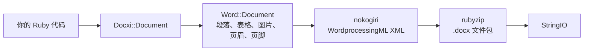

<!-- Translated from README.md (git blob 08aeefecb2eaa6ce543fc23576be90e5767dfaf8). See docs/i18n/TRANSLATION_GUIDE.md. -->

# docxi：使用 Ruby 生成 Word（.docx）文档

[](https://rubygems.org/gems/docxi)
[](https://github.com/hammad417/docxi/actions/workflows/ci.yml)
[](https://rubygems.org/gems/docxi)
[](https://rubygems.org/gems/docxi)
[](../../LICENSE)

[English](../../README.md) · [简体中文](README.zh-CN.md) · [繁體中文](README.zh-TW.md) · [Español](README.es.md) · [العربية](README.ar.md) · [Français](README.fr.md) · [Português (Brasil)](README.pt-BR.md) · [Deutsch](README.de.md) · [हिन्दी](README.hi.md) · [日本語](README.ja.md) · [한국어](README.ko.md) · [Русский](README.ru.md) · [Bahasa Indonesia](README.id.md) · [Türkçe](README.tr.md) · [Italiano](README.it.md) · [Tiếng Việt](README.vi.md)

> 本文译自英文版 [README](../../README.md)。两者如有出入，以英文版为准。

docxi 是一个 Ruby gem，用代码生成 Microsoft Word `.docx` 文件。你用一套基于代码块的小型 DSL 描述文档（段落、带格式的文本、表格、图片、页眉页脚、页码、超链接），docxi 负责写出 Office Open XML 文件包。它不需要 Microsoft Word、LibreOffice 或模板文件，在普通 Ruby 脚本和 Ruby on Rails 应用中都能使用。

```ruby
require "docxi"

word = Docxi::Document.new
word.document.p { |p| p.text "Hello from docxi", bold: true, size: 16 }
File.binwrite("hello.docx", word.render.string)
```

## <a id="contents"></a>目录

- [概述](#overview)
- [功能特性](#features)
- [技术栈](#technology-stack)
- [安装](#installation)
- [快速开始](#quick-start)
- [使用示例](#usage-examples)
- [配置](#configuration)
- [工作原理](#how-it-works)
- [API 速览](#api-at-a-glance)
- [支持的平台](#supported-platforms)
- [常见使用场景](#common-use-cases)
- [故障排除](#troubleshooting)
- [常见问题](#faq)
- [文档](#documentation)
- [参与贡献](#contributing)
- [安全](#security)
- [许可证](#license)
- [维护者](#maintainers)

## <a id="overview"></a>概述

在应用中生成 Word 文档，通常意味着填充模板、驱动一整套办公软件，或者把 HTML 转换过去、再祈祷排版不乱。docxi 换了一种做法：你在 Ruby 中逐个元素地构建文档，最后得到一个装着完整 `.docx` 文件的 `StringIO`，可以写入磁盘、作为邮件附件发送，或者从 Rails 控制器返回给用户。

它面向需要把自己的数据导出为 Word 格式的报表、信函或其他文档的 Ruby 和 Rails 开发者。运行时依赖只有两个：负责构建 XML 的 [nokogiri](https://nokogiri.org/)，以及负责打包的 [rubyzip](https://github.com/rubyzip/rubyzip)。

## <a id="features"></a>功能特性

- **段落**：对齐方式、背景底纹、左右缩进、下边框，以及项目符号列表项
- **文本**：粗体、斜体、下划线、颜色、字号、字体、背景底纹、保留空格和换行
- **换行、分页与制表符**：换行符、分页符和制表符
- **表格**：列宽、行高、表格缩进，每个单元格各自的边框、底纹和垂直对齐，以及用 `colspan` 和 `rowspan` 合并单元格
- **图片**：来源可以是 `File` 等 IO 对象、文件路径或 `http(s)` URL，以内联方式插入，尺寸用 CSS 风格的值指定，例如 `120pt`
- **页眉与页脚**：文本、表格、页眉中的图片、页码，以及首页单独的页眉和页脚
- **目录**：带点线（或其他）前导符和右对齐页码的目录行，页码由你提供
- **超链接**：指向外部 URL
- **文本框**
- **页边距**
- **不含 Zip64 的输出**：即使使用 rubyzip 3，写出的压缩包也不含 Zip64 记录；Google Docs 和旧版 LibreOffice 会拒绝打开含有这类记录的文件

### <a id="limitations-and-known-issues"></a>限制与已知问题

docxi 只能创建新文档，不能打开或编辑已有的 `.docx`，不能填充模板，也不能执行邮件合并。它没有编号列表、标题样式或自动生成的目录，页面尺寸固定为纵向的 US Letter。

以下问题已知，计划在 0.2.0 中修复：

- 用 `pH`/`pV` 定位的图片、页眉中的图片以及表格单元格中的图片，尺寸按 `width * height` 计算，因此会比预期小得多。用 `style:` 指定尺寸的内联图片不受影响。
- 表格级别的 `borders:` 会应用到每个单元格，而不是表格的外框。单元格级别的 `borders:` 正常工作。
- 页码字段的域代码中，`\* MERGEFORMAT` 缺少反斜杠。
- 表格单元格中的页码前面会多出文本 "GlobalOptions"。
- 图片总是以 PNG 部件存储，并且 `[Content_Types].xml` 只声明前两个页眉和页脚。

## <a id="technology-stack"></a>技术栈

| 组成部分 | 使用的技术 |
|---|---|
| 语言 | Ruby 2.5 或更高版本 |
| XML | [nokogiri](https://nokogiri.org/) `>= 1.8, < 2` |
| 打包 | [rubyzip](https://github.com/rubyzip/rubyzip) `>= 1.3, < 4` |
| 输出格式 | Office Open XML WordprocessingML（`.docx`） |
| 测试 | Minitest，并将输出与上一个版本生成的文件逐一比对 |
| CI | 在 Ubuntu 24.04 上运行的 GitHub Actions，外加 LibreOffice 转换检查 |

## <a id="installation"></a>安装

### <a id="prerequisites"></a>前置条件

- Ruby 2.5 或更高版本
- 如果通过 Gemfile 安装，需要 Bundler
- 一个能安装 nokogiri 的平台。nokogiri 为常见的 Linux、macOS 和 Windows 平台提供预编译版本。

### <a id="install"></a>安装 gem

在 Gemfile 中加入 docxi：

```ruby
gem "docxi", "~> 0.1"
```

然后运行 `bundle install`。也可以直接安装：

```sh
gem install docxi
```

从 0.0.x 升级不需要改动代码，运行 `bundle update docxi` 即可。0.1.0 生成的文档与 0.0.6 相同。Ruby 版本低于 2.5 的应用会自动停留在 0.0.6。

## <a id="quick-start"></a>快速开始

```ruby
require "docxi"

word = Docxi::Document.new
document = word.document

document.p(align: "center") do |p|
  p.text "Monthly report", size: 20, bold: true
end

document.p do |p|
  p.text "Generated with docxi on ", space: true
  p.text Time.now.strftime("%Y-%m-%d"), bold: true
end

File.binwrite("report.docx", word.render.string)
```

`word.render` 返回一个 `StringIO`，它的 `.string` 就是完整的 `.docx` 文件。

## <a id="usage-examples"></a>使用示例

以下示例接着快速开始的代码，沿用同一个 `word` 和 `document`。

### <a id="formatted-text-and-bullet-lists"></a>带格式的文本和项目符号列表

```ruby
document.p do |p|
  p.text "Bold", bold: true
  p.text " italic", italic: true, space: true
  p.text " underlined", underline: true, space: true, br: true
  p.text "Dark red Georgia, 14 pt, on yellow", color: "8B0000", font: "Georgia", size: 14, fill: "FFFF00"
end

document.p(ul: true) { |p| p.text "First bullet" }
document.p(ul: true) { |p| p.text "Second bullet" }

document.p(align: "center", fill: "EEEEEE", bottom: true) do |p|
  p.text "Shaded, centered, with a bottom border"
end

document.br(page: true)
```

如果文本以空格开头或结尾，请加上 `space: true`，否则 Word 会丢掉这个空格。

### <a id="tables"></a>表格

```ruby
document.table(columns_width: [240, 100, 100]) do |table|
  table.tr(fill: "D9D9D9", bold: true) do |tr|
    tr.tc { |tc| tc.text "Item" }
    tr.tc { |tc| tc.text "Qty" }
    tr.tc { |tc| tc.text "Price" }
  end

  table.tr do |tr|
    tr.tc(borders: { top: 4, right: 4, bottom: 4, left: 4 }) { |tc| tc.text "Widget" }
    tr.tc(valign: "center") { |tc| tc.text "2" }
    tr.tc { |tc| tc.text "$20.00", align: "right" }
  end

  table.tr do |tr|
    tr.tc(colspan: 2) { |tc| tc.text "Total", bold: true }
    tr.tc { |tc| tc.text "$20.00", align: "right", bold: true }
  end
end
```

`tr` 上的选项会应用到这一行的每个单元格。要纵向合并单元格，请给上面的单元格传 `rowspan: true`，给它下面的单元格传 `merged: true`。

### <a id="images"></a>图片

```ruby
logo = document.add_media(File.open("logo.png", "rb"))
# add_media 也接受文件路径或 http(s) URL：
# logo = document.add_media("https://example.com/logo.png")

document.p(align: "center") do |p|
  p.image logo, style: { width: "120pt", height: "60pt" }
end
```

### <a id="headers-footers-and-page-numbers"></a>页眉、页脚和页码

```ruby
header = Docxi::Word::Headers::Header.new do |h|
  h.text "ACME Corp. quarterly report", size: 9, align: "right"
end

footer = Docxi::Word::Footers::Footer.new do |f|
  f.page_numbers name: "Page", align: "center"
end

document.add_header(header)
document.add_footer(footer)

# 首页总是有自己单独的页眉和页脚：
document.add_first_header(Docxi::Word::Headers::Header.new { |h| h.text "Cover page" })
document.add_first_footer(Docxi::Word::Footers::Footer.new { |f| f.text "Confidential" })
```

### <a id="hyperlinks"></a>超链接

```ruby
url = "https://github.com/hammad417/docxi"
link = document.add_hyperlink(url)

document.p { |p| p.hyperlink "docxi on GitHub", url, link }
```

### <a id="table-of-contents"></a>添加目录

```ruby
document.text "Contents", size: 16, bold: true

document.table_of_content do |toc|
  toc.add_row "Introduction", 1
  toc.add_row "Results", 3
  toc.add_row "Appendix", 7, leader: "hyphen"
end
```

docxi 不会计算页码，目录行显示的是你传入的页码。

### <a id="sending-a-document-from-rails"></a>从 Rails 发送文档

```ruby
class ReportsController < ApplicationController
  def show
    word = Docxi::Document.new
    word.document.p { |p| p.text "Report for #{Date.today}" }

    send_data word.render.string,
              filename: "report.docx",
              type: "application/vnd.openxmlformats-officedocument.wordprocessingml.document"
  end
end
```

### <a id="more-examples"></a>更多示例

[`examples/full_document.rb`](../../examples/full_document.rb) 在一个文档中用到了全部功能，wiki 的[使用示例](https://github.com/hammad417/docxi/wiki/Usage-Examples-zh-CN)页面还有报告、发票、信函等完整示例。在本仓库的克隆中运行 `bundle exec rake samples`，会把测试套件中的示例文档写入 `tmp/samples/`。

## <a id="configuration"></a>配置

docxi 没有配置文件，也没有环境变量。页边距在创建文档时设置：

```ruby
# 单位是二十分之一磅（1440 = 1 英寸）。请同时传入四个方向的值。
word = Docxi::Document.new(top: 1440, right: 1080, bottom: 1440, left: 1080, header: 720, footer: 720)
```

默认值为 `top: 720, right: 1440, bottom: 720, left: 1440, header: 190, footer: 200`。只要设置了任意一个页边距，就请把 `top`、`right`、`bottom` 和 `left` 一起设置，因为没有设置的那几个会被写成空值。

| 选项 | 单位 |
|---|---|
| 文本的 `size:` | 磅 |
| 页边距、段落的 `left:` 和 `right:` 缩进、表格的 `iwidth:` | 二十分之一磅（每英寸 1440） |
| 单元格 `borders:` 的粗细 | 八分之一磅 |
| `columns_width:` 和单元格的 `width:` | 乘以 14.92 换算成二十分之一磅，大致相当于像素 |
| 图片的 `style:` | CSS 长度，例如 `"120pt"` |

页面为纵向 US Letter，默认字体为 Arial 12 磅。

## <a id="how-it-works"></a>工作原理



`Docxi::Document` 保存文件包级别的部件：关系（relationships）、内容类型和文档属性。`word.document` 是一个 `Docxi::Word::Document`，它收集你添加的元素（`Docxi::Word::Contents::Paragraph`、`Table`、`Image`、`TableOfContent` 等），以及页眉、页脚、图片、超链接、样式、编号和主题。调用 `render` 时，每个部件用 nokogiri 构建自己的 XML，再由 rubyzip 写入 zip 压缩包。`Docxi.write_entry` 会预先设置每个条目的大小，这样 rubyzip 就不会添加 Zip64 记录。

## <a id="api-at-a-glance"></a>API 速览

| 调用 | 添加的内容 |
|---|---|
| `Docxi::Document.new(margins)` | 一个新文档。`#render` 以 `StringIO` 的形式返回 `.docx` |
| `document.p(options)` 加代码块 | 一个段落。代码块中可以使用 `text`、`br`、`tab`、`image`、`hyperlink`、`frame` |
| `document.text(string, options)` | 只包含一段文本的段落 |
| `document.br(page: true)` | 一个分页符 |
| `document.table(options)` 加代码块 | 一个表格。内部依次使用 `tr`、`tc`，再用 `text`、`p`、`image` 或 `page_numbers` |
| `document.table_of_content(options)` 加代码块 | 用 `add_row(text, page)` 添加的目录行 |
| `document.add_media(file_path_or_url)` | 一张图片，之后用 `image` 放置 |
| `document.add_hyperlink(url)` | 一个链接目标，供 `hyperlink` 使用 |
| `document.add_header(header)` 和 `add_first_header` | 用 `Docxi::Word::Headers::Header` 构建的页眉 |
| `document.add_footer(footer)` 和 `add_first_footer` | 用 `Docxi::Word::Footers::Footer` 构建的页脚 |
| `document.frame(text, options)` | 一个文本框 |

## <a id="supported-platforms"></a>支持的平台

| 方面 | 支持情况 |
|---|---|
| Ruby | 2.5 或更高版本。CI 运行 Ruby 2.5、2.6、2.7、3.0、3.1、3.2、3.3、3.4 和 4.0 |
| Rails | 不是必需的。CI 会同时加载 Rails 5.2、6.0、6.1、7.0、7.1、7.2、8.0 和 8.1 来运行 docxi |
| 依赖 | CI 覆盖 rubyzip 1.3、2.4 和 3.x，以及 nokogiri 1.11 到 1.19 |
| 操作系统 | CI 在 Ubuntu 24.04 上运行，测试也在 macOS 上跑过。Windows 未经测试。 |
| 输出 | 面向 Microsoft Word 的 `.docx`。CI 会检查 LibreOffice 能否转换示例文档 |

## <a id="common-use-cases"></a>常见使用场景

- 把 Rails 应用中的报表导出为 Word 文件
- 根据数据库记录生成信函、证书或发票
- 在没有安装办公软件的后台任务或命令行脚本中生成文档

## <a id="troubleshooting"></a>故障排除

**在 Rails 6 及以上的应用中添加 docxi 时，Bundler 找不到兼容的 `nokogiri` 版本。**
docxi 0.0.6 锁定了 `nokogiri < 1.7`，而 Rails 6.0 以来的每个版本都需要 nokogiri 1.8.5 或更高版本。请使用 `gem "docxi", "~> 0.1"`。

**Bundler 找不到兼容的 `rubyzip` 版本。**
docxi 0.0.6 锁定了 `rubyzip ~> 0.9.9`，会与任何需要更新版 rubyzip 的 gem 冲突。docxi 0.1.0 支持 rubyzip 1.3 到 3.x。

**在 Rails 之外出现 `NoMethodError: undefined method 'present?'`。**
docxi 0.0.6 依赖于已加载的 ActiveSupport，0.1.0 不再依赖它。

**Google Docs 或 LibreOffice 打不开用 rubyzip 3 生成的文件。**
docxi 0.0.6 配合 rubyzip 3 使用时，会在每个条目中写入 Zip64 记录。0.1.0 写出的压缩包不含这些记录。

**在 Ruby 3 上，图片 URL 抛出 `Errno::ENOENT`。**
docxi 0.0.6 用 `Kernel#open` 打开 URL，而在 Ruby 3 上它已不再获取 URL。0.1.0 改用 `URI#open` 下载图片。

**调用 `tab`、`frame` 或页眉的 `page_numbers` 时出现 `NameError`。**
这些功能在 0.0.6 中无法使用，在 0.1.0 中已经修复。

**首页不显示你设置的页眉或页脚。**
docxi 总是为首页提供单独的页眉和页脚。请用 `add_first_header` 和 `add_first_footer` 设置它们。

**缺少某个页边距。**
设置页边距时，请同时传入 `top`、`right`、`bottom` 和 `left`。参见[配置](#configuration)。

## <a id="faq"></a>常见问题

**需要安装 Microsoft Word 或 LibreOffice 吗？**
不需要。docxi 自己写出 XML 和 zip 压缩包。

**docxi 需要 Rails 吗？**
不需要。它可以在任何 Ruby 程序中使用。CI 还会在加载 Rails 5.2 到 8.1 的情况下运行测试。

**如何在 Ruby on Rails 中生成 Word 文档？**
在控制器或后台任务中用 docxi 构建文档，再用 `send_data` 发送 `word.render.string`。参见[从 Rails 发送文档](#sending-a-document-from-rails)。

**docxi 能编辑已有的 .docx 文件或填充 Word 模板吗？**
不能。docxi 只创建新文档。如果需要使用带合并域的模板，请选择基于模板的 gem，例如 sablon。

**目录是根据标题自动生成的吗？**
不是。每一行目录及其页码都要由你自己添加。

**可以修改纸张大小或方向吗？**
暂时不行。页面为纵向 US Letter，只能修改页边距。

**支持哪些图片格式？**
图片以 PNG 部件存储，因此使用 PNG 文件最稳妥。

**支持哪些 Ruby 和 Rails 版本？**
Ruby 2.5 及以上。Rails 是可选的，CI 测试了 Rails 5.2 到 8.1。

## <a id="documentation"></a>文档

- [docxi wiki](https://github.com/hammad417/docxi/wiki/Home-zh-CN) 介绍每个选项，并提供更多示例和故障排除
- [CHANGELOG.md](../../CHANGELOG.md) 列出每个版本的变更（英文）
- [examples/full_document.rb](../../examples/full_document.rb) 是一个完整示例
- [docs/i18n](README.md) 记录本 README 各语言译本的状态

## <a id="contributing"></a>参与贡献

欢迎在 [GitHub](https://github.com/hammad417/docxi/issues) 上提交 bug 报告和拉取请求（pull request）。参与 docxi 的开发：

```sh
git clone https://github.com/hammad417/docxi.git
cd docxi
bundle install
bundle exec rake test
```

如果要在加载特定 Rails 版本的情况下运行测试，请使用 `gemfiles/` 中对应的 Gemfile：

```sh
BUNDLE_GEMFILE=gemfiles/rails_8.1.gemfile bundle install
BUNDLE_GEMFILE=gemfiles/rails_8.1.gemfile DOCXI_WITH_RAILS=1 bundle exec rake test
```

`test/golden` 保存了 0.0.6 为 `test/support/sample_documents.rb` 中的文档生成的 XML，测试会把每一次改动与它比对。如果你有意修改了生成的 XML，请用 `bundle exec rake golden` 更新它，并在拉取请求中说明这项改动。

## <a id="security"></a>安全

请不要在公开的 issue 中报告安全问题，而是直接发邮件给维护者。邮箱地址见 [docxi.gemspec](../../docxi.gemspec)。

如果你仍在使用 docxi 0.0.x，请升级到 0.1.0。旧版本会把图片路径字符串交给 `Kernel#open`，而它会把以 `|` 开头的字符串当作 shell 命令执行。

## <a id="license"></a>许可证

docxi 基于 [MIT 许可证](../../LICENSE) 发布。许可证文件保留了 docxer 的原始版权声明，docxi 正是在 docxer 的基础上开发的。

## <a id="maintainers"></a>维护者

docxi 由 [Phaedra Solutions](https://www.phaedrasolutions.com/) 的 [Hammad Maqbool](https://github.com/hammad417) 维护。它于 2016 年在 Timur Gabdrakipov 的 [docxer](https://github.com/gtimti/docxer) 基础上起步。

### <a id="about-phaedra-solutions"></a>关于 Phaedra Solutions

Phaedra Solutions 是一家以 AI 为先的软件工程公司，自 2013 年起为企业开发定制软件。
