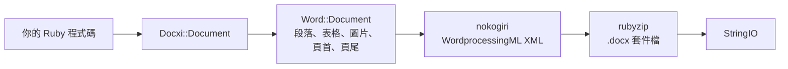

<!-- Translated from README.md (git blob 08aeefecb2eaa6ce543fc23576be90e5767dfaf8). See docs/i18n/TRANSLATION_GUIDE.md. -->

# docxi：使用 Ruby 產生 Word（.docx）文件

[](https://rubygems.org/gems/docxi)
[](https://github.com/hammad417/docxi/actions/workflows/ci.yml)
[](https://rubygems.org/gems/docxi)
[](https://rubygems.org/gems/docxi)
[](../../LICENSE)

[English](../../README.md) · [简体中文](README.zh-CN.md) · [繁體中文](README.zh-TW.md) · [Español](README.es.md) · [العربية](README.ar.md) · [Français](README.fr.md) · [Português (Brasil)](README.pt-BR.md) · [Deutsch](README.de.md) · [हिन्दी](README.hi.md) · [日本語](README.ja.md) · [한국어](README.ko.md) · [Русский](README.ru.md) · [Bahasa Indonesia](README.id.md) · [Türkçe](README.tr.md) · [Italiano](README.it.md) · [Tiếng Việt](README.vi.md)

> 本文譯自英文版 [README](../../README.md)。兩者如有出入，以英文版為準。

docxi 是一個 Ruby gem，可以用程式碼產生 Microsoft Word `.docx` 檔案。你透過一套以區塊為基礎的小型 DSL 描述文件（段落、格式化文字、表格、圖片、頁首頁尾、頁碼、超連結），docxi 負責寫出 Office Open XML 套件檔。它不需要 Microsoft Word、LibreOffice 或範本檔案，在一般的 Ruby 指令碼和 Ruby on Rails 應用程式中都能使用。

```ruby
require "docxi"

word = Docxi::Document.new
word.document.p { |p| p.text "Hello from docxi", bold: true, size: 16 }
File.binwrite("hello.docx", word.render.string)
```

## <a id="contents"></a>目錄

- [概覽](#overview)
- [功能](#features)
- [技術堆疊](#technology-stack)
- [安裝](#installation)
- [快速入門](#quick-start)
- [使用範例](#usage-examples)
- [設定](#configuration)
- [運作方式](#how-it-works)
- [API 一覽](#api-at-a-glance)
- [支援的平台](#supported-platforms)
- [常見使用情境](#common-use-cases)
- [疑難排解](#troubleshooting)
- [常見問題](#faq)
- [文件](#documentation)
- [參與貢獻](#contributing)
- [安全性](#security)
- [授權](#license)
- [維護者](#maintainers)

## <a id="overview"></a>概覽

在應用程式中產生 Word 文件，通常意味著填寫範本、操控一整套辦公室軟體，或是把 HTML 轉換過去，再祈禱版面不會跑掉。docxi 採取不同的做法：你在 Ruby 中逐一建立文件的每個元素，最後取得一個裝有完整 `.docx` 檔案的 `StringIO`，可以寫入磁碟、作為電子郵件附件寄出，或從 Rails 控制器傳送給使用者。

它的目標使用者，是需要把自家資料匯出成 Word 格式報表、信函或其他文件的 Ruby 與 Rails 開發者。執行期相依套件只有兩個：負責建立 XML 的 [nokogiri](https://nokogiri.org/)，以及負責打包的 [rubyzip](https://github.com/rubyzip/rubyzip)。

## <a id="features"></a>功能

- **段落**：對齊方式、背景網底、左右縮排、下框線，以及項目符號清單項目
- **文字**：粗體、斜體、底線、色彩、字型大小、字型、背景網底、保留空白與換行
- **換行、分頁與定位字元**：換行、分頁符號與定位字元
- **表格**：欄寬、列高、表格縮排，每個儲存格各自的框線、網底與垂直對齊，以及用 `colspan` 和 `rowspan` 合併儲存格
- **圖片**：來源可以是 `File` 等 IO 物件、檔案路徑或 `http(s)` URL，以內嵌方式放置，並用 CSS 風格的尺寸指定大小，例如 `120pt`
- **頁首與頁尾**：文字、表格、頁首中的圖片、頁碼，以及第一頁專用的頁首和頁尾
- **目錄**：帶有點狀（或其他）前置字元與靠右對齊頁碼的目錄列，頁碼由你提供
- **超連結**：連到外部 URL
- **文字方塊**
- **頁面邊界**
- **不含 Zip64 的輸出**：即使使用 rubyzip 3，寫出的壓縮檔也不含 Zip64 記錄；Google Docs 和舊版 LibreOffice 會拒絕開啟含有這類記錄的檔案

### <a id="limitations-and-known-issues"></a>限制與已知問題

docxi 只能建立新文件，無法開啟或編輯既有的 `.docx`、填寫範本或執行合併列印。它沒有編號清單、標題樣式或自動產生的目錄，頁面大小固定為直向的 US Letter。

以下是已知問題，預計在 0.2.0 修正：

- 用 `pH`/`pV` 定位的圖片、頁首中的圖片，以及表格儲存格中的圖片，尺寸是依 `width * height` 計算，因此會比預期小很多。用 `style:` 指定尺寸的內嵌圖片不受影響。
- 表格層級的 `borders:` 會套用到每個儲存格，而不是表格的外框。儲存格層級的 `borders:` 可以正常運作。
- 頁碼欄位的功能變數代碼中，`\* MERGEFORMAT` 少了反斜線。
- 表格儲存格中的頁碼前面會多出文字 "GlobalOptions"。
- 圖片一律以 PNG 部分（part）儲存，而且 `[Content_Types].xml` 只宣告前兩個頁首和頁尾。

## <a id="technology-stack"></a>技術堆疊

| 部分 | 使用的技術 |
|---|---|
| 語言 | Ruby 2.5 或更新版本 |
| XML | [nokogiri](https://nokogiri.org/) `>= 1.8, < 2` |
| 打包 | [rubyzip](https://github.com/rubyzip/rubyzip) `>= 1.3, < 4` |
| 輸出格式 | Office Open XML WordprocessingML（`.docx`） |
| 測試 | Minitest，並將輸出與上一個版本產生的檔案逐一比對 |
| CI | 在 Ubuntu 24.04 上執行的 GitHub Actions，另加 LibreOffice 轉檔檢查 |

## <a id="installation"></a>安裝

### <a id="prerequisites"></a>事前準備

- Ruby 2.5 或更新版本
- 若透過 Gemfile 安裝，需要 Bundler
- 可以安裝 nokogiri 的平台。nokogiri 為常見的 Linux、macOS 和 Windows 平台提供預先編譯的版本。

### <a id="install"></a>安裝 gem

在 Gemfile 中加入 docxi：

```ruby
gem "docxi", "~> 0.1"
```

然後執行 `bundle install`。也可以直接安裝：

```sh
gem install docxi
```

從 0.0.x 升級不需要修改程式碼，只要執行 `bundle update docxi`。0.1.0 產生的文件與 0.0.6 相同。Ruby 版本低於 2.5 的應用程式會自動停留在 0.0.6。

## <a id="quick-start"></a>快速入門

```ruby
require "docxi"

word = Docxi::Document.new
document = word.document

document.p(align: "center") do |p|
  p.text "Monthly report", size: 20, bold: true
end

document.p do |p|
  p.text "Generated with docxi on ", space: true
  p.text Time.now.strftime("%Y-%m-%d"), bold: true
end

File.binwrite("report.docx", word.render.string)
```

`word.render` 會傳回一個 `StringIO`，它的 `.string` 就是完整的 `.docx` 檔案。

## <a id="usage-examples"></a>使用範例

以下範例接續快速入門的程式碼，沿用同一個 `word` 和 `document`。

### <a id="formatted-text-and-bullet-lists"></a>格式化文字與項目符號清單

```ruby
document.p do |p|
  p.text "Bold", bold: true
  p.text " italic", italic: true, space: true
  p.text " underlined", underline: true, space: true, br: true
  p.text "Dark red Georgia, 14 pt, on yellow", color: "8B0000", font: "Georgia", size: 14, fill: "FFFF00"
end

document.p(ul: true) { |p| p.text "First bullet" }
document.p(ul: true) { |p| p.text "Second bullet" }

document.p(align: "center", fill: "EEEEEE", bottom: true) do |p|
  p.text "Shaded, centered, with a bottom border"
end

document.br(page: true)
```

文字開頭或結尾有空白時，請加上 `space: true`，否則 Word 會把那個空白去掉。

### <a id="tables"></a>表格

```ruby
document.table(columns_width: [240, 100, 100]) do |table|
  table.tr(fill: "D9D9D9", bold: true) do |tr|
    tr.tc { |tc| tc.text "Item" }
    tr.tc { |tc| tc.text "Qty" }
    tr.tc { |tc| tc.text "Price" }
  end

  table.tr do |tr|
    tr.tc(borders: { top: 4, right: 4, bottom: 4, left: 4 }) { |tc| tc.text "Widget" }
    tr.tc(valign: "center") { |tc| tc.text "2" }
    tr.tc { |tc| tc.text "$20.00", align: "right" }
  end

  table.tr do |tr|
    tr.tc(colspan: 2) { |tc| tc.text "Total", bold: true }
    tr.tc { |tc| tc.text "$20.00", align: "right", bold: true }
  end
end
```

設在 `tr` 上的選項會套用到該列的每個儲存格。若要垂直合併儲存格，請在上方的儲存格傳入 `rowspan: true`，並在它下方的儲存格傳入 `merged: true`。

### <a id="images"></a>圖片

```ruby
logo = document.add_media(File.open("logo.png", "rb"))
# add_media 也接受檔案路徑或 http(s) URL：
# logo = document.add_media("https://example.com/logo.png")

document.p(align: "center") do |p|
  p.image logo, style: { width: "120pt", height: "60pt" }
end
```

### <a id="headers-footers-and-page-numbers"></a>頁首、頁尾與頁碼

```ruby
header = Docxi::Word::Headers::Header.new do |h|
  h.text "ACME Corp. quarterly report", size: 9, align: "right"
end

footer = Docxi::Word::Footers::Footer.new do |f|
  f.page_numbers name: "Page", align: "center"
end

document.add_header(header)
document.add_footer(footer)

# 第一頁一律有自己專用的頁首和頁尾：
document.add_first_header(Docxi::Word::Headers::Header.new { |h| h.text "Cover page" })
document.add_first_footer(Docxi::Word::Footers::Footer.new { |f| f.text "Confidential" })
```

### <a id="hyperlinks"></a>超連結

```ruby
url = "https://github.com/hammad417/docxi"
link = document.add_hyperlink(url)

document.p { |p| p.hyperlink "docxi on GitHub", url, link }
```

### <a id="table-of-contents"></a>新增目錄

```ruby
document.text "Contents", size: 16, bold: true

document.table_of_content do |toc|
  toc.add_row "Introduction", 1
  toc.add_row "Results", 3
  toc.add_row "Appendix", 7, leader: "hyphen"
end
```

docxi 不會計算頁碼，目錄列顯示的是你傳入的頁碼。

### <a id="sending-a-document-from-rails"></a>從 Rails 傳送文件

```ruby
class ReportsController < ApplicationController
  def show
    word = Docxi::Document.new
    word.document.p { |p| p.text "Report for #{Date.today}" }

    send_data word.render.string,
              filename: "report.docx",
              type: "application/vnd.openxmlformats-officedocument.wordprocessingml.document"
  end
end
```

### <a id="more-examples"></a>更多範例

[`examples/full_document.rb`](../../examples/full_document.rb) 在一份文件中用到了所有功能，wiki 的[使用範例](https://github.com/hammad417/docxi/wiki/Usage-Examples-zh-TW)頁面還有報告、發票、信件等完整範例。在本儲存庫的複本中執行 `bundle exec rake samples`，會把測試套件中的範例文件寫入 `tmp/samples/`。

## <a id="configuration"></a>設定

docxi 沒有設定檔，也沒有環境變數。頁面邊界在建立文件時設定：

```ruby
# 單位是二十分之一點（1440 = 1 英吋）。請同時傳入四邊的值。
word = Docxi::Document.new(top: 1440, right: 1080, bottom: 1440, left: 1080, header: 720, footer: 720)
```

預設值為 `top: 720, right: 1440, bottom: 720, left: 1440, header: 190, footer: 200`。只要設定了任何一個邊界，就請把 `top`、`right`、`bottom` 和 `left` 一起設定，因為沒有設定的邊界會被寫成空值。

| 選項 | 單位 |
|---|---|
| 文字的 `size:` | 點 |
| 頁面邊界、段落的 `left:` 和 `right:` 縮排、表格的 `iwidth:` | 二十分之一點（每英吋 1440） |
| 儲存格 `borders:` 的粗細 | 八分之一點 |
| `columns_width:` 和儲存格的 `width:` | 乘以 14.92 換算成二十分之一點，大約等於像素 |
| 圖片的 `style:` | CSS 長度，例如 `"120pt"` |

頁面為直向 US Letter，預設字型為 Arial 12 點。

## <a id="how-it-works"></a>運作方式



`Docxi::Document` 負責套件層級的部分：關聯（relationships）、內容類型與文件屬性。`word.document` 是一個 `Docxi::Word::Document`，它收集你加入的元素（`Docxi::Word::Contents::Paragraph`、`Table`、`Image`、`TableOfContent` 等），以及頁首、頁尾、圖片、超連結、樣式、編號和佈景主題。呼叫 `render` 時，每個部分會用 nokogiri 建立自己的 XML，再由 rubyzip 寫入 zip 壓縮檔。`Docxi.write_entry` 會事先設定每個項目的大小，讓 rubyzip 不會加入 Zip64 記錄。

## <a id="api-at-a-glance"></a>API 一覽

| 呼叫 | 加入的內容 |
|---|---|
| `Docxi::Document.new(margins)` | 一份新文件。`#render` 以 `StringIO` 的形式傳回 `.docx` |
| `document.p(options)` 搭配區塊 | 一個段落。區塊中可以使用 `text`、`br`、`tab`、`image`、`hyperlink`、`frame` |
| `document.text(string, options)` | 只包含一段文字的段落 |
| `document.br(page: true)` | 一個分頁符號 |
| `document.table(options)` 搭配區塊 | 一個表格。區塊中依序使用 `tr`、`tc`，再用 `text`、`p`、`image` 或 `page_numbers` |
| `document.table_of_content(options)` 搭配區塊 | 以 `add_row(text, page)` 加入的目錄列 |
| `document.add_media(file_path_or_url)` | 一張圖片，之後用 `image` 放置 |
| `document.add_hyperlink(url)` | 一個連結目標，供 `hyperlink` 使用 |
| `document.add_header(header)` 和 `add_first_header` | 用 `Docxi::Word::Headers::Header` 建立的頁首 |
| `document.add_footer(footer)` 和 `add_first_footer` | 用 `Docxi::Word::Footers::Footer` 建立的頁尾 |
| `document.frame(text, options)` | 一個文字方塊 |

## <a id="supported-platforms"></a>支援的平台

| 項目 | 支援情況 |
|---|---|
| Ruby | 2.5 或更新版本。CI 會執行 Ruby 2.5、2.6、2.7、3.0、3.1、3.2、3.3、3.4 和 4.0 |
| Rails | 非必要。CI 會同時載入 Rails 5.2、6.0、6.1、7.0、7.1、7.2、8.0 和 8.1 來執行 docxi |
| 相依套件 | CI 涵蓋 rubyzip 1.3、2.4 和 3.x，以及 nokogiri 1.11 到 1.19 |
| 作業系統 | CI 在 Ubuntu 24.04 上執行，測試也曾在 macOS 上跑過。未在 Windows 上測試。 |
| 輸出 | 給 Microsoft Word 使用的 `.docx`。CI 會檢查 LibreOffice 能否轉換範例文件 |

## <a id="common-use-cases"></a>常見使用情境

- 將 Rails 應用程式中的報表匯出成 Word 檔案
- 根據資料庫記錄產生信函、證書或發票
- 在沒有安裝辦公室軟體的背景工作或命令列指令碼中產生文件

## <a id="troubleshooting"></a>疑難排解

**在 Rails 6 以上的應用程式中加入 docxi 時，Bundler 找不到相容的 `nokogiri` 版本。**
docxi 0.0.6 鎖定了 `nokogiri < 1.7`，而 Rails 6.0 以後的每個版本都需要 nokogiri 1.8.5 或更新版本。請使用 `gem "docxi", "~> 0.1"`。

**Bundler 找不到相容的 `rubyzip` 版本。**
docxi 0.0.6 鎖定了 `rubyzip ~> 0.9.9`，會和任何需要較新 rubyzip 的 gem 衝突。docxi 0.1.0 支援 rubyzip 1.3 到 3.x。

**在 Rails 之外出現 `NoMethodError: undefined method 'present?'`。**
docxi 0.0.6 依賴已載入的 ActiveSupport，0.1.0 不再需要。

**Google Docs 或 LibreOffice 無法開啟用 rubyzip 3 產生的檔案。**
docxi 0.0.6 搭配 rubyzip 3 時，會在每個項目中寫入 Zip64 記錄。0.1.0 寫出的壓縮檔不含這些記錄。

**在 Ruby 3 上，圖片 URL 引發 `Errno::ENOENT`。**
docxi 0.0.6 用 `Kernel#open` 開啟 URL，但在 Ruby 3 上它已不再擷取 URL。0.1.0 改用 `URI#open` 下載圖片。

**呼叫 `tab`、`frame` 或頁首的 `page_numbers` 時出現 `NameError`。**
這些功能在 0.0.6 中無法運作，在 0.1.0 已修正。

**第一頁沒有顯示你設定的頁首或頁尾。**
docxi 一律為第一頁提供專用的頁首和頁尾。請用 `add_first_header` 和 `add_first_footer` 設定。

**少了某個頁面邊界。**
設定邊界時，請同時傳入 `top`、`right`、`bottom` 和 `left`。請參閱[設定](#configuration)。

## <a id="faq"></a>常見問題

**需要安裝 Microsoft Word 或 LibreOffice 嗎？**
不需要。docxi 會自行寫出 XML 和 zip 壓縮檔。

**docxi 需要 Rails 嗎？**
不需要。它可以在任何 Ruby 程式中使用。CI 也會在載入 Rails 5.2 到 8.1 的情況下執行測試。

**如何在 Ruby on Rails 中產生 Word 文件？**
在控制器或背景工作中用 docxi 建立文件，再用 `send_data` 傳送 `word.render.string`。請參閱[從 Rails 傳送文件](#sending-a-document-from-rails)。

**docxi 可以編輯既有的 .docx 或填寫 Word 範本嗎？**
不行。docxi 只會建立新文件。如果需要含合併欄位的範本，請改用以範本為基礎的 gem，例如 sablon。

**目錄是根據標題自動產生的嗎？**
不是。每一列目錄和它的頁碼都要由你自行加入。

**可以變更紙張大小或方向嗎？**
目前還不行。頁面為直向 US Letter，只能變更邊界。

**支援哪些圖片格式？**
圖片會以 PNG 部分儲存，所以使用 PNG 檔案最保險。

**支援哪些 Ruby 和 Rails 版本？**
Ruby 2.5 以上。Rails 為選用，CI 測試了 Rails 5.2 到 8.1。

## <a id="documentation"></a>文件

- [docxi wiki](https://github.com/hammad417/docxi/wiki/Home-zh-TW) 說明每個選項，並提供更多範例與疑難排解
- [CHANGELOG.md](../../CHANGELOG.md) 列出每個版本的變更（英文）
- [examples/full_document.rb](../../examples/full_document.rb) 是一個完整範例
- [docs/i18n](README.md) 追蹤本 README 各語言譯本的狀態

## <a id="contributing"></a>參與貢獻

歡迎在 [GitHub](https://github.com/hammad417/docxi/issues) 上回報錯誤或提出拉取請求（pull request）。參與 docxi 開發的步驟：

```sh
git clone https://github.com/hammad417/docxi.git
cd docxi
bundle install
bundle exec rake test
```

若要在載入特定 Rails 版本的情況下執行測試，請使用 `gemfiles/` 中對應的 Gemfile：

```sh
BUNDLE_GEMFILE=gemfiles/rails_8.1.gemfile bundle install
BUNDLE_GEMFILE=gemfiles/rails_8.1.gemfile DOCXI_WITH_RAILS=1 bundle exec rake test
```

`test/golden` 保存了 0.0.6 為 `test/support/sample_documents.rb` 中的文件所產生的 XML，測試會將每一次變更與它比對。如果你是刻意修改產生的 XML，請用 `bundle exec rake golden` 更新它，並在拉取請求中說明這項變更。

## <a id="security"></a>安全性

請不要在公開的 issue 中回報安全性問題，請改為寄電子郵件給維護者。電子郵件地址列在 [docxi.gemspec](../../docxi.gemspec) 中。

如果你仍在使用 docxi 0.0.x，請升級到 0.1.0。舊版本會把圖片路徑字串交給 `Kernel#open`，而它會把以 `|` 開頭的字串當成 shell 指令執行。

## <a id="license"></a>授權

docxi 以 [MIT 授權條款](../../LICENSE) 發布。授權檔案保留了 docxer 的原始著作權聲明，docxi 就是以 docxer 為基礎開發的。

## <a id="maintainers"></a>維護者

docxi 由 [Phaedra Solutions](https://www.phaedrasolutions.com/) 的 [Hammad Maqbool](https://github.com/hammad417) 維護。它於 2016 年以 Timur Gabdrakipov 的 [docxer](https://github.com/gtimti/docxer) 為基礎起步。

### <a id="about-phaedra-solutions"></a>關於 Phaedra Solutions

Phaedra Solutions 是一家以 AI 為優先的軟體工程公司，自 2013 年起為企業開發客製化軟體。
