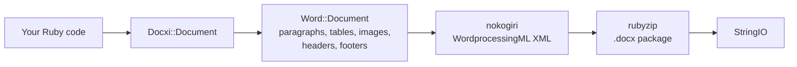

# docxi architecture: how Ruby code becomes a .docx package

A `.docx` file is a zip archive of XML files, called parts, that follow the Office Open XML standard. docxi keeps a Ruby object for each part, builds each part's XML with nokogiri when you call `render`, and writes the archive with rubyzip. This page is for contributors and for anyone debugging the generated XML.

## Overview

## Main classes

| Class | File | Role |
|---|---|---|
| `Docxi::Document` | `lib/docxi/document.rb` | Entry point. Holds the package parts and implements `render` |
| `Docxi::Relationships` | `lib/docxi/relationships.rb` | `_rels/.rels`, the package-level relationships |
| `Docxi::ContentTypes` | `lib/docxi/content_types.rb` | `[Content_Types].xml` |
| `Docxi::Properties` | `lib/docxi/properties.rb` | `docProps/app.xml` and `docProps/core.xml` |
| `Docxi::Word::Document` | `lib/docxi/word/document.rb` | The document body, section settings, and the registry of images, headers, footers and links |
| `Docxi::Word::Helpers` | `lib/docxi/word/helpers.rb` | `p`, `text`, `br`, `tab`, `frame`, `table` and `table_of_content` |
| `Docxi::Word::Contents::*` | `lib/docxi/word/contents/` | `Paragraph`, `Text`, `Break`, `Tab`, `Frame`, `Image`, `Table` and `TableOfContent` |
| `Docxi::Word::Headers::Header`, `Docxi::Word::Footers::Footer` | `lib/docxi/word/headers/`, `lib/docxi/word/footers/` | Header and footer parts, each with its own relationships file |
| `Docxi::Word::Medias` | `lib/docxi/word/medias/` | Images added with `add_media` |
| Static parts | `lib/docxi/word/*.rb` | Styles, numbering, settings, fonts, theme, effects, footnotes and endnotes |

## What `render` does

1. `Docxi::Document#render` opens `Zip::OutputStream.write_buffer`.
2. `Word::Document#render` writes `word/document.xml` (each element writes its own XML), then the static parts, headers, footers, images and `word/_rels/document.xml.rels`.
3. The package properties, package relationships and content types are written last.
4. The buffer is returned as a `StringIO`.

Each part goes through `Docxi.write_entry`, which sets the entry's size before writing. rubyzip 3 would otherwise add Zip64 records to every entry, and Google Docs and older LibreOffice versions refuse to open such files.

## Parts in a generated document

| Part | Contents |
|---|---|
| `[Content_Types].xml` | Content types of the parts |
| `_rels/.rels` | Links to the document and its properties |
| `docProps/app.xml`, `docProps/core.xml` | Application name ("Docxi Ruby Gem") and render time |
| `word/document.xml` | The body: paragraphs, tables and the section settings (margins, page size, header and footer references) |
| `word/styles.xml`, `word/stylesWithEffects.xml` | Styles. The default font is Arial 12 pt |
| `word/numbering.xml` | The bullet list definition |
| `word/settings.xml`, `word/webSettings.xml`, `word/fontTable.xml` | Document settings and fonts |
| `word/theme/theme1.xml` | Theme |
| `word/footnotes.xml`, `word/endnotes.xml` | Separators only. docxi has no footnote API |
| `word/headerN.xml`, `word/footerN.xml` | One part per header and footer, numbered in the order they're added |
| `word/media/imageN.png` | One part per `add_media` call |
| `word/_rels/document.xml.rels` | Relationships of the body |

To look inside a document, unzip it, for example `unzip -p report.docx word/document.xml`.

## Relationship ids

`word/_rels/document.xml.rels` starts with nine fixed relationships, `rId1` to `rId9`:

1. styles
2. styles with effects
3. settings
4. web settings
5. font table
6. theme
7. endnotes
8. footnotes
9. numbering

Images, headers, footers and hyperlinks follow, numbered in the order you call `add_media`, `add_header`, `add_footer` and `add_hyperlink`. `add_hyperlink` returns its id so `hyperlink` can refer to it.

## Units and conversions

- Text `size` is doubled, because Word stores half-points.
- `columns_width` and cell `width` are multiplied by 14.92 to get twentieths of a point.
- Positioned, header and table-cell images compute their size as `width * height * 14.92` EMU. This is a known issue planned for 0.2.0.
- Margins, indents and row heights are passed through as twentieths of a point.

## How output stays stable

`test/golden` holds every part that 0.0.6 generated for two sample documents (`test/support/sample_documents.rb`). The tests render the same documents and compare each part as canonical XML, so differences between nokogiri versions don't count, but any real change does. `bundle exec rake golden` rewrites the golden files after an intentional change. See [Development Setup](Development-Setup).

## Related pages

- [API Reference](API-Reference)
- [Features](Features)
- [Contributing](Contributing)

---

[← Wiki home](Home) · [README](https://github.com/hammad417/docxi#readme)
