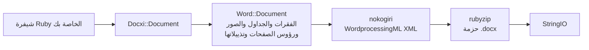

<!-- Translated from wiki/Architecture.md (git blob 38e8491be82a60fc51d016cdfd25fc8316608686). See wiki/TRANSLATION_GUIDE.md. -->

# بنية docxi: كيف تتحول شيفرة Ruby إلى حزمة .docx

ملف `.docx` أرشيف zip يضم ملفات XML تُسمى أجزاءً (parts)، وتتبع معيار Office Open XML. تحتفظ docxi بكائن Ruby لكل جزء، وتبني XML كل جزء باستخدام nokogiri عند استدعاء `render`، ثم تكتب الأرشيف باستخدام rubyzip. هذه الصفحة موجّهة إلى المساهمين وإلى كل من يحتاج إلى تتبّع أخطاء XML المولَّد.

## نظرة عامة

## الأصناف الرئيسية

| الصنف | الملف | الدور |
|---|---|---|
| `Docxi::Document` | `lib/docxi/document.rb` | نقطة الدخول. يحتفظ بأجزاء الحزمة وينفّذ `render` |
| `Docxi::Relationships` | `lib/docxi/relationships.rb` | الملف `_rels/.rels`، أي العلاقات على مستوى الحزمة |
| `Docxi::ContentTypes` | `lib/docxi/content_types.rb` | الملف `[Content_Types].xml` |
| `Docxi::Properties` | `lib/docxi/properties.rb` | الملفان `docProps/app.xml` و`docProps/core.xml` |
| `Docxi::Word::Document` | `lib/docxi/word/document.rb` | متن المستند، وإعدادات المقطع، وسجل الصور ورؤوس الصفحات وتذييلاتها والارتباطات |
| `Docxi::Word::Helpers` | `lib/docxi/word/helpers.rb` | الدوال `p` و`text` و`br` و`tab` و`frame` و`table` و`table_of_content` |
| `Docxi::Word::Contents::*` | `lib/docxi/word/contents/` | الأصناف `Paragraph` و`Text` و`Break` و`Tab` و`Frame` و`Image` و`Table` و`TableOfContent` |
| `Docxi::Word::Headers::Header` و`Docxi::Word::Footers::Footer` | `lib/docxi/word/headers/` و`lib/docxi/word/footers/` | أجزاء رؤوس الصفحات وتذييلاتها، ولكل منها ملف علاقات خاص به |
| `Docxi::Word::Medias` | `lib/docxi/word/medias/` | الصور المضافة عبر `add_media` |
| الأجزاء الثابتة | `lib/docxi/word/*.rb` | الأنماط والترقيم والإعدادات والخطوط والسمة والتأثيرات والحواشي السفلية والتعليقات الختامية |

## ما الذي تفعله `render`

1. تفتح `Docxi::Document#render` الكائن `Zip::OutputStream.write_buffer`.
2. تكتب `Word::Document#render` الملف `word/document.xml` (يكتب كل عنصر XML الخاص به)، ثم الأجزاء الثابتة ورؤوس الصفحات وتذييلاتها والصور و`word/_rels/document.xml.rels`.
3. تُكتب خصائص الحزمة وعلاقات الحزمة وأنواع المحتوى في النهاية.
4. يُعاد المخزن المؤقت ككائن `StringIO`.

يمر كل جزء عبر `Docxi.write_entry`، التي تضبط حجم المُدخل قبل كتابته. ولولا ذلك لأضافت rubyzip 3 سجلات Zip64 إلى كل مُدخل، في حين يرفض Google Docs وإصدارات LibreOffice القديمة فتح مثل هذه الملفات.

## الأجزاء في المستند المولَّد

| الجزء | المحتوى |
|---|---|
| `[Content_Types].xml` | أنواع محتوى الأجزاء |
| `_rels/.rels` | روابط إلى المستند وخصائصه |
| `docProps/app.xml` و`docProps/core.xml` | اسم التطبيق («Docxi Ruby Gem») ووقت التوليد |
| `word/document.xml` | المتن: الفقرات والجداول وإعدادات المقطع (الهوامش وحجم الصفحة ومراجع رؤوس الصفحات وتذييلاتها) |
| `word/styles.xml` و`word/stylesWithEffects.xml` | الأنماط. الخط الافتراضي Arial بحجم 12 نقطة |
| `word/numbering.xml` | تعريف القائمة النقطية |
| `word/settings.xml` و`word/webSettings.xml` و`word/fontTable.xml` | إعدادات المستند والخطوط |
| `word/theme/theme1.xml` | السمة |
| `word/footnotes.xml` و`word/endnotes.xml` | فواصل فقط. لا تملك docxi واجهة برمجية للحواشي السفلية |
| `word/headerN.xml` و`word/footerN.xml` | جزء لكل رأس صفحة وتذييل، مرقّمة بترتيب إضافتها |
| `word/media/imageN.png` | جزء لكل استدعاء لـ `add_media` |
| `word/_rels/document.xml.rels` | علاقات المتن |

لمعاينة محتوى مستند، فك ضغطه، مثلًا باستخدام `unzip -p report.docx word/document.xml`.

## معرّفات العلاقات

يبدأ `word/_rels/document.xml.rels` بتسع علاقات ثابتة، من `rId1` إلى `rId9`:

1. الأنماط
2. الأنماط مع التأثيرات
3. الإعدادات
4. إعدادات الويب
5. جدول الخطوط
6. السمة
7. التعليقات الختامية
8. الحواشي السفلية
9. الترقيم

تليها الصور ورؤوس الصفحات وتذييلاتها والارتباطات التشعبية، مرقّمةً بالترتيب الذي تستدعي به `add_media` و`add_header` و`add_footer` و`add_hyperlink`. تعيد `add_hyperlink` معرّفها كي تتمكن `hyperlink` من الإشارة إليه.

## الوحدات والتحويلات

- يُضاعَف `size` للنص، لأن Word يخزّن أنصاف النقاط.
- يُضرب `columns_width` و`width` للخلية في 14.92 للحصول على أجزاء من عشرين من النقطة.
- تحسب الصور المحددة الموضع وصور رؤوس الصفحات وصور خلايا الجداول حجمها على أنه `width * height * 14.92` EMU. هذه مشكلة معروفة مخطط إصلاحها في الإصدار 0.2.0.
- تُمرَّر الهوامش والمسافات البادئة وارتفاعات الصفوف كما هي، بوحدة جزء من عشرين من النقطة.

## كيف تبقى المخرجات ثابتة

يحتوي `test/golden` على كل جزء ولّده الإصدار 0.0.6 لمستندين نموذجيين (`test/support/sample_documents.rb`). تولّد الاختبارات المستندات نفسها وتقارن كل جزء بصيغة XML قانونية (canonical)، فلا تُحتسب الفروق بين إصدارات nokogiri، بينما يُكتشف أي تغيير حقيقي. يعيد `bundle exec rake golden` كتابة الملفات المرجعية (golden files) بعد أي تغيير مقصود. راجع [إعداد بيئة التطوير](Development-Setup).

## صفحات ذات صلة

- [مرجع API](API-Reference)
- [الميزات](Features)
- [المساهمة](Contributing)

---

[→ الصفحة الرئيسية للويكي](Home) · [README](https://github.com/hammad417/docxi#readme)

