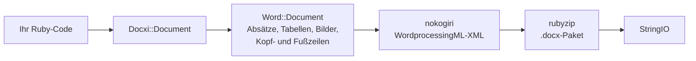

<!-- Translated from wiki/Architecture.md (git blob 38e8491be82a60fc51d016cdfd25fc8316608686). See wiki/TRANSLATION_GUIDE.md. -->
# docxi-Architektur: wie aus Ruby-Code ein .docx-Paket wird

Eine `.docx`-Datei ist ein Zip-Archiv aus XML-Dateien, den sogenannten Teilen (Parts), die dem Standard Office Open XML folgen. docxi hält für jeden Teil ein Ruby-Objekt, baut beim Aufruf von `render` das XML jedes Teils mit nokogiri und schreibt das Archiv mit rubyzip. Diese Seite richtet sich an Mitwirkende und an alle, die das erzeugte XML debuggen.

## Überblick

## Wichtige Klassen

| Klasse | Datei | Aufgabe |
|---|---|---|
| `Docxi::Document` | `lib/docxi/document.rb` | Einstiegspunkt. Hält die Teile des Pakets und implementiert `render` |
| `Docxi::Relationships` | `lib/docxi/relationships.rb` | `_rels/.rels`, die Beziehungen auf Paketebene |
| `Docxi::ContentTypes` | `lib/docxi/content_types.rb` | `[Content_Types].xml` |
| `Docxi::Properties` | `lib/docxi/properties.rb` | `docProps/app.xml` und `docProps/core.xml` |
| `Docxi::Word::Document` | `lib/docxi/word/document.rb` | Der Dokumentkörper, die Abschnittseinstellungen und die Registrierung von Bildern, Kopfzeilen, Fußzeilen und Links |
| `Docxi::Word::Helpers` | `lib/docxi/word/helpers.rb` | `p`, `text`, `br`, `tab`, `frame`, `table` und `table_of_content` |
| `Docxi::Word::Contents::*` | `lib/docxi/word/contents/` | `Paragraph`, `Text`, `Break`, `Tab`, `Frame`, `Image`, `Table` und `TableOfContent` |
| `Docxi::Word::Headers::Header`, `Docxi::Word::Footers::Footer` | `lib/docxi/word/headers/`, `lib/docxi/word/footers/` | Kopf- und Fußzeilenteile, jeweils mit eigener Beziehungsdatei |
| `Docxi::Word::Medias` | `lib/docxi/word/medias/` | Mit `add_media` hinzugefügte Bilder |
| Statische Teile | `lib/docxi/word/*.rb` | Formatvorlagen, Nummerierung, Einstellungen, Schriftarten, Design, Effekte, Fußnoten und Endnoten |

## Was `render` macht

1. `Docxi::Document#render` öffnet `Zip::OutputStream.write_buffer`.
2. `Word::Document#render` schreibt `word/document.xml` (jedes Element schreibt sein eigenes XML), danach die statischen Teile, Kopfzeilen, Fußzeilen, Bilder und `word/_rels/document.xml.rels`.
3. Paketeigenschaften, Paketbeziehungen und Inhaltstypen werden zuletzt geschrieben.
4. Der Puffer wird als `StringIO` zurückgegeben.

Jeder Teil läuft durch `Docxi.write_entry`, das die Größe des Eintrags vor dem Schreiben setzt. Sonst würde rubyzip 3 jedem Eintrag Zip64-Einträge hinzufügen, und Google Docs sowie ältere LibreOffice-Versionen weigern sich, solche Dateien zu öffnen.

## Teile eines erzeugten Dokuments

| Teil | Inhalt |
|---|---|
| `[Content_Types].xml` | Inhaltstypen der Teile |
| `_rels/.rels` | Verweise auf das Dokument und seine Eigenschaften |
| `docProps/app.xml`, `docProps/core.xml` | Anwendungsname („Docxi Ruby Gem“) und Renderzeitpunkt |
| `word/document.xml` | Der Hauptteil: Absätze, Tabellen und die Abschnittseinstellungen (Ränder, Seitengröße, Verweise auf Kopf- und Fußzeilen) |
| `word/styles.xml`, `word/stylesWithEffects.xml` | Formatvorlagen. Die Standardschrift ist Arial 12 pt |
| `word/numbering.xml` | Die Definition der Aufzählungsliste |
| `word/settings.xml`, `word/webSettings.xml`, `word/fontTable.xml` | Dokumenteinstellungen und Schriftarten |
| `word/theme/theme1.xml` | Design |
| `word/footnotes.xml`, `word/endnotes.xml` | Nur Trennlinien. docxi hat keine Fußnoten-API |
| `word/headerN.xml`, `word/footerN.xml` | Ein Teil pro Kopf- und Fußzeile, nummeriert in der Reihenfolge, in der sie hinzugefügt werden |
| `word/media/imageN.png` | Ein Teil pro Aufruf von `add_media` |
| `word/_rels/document.xml.rels` | Beziehungen des Hauptteils |

Um in ein Dokument hineinzuschauen, entpacken Sie es, zum Beispiel mit `unzip -p report.docx word/document.xml`.

## Beziehungs-IDs

`word/_rels/document.xml.rels` beginnt mit neun festen Beziehungen, `rId1` bis `rId9`:

1. Formatvorlagen
2. Formatvorlagen mit Effekten
3. Einstellungen
4. Webeinstellungen
5. Schriftartentabelle
6. Design
7. Endnoten
8. Fußnoten
9. Nummerierung

Danach folgen Bilder, Kopfzeilen, Fußzeilen und Hyperlinks, nummeriert in der Reihenfolge, in der Sie `add_media`, `add_header`, `add_footer` und `add_hyperlink` aufrufen. `add_hyperlink` gibt seine ID zurück, damit `hyperlink` darauf verweisen kann.

## Einheiten und Umrechnungen

- Text-`size` wird verdoppelt, weil Word halbe Punkte speichert.
- `columns_width` und Zellen-`width` werden mit 14.92 multipliziert, um Zwanzigstelpunkt zu erhalten.
- Positionierte Bilder, Bilder in Kopfzeilen und Bilder in Tabellenzellen berechnen ihre Größe als `width * height * 14.92` EMU. Das ist ein bekanntes Problem, das für 0.2.0 geplant ist.
- Ränder, Einzüge und Zeilenhöhen werden unverändert in Zwanzigstelpunkt übernommen.

## Wie die Ausgabe stabil bleibt

`test/golden` enthält jeden Teil, den 0.0.6 für zwei Beispieldokumente (`test/support/sample_documents.rb`) erzeugt hat. Die Tests rendern dieselben Dokumente und vergleichen jeden Teil als kanonisches XML. Unterschiede zwischen nokogiri-Versionen zählen deshalb nicht, jede echte Änderung aber schon. `bundle exec rake golden` schreibt die Referenzdateien (Golden Files) nach einer beabsichtigten Änderung neu. Siehe [Entwicklungsumgebung](Development-Setup).

## Verwandte Seiten

- [API-Referenz](API-Reference)
- [Funktionen](Features)
- [Mitwirken](Contributing)

---

[← Wiki-Startseite](Home) · [README](https://github.com/hammad417/docxi#readme)
