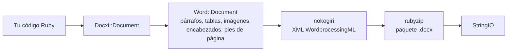

<!-- Translated from wiki/Architecture.md (git blob 38e8491be82a60fc51d016cdfd25fc8316608686). See wiki/TRANSLATION_GUIDE.md. -->
# Arquitectura de docxi: cómo el código Ruby se convierte en un paquete .docx

Un archivo `.docx` es un ZIP que contiene archivos XML, llamados partes, que siguen el estándar Office Open XML. docxi mantiene un objeto Ruby por cada parte, construye el XML de cada parte con nokogiri cuando llamas a `render` y escribe el ZIP con rubyzip. Esta página está pensada para quienes contribuyen al proyecto y para quien necesite depurar el XML generado.

## Visión general

## Clases principales

| Clase | Archivo | Función |
|---|---|---|
| `Docxi::Document` | `lib/docxi/document.rb` | Punto de entrada. Contiene las partes del paquete e implementa `render` |
| `Docxi::Relationships` | `lib/docxi/relationships.rb` | `_rels/.rels`, las relaciones a nivel de paquete |
| `Docxi::ContentTypes` | `lib/docxi/content_types.rb` | `[Content_Types].xml` |
| `Docxi::Properties` | `lib/docxi/properties.rb` | `docProps/app.xml` y `docProps/core.xml` |
| `Docxi::Word::Document` | `lib/docxi/word/document.rb` | El cuerpo del documento, la configuración de sección y el registro de imágenes, encabezados, pies de página y vínculos |
| `Docxi::Word::Helpers` | `lib/docxi/word/helpers.rb` | `p`, `text`, `br`, `tab`, `frame`, `table` y `table_of_content` |
| `Docxi::Word::Contents::*` | `lib/docxi/word/contents/` | `Paragraph`, `Text`, `Break`, `Tab`, `Frame`, `Image`, `Table` y `TableOfContent` |
| `Docxi::Word::Headers::Header`, `Docxi::Word::Footers::Footer` | `lib/docxi/word/headers/`, `lib/docxi/word/footers/` | Partes de encabezado y pie de página, cada una con su propio archivo de relaciones |
| `Docxi::Word::Medias` | `lib/docxi/word/medias/` | Imágenes añadidas con `add_media` |
| Partes estáticas | `lib/docxi/word/*.rb` | Estilos, numeración, configuración, fuentes, tema, efectos, notas al pie y notas al final |

## Qué hace `render`

1. `Docxi::Document#render` abre `Zip::OutputStream.write_buffer`.
2. `Word::Document#render` escribe `word/document.xml` (cada elemento escribe su propio XML) y después las partes estáticas, los encabezados, los pies de página, las imágenes y `word/_rels/document.xml.rels`.
3. Las propiedades del paquete, las relaciones del paquete y los tipos de contenido se escriben al final.
4. El búfer se devuelve como un `StringIO`.

Cada parte pasa por `Docxi.write_entry`, que fija el tamaño de la entrada antes de escribirla. De lo contrario, rubyzip 3 añadiría registros Zip64 a cada entrada, y Google Docs y las versiones antiguas de LibreOffice se niegan a abrir esos archivos.

## Partes de un documento generado

| Parte | Contenido |
|---|---|
| `[Content_Types].xml` | Tipos de contenido de las partes |
| `_rels/.rels` | Vínculos al documento y a sus propiedades |
| `docProps/app.xml`, `docProps/core.xml` | Nombre de la aplicación («Docxi Ruby Gem») y hora de generación |
| `word/document.xml` | El cuerpo: párrafos, tablas y la configuración de sección (márgenes, tamaño de página, referencias a encabezados y pies de página) |
| `word/styles.xml`, `word/stylesWithEffects.xml` | Estilos. La fuente predeterminada es Arial de 12 pt |
| `word/numbering.xml` | La definición de la lista con viñetas |
| `word/settings.xml`, `word/webSettings.xml`, `word/fontTable.xml` | Configuración del documento y fuentes |
| `word/theme/theme1.xml` | Tema |
| `word/footnotes.xml`, `word/endnotes.xml` | Solo separadores. docxi no tiene API de notas al pie |
| `word/headerN.xml`, `word/footerN.xml` | Una parte por cada encabezado y pie de página, numeradas en el orden en que se añaden |
| `word/media/imageN.png` | Una parte por cada llamada a `add_media` |
| `word/_rels/document.xml.rels` | Relaciones del cuerpo |

Para ver el interior de un documento, descomprímelo, por ejemplo con `unzip -p report.docx word/document.xml`.

## Identificadores de relación

`word/_rels/document.xml.rels` empieza con nueve relaciones fijas, de `rId1` a `rId9`:

1. estilos
2. estilos con efectos
3. configuración
4. configuración web
5. tabla de fuentes
6. tema
7. notas al final
8. notas al pie
9. numeración

Después vienen las imágenes, los encabezados, los pies de página y los hipervínculos, numerados en el orden en que llamas a `add_media`, `add_header`, `add_footer` y `add_hyperlink`. `add_hyperlink` devuelve su identificador para que `hyperlink` pueda hacer referencia a él.

## Unidades y conversiones

- El `size` del texto se duplica, porque Word guarda medios puntos.
- `columns_width` y el `width` de celda se multiplican por 14.92 para obtener veinteavos de punto.
- Las imágenes posicionadas, de encabezado y de celdas de tabla calculan su tamaño como `width * height * 14.92` EMU. Es un problema conocido previsto para la 0.2.0.
- Los márgenes, las sangrías y las alturas de fila se pasan tal cual, en veinteavos de punto.

## Cómo se mantiene estable la salida

`test/golden` contiene cada parte que la 0.0.6 generó para dos documentos de ejemplo (`test/support/sample_documents.rb`). Las pruebas generan los mismos documentos y comparan cada parte como XML canónico, de modo que las diferencias entre versiones de nokogiri no cuentan, pero cualquier cambio real sí. `bundle exec rake golden` reescribe los archivos de referencia (golden files) después de un cambio intencionado. Consulta [Entorno de desarrollo](Development-Setup).

## Páginas relacionadas

- [Referencia de la API](API-Reference)
- [Funciones](Features)
- [Contribuir](Contributing)

---

[← Inicio de la wiki](Home) · [README](https://github.com/hammad417/docxi#readme)
