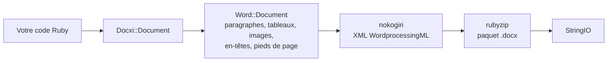

<!-- Translated from wiki/Architecture.md (git blob 38e8491be82a60fc51d016cdfd25fc8316608686). See wiki/TRANSLATION_GUIDE.md. -->
# Architecture de docxi : comment du code Ruby devient un paquet .docx

Un fichier `.docx` est une archive zip de fichiers XML, appelés parties, qui suivent la norme Office Open XML. docxi conserve un objet Ruby par partie, construit le XML de chaque partie avec nokogiri lorsque vous appelez `render`, puis écrit l'archive avec rubyzip. Cette page s'adresse aux personnes qui contribuent au projet et à celles qui doivent déboguer le XML généré.

## Vue d'ensemble

## Classes principales

| Classe | Fichier | Rôle |
|---|---|---|
| `Docxi::Document` | `lib/docxi/document.rb` | Point d'entrée. Contient les parties du paquet et implémente `render` |
| `Docxi::Relationships` | `lib/docxi/relationships.rb` | `_rels/.rels`, les relations au niveau du paquet |
| `Docxi::ContentTypes` | `lib/docxi/content_types.rb` | `[Content_Types].xml` |
| `Docxi::Properties` | `lib/docxi/properties.rb` | `docProps/app.xml` et `docProps/core.xml` |
| `Docxi::Word::Document` | `lib/docxi/word/document.rb` | Le corps du document, les paramètres de section et le registre des images, en-têtes, pieds de page et liens |
| `Docxi::Word::Helpers` | `lib/docxi/word/helpers.rb` | `p`, `text`, `br`, `tab`, `frame`, `table` et `table_of_content` |
| `Docxi::Word::Contents::*` | `lib/docxi/word/contents/` | `Paragraph`, `Text`, `Break`, `Tab`, `Frame`, `Image`, `Table` et `TableOfContent` |
| `Docxi::Word::Headers::Header`, `Docxi::Word::Footers::Footer` | `lib/docxi/word/headers/`, `lib/docxi/word/footers/` | Parties d'en-tête et de pied de page, chacune avec son propre fichier de relations |
| `Docxi::Word::Medias` | `lib/docxi/word/medias/` | Images ajoutées avec `add_media` |
| Parties statiques | `lib/docxi/word/*.rb` | Styles, numérotation, paramètres, polices, thème, effets, notes de bas de page et notes de fin |

## Ce que fait `render`

1. `Docxi::Document#render` ouvre `Zip::OutputStream.write_buffer`.
2. `Word::Document#render` écrit `word/document.xml` (chaque élément écrit son propre XML), puis les parties statiques, les en-têtes, les pieds de page, les images et `word/_rels/document.xml.rels`.
3. Les propriétés du paquet, les relations du paquet et les types de contenu sont écrits en dernier.
4. Le tampon est renvoyé sous forme de `StringIO`.

Chaque partie passe par `Docxi.write_entry`, qui fixe la taille de l'entrée avant de l'écrire. Sinon, rubyzip 3 ajouterait des enregistrements Zip64 à chaque entrée, et Google Docs ainsi que les anciennes versions de LibreOffice refusent d'ouvrir de tels fichiers.

## Parties d'un document généré

| Partie | Contenu |
|---|---|
| `[Content_Types].xml` | Types de contenu des parties |
| `_rels/.rels` | Liens vers le document et ses propriétés |
| `docProps/app.xml`, `docProps/core.xml` | Nom de l'application (« Docxi Ruby Gem ») et heure de génération |
| `word/document.xml` | Le corps : paragraphes, tableaux et paramètres de section (marges, taille de page, références aux en-têtes et pieds de page) |
| `word/styles.xml`, `word/stylesWithEffects.xml` | Styles. La police par défaut est Arial 12 pt |
| `word/numbering.xml` | La définition de la liste à puces |
| `word/settings.xml`, `word/webSettings.xml`, `word/fontTable.xml` | Paramètres du document et polices |
| `word/theme/theme1.xml` | Thème |
| `word/footnotes.xml`, `word/endnotes.xml` | Séparateurs uniquement. docxi n'a pas d'API pour les notes de bas de page |
| `word/headerN.xml`, `word/footerN.xml` | Une partie par en-tête et par pied de page, numérotées dans l'ordre d'ajout |
| `word/media/imageN.png` | Une partie par appel à `add_media` |
| `word/_rels/document.xml.rels` | Relations du corps |

Pour regarder à l'intérieur d'un document, décompressez-le, par exemple avec `unzip -p report.docx word/document.xml`.

## Identifiants de relation

`word/_rels/document.xml.rels` commence par neuf relations fixes, de `rId1` à `rId9` :

1. styles
2. styles avec effets
3. paramètres
4. paramètres web
5. table des polices
6. thème
7. notes de fin
8. notes de bas de page
9. numérotation

Viennent ensuite les images, les en-têtes, les pieds de page et les liens hypertexte, numérotés dans l'ordre de vos appels à `add_media`, `add_header`, `add_footer` et `add_hyperlink`. `add_hyperlink` renvoie son identifiant pour que `hyperlink` puisse y faire référence.

## Unités et conversions

- Le `size` du texte est doublé, car Word stocke des demi-points.
- `columns_width` et le `width` de cellule sont multipliés par 14.92 pour obtenir des vingtièmes de point.
- Les images positionnées, d'en-tête et de cellule calculent leur taille comme `width * height * 14.92` EMU. C'est un problème connu prévu pour la 0.2.0.
- Les marges, les retraits et les hauteurs de ligne sont transmis tels quels, en vingtièmes de point.

## Comment la sortie reste stable

`test/golden` contient chaque partie générée par la 0.0.6 pour deux documents d'exemple (`test/support/sample_documents.rb`). Les tests génèrent les mêmes documents et comparent chaque partie sous forme de XML canonique : les différences entre versions de nokogiri ne comptent pas, mais tout changement réel est détecté. `bundle exec rake golden` réécrit les fichiers de référence (golden files) après un changement intentionnel. Voir [Environnement de développement](Development-Setup).

## Pages associées

- [Référence de l'API](API-Reference)
- [Fonctionnalités](Features)
- [Contribuer](Contributing)

---

[← Accueil du wiki](Home) · [README](https://github.com/hammad417/docxi#readme)
