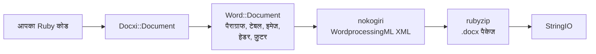

<!-- Translated from wiki/Architecture.md (git blob 38e8491be82a60fc51d016cdfd25fc8316608686). See wiki/TRANSLATION_GUIDE.md. -->
# docxi का आर्किटेक्चर: Ruby कोड .docx पैकेज कैसे बनता है

`.docx` फ़ाइल XML फ़ाइलों का एक zip आर्काइव होती है। इन XML फ़ाइलों को पार्ट कहा जाता है, और ये Office Open XML स्टैंडर्ड का पालन करती हैं। docxi हर पार्ट के लिए एक Ruby ऑब्जेक्ट रखता है, `render` कॉल करने पर nokogiri से हर पार्ट का XML बनाता है, और rubyzip से आर्काइव लिखता है। यह पेज योगदान करने वालों और बने हुए XML को डीबग करने वालों के लिए है।

## एक नज़र में

## मुख्य क्लास

| क्लास | फ़ाइल | भूमिका |
|---|---|---|
| `Docxi::Document` | `lib/docxi/document.rb` | एंट्री पॉइंट। पैकेज के पार्ट रखता है और `render` लागू करता है |
| `Docxi::Relationships` | `lib/docxi/relationships.rb` | `_rels/.rels`, यानी पैकेज स्तर के रिलेशनशिप |
| `Docxi::ContentTypes` | `lib/docxi/content_types.rb` | `[Content_Types].xml` |
| `Docxi::Properties` | `lib/docxi/properties.rb` | `docProps/app.xml` और `docProps/core.xml` |
| `Docxi::Word::Document` | `lib/docxi/word/document.rb` | डॉक्यूमेंट बॉडी, सेक्शन सेटिंग, और इमेज, हेडर, फ़ुटर व लिंक की रजिस्ट्री |
| `Docxi::Word::Helpers` | `lib/docxi/word/helpers.rb` | `p`, `text`, `br`, `tab`, `frame`, `table` और `table_of_content` |
| `Docxi::Word::Contents::*` | `lib/docxi/word/contents/` | `Paragraph`, `Text`, `Break`, `Tab`, `Frame`, `Image`, `Table` और `TableOfContent` |
| `Docxi::Word::Headers::Header`, `Docxi::Word::Footers::Footer` | `lib/docxi/word/headers/`, `lib/docxi/word/footers/` | हेडर और फ़ुटर के पार्ट, हर एक की अपनी रिलेशनशिप फ़ाइल के साथ |
| `Docxi::Word::Medias` | `lib/docxi/word/medias/` | `add_media` से जोड़ी गई इमेज |
| स्टैटिक पार्ट | `lib/docxi/word/*.rb` | स्टाइल, नंबरिंग, सेटिंग, फ़ॉन्ट, थीम, इफ़ेक्ट, फ़ुटनोट और एंडनोट |

## `render` क्या करता है

1. `Docxi::Document#render` `Zip::OutputStream.write_buffer` खोलता है।
2. `Word::Document#render` `word/document.xml` लिखता है (हर एलिमेंट अपना XML खुद लिखता है), फिर स्टैटिक पार्ट, हेडर, फ़ुटर, इमेज और `word/_rels/document.xml.rels` लिखता है।
3. पैकेज प्रॉपर्टी, पैकेज रिलेशनशिप और कंटेंट टाइप सबसे आखिर में लिखे जाते हैं।
4. बफ़र एक `StringIO` के रूप में लौटाया जाता है।

हर पार्ट `Docxi.write_entry` से होकर गुज़रता है, जो लिखने से पहले एंट्री का साइज़ सेट कर देता है। ऐसा न हो तो rubyzip 3 हर एंट्री में Zip64 रिकॉर्ड जोड़ देगा, और Google Docs व LibreOffice के पुराने वर्शन ऐसी फ़ाइलें खोलने से मना कर देते हैं।

## बने हुए डॉक्यूमेंट के पार्ट

| पार्ट | कंटेंट |
|---|---|
| `[Content_Types].xml` | पार्ट के कंटेंट टाइप |
| `_rels/.rels` | डॉक्यूमेंट और उसकी प्रॉपर्टी के लिंक |
| `docProps/app.xml`, `docProps/core.xml` | ऐप्लिकेशन का नाम ("Docxi Ruby Gem") और रेंडर का समय |
| `word/document.xml` | बॉडी: पैराग्राफ, टेबल और सेक्शन सेटिंग (मार्जिन, पेज साइज़, हेडर और फ़ुटर के रेफ़रेंस) |
| `word/styles.xml`, `word/stylesWithEffects.xml` | स्टाइल। डिफ़ॉल्ट फ़ॉन्ट Arial 12 pt है |
| `word/numbering.xml` | बुलेट सूची की परिभाषा |
| `word/settings.xml`, `word/webSettings.xml`, `word/fontTable.xml` | डॉक्यूमेंट सेटिंग और फ़ॉन्ट |
| `word/theme/theme1.xml` | थीम |
| `word/footnotes.xml`, `word/endnotes.xml` | सिर्फ़ सेपरेटर। docxi में फ़ुटनोट API नहीं है |
| `word/headerN.xml`, `word/footerN.xml` | हर हेडर और फ़ुटर का एक पार्ट, जोड़े जाने के क्रम में नंबर किया हुआ |
| `word/media/imageN.png` | हर `add_media` कॉल का एक पार्ट |
| `word/_rels/document.xml.rels` | बॉडी के रिलेशनशिप |

किसी डॉक्यूमेंट के अंदर देखने के लिए उसे अनज़िप करें, जैसे `unzip -p report.docx word/document.xml`।

## रिलेशनशिप id

`word/_rels/document.xml.rels` नौ तय रिलेशनशिप से शुरू होता है, `rId1` से `rId9` तक:

1. स्टाइल
2. इफ़ेक्ट वाली स्टाइल
3. सेटिंग
4. वेब सेटिंग
5. फ़ॉन्ट टेबल
6. थीम
7. एंडनोट
8. फ़ुटनोट
9. नंबरिंग

इसके बाद इमेज, हेडर, फ़ुटर और हाइपरलिंक आते हैं, उसी क्रम में नंबर किए हुए जिसमें आप `add_media`, `add_header`, `add_footer` और `add_hyperlink` कॉल करते हैं। `add_hyperlink` अपनी id लौटाता है ताकि `hyperlink` उसका इस्तेमाल कर सके।

## यूनिट और रूपांतरण

- टेक्स्ट का `size` दोगुना किया जाता है, क्योंकि Word आधे पॉइंट में स्टोर करता है।
- `columns_width` और सेल के `width` को पॉइंट का बीसवां हिस्सा पाने के लिए 14.92 से गुणा किया जाता है।
- पोज़िशन की गई, हेडर और टेबल सेल की इमेज अपना साइज़ `width * height * 14.92` EMU के रूप में निकालती हैं। यह 0.2.0 के लिए तय एक ज्ञात समस्या है।
- मार्जिन, इंडेंट और पंक्ति की ऊंचाई पॉइंट के बीसवें हिस्से में ही आगे भेजी जाती हैं।

## आउटपुट स्थिर कैसे रहता है

`test/golden` में वे सभी पार्ट हैं जो 0.0.6 ने दो सैंपल डॉक्यूमेंट (`test/support/sample_documents.rb`) के लिए बनाए थे। टेस्ट वही डॉक्यूमेंट रेंडर करते हैं और हर पार्ट की तुलना कैनॉनिकल XML के रूप में करते हैं, इसलिए nokogiri वर्शन के बीच के अंतर गिने नहीं जाते, लेकिन कोई भी असली बदलाव पकड़ा जाता है। जानबूझकर बदलाव करने के बाद `bundle exec rake golden` गोल्डन फ़ाइलें (golden files) फिर से लिखता है। [डेवलपमेंट सेटअप](Development-Setup) देखें।

## संबंधित पेज

- [API संदर्भ](API-Reference)
- [सुविधाएं](Features)
- [योगदान](Contributing)

---

[← विकी होम](Home) · [README](https://github.com/hammad417/docxi#readme)
