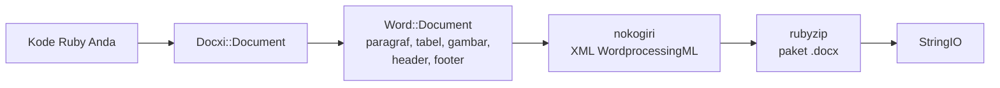

<!-- Translated from wiki/Architecture.md (git blob 38e8491be82a60fc51d016cdfd25fc8316608686). See wiki/TRANSLATION_GUIDE.md. -->
# Arsitektur docxi: bagaimana kode Ruby menjadi paket .docx

File `.docx` adalah arsip zip berisi file XML, yang disebut part, mengikuti standar Office Open XML. docxi menyimpan satu objek Ruby untuk setiap part, menyusun XML tiap part dengan nokogiri saat Anda memanggil `render`, lalu menulis arsipnya dengan rubyzip. Halaman ini ditujukan bagi kontributor dan siapa pun yang sedang men-debug XML yang dihasilkan.

## Gambaran umum

## Kelas utama

| Kelas | File | Peran |
|---|---|---|
| `Docxi::Document` | `lib/docxi/document.rb` | Titik masuk. Menyimpan part paket dan mengimplementasikan `render` |
| `Docxi::Relationships` | `lib/docxi/relationships.rb` | `_rels/.rels`, relasi tingkat paket |
| `Docxi::ContentTypes` | `lib/docxi/content_types.rb` | `[Content_Types].xml` |
| `Docxi::Properties` | `lib/docxi/properties.rb` | `docProps/app.xml` dan `docProps/core.xml` |
| `Docxi::Word::Document` | `lib/docxi/word/document.rb` | Isi dokumen, pengaturan seksi, dan daftar gambar, header, footer, serta tautan |
| `Docxi::Word::Helpers` | `lib/docxi/word/helpers.rb` | `p`, `text`, `br`, `tab`, `frame`, `table`, dan `table_of_content` |
| `Docxi::Word::Contents::*` | `lib/docxi/word/contents/` | `Paragraph`, `Text`, `Break`, `Tab`, `Frame`, `Image`, `Table`, dan `TableOfContent` |
| `Docxi::Word::Headers::Header`, `Docxi::Word::Footers::Footer` | `lib/docxi/word/headers/`, `lib/docxi/word/footers/` | Part header dan footer, masing-masing dengan file relasinya sendiri |
| `Docxi::Word::Medias` | `lib/docxi/word/medias/` | Gambar yang ditambahkan dengan `add_media` |
| Part statis | `lib/docxi/word/*.rb` | Gaya, penomoran, pengaturan, font, tema, efek, catatan kaki, dan catatan akhir |

## Apa yang dilakukan `render`

1. `Docxi::Document#render` membuka `Zip::OutputStream.write_buffer`.
2. `Word::Document#render` menulis `word/document.xml` (setiap elemen menulis XML-nya sendiri), lalu part statis, header, footer, gambar, dan `word/_rels/document.xml.rels`.
3. Properti paket, relasi paket, dan tipe konten ditulis paling akhir.
4. Buffer dikembalikan sebagai `StringIO`.

Setiap part melewati `Docxi.write_entry`, yang mengatur ukuran entri sebelum menulisnya. Tanpa itu, rubyzip 3 akan menambahkan rekaman Zip64 ke setiap entri, sementara Google Docs dan versi LibreOffice yang lebih lama menolak membuka file seperti itu.

## Part dalam dokumen yang dihasilkan

| Part | Isi |
|---|---|
| `[Content_Types].xml` | Tipe konten setiap part |
| `_rels/.rels` | Tautan ke dokumen dan propertinya |
| `docProps/app.xml`, `docProps/core.xml` | Nama aplikasi ("Docxi Ruby Gem") dan waktu render |
| `word/document.xml` | Isi dokumen: paragraf, tabel, dan pengaturan seksi (margin, ukuran halaman, referensi header dan footer) |
| `word/styles.xml`, `word/stylesWithEffects.xml` | Gaya. Font bawaan adalah Arial 12 pt |
| `word/numbering.xml` | Definisi daftar berpoin |
| `word/settings.xml`, `word/webSettings.xml`, `word/fontTable.xml` | Pengaturan dokumen dan font |
| `word/theme/theme1.xml` | Tema |
| `word/footnotes.xml`, `word/endnotes.xml` | Hanya pemisah. docxi tidak punya API catatan kaki |
| `word/headerN.xml`, `word/footerN.xml` | Satu part per header dan footer, dinomori sesuai urutan penambahannya |
| `word/media/imageN.png` | Satu part per panggilan `add_media` |
| `word/_rels/document.xml.rels` | Relasi isi dokumen |

Untuk melihat isi dokumen, ekstrak file tersebut, misalnya dengan `unzip -p report.docx word/document.xml`.

## ID relasi

`word/_rels/document.xml.rels` diawali sembilan relasi tetap, `rId1` sampai `rId9`:

1. gaya
2. gaya dengan efek
3. pengaturan
4. pengaturan web
5. tabel font
6. tema
7. catatan akhir
8. catatan kaki
9. penomoran

Setelah itu menyusul gambar, header, footer, dan hyperlink, dinomori sesuai urutan Anda memanggil `add_media`, `add_header`, `add_footer`, dan `add_hyperlink`. `add_hyperlink` mengembalikan ID-nya agar `hyperlink` bisa merujuknya.

## Satuan dan konversi

- `size` teks digandakan, karena Word menyimpan setengah poin.
- `columns_width` dan `width` sel dikalikan 14.92 untuk mendapatkan seperdua puluh poin.
- Gambar berposisi, gambar header, dan gambar sel tabel menghitung ukurannya sebagai `width * height * 14.92` EMU. Ini masalah yang diketahui dan direncanakan untuk 0.2.0.
- Margin, indentasi, dan tinggi baris diteruskan apa adanya dalam seperdua puluh poin.

## Bagaimana keluaran tetap stabil

`test/golden` menyimpan setiap part yang dihasilkan 0.0.6 untuk dua dokumen contoh (`test/support/sample_documents.rb`). Pengujian merender dokumen yang sama dan membandingkan setiap part sebagai XML kanonis, sehingga perbedaan antarversi nokogiri tidak dihitung, tetapi setiap perubahan nyata terdeteksi. `bundle exec rake golden` menulis ulang file golden (golden files) setelah perubahan yang disengaja. Lihat [Penyiapan pengembangan](Development-Setup).

## Halaman terkait

- [Referensi API](API-Reference)
- [Fitur](Features)
- [Berkontribusi](Contributing)

---

[← Beranda wiki](Home) · [README](https://github.com/hammad417/docxi#readme)
