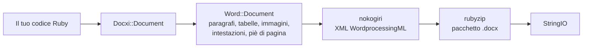

<!-- Translated from wiki/Architecture.md (git blob 38e8491be82a60fc51d016cdfd25fc8316608686). See wiki/TRANSLATION_GUIDE.md. -->
# Architettura di docxi: come il codice Ruby diventa un pacchetto .docx

Un file `.docx` è un archivio zip di file XML, chiamati parti, conformi allo standard Office Open XML. docxi mantiene un oggetto Ruby per ogni parte, costruisce l'XML di ciascuna parte con nokogiri quando chiami `render` e scrive l'archivio con rubyzip. Questa pagina è pensata per chi contribuisce al progetto e per chi deve fare il debug dell'XML generato.

## Panoramica

## Classi principali

| Classe | File | Ruolo |
|---|---|---|
| `Docxi::Document` | `lib/docxi/document.rb` | Punto di ingresso. Contiene le parti del pacchetto e implementa `render` |
| `Docxi::Relationships` | `lib/docxi/relationships.rb` | `_rels/.rels`, le relazioni a livello di pacchetto |
| `Docxi::ContentTypes` | `lib/docxi/content_types.rb` | `[Content_Types].xml` |
| `Docxi::Properties` | `lib/docxi/properties.rb` | `docProps/app.xml` e `docProps/core.xml` |
| `Docxi::Word::Document` | `lib/docxi/word/document.rb` | Il corpo del documento, le impostazioni di sezione e il registro di immagini, intestazioni, piè di pagina e collegamenti |
| `Docxi::Word::Helpers` | `lib/docxi/word/helpers.rb` | `p`, `text`, `br`, `tab`, `frame`, `table` e `table_of_content` |
| `Docxi::Word::Contents::*` | `lib/docxi/word/contents/` | `Paragraph`, `Text`, `Break`, `Tab`, `Frame`, `Image`, `Table` e `TableOfContent` |
| `Docxi::Word::Headers::Header`, `Docxi::Word::Footers::Footer` | `lib/docxi/word/headers/`, `lib/docxi/word/footers/` | Parti di intestazione e piè di pagina, ciascuna con il proprio file di relazioni |
| `Docxi::Word::Medias` | `lib/docxi/word/medias/` | Immagini aggiunte con `add_media` |
| Parti statiche | `lib/docxi/word/*.rb` | Stili, numerazione, impostazioni, caratteri, tema, effetti, note a piè di pagina e note di chiusura |

## Cosa fa `render`

1. `Docxi::Document#render` apre `Zip::OutputStream.write_buffer`.
2. `Word::Document#render` scrive `word/document.xml` (ogni elemento scrive il proprio XML), poi le parti statiche, le intestazioni, i piè di pagina, le immagini e `word/_rels/document.xml.rels`.
3. Le proprietà del pacchetto, le relazioni del pacchetto e i tipi di contenuto vengono scritti per ultimi.
4. Il buffer viene restituito come `StringIO`.

Ogni parte passa da `Docxi.write_entry`, che imposta la dimensione della voce prima di scriverla. Altrimenti rubyzip 3 aggiungerebbe record Zip64 a ogni voce, e Google Docs e le versioni meno recenti di LibreOffice si rifiutano di aprire file di questo tipo.

## Parti di un documento generato

| Parte | Contenuto |
|---|---|
| `[Content_Types].xml` | Tipi di contenuto delle parti |
| `_rels/.rels` | Collegamenti al documento e alle sue proprietà |
| `docProps/app.xml`, `docProps/core.xml` | Nome dell'applicazione («Docxi Ruby Gem») e ora di generazione |
| `word/document.xml` | Il corpo: paragrafi, tabelle e impostazioni di sezione (margini, dimensioni della pagina, riferimenti a intestazioni e piè di pagina) |
| `word/styles.xml`, `word/stylesWithEffects.xml` | Stili. Il carattere predefinito è Arial 12 pt |
| `word/numbering.xml` | La definizione dell'elenco puntato |
| `word/settings.xml`, `word/webSettings.xml`, `word/fontTable.xml` | Impostazioni del documento e caratteri |
| `word/theme/theme1.xml` | Tema |
| `word/footnotes.xml`, `word/endnotes.xml` | Solo separatori. docxi non ha un'API per le note a piè di pagina |
| `word/headerN.xml`, `word/footerN.xml` | Una parte per ogni intestazione e piè di pagina, numerate nell'ordine in cui vengono aggiunte |
| `word/media/imageN.png` | Una parte per ogni chiamata a `add_media` |
| `word/_rels/document.xml.rels` | Relazioni del corpo |

Per guardare dentro un documento, decomprimilo, per esempio con `unzip -p report.docx word/document.xml`.

## ID delle relazioni

`word/_rels/document.xml.rels` inizia con nove relazioni fisse, da `rId1` a `rId9`:

1. stili
2. stili con effetti
3. impostazioni
4. impostazioni web
5. tabella dei caratteri
6. tema
7. note di chiusura
8. note a piè di pagina
9. numerazione

Seguono immagini, intestazioni, piè di pagina e collegamenti ipertestuali, numerati nell'ordine in cui chiami `add_media`, `add_header`, `add_footer` e `add_hyperlink`. `add_hyperlink` restituisce il proprio ID in modo che `hyperlink` possa farvi riferimento.

## Unità e conversioni

- Il `size` del testo viene raddoppiato, perché Word memorizza mezzi punti.
- `columns_width` e il `width` della cella vengono moltiplicati per 14.92 per ottenere ventesimi di punto.
- Le immagini posizionate, quelle nelle intestazioni e quelle nelle celle delle tabelle calcolano le dimensioni come `width * height * 14.92` EMU. È un problema noto previsto per la 0.2.0.
- Margini, rientri e altezze delle righe vengono passati così come sono, in ventesimi di punto.

## Come l'output resta stabile

`test/golden` contiene ogni parte generata dalla 0.0.6 per due documenti di esempio (`test/support/sample_documents.rb`). I test generano gli stessi documenti e confrontano ogni parte come XML canonico, così le differenze tra versioni di nokogiri non contano, ma qualsiasi modifica reale viene rilevata. `bundle exec rake golden` riscrive i file di riferimento (golden files) dopo una modifica intenzionale. Consulta [Ambiente di sviluppo](Development-Setup).

## Pagine correlate

- [Riferimento API](API-Reference)
- [Funzionalità](Features)
- [Contribuire](Contributing)

---

[← Home della wiki](Home) · [README](https://github.com/hammad417/docxi#readme)
