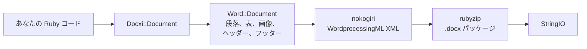

<!-- Translated from wiki/Architecture.md (git blob 38e8491be82a60fc51d016cdfd25fc8316608686). See wiki/TRANSLATION_GUIDE.md. -->
# docxi のアーキテクチャ：Ruby のコードが .docx パッケージになるまで

`.docx` ファイルは、パーツと呼ばれる XML ファイルを zip でまとめたアーカイブで、Office Open XML 規格に従っています。docxi はパーツごとに Ruby オブジェクトを持ち、`render` を呼び出したときに nokogiri で各パーツの XML を組み立て、rubyzip でアーカイブを書き出します。このページは、コントリビューターと、生成された XML をデバッグしたい方に向けたものです。

## 概要

## 主なクラス

| クラス | ファイル | 役割 |
|---|---|---|
| `Docxi::Document` | `lib/docxi/document.rb` | エントリーポイント。パッケージのパーツを保持し、`render` を実装します |
| `Docxi::Relationships` | `lib/docxi/relationships.rb` | `_rels/.rels`（パッケージレベルのリレーションシップ） |
| `Docxi::ContentTypes` | `lib/docxi/content_types.rb` | `[Content_Types].xml` |
| `Docxi::Properties` | `lib/docxi/properties.rb` | `docProps/app.xml` と `docProps/core.xml` |
| `Docxi::Word::Document` | `lib/docxi/word/document.rb` | ドキュメントの本文、セクションの設定、画像・ヘッダー・フッター・リンクの登録 |
| `Docxi::Word::Helpers` | `lib/docxi/word/helpers.rb` | `p`、`text`、`br`、`tab`、`frame`、`table`、`table_of_content` |
| `Docxi::Word::Contents::*` | `lib/docxi/word/contents/` | `Paragraph`、`Text`、`Break`、`Tab`、`Frame`、`Image`、`Table`、`TableOfContent` |
| `Docxi::Word::Headers::Header`、`Docxi::Word::Footers::Footer` | `lib/docxi/word/headers/`、`lib/docxi/word/footers/` | ヘッダーとフッターのパーツ。それぞれ専用のリレーションシップファイルを持ちます |
| `Docxi::Word::Medias` | `lib/docxi/word/medias/` | `add_media` で追加した画像 |
| 静的パーツ | `lib/docxi/word/*.rb` | スタイル、番号付け、設定、フォント、テーマ、効果、脚注、文末脚注 |

## `render` の処理内容

1. `Docxi::Document#render` が `Zip::OutputStream.write_buffer` を開きます。
2. `Word::Document#render` が `word/document.xml` を書き出し（各要素が自分の XML を書きます）、続いて静的パーツ、ヘッダー、フッター、画像、`word/_rels/document.xml.rels` を書き出します。
3. 最後に、パッケージのプロパティ、パッケージのリレーションシップ、コンテンツタイプを書き出します。
4. バッファーを `StringIO` として返します。

各パーツは `Docxi.write_entry` を通して書き出され、書き込み前にエントリーのサイズが設定されます。そうしないと rubyzip 3 がすべてのエントリーに Zip64 レコードを追加し、Google Docs や古いバージョンの LibreOffice がそのファイルを開けなくなります。

## 生成されたドキュメントのパーツ

| パーツ | 内容 |
|---|---|
| `[Content_Types].xml` | 各パーツのコンテンツタイプ |
| `_rels/.rels` | ドキュメントとそのプロパティへのリンク |
| `docProps/app.xml`、`docProps/core.xml` | アプリケーション名（「Docxi Ruby Gem」）とレンダリング時刻 |
| `word/document.xml` | 本文。段落、表、セクションの設定（余白、ページサイズ、ヘッダーとフッターの参照） |
| `word/styles.xml`、`word/stylesWithEffects.xml` | スタイル。デフォルトのフォントは Arial 12 pt です |
| `word/numbering.xml` | 箇条書きの定義 |
| `word/settings.xml`、`word/webSettings.xml`、`word/fontTable.xml` | ドキュメントの設定とフォント |
| `word/theme/theme1.xml` | テーマ |
| `word/footnotes.xml`、`word/endnotes.xml` | 区切り線のみ。docxi には脚注の API はありません |
| `word/headerN.xml`、`word/footerN.xml` | ヘッダーとフッターごとに 1 パーツ。追加した順に番号が付きます |
| `word/media/imageN.png` | `add_media` の呼び出しごとに 1 パーツ |
| `word/_rels/document.xml.rels` | 本文のリレーションシップ |

ドキュメントの中身を見るには、`unzip -p report.docx word/document.xml` のように展開します。

## リレーションシップ ID

`word/_rels/document.xml.rels` は、`rId1` から `rId9` までの 9 つの固定のリレーションシップで始まります。

1. スタイル
2. 効果付きのスタイル
3. 設定
4. Web の設定
5. フォントテーブル
6. テーマ
7. 文末脚注
8. 脚注
9. 番号付け

その後に画像、ヘッダー、フッター、ハイパーリンクが、`add_media`、`add_header`、`add_footer`、`add_hyperlink` を呼び出した順に番号付けされて続きます。`add_hyperlink` は自分の ID を返すので、`hyperlink` から参照できます。

## 単位と変換

- Word は半ポイント単位で保存するため、テキストの `size` は 2 倍されます。
- `columns_width` とセルの `width` は 14.92 を掛けて 1/20 ポイントに変換されます。
- 配置を指定した画像、ヘッダーの画像、表のセル内の画像は、サイズを `width * height * 14.92` EMU として計算します。これは 0.2.0 で対応予定の既知の問題です。
- 余白、インデント、行の高さは 1/20 ポイントのままそのまま渡されます。

## 出力を安定させる仕組み

`test/golden` には、0.0.6 が 2 つのサンプルドキュメント（`test/support/sample_documents.rb`）に対して生成したすべてのパーツが入っています。テストは同じドキュメントをレンダリングし、各パーツを正規化した XML として比較します。そのため nokogiri のバージョンによる差は無視され、実際の変更だけが検出されます。意図的に出力を変えた後は、`bundle exec rake golden` でゴールデンファイル（golden files）を書き直します。[開発環境のセットアップ](Development-Setup)を参照してください。

## 関連ページ

- [API リファレンス](API-Reference)
- [機能](Features)
- [コントリビュート](Contributing)

---

[← Wiki ホーム](Home) · [README](https://github.com/hammad417/docxi#readme)
