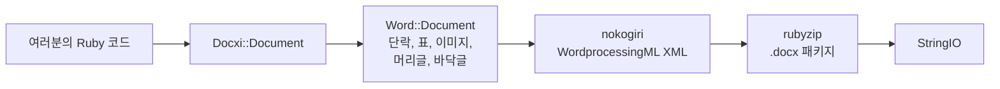

<!-- Translated from wiki/Architecture.md (git blob 38e8491be82a60fc51d016cdfd25fc8316608686). See wiki/TRANSLATION_GUIDE.md. -->
# docxi 아키텍처: Ruby 코드가 .docx 패키지가 되는 과정

`.docx` 파일은 파트라고 부르는 XML 파일들을 묶은 zip 아카이브이며, Office Open XML 표준을 따릅니다. docxi는 파트마다 Ruby 객체를 하나씩 두고, `render`를 호출하면 nokogiri로 각 파트의 XML을 만든 뒤 rubyzip으로 아카이브를 씁니다. 이 페이지는 기여자와 생성된 XML을 디버깅하려는 분들을 위한 것입니다.

## 개요

## 주요 클래스

| 클래스 | 파일 | 역할 |
|---|---|---|
| `Docxi::Document` | `lib/docxi/document.rb` | 진입점. 패키지의 파트를 보관하고 `render`를 구현합니다 |
| `Docxi::Relationships` | `lib/docxi/relationships.rb` | `_rels/.rels`, 즉 패키지 수준의 관계 |
| `Docxi::ContentTypes` | `lib/docxi/content_types.rb` | `[Content_Types].xml` |
| `Docxi::Properties` | `lib/docxi/properties.rb` | `docProps/app.xml`과 `docProps/core.xml` |
| `Docxi::Word::Document` | `lib/docxi/word/document.rb` | 문서 본문, 구역 설정, 그리고 이미지·머리글·바닥글·링크의 등록 정보 |
| `Docxi::Word::Helpers` | `lib/docxi/word/helpers.rb` | `p`, `text`, `br`, `tab`, `frame`, `table`, `table_of_content` |
| `Docxi::Word::Contents::*` | `lib/docxi/word/contents/` | `Paragraph`, `Text`, `Break`, `Tab`, `Frame`, `Image`, `Table`, `TableOfContent` |
| `Docxi::Word::Headers::Header`, `Docxi::Word::Footers::Footer` | `lib/docxi/word/headers/`, `lib/docxi/word/footers/` | 머리글과 바닥글 파트. 각각 자체 관계 파일을 가집니다 |
| `Docxi::Word::Medias` | `lib/docxi/word/medias/` | `add_media`로 추가한 이미지 |
| 정적 파트 | `lib/docxi/word/*.rb` | 스타일, 번호 매기기, 설정, 글꼴, 테마, 효과, 각주, 미주 |

## `render`가 하는 일

1. `Docxi::Document#render`가 `Zip::OutputStream.write_buffer`를 엽니다.
2. `Word::Document#render`가 `word/document.xml`을 쓰고(각 요소가 자기 XML을 씁니다), 이어서 정적 파트, 머리글, 바닥글, 이미지, `word/_rels/document.xml.rels`를 씁니다.
3. 패키지 속성, 패키지 관계, 콘텐츠 형식은 마지막에 씁니다.
4. 버퍼를 `StringIO`로 반환합니다.

모든 파트는 `Docxi.write_entry`를 거치며, 이 메서드는 쓰기 전에 항목의 크기를 설정합니다. 그렇지 않으면 rubyzip 3이 모든 항목에 Zip64 레코드를 추가하고, Google Docs와 이전 버전의 LibreOffice는 그런 파일을 열지 않습니다.

## 생성된 문서의 파트

| 파트 | 내용 |
|---|---|
| `[Content_Types].xml` | 각 파트의 콘텐츠 형식 |
| `_rels/.rels` | 문서와 그 속성에 대한 링크 |
| `docProps/app.xml`, `docProps/core.xml` | 애플리케이션 이름("Docxi Ruby Gem")과 렌더링 시각 |
| `word/document.xml` | 본문: 단락, 표, 구역 설정(여백, 페이지 크기, 머리글과 바닥글 참조) |
| `word/styles.xml`, `word/stylesWithEffects.xml` | 스타일. 기본 글꼴은 Arial 12pt입니다 |
| `word/numbering.xml` | 글머리 기호 목록 정의 |
| `word/settings.xml`, `word/webSettings.xml`, `word/fontTable.xml` | 문서 설정과 글꼴 |
| `word/theme/theme1.xml` | 테마 |
| `word/footnotes.xml`, `word/endnotes.xml` | 구분선만 있습니다. docxi에는 각주 API가 없습니다 |
| `word/headerN.xml`, `word/footerN.xml` | 머리글과 바닥글마다 파트 하나. 추가한 순서대로 번호가 붙습니다 |
| `word/media/imageN.png` | `add_media` 호출마다 파트 하나 |
| `word/_rels/document.xml.rels` | 본문의 관계 |

문서 안을 보려면 압축을 풀면 됩니다. 예: `unzip -p report.docx word/document.xml`.

## 관계 ID

`word/_rels/document.xml.rels`는 `rId1`부터 `rId9`까지 고정된 관계 9개로 시작합니다.

1. 스타일
2. 효과가 있는 스타일
3. 설정
4. 웹 설정
5. 글꼴 표
6. 테마
7. 미주
8. 각주
9. 번호 매기기

그 뒤로 이미지, 머리글, 바닥글, 하이퍼링크가 `add_media`, `add_header`, `add_footer`, `add_hyperlink`를 호출한 순서대로 번호가 매겨져 이어집니다. `add_hyperlink`는 자기 ID를 반환하므로 `hyperlink`에서 참조할 수 있습니다.

## 단위와 변환

- Word는 반 포인트 단위로 저장하므로 텍스트의 `size`는 2배가 됩니다.
- `columns_width`와 셀의 `width`는 14.92를 곱해 1/20포인트로 변환합니다.
- 위치를 지정한 이미지, 머리글 이미지, 표 셀 이미지는 크기를 `width * height * 14.92` EMU로 계산합니다. 0.2.0에서 고칠 예정인 알려진 문제입니다.
- 여백, 들여쓰기, 행 높이는 1/20포인트 그대로 전달됩니다.

## 출력을 안정적으로 유지하는 방법

`test/golden`에는 0.0.6이 샘플 문서 두 개(`test/support/sample_documents.rb`)에 대해 생성한 모든 파트가 들어 있습니다. 테스트는 같은 문서를 렌더링하고 각 파트를 정규화된 XML로 비교하므로, nokogiri 버전 간의 차이는 무시되고 실제 변경만 잡아냅니다. 의도적으로 출력을 바꾼 뒤에는 `bundle exec rake golden`으로 골든 파일(golden files)을 다시 씁니다. [개발 환경 설정](Development-Setup)을 참고하세요.

## 관련 페이지

- [API 참조](API-Reference)
- [기능](Features)
- [기여하기](Contributing)

---

[← 위키 홈](Home) · [README](https://github.com/hammad417/docxi#readme)
