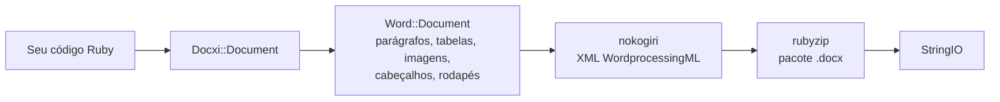

<!-- Translated from wiki/Architecture.md (git blob 38e8491be82a60fc51d016cdfd25fc8316608686). See wiki/TRANSLATION_GUIDE.md. -->
# Arquitetura do docxi: como código Ruby vira um pacote .docx

Um arquivo `.docx` é um arquivo zip com arquivos XML, chamados partes, que seguem o padrão Office Open XML. O docxi mantém um objeto Ruby para cada parte, monta o XML de cada uma com o nokogiri quando você chama `render` e grava o arquivo compactado com o rubyzip. Esta página é para quem contribui com o projeto e para quem precisa depurar o XML gerado.

## Visão geral

## Classes principais

| Classe | Arquivo | Papel |
|---|---|---|
| `Docxi::Document` | `lib/docxi/document.rb` | Ponto de entrada. Guarda as partes do pacote e implementa `render` |
| `Docxi::Relationships` | `lib/docxi/relationships.rb` | `_rels/.rels`, os relacionamentos no nível do pacote |
| `Docxi::ContentTypes` | `lib/docxi/content_types.rb` | `[Content_Types].xml` |
| `Docxi::Properties` | `lib/docxi/properties.rb` | `docProps/app.xml` e `docProps/core.xml` |
| `Docxi::Word::Document` | `lib/docxi/word/document.rb` | O corpo do documento, as configurações de seção e o registro de imagens, cabeçalhos, rodapés e links |
| `Docxi::Word::Helpers` | `lib/docxi/word/helpers.rb` | `p`, `text`, `br`, `tab`, `frame`, `table` e `table_of_content` |
| `Docxi::Word::Contents::*` | `lib/docxi/word/contents/` | `Paragraph`, `Text`, `Break`, `Tab`, `Frame`, `Image`, `Table` e `TableOfContent` |
| `Docxi::Word::Headers::Header`, `Docxi::Word::Footers::Footer` | `lib/docxi/word/headers/`, `lib/docxi/word/footers/` | Partes de cabeçalho e rodapé, cada uma com o próprio arquivo de relacionamentos |
| `Docxi::Word::Medias` | `lib/docxi/word/medias/` | Imagens adicionadas com `add_media` |
| Partes estáticas | `lib/docxi/word/*.rb` | Estilos, numeração, configurações, fontes, tema, efeitos, notas de rodapé e notas de fim |

## O que `render` faz

1. `Docxi::Document#render` abre `Zip::OutputStream.write_buffer`.
2. `Word::Document#render` grava `word/document.xml` (cada elemento grava o próprio XML) e depois as partes estáticas, os cabeçalhos, os rodapés, as imagens e `word/_rels/document.xml.rels`.
3. As propriedades do pacote, os relacionamentos do pacote e os tipos de conteúdo são gravados por último.
4. O buffer é retornado como um `StringIO`.

Cada parte passa por `Docxi.write_entry`, que define o tamanho da entrada antes de gravá-la. Sem isso, o rubyzip 3 adicionaria registros Zip64 a cada entrada, e o Google Docs e versões mais antigas do LibreOffice se recusam a abrir esses arquivos.

## Partes de um documento gerado

| Parte | Conteúdo |
|---|---|
| `[Content_Types].xml` | Tipos de conteúdo das partes |
| `_rels/.rels` | Links para o documento e as propriedades dele |
| `docProps/app.xml`, `docProps/core.xml` | Nome do aplicativo ("Docxi Ruby Gem") e hora da geração |
| `word/document.xml` | O corpo: parágrafos, tabelas e as configurações de seção (margens, tamanho da página, referências a cabeçalhos e rodapés) |
| `word/styles.xml`, `word/stylesWithEffects.xml` | Estilos. A fonte padrão é Arial 12 pt |
| `word/numbering.xml` | A definição da lista com marcadores |
| `word/settings.xml`, `word/webSettings.xml`, `word/fontTable.xml` | Configurações do documento e fontes |
| `word/theme/theme1.xml` | Tema |
| `word/footnotes.xml`, `word/endnotes.xml` | Apenas separadores. O docxi não tem API de notas de rodapé |
| `word/headerN.xml`, `word/footerN.xml` | Uma parte por cabeçalho e por rodapé, numeradas na ordem em que são adicionados |
| `word/media/imageN.png` | Uma parte por chamada a `add_media` |
| `word/_rels/document.xml.rels` | Relacionamentos do corpo |

Para ver o conteúdo de um documento, descompacte-o, por exemplo com `unzip -p report.docx word/document.xml`.

## Ids de relacionamento

`word/_rels/document.xml.rels` começa com nove relacionamentos fixos, de `rId1` a `rId9`:

1. estilos
2. estilos com efeitos
3. configurações
4. configurações da web
5. tabela de fontes
6. tema
7. notas de fim
8. notas de rodapé
9. numeração

Em seguida vêm imagens, cabeçalhos, rodapés e hiperlinks, numerados na ordem em que você chama `add_media`, `add_header`, `add_footer` e `add_hyperlink`. `add_hyperlink` retorna o id para que `hyperlink` possa referenciá-lo.

## Unidades e conversões

- O `size` do texto é dobrado, porque o Word armazena meios pontos.
- `columns_width` e o `width` da célula são multiplicados por 14.92 para obter vigésimos de ponto.
- Imagens posicionadas, de cabeçalho e de células de tabela calculam o tamanho como `width * height * 14.92` EMU. É um problema conhecido previsto para a 0.2.0.
- Margens, recuos e alturas de linha são repassados como estão, em vigésimos de ponto.

## Como a saída se mantém estável

`test/golden` guarda cada parte que a 0.0.6 gerou para dois documentos de exemplo (`test/support/sample_documents.rb`). Os testes geram os mesmos documentos e comparam cada parte como XML canônico, então diferenças entre versões do nokogiri não contam, mas qualquer mudança real é detectada. `bundle exec rake golden` regrava os arquivos de referência (golden files) depois de uma mudança intencional. Veja [Ambiente de desenvolvimento](Development-Setup).

## Páginas relacionadas

- [Referência da API](API-Reference)
- [Recursos](Features)
- [Como contribuir](Contributing)

---

[← Início da wiki](Home) · [README](https://github.com/hammad417/docxi#readme)
