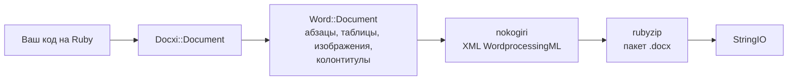

<!-- Translated from wiki/Architecture.md (git blob 38e8491be82a60fc51d016cdfd25fc8316608686). See wiki/TRANSLATION_GUIDE.md. -->
# Архитектура docxi: как код на Ruby превращается в пакет .docx

Файл `.docx` — это zip-архив с XML-файлами, которые называются частями (parts) и соответствуют стандарту Office Open XML. docxi хранит по одному Ruby-объекту на каждую часть, при вызове `render` собирает XML каждой части с помощью nokogiri и записывает архив с помощью rubyzip. Эта страница предназначена для участников разработки и для тех, кто отлаживает созданный XML.

## Обзор

## Основные классы

| Класс | Файл | Назначение |
|---|---|---|
| `Docxi::Document` | `lib/docxi/document.rb` | Точка входа. Хранит части пакета и реализует `render` |
| `Docxi::Relationships` | `lib/docxi/relationships.rb` | `_rels/.rels`, связи уровня пакета |
| `Docxi::ContentTypes` | `lib/docxi/content_types.rb` | `[Content_Types].xml` |
| `Docxi::Properties` | `lib/docxi/properties.rb` | `docProps/app.xml` и `docProps/core.xml` |
| `Docxi::Word::Document` | `lib/docxi/word/document.rb` | Тело документа, параметры раздела и реестр изображений, колонтитулов и ссылок |
| `Docxi::Word::Helpers` | `lib/docxi/word/helpers.rb` | `p`, `text`, `br`, `tab`, `frame`, `table` и `table_of_content` |
| `Docxi::Word::Contents::*` | `lib/docxi/word/contents/` | `Paragraph`, `Text`, `Break`, `Tab`, `Frame`, `Image`, `Table` и `TableOfContent` |
| `Docxi::Word::Headers::Header`, `Docxi::Word::Footers::Footer` | `lib/docxi/word/headers/`, `lib/docxi/word/footers/` | Части колонтитулов, у каждой свой файл связей |
| `Docxi::Word::Medias` | `lib/docxi/word/medias/` | Изображения, добавленные через `add_media` |
| Статические части | `lib/docxi/word/*.rb` | Стили, нумерация, параметры, шрифты, тема, эффекты, сноски и концевые сноски |

## Что делает `render`

1. `Docxi::Document#render` открывает `Zip::OutputStream.write_buffer`.
2. `Word::Document#render` записывает `word/document.xml` (каждый элемент записывает свой XML), затем статические части, колонтитулы, изображения и `word/_rels/document.xml.rels`.
3. Свойства пакета, связи пакета и типы содержимого записываются последними.
4. Буфер возвращается как `StringIO`.

Каждая часть проходит через `Docxi.write_entry`, который задаёт размер записи до её сохранения. Иначе rubyzip 3 добавил бы записи Zip64 к каждой записи архива, а Google Docs и старые версии LibreOffice такие файлы не открывают.

## Части созданного документа

| Часть | Содержимое |
|---|---|
| `[Content_Types].xml` | Типы содержимого частей |
| `_rels/.rels` | Ссылки на документ и его свойства |
| `docProps/app.xml`, `docProps/core.xml` | Название приложения («Docxi Ruby Gem») и время формирования |
| `word/document.xml` | Тело: абзацы, таблицы и параметры раздела (поля, размер страницы, ссылки на колонтитулы) |
| `word/styles.xml`, `word/stylesWithEffects.xml` | Стили. Шрифт по умолчанию — Arial 12 pt |
| `word/numbering.xml` | Определение маркированного списка |
| `word/settings.xml`, `word/webSettings.xml`, `word/fontTable.xml` | Параметры документа и шрифты |
| `word/theme/theme1.xml` | Тема |
| `word/footnotes.xml`, `word/endnotes.xml` | Только разделители. В docxi нет API для сносок |
| `word/headerN.xml`, `word/footerN.xml` | По одной части на каждый колонтитул, нумерация в порядке добавления |
| `word/media/imageN.png` | По одной части на каждый вызов `add_media` |
| `word/_rels/document.xml.rels` | Связи тела документа |

Чтобы заглянуть внутрь документа, распакуйте его, например так: `unzip -p report.docx word/document.xml`.

## Идентификаторы связей

`word/_rels/document.xml.rels` начинается с девяти фиксированных связей, от `rId1` до `rId9`:

1. стили
2. стили с эффектами
3. параметры
4. веб-параметры
5. таблица шрифтов
6. тема
7. концевые сноски
8. сноски
9. нумерация

Затем идут изображения, колонтитулы и гиперссылки, пронумерованные в том порядке, в каком вы вызываете `add_media`, `add_header`, `add_footer` и `add_hyperlink`. `add_hyperlink` возвращает свой идентификатор, чтобы `hyperlink` мог на него сослаться.

## Единицы и преобразования

- `size` текста удваивается, потому что Word хранит размер в половинах пункта.
- `columns_width` и `width` ячейки умножаются на 14.92 для перевода в двадцатые доли пункта.
- Позиционированные изображения, изображения в колонтитулах и в ячейках таблиц вычисляют размер как `width * height * 14.92` EMU. Это известная проблема, которую планируется исправить в 0.2.0.
- Поля, отступы и высота строк передаются как есть, в двадцатых долях пункта.

## Как обеспечивается стабильность результата

`test/golden` хранит все части, которые версия 0.0.6 создала для двух примеров документов (`test/support/sample_documents.rb`). Тесты формируют те же документы и сравнивают каждую часть как канонический XML, поэтому различия между версиями nokogiri не учитываются, а любое реальное изменение обнаруживается. После намеренного изменения результата `bundle exec rake golden` перезаписывает эталонные файлы (golden files). См. [Среда разработки](Development-Setup).

## Связанные страницы

- [Справочник API](API-Reference)
- [Возможности](Features)
- [Участие в разработке](Contributing)

---

[← Главная вики](Home) · [README](https://github.com/hammad417/docxi#readme)
