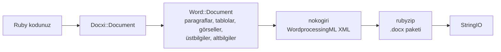

<!-- Translated from wiki/Architecture.md (git blob 38e8491be82a60fc51d016cdfd25fc8316608686). See wiki/TRANSLATION_GUIDE.md. -->
# docxi mimarisi: Ruby kodu nasıl .docx paketine dönüşür

Bir `.docx` dosyası, parça (part) adı verilen ve Office Open XML standardına uyan XML dosyalarından oluşan bir zip arşividir. docxi her parça için bir Ruby nesnesi tutar, `render` çağrıldığında her parçanın XML'ini nokogiri ile oluşturur ve arşivi rubyzip ile yazar. Bu sayfa, katkıda bulunanlar ve üretilen XML'de hata ayıklayanlar içindir.

## Genel bakış

## Ana sınıflar

| Sınıf | Dosya | Görevi |
|---|---|---|
| `Docxi::Document` | `lib/docxi/document.rb` | Giriş noktası. Paketin parçalarını tutar ve `render` yöntemini uygular |
| `Docxi::Relationships` | `lib/docxi/relationships.rb` | `_rels/.rels`, yani paket düzeyindeki ilişkiler |
| `Docxi::ContentTypes` | `lib/docxi/content_types.rb` | `[Content_Types].xml` |
| `Docxi::Properties` | `lib/docxi/properties.rb` | `docProps/app.xml` ve `docProps/core.xml` |
| `Docxi::Word::Document` | `lib/docxi/word/document.rb` | Belge gövdesi, bölüm ayarları ve görsel, üstbilgi, altbilgi ve bağlantı kayıtları |
| `Docxi::Word::Helpers` | `lib/docxi/word/helpers.rb` | `p`, `text`, `br`, `tab`, `frame`, `table` ve `table_of_content` |
| `Docxi::Word::Contents::*` | `lib/docxi/word/contents/` | `Paragraph`, `Text`, `Break`, `Tab`, `Frame`, `Image`, `Table` ve `TableOfContent` |
| `Docxi::Word::Headers::Header`, `Docxi::Word::Footers::Footer` | `lib/docxi/word/headers/`, `lib/docxi/word/footers/` | Her biri kendi ilişki dosyasına sahip üstbilgi ve altbilgi parçaları |
| `Docxi::Word::Medias` | `lib/docxi/word/medias/` | `add_media` ile eklenen görseller |
| Statik parçalar | `lib/docxi/word/*.rb` | Stiller, numaralandırma, ayarlar, yazı tipleri, tema, efektler, dipnotlar ve sonnotlar |

## `render` ne yapar

1. `Docxi::Document#render`, `Zip::OutputStream.write_buffer` akışını açar.
2. `Word::Document#render`, önce `word/document.xml` dosyasını (her öğe kendi XML'ini yazar), ardından statik parçaları, üstbilgileri, altbilgileri, görselleri ve `word/_rels/document.xml.rels` dosyasını yazar.
3. Paket özellikleri, paket ilişkileri ve içerik türleri en son yazılır.
4. Arabellek bir `StringIO` olarak döndürülür.

Her parça `Docxi.write_entry` üzerinden geçer; bu yöntem girdinin boyutunu yazmadan önce ayarlar. Aksi halde rubyzip 3 her girdiye Zip64 kayıtları ekler ve Google Docs ile LibreOffice'in eski sürümleri bu tür dosyaları açmayı reddeder.

## Üretilen bir belgedeki parçalar

| Parça | İçerik |
|---|---|
| `[Content_Types].xml` | Parçaların içerik türleri |
| `_rels/.rels` | Belgeye ve özelliklerine giden bağlantılar |
| `docProps/app.xml`, `docProps/core.xml` | Uygulama adı ("Docxi Ruby Gem") ve oluşturma zamanı |
| `word/document.xml` | Gövde: paragraflar, tablolar ve bölüm ayarları (kenar boşlukları, sayfa boyutu, üstbilgi ve altbilgi başvuruları) |
| `word/styles.xml`, `word/stylesWithEffects.xml` | Stiller. Varsayılan yazı tipi Arial 12 pt'dir |
| `word/numbering.xml` | Madde işaretli listenin tanımı |
| `word/settings.xml`, `word/webSettings.xml`, `word/fontTable.xml` | Belge ayarları ve yazı tipleri |
| `word/theme/theme1.xml` | Tema |
| `word/footnotes.xml`, `word/endnotes.xml` | Yalnızca ayırıcılar. docxi'nin dipnot API'si yoktur |
| `word/headerN.xml`, `word/footerN.xml` | Her üstbilgi ve altbilgi için bir parça; eklenme sırasına göre numaralandırılır |
| `word/media/imageN.png` | Her `add_media` çağrısı için bir parça |
| `word/_rels/document.xml.rels` | Gövdenin ilişkileri |

Bir belgenin içine bakmak için onu açın, örneğin `unzip -p report.docx word/document.xml` ile.

## İlişki kimlikleri

`word/_rels/document.xml.rels`, `rId1` ile `rId9` arasındaki dokuz sabit ilişkiyle başlar:

1. stiller
2. efektli stiller
3. ayarlar
4. web ayarları
5. yazı tipi tablosu
6. tema
7. sonnotlar
8. dipnotlar
9. numaralandırma

Ardından görseller, üstbilgiler, altbilgiler ve köprüler gelir; `add_media`, `add_header`, `add_footer` ve `add_hyperlink` yöntemlerini çağırdığınız sıraya göre numaralandırılırlar. `add_hyperlink` kendi kimliğini döndürür, böylece `hyperlink` ona başvurabilir.

## Birimler ve dönüşümler

- Word yarım punto sakladığı için metnin `size` değeri iki katına çıkarılır.
- `columns_width` ve hücrenin `width` değeri, puntonun yirmide birini elde etmek için 14.92 ile çarpılır.
- Konumlandırılmış görseller, üstbilgi görselleri ve tablo hücresi görselleri boyutlarını `width * height * 14.92` EMU olarak hesaplar. Bu, 0.2.0 için planlanan bilinen bir sorundur.
- Kenar boşlukları, girintiler ve satır yükseklikleri puntonun yirmide biri cinsinden olduğu gibi aktarılır.

## Çıktı nasıl kararlı kalır

`test/golden`, 0.0.6'nın iki örnek belge (`test/support/sample_documents.rb`) için ürettiği her parçayı tutar. Testler aynı belgeleri oluşturur ve her parçayı kanonik XML olarak karşılaştırır; böylece nokogiri sürümleri arasındaki farklar sayılmaz ama gerçek her değişiklik yakalanır. Bilinçli bir değişiklikten sonra `bundle exec rake golden` golden dosyaları (golden files) yeniden yazar. [Geliştirme ortamı](Development-Setup) sayfasına bakın.

## İlgili sayfalar

- [API başvurusu](API-Reference)
- [Özellikler](Features)
- [Katkıda bulunma](Contributing)

---

[← Wiki ana sayfası](Home) · [README](https://github.com/hammad417/docxi#readme)
