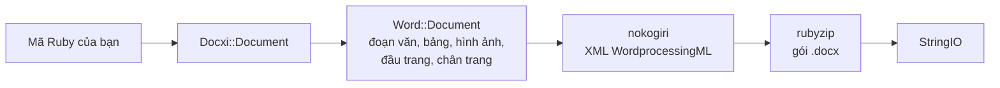

<!-- Translated from wiki/Architecture.md (git blob 38e8491be82a60fc51d016cdfd25fc8316608686). See wiki/TRANSLATION_GUIDE.md. -->
# Kiến trúc của docxi: mã Ruby trở thành gói .docx như thế nào

Tệp `.docx` là một tệp nén zip chứa các tệp XML, gọi là part, tuân theo chuẩn Office Open XML. docxi giữ một đối tượng Ruby cho mỗi part, dựng XML của từng part bằng nokogiri khi bạn gọi `render`, rồi ghi tệp nén bằng rubyzip. Trang này dành cho người đóng góp và cho bất kỳ ai đang gỡ lỗi XML được tạo ra.

## Tổng quan

## Các lớp chính

| Lớp | Tệp | Vai trò |
|---|---|---|
| `Docxi::Document` | `lib/docxi/document.rb` | Điểm vào. Giữ các part của gói và cài đặt `render` |
| `Docxi::Relationships` | `lib/docxi/relationships.rb` | `_rels/.rels`, tức các quan hệ ở cấp gói |
| `Docxi::ContentTypes` | `lib/docxi/content_types.rb` | `[Content_Types].xml` |
| `Docxi::Properties` | `lib/docxi/properties.rb` | `docProps/app.xml` và `docProps/core.xml` |
| `Docxi::Word::Document` | `lib/docxi/word/document.rb` | Thân tài liệu, thiết lập phần (section) và sổ đăng ký hình ảnh, đầu trang, chân trang và liên kết |
| `Docxi::Word::Helpers` | `lib/docxi/word/helpers.rb` | `p`, `text`, `br`, `tab`, `frame`, `table` và `table_of_content` |
| `Docxi::Word::Contents::*` | `lib/docxi/word/contents/` | `Paragraph`, `Text`, `Break`, `Tab`, `Frame`, `Image`, `Table` và `TableOfContent` |
| `Docxi::Word::Headers::Header`, `Docxi::Word::Footers::Footer` | `lib/docxi/word/headers/`, `lib/docxi/word/footers/` | Các part đầu trang và chân trang, mỗi part có tệp quan hệ riêng |
| `Docxi::Word::Medias` | `lib/docxi/word/medias/` | Hình ảnh thêm bằng `add_media` |
| Các part tĩnh | `lib/docxi/word/*.rb` | Kiểu, đánh số, thiết lập, phông chữ, chủ đề, hiệu ứng, chú thích cuối trang và chú thích cuối văn bản |

## `render` làm gì

1. `Docxi::Document#render` mở `Zip::OutputStream.write_buffer`.
2. `Word::Document#render` ghi `word/document.xml` (mỗi thành phần tự ghi XML của mình), sau đó ghi các part tĩnh, đầu trang, chân trang, hình ảnh và `word/_rels/document.xml.rels`.
3. Thuộc tính của gói, quan hệ của gói và kiểu nội dung được ghi sau cùng.
4. Bộ đệm được trả về dưới dạng một `StringIO`.

Mỗi part đều đi qua `Docxi.write_entry`, phương thức này đặt kích thước của mục trước khi ghi. Nếu không, rubyzip 3 sẽ thêm bản ghi Zip64 vào mọi mục, trong khi Google Docs và các phiên bản LibreOffice cũ hơn từ chối mở những tệp như vậy.

## Các part trong tài liệu được tạo

| Part | Nội dung |
|---|---|
| `[Content_Types].xml` | Kiểu nội dung của các part |
| `_rels/.rels` | Liên kết tới tài liệu và các thuộc tính của nó |
| `docProps/app.xml`, `docProps/core.xml` | Tên ứng dụng ("Docxi Ruby Gem") và thời điểm kết xuất |
| `word/document.xml` | Phần thân: đoạn văn, bảng và thiết lập phần (lề, kích thước trang, tham chiếu đến đầu trang và chân trang) |
| `word/styles.xml`, `word/stylesWithEffects.xml` | Kiểu. Phông chữ mặc định là Arial 12 pt |
| `word/numbering.xml` | Định nghĩa danh sách có dấu đầu dòng |
| `word/settings.xml`, `word/webSettings.xml`, `word/fontTable.xml` | Thiết lập tài liệu và phông chữ |
| `word/theme/theme1.xml` | Chủ đề |
| `word/footnotes.xml`, `word/endnotes.xml` | Chỉ có dấu phân cách. docxi không có API cho chú thích cuối trang |
| `word/headerN.xml`, `word/footerN.xml` | Mỗi đầu trang và chân trang một part, được đánh số theo thứ tự thêm vào |
| `word/media/imageN.png` | Mỗi lần gọi `add_media` một part |
| `word/_rels/document.xml.rels` | Các quan hệ của phần thân |

Để xem bên trong một tài liệu, hãy giải nén nó, ví dụ bằng `unzip -p report.docx word/document.xml`.

## Mã quan hệ

`word/_rels/document.xml.rels` bắt đầu bằng chín quan hệ cố định, từ `rId1` đến `rId9`:

1. kiểu
2. kiểu có hiệu ứng
3. thiết lập
4. thiết lập web
5. bảng phông chữ
6. chủ đề
7. chú thích cuối văn bản
8. chú thích cuối trang
9. đánh số

Tiếp theo là hình ảnh, đầu trang, chân trang và siêu liên kết, được đánh số theo thứ tự bạn gọi `add_media`, `add_header`, `add_footer` và `add_hyperlink`. `add_hyperlink` trả về mã của nó để `hyperlink` có thể tham chiếu.

## Đơn vị và quy đổi

- `size` của văn bản được nhân đôi, vì Word lưu theo nửa point.
- `columns_width` và `width` của ô được nhân với 14.92 để ra phần hai mươi point.
- Hình ảnh định vị, hình ảnh trong đầu trang và hình ảnh trong ô bảng tính kích thước bằng `width * height * 14.92` EMU. Đây là vấn đề đã biết dự kiến khắc phục trong 0.2.0.
- Lề, thụt lề và chiều cao hàng được truyền nguyên giá trị, tính bằng một phần hai mươi point.

## Cách giữ đầu ra ổn định

`test/golden` lưu mọi part mà 0.0.6 tạo ra cho hai tài liệu mẫu (`test/support/sample_documents.rb`). Các bài kiểm thử kết xuất cùng những tài liệu đó và so sánh từng part dưới dạng XML chuẩn tắc, nên khác biệt giữa các phiên bản nokogiri không được tính, nhưng mọi thay đổi thực sự đều bị phát hiện. `bundle exec rake golden` ghi lại các tệp golden (golden files) sau một thay đổi có chủ đích. Xem [Thiết lập môi trường phát triển](Development-Setup).

## Trang liên quan

- [Tham chiếu API](API-Reference)
- [Tính năng](Features)
- [Đóng góp](Contributing)

---

[← Trang chủ wiki](Home) · [README](https://github.com/hammad417/docxi#readme)
