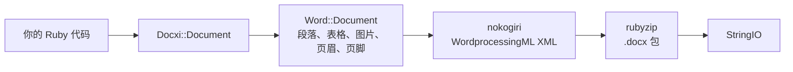

<!-- Translated from wiki/Architecture.md (git blob 38e8491be82a60fc51d016cdfd25fc8316608686). See wiki/TRANSLATION_GUIDE.md. -->
# docxi 架构：Ruby 代码如何变成 .docx 包

`.docx` 文件是一个由 XML 文件组成的 zip 压缩包，这些 XML 文件称为部件（part），遵循 Office Open XML 标准。docxi 为每个部件保留一个 Ruby 对象，在你调用 `render` 时用 nokogiri 构建每个部件的 XML，再用 rubyzip 写出压缩包。本页面向贡献者，以及需要调试生成的 XML 的人。

## 概览

## 主要类

| 类 | 文件 | 作用 |
|---|---|---|
| `Docxi::Document` | `lib/docxi/document.rb` | 入口。保存包的各个部件并实现 `render` |
| `Docxi::Relationships` | `lib/docxi/relationships.rb` | `_rels/.rels`，即包级关系 |
| `Docxi::ContentTypes` | `lib/docxi/content_types.rb` | `[Content_Types].xml` |
| `Docxi::Properties` | `lib/docxi/properties.rb` | `docProps/app.xml` 和 `docProps/core.xml` |
| `Docxi::Word::Document` | `lib/docxi/word/document.rb` | 文档正文、节设置，以及图片、页眉、页脚和链接的登记表 |
| `Docxi::Word::Helpers` | `lib/docxi/word/helpers.rb` | `p`、`text`、`br`、`tab`、`frame`、`table` 和 `table_of_content` |
| `Docxi::Word::Contents::*` | `lib/docxi/word/contents/` | `Paragraph`、`Text`、`Break`、`Tab`、`Frame`、`Image`、`Table` 和 `TableOfContent` |
| `Docxi::Word::Headers::Header`、`Docxi::Word::Footers::Footer` | `lib/docxi/word/headers/`、`lib/docxi/word/footers/` | 页眉和页脚部件，各自带有自己的关系文件 |
| `Docxi::Word::Medias` | `lib/docxi/word/medias/` | 用 `add_media` 添加的图片 |
| 静态部件 | `lib/docxi/word/*.rb` | 样式、编号、设置、字体、主题、效果、脚注和尾注 |

## `render` 做了什么

1. `Docxi::Document#render` 打开 `Zip::OutputStream.write_buffer`。
2. `Word::Document#render` 写入 `word/document.xml`（每个元素写出自己的 XML），然后写入静态部件、页眉、页脚、图片和 `word/_rels/document.xml.rels`。
3. 最后写入包属性、包关系和内容类型。
4. 缓冲区以 `StringIO` 的形式返回。

每个部件都通过 `Docxi.write_entry` 写入，它会在写入前设置条目的大小。否则 rubyzip 3 会给每个条目添加 Zip64 记录，而 Google Docs 和较旧的 LibreOffice 版本拒绝打开这样的文件。

## 生成的文档中的部件

| 部件 | 内容 |
|---|---|
| `[Content_Types].xml` | 各部件的内容类型 |
| `_rels/.rels` | 指向文档及其属性的链接 |
| `docProps/app.xml`、`docProps/core.xml` | 应用程序名称（“Docxi Ruby Gem”）和渲染时间 |
| `word/document.xml` | 正文：段落、表格和节设置（页边距、页面大小、页眉和页脚引用） |
| `word/styles.xml`、`word/stylesWithEffects.xml` | 样式。默认字体为 Arial 12 磅 |
| `word/numbering.xml` | 项目符号列表的定义 |
| `word/settings.xml`、`word/webSettings.xml`、`word/fontTable.xml` | 文档设置和字体 |
| `word/theme/theme1.xml` | 主题 |
| `word/footnotes.xml`、`word/endnotes.xml` | 只有分隔符。docxi 没有脚注 API |
| `word/headerN.xml`、`word/footerN.xml` | 每个页眉和页脚一个部件，按添加顺序编号 |
| `word/media/imageN.png` | 每次调用 `add_media` 对应一个部件 |
| `word/_rels/document.xml.rels` | 正文的关系 |

要查看文档内部，可以解压它，例如 `unzip -p report.docx word/document.xml`。

## 关系 ID

`word/_rels/document.xml.rels` 以九个固定的关系开头，即 `rId1` 到 `rId9`：

1. 样式
2. 带效果的样式
3. 设置
4. Web 设置
5. 字体表
6. 主题
7. 尾注
8. 脚注
9. 编号

之后是图片、页眉、页脚和超链接，按你调用 `add_media`、`add_header`、`add_footer` 和 `add_hyperlink` 的顺序编号。`add_hyperlink` 会返回它的 ID，以便 `hyperlink` 引用。

## 单位与换算

- 文本 `size` 会乘以 2，因为 Word 以半磅为单位存储字号。
- `columns_width` 和单元格 `width` 乘以 14.92，得到二十分之一磅。
- 定位图片、页眉图片和表格单元格图片的尺寸按 `width * height * 14.92` EMU 计算。这是计划在 0.2.0 中修复的已知问题。
- 页边距、缩进和行高按二十分之一磅原样传递。

## 如何保持输出稳定

`test/golden` 保存了 0.0.6 为两个示例文档（`test/support/sample_documents.rb`）生成的每个部件。测试会渲染相同的文档，并以规范化 XML 的形式逐个比较部件，因此 nokogiri 版本之间的差异不会造成影响，而任何实际的变化都会被发现。有意修改输出后，运行 `bundle exec rake golden` 重写基准文件（golden files）。参见[开发环境搭建](Development-Setup)。

## 相关页面

- [API 参考](API-Reference)
- [功能](Features)
- [参与贡献](Contributing)

---

[← Wiki 首页](Home) · [README](https://github.com/hammad417/docxi#readme)
