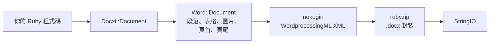

<!-- Translated from wiki/Architecture.md (git blob 38e8491be82a60fc51d016cdfd25fc8316608686). See wiki/TRANSLATION_GUIDE.md. -->
# docxi 架構：Ruby 程式碼如何變成 .docx 封裝

`.docx` 檔案是一個由 XML 檔案組成的 zip 壓縮檔，這些 XML 檔案稱為組件（part），遵循 Office Open XML 標準。docxi 為每個組件保留一個 Ruby 物件，在你呼叫 `render` 時以 nokogiri 建立每個組件的 XML，再以 rubyzip 寫出壓縮檔。本頁的對象是貢獻者，以及需要對產生的 XML 進行偵錯的人。

## 概觀

## 主要類別

| 類別 | 檔案 | 角色 |
|---|---|---|
| `Docxi::Document` | `lib/docxi/document.rb` | 進入點。保存封裝的各個組件並實作 `render` |
| `Docxi::Relationships` | `lib/docxi/relationships.rb` | `_rels/.rels`，也就是封裝層級的關聯 |
| `Docxi::ContentTypes` | `lib/docxi/content_types.rb` | `[Content_Types].xml` |
| `Docxi::Properties` | `lib/docxi/properties.rb` | `docProps/app.xml` 和 `docProps/core.xml` |
| `Docxi::Word::Document` | `lib/docxi/word/document.rb` | 文件本文、節的設定，以及圖片、頁首、頁尾和連結的登錄表 |
| `Docxi::Word::Helpers` | `lib/docxi/word/helpers.rb` | `p`、`text`、`br`、`tab`、`frame`、`table` 和 `table_of_content` |
| `Docxi::Word::Contents::*` | `lib/docxi/word/contents/` | `Paragraph`、`Text`、`Break`、`Tab`、`Frame`、`Image`、`Table` 和 `TableOfContent` |
| `Docxi::Word::Headers::Header`、`Docxi::Word::Footers::Footer` | `lib/docxi/word/headers/`、`lib/docxi/word/footers/` | 頁首和頁尾組件，各自有自己的關聯檔案 |
| `Docxi::Word::Medias` | `lib/docxi/word/medias/` | 以 `add_media` 加入的圖片 |
| 靜態組件 | `lib/docxi/word/*.rb` | 樣式、編號、設定、字型、佈景主題、效果、註腳和章節附註 |

## `render` 做了什麼

1. `Docxi::Document#render` 開啟 `Zip::OutputStream.write_buffer`。
2. `Word::Document#render` 寫入 `word/document.xml`（每個元素寫出自己的 XML），接著寫入靜態組件、頁首、頁尾、圖片和 `word/_rels/document.xml.rels`。
3. 最後寫入封裝屬性、封裝關聯和內容類型。
4. 緩衝區以 `StringIO` 的形式傳回。

每個組件都透過 `Docxi.write_entry` 寫入，它會在寫入前設定項目的大小。否則 rubyzip 3 會為每個項目加入 Zip64 記錄，而 Google Docs 和較舊的 LibreOffice 版本會拒絕開啟這樣的檔案。

## 產生的文件中的組件

| 組件 | 內容 |
|---|---|
| `[Content_Types].xml` | 各組件的內容類型 |
| `_rels/.rels` | 指向文件及其屬性的連結 |
| `docProps/app.xml`、`docProps/core.xml` | 應用程式名稱（「Docxi Ruby Gem」）和渲染時間 |
| `word/document.xml` | 本文：段落、表格和節的設定（邊界、頁面大小、頁首和頁尾參照） |
| `word/styles.xml`、`word/stylesWithEffects.xml` | 樣式。預設字型為 Arial 12 點 |
| `word/numbering.xml` | 項目符號清單的定義 |
| `word/settings.xml`、`word/webSettings.xml`、`word/fontTable.xml` | 文件設定和字型 |
| `word/theme/theme1.xml` | 佈景主題 |
| `word/footnotes.xml`、`word/endnotes.xml` | 只有分隔符號。docxi 沒有註腳 API |
| `word/headerN.xml`、`word/footerN.xml` | 每個頁首和頁尾各一個組件，依加入順序編號 |
| `word/media/imageN.png` | 每次呼叫 `add_media` 對應一個組件 |
| `word/_rels/document.xml.rels` | 本文的關聯 |

若要查看文件內部，可以將它解壓縮，例如 `unzip -p report.docx word/document.xml`。

## 關聯 ID

`word/_rels/document.xml.rels` 以九個固定的關聯開頭，也就是 `rId1` 到 `rId9`：

1. 樣式
2. 含效果的樣式
3. 設定
4. Web 設定
5. 字型表
6. 佈景主題
7. 章節附註
8. 註腳
9. 編號

接著是圖片、頁首、頁尾和超連結，依你呼叫 `add_media`、`add_header`、`add_footer` 和 `add_hyperlink` 的順序編號。`add_hyperlink` 會傳回它的 ID，讓 `hyperlink` 可以參照。

## 單位與換算

- 文字 `size` 會乘以 2，因為 Word 以半點為單位儲存字型大小。
- `columns_width` 和儲存格 `width` 乘以 14.92，得到二十分之一點。
- 定位圖片、頁首圖片和表格儲存格圖片的尺寸以 `width * height * 14.92` EMU 計算。這是預計在 0.2.0 修正的已知問題。
- 邊界、縮排和列高以二十分之一點原樣傳遞。

## 如何讓輸出保持穩定

`test/golden` 保存了 0.0.6 為兩份範例文件（`test/support/sample_documents.rb`）產生的每個組件。測試會渲染相同的文件，並以標準化 XML 逐一比對組件，因此 nokogiri 版本之間的差異不會造成影響，而任何實際的變更都會被發現。刻意變更輸出後，請執行 `bundle exec rake golden` 重寫基準檔案（golden files）。請參閱[開發環境設定](Development-Setup)。

## 相關頁面

- [API 參考](API-Reference)
- [功能](Features)
- [參與貢獻](Contributing)

---

[← Wiki 首頁](Home) · [README](https://github.com/hammad417/docxi#readme)
